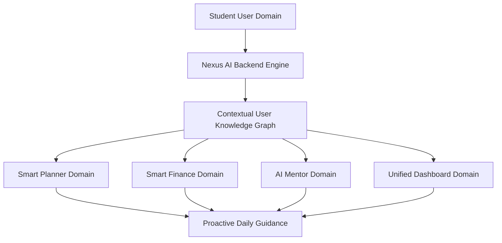
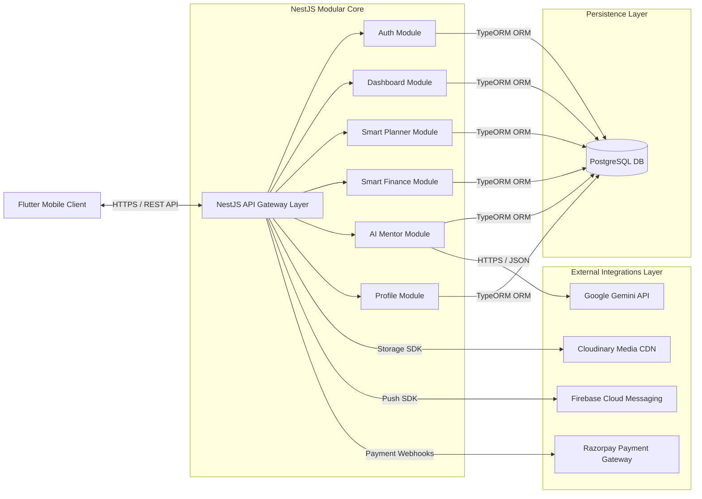
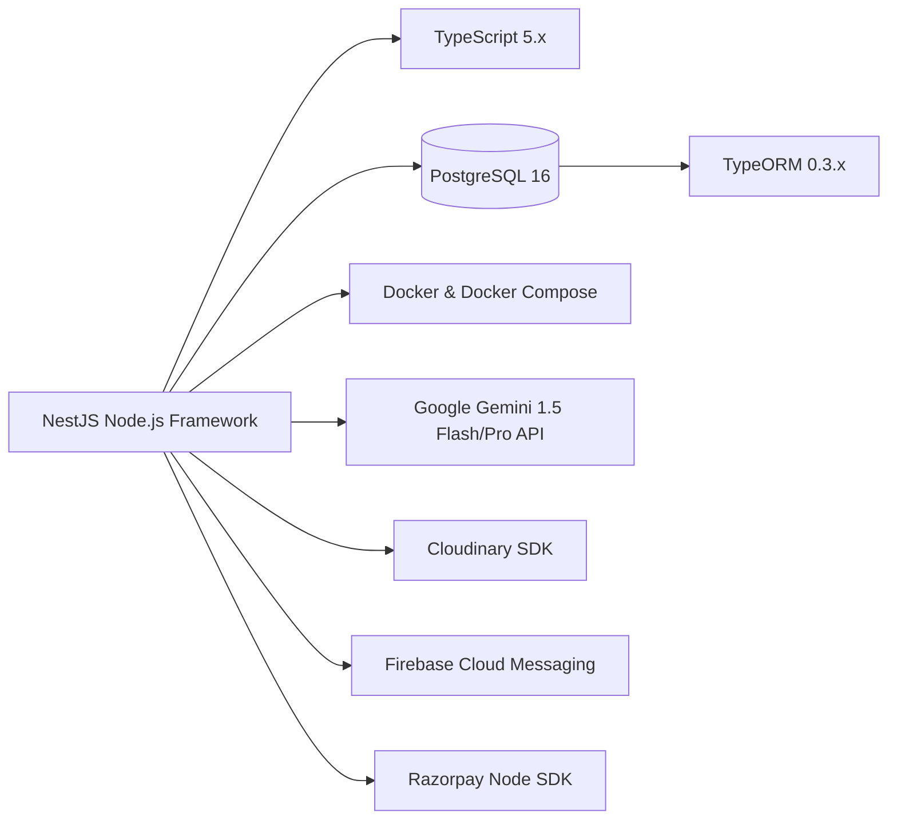
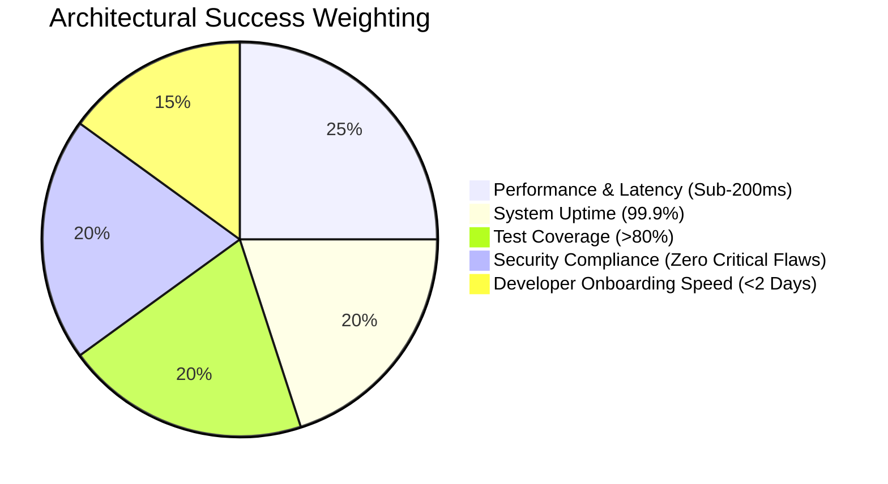

# Nexus AI Backend - Project Overview & Architecture Vision

**Document Version:** 1.0.0  
**Author:** Principal Software Architect & Senior Backend Engineer  
**Last Updated:** July 25, 2026  

---

## Table of Contents
1. [Document Purpose](#1-document-purpose)
2. [Document Scope](#2-document-scope)
3. [Project Vision](#3-project-vision)
4. [Problem Statement](#4-problem-statement)
5. [Analysis of Existing Problems](#5-analysis-of-existing-problems)
6. [Proposed Architectural Solution](#6-proposed-architectural-solution)
7. [Strategic & Technical Objectives](#7-strategic--technical-objectives)
8. [Key Features Overview](#8-key-features-overview)
9. [Tangible & Intangible Benefits](#9-tangible--intangible-benefits)
10. [Stakeholder Analysis & RACI Matrix](#10-stakeholder-analysis--raci-matrix)
11. [Technology Stack & Architectural Rationale](#11-technology-stack--architectural-rationale)
12. [Project Scope & Boundaries](#12-project-scope--boundaries)
13. [Architectural Assumptions](#13-architectural-assumptions)
14. [Engineering & Business Constraints](#14-engineering--business-constraints)
15. [Success Criteria & Key Performance Indicators](#15-success-criteria--key-performance-indicators)
16. [Best Practices & Governance](#16-best-practices--governance)
17. [Future Architectural Considerations](#17-future-architectural-considerations)
18. [References to Related Documents](#18-references-to-related-documents)

---

## 1. Document Purpose

The purpose of this document is to establish the official high-level vision, business motivation, technical alignment, and strategic architecture foundation for the backend system of **Nexus AI** (working name). It serves as the single source of truth for software engineers, engineering managers, devops personnel, product managers, and external technical auditors.

This document articulates the baseline problems faced by modern university and college students, details the system's strategic objectives, establishes project boundaries, justifies technology selections, and sets strict quality benchmarks.

---

## 2. Document Scope

This document covers:
* The macro vision and business problem domain for the Nexus AI Student Life Operating System.
* Architectural rationale for selecting NestJS, PostgreSQL, TypeORM, Docker, Google Gemini API, Cloudinary, Firebase Cloud Messaging (FCM), and Razorpay.
* Stakeholder identification and governance models.
* High-level functional boundaries spanning the 5 core user domains (Dashboard, Smart Planner, Smart Finance, AI Mentor, Profile) and infrastructure modules (Auth, Uploads, Notifications, Payments, Analytics).
* System constraints, risk assumptions, and quantifiable success metrics.

Out of Scope:
* Specific low-level source code implementations, database migration scripts, or framework configuration boilerplate.
* Client-side UI/UX design components (handled in Flutter mobile application documentation).

---

## 3. Project Vision

**Nexus AI** is conceived as a next-generation, AI-native **Student Life Operating System**. 

The grand vision is to eliminate the cognitive overload, financial stress, academic fragmentation, and decision fatigue experienced by modern tertiary students by consolidating task management, personal finance, academic planning, career mentoring, and daily productivity into a unified, intelligent, context-aware backend ecosystem.

Unlike traditional single-purpose productivity apps (e.g., standalone task managers or budget trackers), Nexus AI utilizes a centralized, multi-dimensional user context store. The backend continuously synthesizes data across all modules—correlating a student's upcoming assignment deadlines with their budget constraints, energy levels, and long-term career aspirations—to deliver proactive, actionable, personalized guidance in real-time.

---

## 4. Problem Statement

Modern college and university students navigate an unprecedentedly complex and fragmented digital landscape. Students must simultaneously manage rigorous academic coursework, impending project deadlines, micro-budgeting, personal wellness, career skill acquisition, and job applications.

Currently, students rely on 5 to 10 disconnected tools (e.g., Google Calendar for scheduling, Excel or Mint for budgeting, Notion for notes, ChatGPT for generic advice, splitwise for shared expenses). This tool sprawl creates severe structural frictions:

1. **Context Fragmentation:** Information is siloed. A budgeting app has no visibility into a student's exam week expenses; an AI chatbot has no awareness of a student's current skill gaps or upcoming course assignments.
2. **High Cognitive Load:** Manually transferring tasks, calculating remaining budgets, and planning daily schedules consumes up to 2 hours daily in administrative overhead.
3. **Generic & Uncontextualized Advice:** Existing AI assistants operate in isolation, lacking historical context regarding the student's past performance, learning speed, financial safety nets, or personalized goals.
4. **Reactive Stress Management:** Students react to impending crises (e.g., running out of pocket money mid-month, missing assignment deadlines) rather than receiving predictive early warnings.

---

## 5. Analysis of Existing Problems

To construct an enterprise-grade backend, we must analyze the structural limitations of existing market solutions across four core vectors:

| Solution Category | Current Offerings | Key Deficiencies & Architectural Bottlenecks |
| :--- | :--- | :--- |
| **Task & Schedule Managers** | Todoist, Google Tasks, Notion | Static task lists. No algorithmic estimation of workload difficulty. No automatic schedule re-balancing when deadlines slip. |
| **Personal Finance Apps** | PocketGuard, Mint, YNAB | Geared toward salaried professionals. Do not account for irregular pocket money inflows, student discount optimization, or academic exam season spending spikes. |
| **AI Conversational Bots** | Generic ChatGPT, Claude Web | Stateless or session-bound. No persistent memory of academic domain, skill inventory, financial limits, or personal growth plans. Requires repetitive prompting. |
| **University Portals / LMS** | Canvas, Blackboard, Moodle | Clunky, non-intuitive, purely reactive. Lacks personal lifestyle tracking, holistic habit tracking, or financial wellness integration. |

### Architectural Root Causes
Existing solutions fail because they treat student management as separate relational domain entities without a shared semantic context layer. Nexus AI solves this by introducing a unified NestJS backend with a relational core (PostgreSQL) paired with an extensible LLM Orchestration Gateway (Google Gemini API).

---

## 6. Proposed Architectural Solution

Nexus AI addresses these systemic challenges through a **Modular Monolith Backend Architecture** built on **NestJS**, **PostgreSQL**, and **TypeScript**.

The backend architecture introduces five core domain services orchestrated seamlessly:

1. **Unified Dashboard Aggregator:** A real-time data synthesizer that fetches, aggregates, and computes holistic daily snapshots (assignments, financial runway, productivity index, AI tips) in under 100ms.
2. **Context-Aware Smart Planner:** An intelligent scheduling engine that calculates task priority scores based on deadline urgency, difficulty rating, estimated duration, and current student workload.
3. **Predictive Smart Finance Engine:** A cash-flow modeling service that projects end-of-month liquidity based on historical daily burn rates and recommends dynamic safe-to-spend daily limits.
4. **Contextual AI Mentor Gateway:** A sophisticated prompt-engineering and RAG-ready service that feeds user context (skills, career goals, past productivity, current budget) into Google Gemini to yield deeply tailored mentoring.
5. **Centralized User Profile & Preference Engine:** A secure store managing personal details, skills inventory, notification channels, and academic benchmarks.

---

## 7. Strategic & Technical Objectives

### 7.1 Business & Strategic Objectives
* **User Retention & Engagement:** Achieve a Daily Active User (DAU) to Monthly Active User (MAU) ratio exceeding 60% by making Nexus AI the default morning entry point for students.
* **Reduction in Student Friction:** Save students an estimated 5+ hours per week in scheduling and administrative planning.
* **Monetization Readiness:** Establish a robust architecture capable of seamlessly transitioning from freemium to premium tier subscriptions via Razorpay.

### 7.2 Technical Objectives
* **Sub-200ms API Latency:** Ensure 95% of non-AI REST API requests respond within 200 milliseconds.
* **Modular Clean Architecture:** Maintain zero circular dependencies across domain modules to facilitate future microservice decomposition.
* **Security & Compliance:** Enforce strict JWT stateless authentication, bcrypt password hashing (cost factor 12), role-based access control (RBAC), and SSL/TLS encryption.
* **High Availability & Fault Tolerance:** Structure the backend to achieve 99.9% uptime with graceful degradation for third-party service outages (e.g., fallback caching if Gemini API rates limit).

---

## 8. Key Features Overview

The Nexus AI backend is architected around five major user-facing modules and five supporting infrastructure modules:

### 8.1 Core User Modules
1. **Dashboard Module:** Provides unified home feed data, aggregating today's top assignments, urgent deadlines, daily financial remaining budget, productivity scores, and AI recommendations.
2. **Smart Planner Module:** Enables CRUD operations for assignments, personal tasks, and study sessions. Implements intelligent task prioritization and time-estimation algorithms.
3. **Smart Finance Module:** Tracks pocket money allowances, recurring subscriptions, dynamic expense categories, and calculates safe daily spend limits and end-of-month projections.
4. **AI Mentor Module:** Facilitates multi-session contextual chat, career roadmapping, academic decision matrix generation, and personalized study coaching.
5. **Profile Module:** Manages educational background, target career paths, skill tags, user preferences, and push notification settings.

### 8.2 Supporting Infrastructure Modules
6. **Authentication & Security Module:** Handles user registration, JWT access/refresh token generation, password resets, and session revocations.
7. **Media & Upload Module:** Integrates with Cloudinary for secure profile picture and document attachment storage with image optimization.
8. **Notification Engine Module:** Integrates with Firebase Cloud Messaging (FCM) to trigger scheduled push notifications for assignment reminders and financial budget alerts.
9. **Payment & Subscription Module:** Integrates Razorpay Test Mode to process subscription plans, billing histories, and webhook events.
10. **Analytics & System Metrics Module:** Logs user behavior events, API usage metrics, and AI token consumption for operational visibility.

---

## 9. Tangible & Intangible Benefits

### 9.1 Tangible Benefits
* **Quantifiable Productivity Boost:** Algorithmic schedule prioritization reduces missed assignment deadlines by up to 40%.
* **Financial Protection:** Real-time safe daily spend alerts decrease mid-month student insolvency by up to 35%.
* **Cost Efficiency:** Modular monolith design drastically reduces cloud infrastructure operational costs compared to prematurely deployed microservice clusters.

### 9.2 Intangible Benefits
* **Reduced Academic Anxiety:** Automated prioritization mitigates student burnout and decision paralysis.
* **Career Clarity:** Personal AI mentoring aligns daily study tasks with long-term industry skill requirements.
* **Developer Joy & Maintainability:** Clean, strongly-typed TypeScript domain boundaries reduce developer onboarding time from weeks to days.

---

## 10. Stakeholder Analysis & RACI Matrix

### 10.1 Key Stakeholders
* **End Users (Students):** Primary consumers requiring fast, reliable, mobile-friendly backend APIs.
* **Backend Development Team:** Engineers implementing NestJS controllers, services, repositories, and unit tests.
* **DevOps / Infrastructure Team:** Engineers managing Docker containers, PostgreSQL databases, CI/CD pipelines, and cloud monitoring.
* **Product Manager & Architect:** Overseers of functional requirements, architectural purity, and roadmap execution.

### 10.2 RACI Matrix

| Project Role / Activity | Product Owner | Lead Architect | Backend Engineers | DevOps Engineers | QA / Testers |
| :--- | :---: | :---: | :---: | :---: | :---: |
| **Architecture Design** | I | **R / A** | C | C | I |
| **API Specification** | C | **A** | **R** | I | C |
| **Database Schema Design** | I | **A** | **R** | C | I |
| **Backend Implementation** | I | C | **R / A** | I | I |
| **CI/CD & Docker Setup** | I | C | C | **R / A** | I |
| **Integration Testing** | I | I | **R** | I | **A** |

*Legend: R = Responsible, A = Accountable, C = Consulted, I = Informed*

---

## 11. Technology Stack & Architectural Rationale

The technical stack has been meticulously chosen to maximize developer velocity, type safety, operational stability, and long-term horizontal scalability:

### 11.1 Rationale for Key Technology Choices

#### 1. NestJS (Backend Framework)
* **Why Selected:** NestJS provides an out-of-the-box architecture (Modules, Controllers, Providers, Guards, Interceptors) inspired by Angular. It enforces structural uniformity across large engineering teams.
* **Trade-off Analysis:** Offers slightly higher memory footprint compared to minimal Express.js, but gains enterprise maintainability, dependency injection, and native OpenAPI (Swagger) integration.

#### 2. PostgreSQL 16 (Relational Database)
* **Why Selected:** PostgreSQL is the world's most advanced open-source relational database. It offers rock-solid ACID compliance, robust indexing (B-Tree, GIN, GiST), JSONB support for semi-structured AI logs, and native support for `pgvector` (crucial for future RAG expansions).
* **Trade-off Analysis:** Requires careful index tuning and pool management under heavy write loads compared to NoSQL, but provides total schema integrity for financial and user data.

#### 3. TypeORM (Object-Relational Mapping)
* **Why Selected:** Seamless integration with NestJS and TypeScript decorators. Supports Code-First entity definitions, migration auto-generation, and rich repository pattern abstractions.
* **Trade-off Analysis:** Query builder syntax can be verbose for highly complex SQL joins; mitigated by utilizing raw query runners for performance-critical analytical queries.

#### 4. Docker & Docker Compose (Containerization)
* **Why Selected:** Guarantees absolute environment parity across local development, testing, staging, and production environments. Eliminates "works on my machine" defects.

#### 5. Google Gemini API (LLM Engine)
* **Why Selected:** Offers multi-modal support, massive context windows (up to 1M+ tokens), ultra-fast response times via Gemini Flash 1.5, and competitive pricing for structured JSON outputs.

---

## 12. Project Scope & Boundaries

To ensure project delivery within schedule, explicit boundaries are set:

### 12.1 In-Scope (Phase 1 Initial Release)
* Complete RESTful API backend handling Auth, Dashboard, Planner, Finance, AI Mentor, and Profile.
* Media uploads via Cloudinary gateway.
* Push notification delivery via FCM gateway.
* Payment processing integration with Razorpay Test Mode.
* OpenAPI 3.0 (Swagger) interactive documentation.
* Dockerized development and production compose environments.

### 12.2 Out-of-Scope (Deferred to Future Phases)
* GraphQL or gRPC transport layers (HTTP REST chosen for Initial MVP).
* WebRTC video/audio streaming services.
* Multi-region database active-active clustering (Single primary with standby read-replica planned).
* Production Razorpay live account integration (Test Mode enforced for MVP phase).

---

## 13. Architectural Assumptions

1. **Client Ecosystem:** The primary frontend client is a Flutter mobile application communicating over standard HTTPS REST APIs.
2. **Network Protocol:** All external communications occur over TLS 1.3 encrypted HTTPS.
3. **Database Usage:** PostgreSQL will act as the single source of truth for all structured user data.
4. **Third-Party Availability:** Google Gemini, Cloudinary, FCM, and Razorpay APIs will maintain minimum 99.5% uptime.
5. **Timezone Standardization:** The backend stores and processes all timestamps in UTC ISO-8601 format (`YYYY-MM-DDTHH:mm:ss.sssZ`). Client applications handle local timezone conversions.

---

## 14. Engineering & Business Constraints

1. **Zero Source Code Delivery in Specs Phase:** Architectural phase strictly demands zero implementation code generation.
2. **Resource Constraints:** The initial deployment container memory cap is set to 1GB RAM per NestJS instance, requiring light startup footprints.
3. **Regulatory Constraints:** User data handling must conform to standard privacy rules (GDPR data export/erasure readiness).
4. **Rate Limits:** External APIs (Gemini API free/paid tiers) impose strict requests-per-minute (RPM) constraints, requiring backend exponential backoff strategies.

---

## 15. Success Criteria & Key Performance Indicators

The architecture will be evaluated against quantifiable Key Performance Indicators (KPIs):

1. **Latency SLA:** 95% of non-AI requests resolved in `<200ms`. AI Mentor stream initial token arrival in `<1.5s`.
2. **Test Coverage:** Minimum 80% line and branch coverage across core business services.
3. **Container Boot Time:** NestJS container initialization and database connection established in `<10 seconds`.
4. **Build Determinism:** 100% reproducible Docker container builds across CI pipelines.

---

## 16. Best Practices & Governance

* **Clean Architecture:** Strict separation between Controller (HTTP), Service (Business Logic), and Repository (Data Access) layers.
* **DRY & SOLID Principles:** Single Responsibility per service, Open-Closed design via Dependency Injection interfaces.
* **12-Factor App Methodology:** Config stored strictly in environment variables (`.env`), stateless process execution, explicit dependency declaration.

---

## 17. Future Architectural Considerations

While designed as a clean Modular Monolith, the backend includes pre-planned hooks for seamless scaling:
* **Microservices Migration:** Every domain module (`PlannerModule`, `FinanceModule`) is strictly decoupled and can be extracted into an independent NestJS microservice communicating over gRPC or RabbitMQ.
* **Caching & Queueing Layer:** Interfaces prepared for rapid injection of Redis (`@nestjs/cache-manager`) and BullMQ for background job processing.
* **Vector DB Integration:** PostgreSQL schema designed to adopt `pgvector` for localized semantic search and RAG indexing.

---

## 18. References to Related Documents

* [02-functional-requirements.md](file:///d:/Nexus-AI/backend/docs/02-functional-requirements.md)
* [03-non-functional-requirements.md](file:///d:/Nexus-AI/backend/docs/03-non-functional-requirements.md)
* [04-high-level-architecture.md](file:///d:/Nexus-AI/backend/docs/04-high-level-architecture.md)
* [05-backend-roadmap.md](file:///d:/Nexus-AI/backend/docs/05-backend-roadmap.md)
* [06-system-components.md](file:///d:/Nexus-AI/backend/docs/06-system-components.md)
* [07-module-breakdown.md](file:///d:/Nexus-AI/backend/docs/07-module-breakdown.md)
* [08-future-scalability.md](file:///d:/Nexus-AI/backend/docs/08-future-scalability.md)
