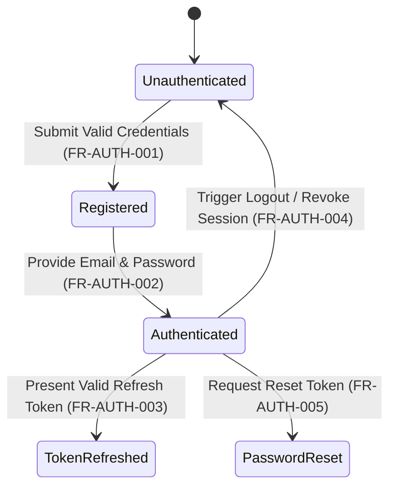
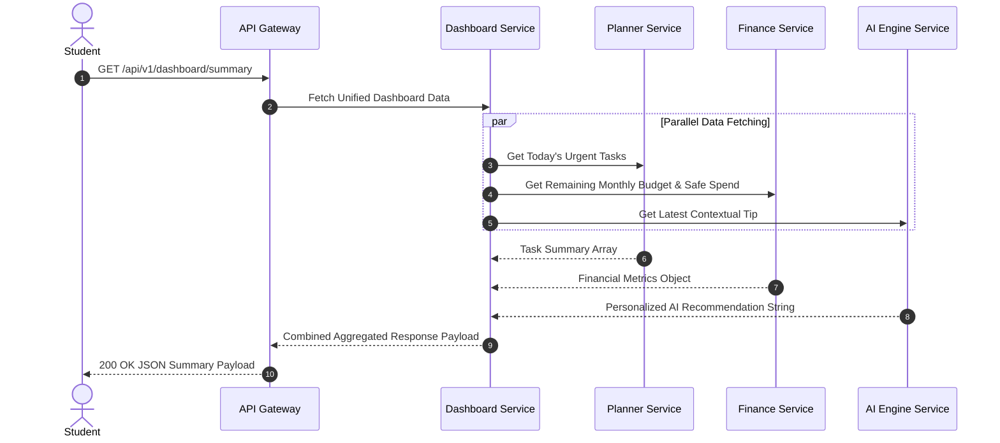
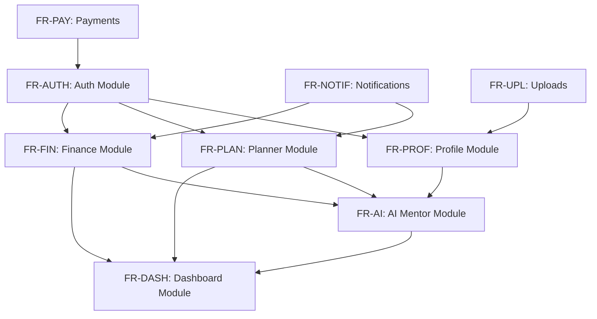

# Nexus AI Backend - Functional Requirements Specification

**Document Version:** 1.0.0  
**Author:** Principal Software Architect & Senior Backend Engineer  
**Last Updated:** July 25, 2026  

---

## Table of Contents
1. [Document Purpose](#1-document-purpose)
2. [Document Scope](#2-document-scope)
3. [Requirement Priority Classification](#3-requirement-priority-classification)
4. [Module 1: Authentication & Authorization (FR-AUTH)](#4-module-1-authentication--authorization-fr-auth)
5. [Module 2: User Profile & Preferences (FR-PROF)](#5-module-2-user-profile--preferences-fr-prof)
6. [Module 3: Unified Dashboard (FR-DASH)](#6-module-3-unified-dashboard-fr-dash)
7. [Module 4: Smart Planner Engine (FR-PLAN)](#7-module-4-smart-planner-engine-fr-plan)
8. [Module 5: Smart Finance Engine (FR-FIN)](#8-module-5-smart-finance-engine-fr-fin)
9. [Module 6: AI Mentor Gateway (FR-AI)](#9-module-6-ai-mentor-gateway-fr-ai)
10. [Module 7: Push Notifications (FR-NOTIF)](#10-module-7-push-notifications-fr-notif)
11. [Module 8: Media & File Uploads (FR-UPL)](#11-module-8-media--file-uploads-fr-upl)
12. [Module 9: Payments & Subscriptions (FR-PAY)](#12-module-9-payments--subscriptions-fr-pay)
13. [Module 10: System & User Analytics (FR-ANL)](#13-module-10-system--user-analytics-fr-anl)
14. [Future Expansion Requirements (FR-FUT)](#14-future-expansion-requirements-fr-fut)
15. [Traceability & Module Dependency Matrix](#15-traceability--module-dependency-matrix)
16. [Best Practices & Verification Criteria](#16-best-practices--verification-criteria)
17. [References to Related Documents](#17-references-to-related-documents)

---

## 1. Document Purpose

This document provides a comprehensive, rigorous functional requirement specification for the Nexus AI backend system. It explicitly defines every feature, business rule, input condition, system behavior, and acceptance criterion required across all core and supporting modules.

---

## 2. Document Scope

This specification covers functional requirements for:
* Core Domain Modules: Dashboard, Smart Planner, Smart Finance, AI Mentor, Profile.
* Infrastructure Modules: Auth & Authorization, Push Notifications, Media Uploads, Payments, Analytics.
* Pre-planned Future Expansion Modules.

---

## 3. Requirement Priority Classification

Each functional requirement is classified using the standard MoSCoW prioritization model:

* **P0 (Must Have):** Mission-critical core functional requirement. System cannot launch without it.
* **P1 (Should Have):** High-value functional requirement. Necessary for complete student experience.
* **P2 (Could Have):** Enhanced functional requirement. Adds significant value but non-blocking.
* **P3 (Future):** Planned for subsequent minor or major releases.

---

## 4. Module 1: Authentication & Authorization (FR-AUTH)

### FR-AUTH-001: User Registration
* **Priority:** P0
* **Description:** The system must allow new student users to create an account using email, password, full name, and institution details.
* **Acceptance Criteria:**
  * **Given** a new user providing valid email, password (min 8 chars, 1 upper, 1 special), and name, **When** submitting registration payload, **Then** system creates user record, hashes password with bcrypt (cost factor 12), and returns user summary with HTTP 201 Created.
  * **Given** an existing email address, **When** attempting registration, **Then** system rejects request with HTTP 409 Conflict error.
* **Dependencies:** Database Service, Bcrypt Module.

### FR-AUTH-002: User Login & JWT Issuance
* **Priority:** P0
* **Description:** The system must authenticate registered users and issue stateless JSON Web Tokens (Access Token & Refresh Token).
* **Acceptance Criteria:**
  * **Given** valid user credentials, **When** POST `/api/v1/auth/login` is executed, **Then** system returns short-lived Access Token (15-min TTL) and long-lived Refresh Token (7-day TTL).
  * **Given** invalid password, **When** login attempted, **Then** system returns HTTP 401 Unauthorized without revealing whether email or password was incorrect.
* **Dependencies:** FR-AUTH-001, Passport-JWT.

### FR-AUTH-003: Refresh Token Rotation
* **Priority:** P0
* **Description:** The system must allow clients to obtain a fresh Access Token using a valid Refresh Token, invalidating the old token family upon reuse detection.
* **Acceptance Criteria:**
  * **Given** a valid unexpired Refresh Token, **When** POST `/api/v1/auth/refresh` is called, **Then** system issues a new Access and Refresh Token pair and updates database token hash.
* **Dependencies:** FR-AUTH-002.

### FR-AUTH-004: Stateless Session Termination (Logout)
* **Priority:** P1
* **Description:** The system must revoke the active Refresh Token upon explicit logout.
* **Acceptance Criteria:**
  * **Given** an authenticated user, **When** POST `/api/v1/auth/logout` is called, **Then** system deletes Refresh Token hash from PostgreSQL session table.
* **Dependencies:** FR-AUTH-002.

### FR-AUTH-005: Self-Service Password Reset
* **Priority:** P1
* **Description:** The system must issue a cryptographically secure, time-bound password reset token via email.
* **Acceptance Criteria:**
  * **Given** a valid user email, **When** POST `/api/v1/auth/forgot-password` is called, **Then** system generates a random 64-char token (15-min TTL) and dispatches reset link.
* **Dependencies:** Mailer Service, FR-AUTH-001.

---

## 5. Module 2: User Profile & Preferences (FR-PROF)

### FR-PROF-001: Profile Retrieval & Management
* **Priority:** P0
* **Description:** Users must be able to retrieve and update their personal details, academic institution, major/specialization, graduation year, and skill sets.
* **Acceptance Criteria:**
  * **Given** an authenticated student, **When** GET `/api/v1/profile` is called, **Then** system returns full profile details including avatar URL, academic bio, and skill tags.
  * **Given** updated skill tags or preferences, **When** PATCH `/api/v1/profile` is called, **Then** system validates fields and updates PostgreSQL profile table.
* **Dependencies:** FR-AUTH-002.

### FR-PROF-002: Notification Preferences Management
* **Priority:** P1
* **Description:** Users must be able to toggle push notification channels for assignment reminders, budget warnings, and AI tips.
* **Acceptance Criteria:**
  * **Given** an authenticated user, **When** PUT `/api/v1/profile/notifications` is called with boolean flags, **Then** system persists preference choices instantly.
* **Dependencies:** FR-AUTH-002.

---

## 6. Module 3: Unified Dashboard (FR-DASH)

### FR-DASH-001: Daily Consolidated Dashboard Feed
* **Priority:** P0
* **Description:** The system must aggregate and return a real-time summary of today's assignments, pending deadlines, daily remaining budget, productivity score, and AI insight in a single call.
* **Acceptance Criteria:**
  * **Given** an active user, **When** GET `/api/v1/dashboard/summary` is requested, **Then** backend executes parallel sub-queries across Planner, Finance, and Profile modules and responds in `<150ms`.
* **Dependencies:** FR-PLAN-001, FR-FIN-001, FR-AI-001.

### FR-DASH-002: Productivity Score Calculation
* **Priority:** P1
* **Description:** The backend must compute a dynamic daily productivity index (0 to 100) based on task completion ratio, study hour targets, and budget adherence.
* **Acceptance Criteria:**
  * **Given** completed tasks and logged study sessions today, **When** requested, **Then** backend applies weighting formula: `(TasksCompleted/TasksDue * 50) + (StudyMinutesLogged/TargetMinutes * 30) + (BudgetAdherence * 20)`.
* **Dependencies:** FR-PLAN-001, FR-FIN-002.

---

## 7. Module 4: Smart Planner Engine (FR-PLAN)

### FR-PLAN-001: Task & Assignment Management
* **Priority:** P0
* **Description:** Users can create, update, list, filter, and delete academic assignments, personal tasks, and exam study plans.
* **Acceptance Criteria:**
  * **Given** task details (Title, Course, DueDate, Difficulty 1-5, EstimatedMinutes), **When** POST `/api/v1/planner/tasks` is executed, **Then** backend persists task and computes dynamic priority score.
* **Dependencies:** FR-AUTH-002.

### FR-PLAN-002: Algorithmic Task Prioritization
* **Priority:** P0
* **Description:** Backend must automatically assign priority ranks (High, Medium, Low) using deadline proximity, weightage, and difficulty.
* **Acceptance Criteria:**
  * **Given** tasks with varying due dates, **When** GET `/api/v1/planner/tasks?sort=priority` is called, **Then** backend sorts tasks using priority algorithm: `Score = (Weight * 0.4) + ((7 - DaysUntilDue) * 0.4) + (Difficulty * 0.2)`.
* **Dependencies:** FR-PLAN-001.

### FR-PLAN-003: AI Schedule Optimization & Study Plan Suggestion
* **Priority:** P1
* **Description:** Backend calls Gemini API to construct an optimized daily study schedule based on user's available hours and pending assignments.
* **Acceptance Criteria:**
  * **Given** user's pending tasks for the week, **When** POST `/api/v1/planner/optimize-schedule` is called, **Then** backend sends prompt to Gemini API and returns structured JSON time-blocks.
* **Dependencies:** FR-PLAN-001, FR-AI-001.

---

## 8. Module 5: Smart Finance Engine (FR-FIN)

### FR-FIN-001: Pocket Money & Budget Setup
* **Priority:** P0
* **Description:** Students can configure monthly allowance/income, total budget cap, and primary currency.
* **Acceptance Criteria:**
  * **Given** budget cap and month, **When** POST `/api/v1/finance/budget` is called, **Then** system stores monthly target and calculates baseline daily target.
* **Dependencies:** FR-AUTH-002.

### FR-FIN-002: Expense Tracking & Dynamic Safe Daily Spend
* **Priority:** P0
* **Description:** Log daily expenses with categories (Food, Academics, Entertainment, Transport) and auto-calculate remaining safe daily spend allowance.
* **Acceptance Criteria:**
  * **Given** logged expenses for the current month, **When** GET `/api/v1/finance/safe-spend` is requested, **Then** backend computes: `SafeDailySpend = (TotalBudget - TotalSpentSoFar) / RemainingDaysInMonth`.
* **Dependencies:** FR-FIN-001.

### FR-FIN-003: Predictive Insolvency Early Warning
* **Priority:** P1
* **Description:** Predict if current spending velocity will cause student to exceed monthly budget prior to month-end.
* **Acceptance Criteria:**
  * **Given** spending rate over past 7 days, **When** projected expenditure exceeds total budget by >10%, **Then** backend sets `isWarningActive = true` and triggers warning push notification.
* **Dependencies:** FR-FIN-002, FR-NOTIF-001.

---

## 9. Module 6: AI Mentor Gateway (FR-AI)

### FR-AI-001: Context-Aware Chat Mentorship
* **Priority:** P0
* **Description:** Facilitate multi-turn mentoring chats using Google Gemini 1.5 API, injecting full user context (academics, skill gaps, current stress indicators) into system prompts.
* **Acceptance Criteria:**
  * **Given** user message, **When** POST `/api/v1/ai-mentor/chat` is invoked, **Then** backend builds system prompt containing user's major, pending tasks, and financial state, dispatches to Gemini API, and streams/returns assistant response.
* **Dependencies:** FR-AUTH-002, Google Gemini SDK.

### FR-AI-002: Personal Career Roadmap Generation
* **Priority:** P1
* **Description:** Generate structured milestone steps to achieve a target career goal (e.g., "Become a Full-Stack Engineer").
* **Acceptance Criteria:**
  * **Given** target role and current skills, **When** POST `/api/v1/ai-mentor/roadmap` is called, **Then** Gemini returns a JSON array of sequential study objectives and recommended projects.
* **Dependencies:** FR-AI-001, FR-PROF-001.

---

## 10. Module 7: Push Notifications (FR-NOTIF)

### FR-NOTIF-001: Device Token Registration & FCM Dispatch
* **Priority:** P0
* **Description:** Register client Firebase Cloud Messaging (FCM) device tokens and send targeted push alerts for upcoming deadlines and budget breaches.
* **Acceptance Criteria:**
  * **Given** valid FCM token, **When** POST `/api/v1/notifications/device-token` is submitted, **Then** token is registered against user ID in database.
* **Dependencies:** FCM Admin SDK.

---

## 11. Module 8: Media & File Uploads (FR-UPL)

### FR-UPL-001: Secure Attachment Upload via Cloudinary
* **Priority:** P1
* **Description:** Handle image and PDF document uploads for profile avatars and assignment attachment scans.
* **Acceptance Criteria:**
  * **Given** valid image file (`.jpg`, `.png`, max 5MB), **When** POST `/api/v1/uploads/image` is sent as `multipart/form-data`, **Then** backend uploads buffer to Cloudinary and returns CDN URL.
* **Dependencies:** Cloudinary SDK, Multer.

---

## 12. Module 9: Payments & Subscriptions (FR-PAY)

### FR-PAY-001: Razorpay Order Creation & Webhook Processing
* **Priority:** P1
* **Description:** Create Razorpay test mode payment orders for premium plan upgrades and handle secure webhook verification.
* **Acceptance Criteria:**
  * **Given** premium plan selection, **When** POST `/api/v1/payments/create-order` is called, **Then** system generates Razorpay `order_id`.
  * **Given** payment signature webhook from Razorpay, **When** POST `/api/v1/payments/webhook` is received, **Then** backend verifies HMAC SHA256 signature and upgrades user account status to `PREMIUM`.
* **Dependencies:** Razorpay SDK.

---

## 13. Module 10: System & User Analytics (FR-ANL)

### FR-ANL-001: User Event Logging & Usage Tracking
* **Priority:** P2
* **Description:** Log user interactions, feature utilization rates, and Gemini API token consumption for business analytics.
* **Acceptance Criteria:**
  * **Given** API requests, **When** executed, **Then** background interceptor writes non-blocking metric entry into analytical log database table.
* **Dependencies:** NestJS Interceptors.

---

## 14. Future Expansion Requirements (FR-FUT)

* **FR-FUT-001 (P3):** Shared Expense Splitter for student roommates.
* **FR-FUT-002 (P3):** Group Study Collaboration Rooms with shared tasks.
* **FR-FUT-003 (P3):** Vector RAG Search over uploaded lecture PDF notes.

---

## 15. Traceability & Module Dependency Matrix

---

## 16. Best Practices & Verification Criteria

* All functional specs must be validated via Jest Integration tests.
* Given-When-Then criteria must map 1:1 with test suite assertions.

---

## 17. References to Related Documents

* [01-project-overview.md](file:///d:/Nexus-AI/backend/docs/01-project-overview.md)
* [03-non-functional-requirements.md](file:///d:/Nexus-AI/backend/docs/03-non-functional-requirements.md)
* [07-module-breakdown.md](file:///d:/Nexus-AI/backend/docs/07-module-breakdown.md)
