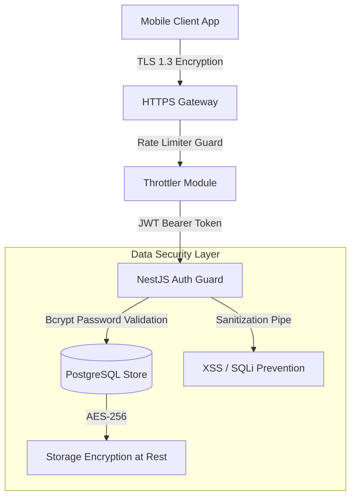
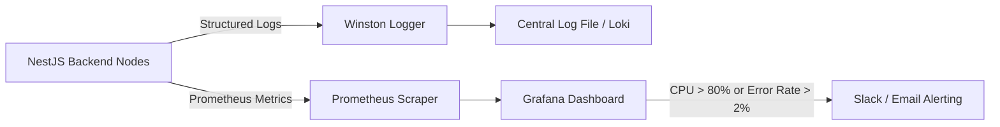

# Nexus AI Backend - Non-Functional Requirements Specification

**Document Version:** 1.0.0  
**Author:** Principal Software Architect & Senior Backend Engineer  
**Last Updated:** July 25, 2026  

---

## Table of Contents
1. [Document Purpose](#1-document-purpose)
2. [Document Scope](#2-document-scope)
3. [Performance & Latency SLAs (NFR-PERF)](#3-performance--latency-slas-nfr-perf)
4. [Scalability & Capacity Planning (NFR-SCAL)](#4-scalability--capacity-planning-nfr-scal)
5. [Availability & High Availability Strategy (NFR-AVAIL)](#5-availability--high-availability-strategy-nfr-avail)
6. [Security & Data Protection Architecture (NFR-SEC)](#6-security--data-protection-architecture-nfr-sec)
7. [Reliability & Fault Tolerance (NFR-REL)](#7-reliability--fault-tolerance-nfr-rel)
8. [Maintainability & Code Quality Standards (NFR-MAINT)](#8-maintainability--code-quality-standards-nfr-maint)
9. [Portability & Containerization (NFR-PORT)](#9-portability--containerization-nfr-port)
10. [Extensibility & System Modularity (NFR-EXT)](#10-extensibility--system-modularity-nfr-ext)
11. [Monitoring, Observability & Alerting (NFR-MON)](#11-monitoring-observability--alerting-nfr-mon)
12. [Structured Logging Architecture (NFR-LOG)](#12-structured-logging-architecture-nfr-log)
13. [Backup Strategy & Disaster Recovery (NFR-DR)](#13-backup-strategy--disaster-recovery-nfr-dr)
14. [Comprehensive Testing Strategy (NFR-TEST)](#14-comprehensive-testing-strategy-nfr-test)
15. [Regulatory Compliance & Data Privacy (NFR-COMP)](#15-regulatory-compliance--data-privacy-nfr-comp)
16. [Coding Standards & Architectural Governance](#16-coding-standards--architectural-governance)
17. [References to Related Documents](#17-references-to-related-documents)

---

## 1. Document Purpose

This document establishes the official Non-Functional Requirements (NFRs) and quality attributes governing the Nexus AI backend. It sets strict operational thresholds, performance SLAs, security constraints, reliability protocols, and maintainability standards required to guarantee enterprise-grade operation.

---

## 2. Document Scope

This specification applies to all NestJS services, PostgreSQL database clusters, Docker deployment containers, background job schedulers, and third-party integration gateways across all deployment environments (Local, Staging, Production).

---

## 3. Performance & Latency SLAs (NFR-PERF)

```mermaid
gantt
    title API Latency Budget Allocations (Target: Sub-200ms Total)
    dateFormat  X
    axisFormat %s ms

    section Request Pipeline
    TLS Termination & Gateway   :0, 15
    Auth Guard & JWT Validate   :15, 30
    Business Logic Service      :30, 80
    Database Query Execution    :80, 150
    Response Serialization      :150, 175
    Network Transit Overhead    :175, 200
```



### 3.1 Response Time Thresholds (Service Level Agreements)
* **Standard Read/Write APIs:** 95% of standard CRUD requests (Planner, Finance, Profile) must respond in `<150ms`; 99% in `<300ms`.
* **Dashboard Aggregation API:** Combined summary endpoint must resolve in `<200ms` under peak load.
* **AI Generation API:** Initial stream token response from Google Gemini Gateway must begin rendering within `<1,500ms`.

### 3.2 Throughput & Baseline Capacity
* **Baseline Concurrency:** Initial backend infrastructure must support a minimum of **500 Requests Per Second (RPS)** without degraded latency SLAs.
* **Peak Surge Capacity:** Must handle 3x traffic spikes (up to 1,500 RPS) during university morning peak hours (8:00 AM - 10:00 AM).

---

## 4. Scalability & Capacity Planning (NFR-SCAL)

### 4.1 Horizontal Scaling Vector
* **Stateless Backend Nodes:** The NestJS API server must remain 100% stateless. No session state stored in container local memory.
* **Container Scale-Out:** System must support instant horizontal scaling from 2 to 10 Docker container replicas behind a round-robin load balancer.

### 4.2 Database Scaling Architecture
* **Connection Pooling:** PostgreSQL connection pool managed via `pg-pool` / TypeORM with maximum 50 concurrent connections per node instance.
* **Read-Replica Preparedness:** TypeORM configured to support primary-replica database split (Writes to Primary Master, Reads off Replica nodes).

---

## 5. Availability & High Availability Strategy (NFR-AVAIL)

* **Uptime Commitment:** Minimum **99.9% Uptime** (maximum allowable unpredicted downtime: 8.76 hours per year).
* **Health Check Probes:** NestJS `@nestjs/terminus` health module exposed at `/api/v1/health` verifying DB connectivity, disk space, and memory limits every 15 seconds.

---

## 6. Security & Data Protection Architecture (NFR-SEC)



### 6.1 Authentication & Encryption
* **In-Transit Protection:** Mandatory TLS 1.3 encryption for all external REST API communications.
* **At-Rest Protection:** Sensitive data columns (refresh tokens, payment metadata) encrypted using AES-256-GCM prior to PostgreSQL insertion.
* **Password Hashing:** Strict enforcement of `bcrypt` algorithm with a work factor cost of **12**.

### 6.2 Application Hardening & Defense
* **OWASP Top 10 Mitigation:** Automatic request body sanitization (`class-validator`, `helmet` HTTP header security) to prevent SQL Injection, Reflected XSS, and Remote Code Execution.
* **Rate Limiting (DDoS Protection):** `@nestjs/throttler` configured to restrict client requests to a max of **100 requests per minute** per IP address.

---

## 7. Reliability & Fault Tolerance (NFR-REL)

* **Circuit Breaker Pattern:** Integration gateways (Google Gemini, Cloudinary, FCM, Razorpay) wrapped in circuit breakers. If 5 consecutive failures occur within 30 seconds, trip circuit and execute fallback logic.
* **Graceful Degradation:** If Gemini API is unreachable, AI Mentor returns cached recommendation templates rather than throwing 500 internal errors.

---

## 8. Maintainability & Code Quality Standards (NFR-MAINT)

* **Clean Architecture Enforcement:** Strict separation between DTOs, Controllers, Services, Entities, and Interfaces.
* **Modular Decoupling:** No direct cross-module entity imports allowed. Cross-module communications must occur via abstract service interfaces or NestJS `EventEmitter2`.

---

## 9. Portability & Containerization (NFR-PORT)

* **OCI Compliance:** Backend packaged as Open Container Initiative (OCI) compliant Docker images based on slim Linux distributions (`node:20-alpine`).
* **Environment Agnosticism:** System configuration managed entirely via environment variables adhering to Twelve-Factor app principles.

---

## 10. Extensibility & System Modularity (NFR-EXT)

* **Plugin-Ready Architecture:** External service implementations injected via NestJS interfaces (`IChatProvider`, `INotificationProvider`), enabling zero-downtime swap from Gemini to OpenAI or FCM to OneSignal.

---

## 11. Monitoring, Observability & Alerting (NFR-MON)



* **Metrics Collection:** Prometheus metrics exposed at `/metrics` tracking JVM/Node memory heap, event loop lag, HTTP response codes, and query durations.
* **Alert Triggers:** Automated alerts fired when API 5xx error rate exceeds 2% over a 5-minute rolling window.

---

## 12. Structured Logging Architecture (NFR-LOG)

* **JSON Format:** All backend logs emitted in structured JSON format via `winston` including fields: `timestamp`, `level`, `correlationId`, `context`, `message`, and `stack`.
* **Correlation Identifiers:** Unique `X-Correlation-ID` header injected into every incoming HTTP request and propagated across internal log statements for end-to-end tracing.

---

## 13. Backup Strategy & Disaster Recovery (NFR-DR)

### 13.1 Recovery Objectives
* **Recovery Point Objective (RPO):** Maximum allowable data loss: **<15 minutes**.
* **Recovery Time Objective (RTO):** Maximum allowable system downtime during disaster recovery: **<1 hour**.

### 13.2 Backup Execution Schedule
* **Automated Daily Snapshots:** Full PostgreSQL database dump performed daily at 02:00 UTC and uploaded to secure offsite cloud storage with 30-day retention policy.
* **Continuous WAL Archiving:** Write-Ahead Logging (WAL) enabled to allow point-in-time recovery (PITR) to any second within the past 7 days.

---

## 14. Comprehensive Testing Strategy (NFR-TEST)

```mermaid
pyramid
    title Software Testing Pyramid Target Ratios
    "E2E Tests (10%)" : 10
    "Integration Tests (30%)" : 30
    "Unit Tests (60%)" : 60
```

* **Unit Testing (Jest):** Target 80%+ code coverage for business logic services, utility functions, and domain calculations.
* **Integration Testing (Supertest):** API endpoint tests verifying controller-to-database workflows using a dedicated PostgreSQL test container.
* **End-to-End (E2E) Testing:** Complete lifecycle simulation validating authentication, payment webhooks, and AI pipeline responses.

---

## 15. Regulatory Compliance & Data Privacy (NFR-COMP)

* **GDPR & FERPA Alignment:** Data portability endpoints provided allowing users to export full JSON archives of their data (`/api/v1/profile/export`).
* **Right to be Forgotten:** Hard deletion workflows executing cascading wipes of user records upon explicit account deletion request.

---

## 16. Coding Standards & Architectural Governance

* **Linter & Formatter Rules:** Mandatory ESLint and Prettier compliance enforced via Git pre-commit hooks (`husky` + `lint-staged`).
* **TypeScript Strict Mode:** Mandatory `"strict": true` flag enabled in `tsconfig.json`. Usage of `any` type prohibited in pull requests.

---

## 17. References to Related Documents

* [01-project-overview.md](file:///d:/Nexus-AI/backend/docs/01-project-overview.md)
* [02-functional-requirements.md](file:///d:/Nexus-AI/backend/docs/02-functional-requirements.md)
* [04-high-level-architecture.md](file:///d:/Nexus-AI/backend/docs/04-high-level-architecture.md)
* [06-system-components.md](file:///d:/Nexus-AI/backend/docs/06-system-components.md)
