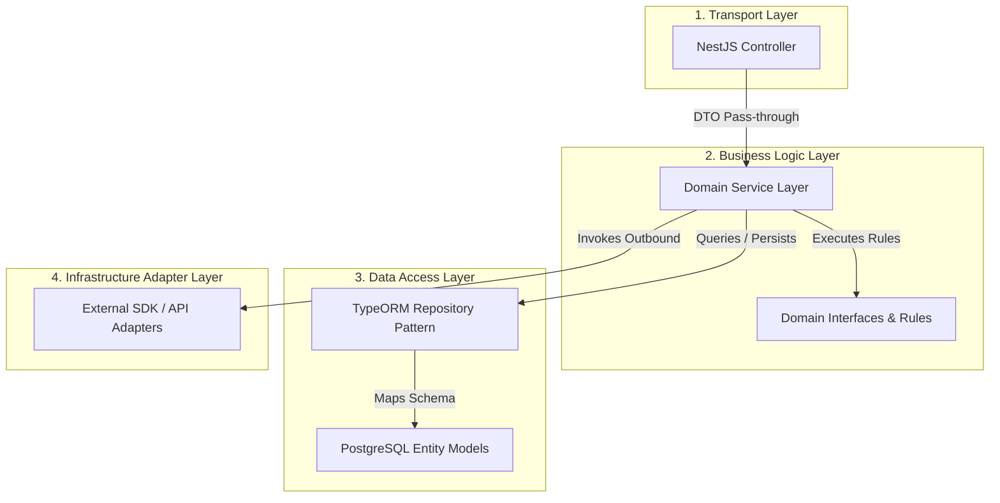
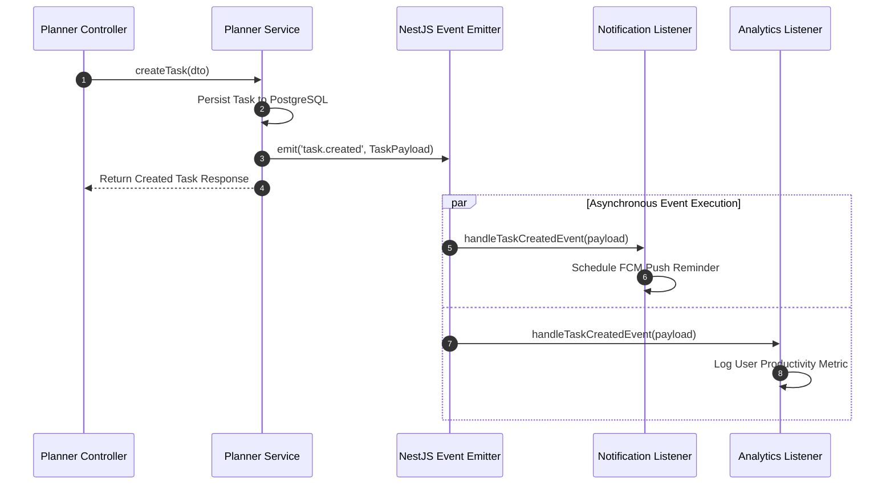
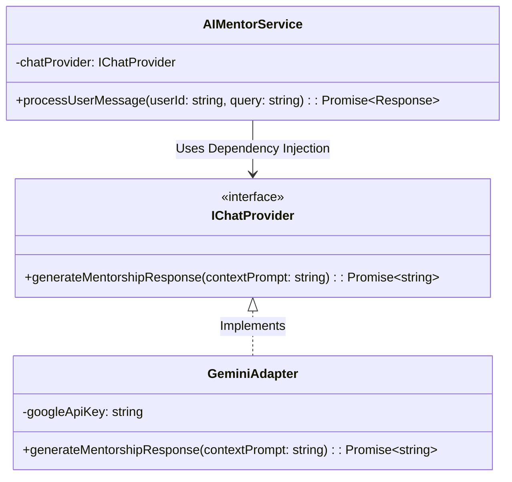
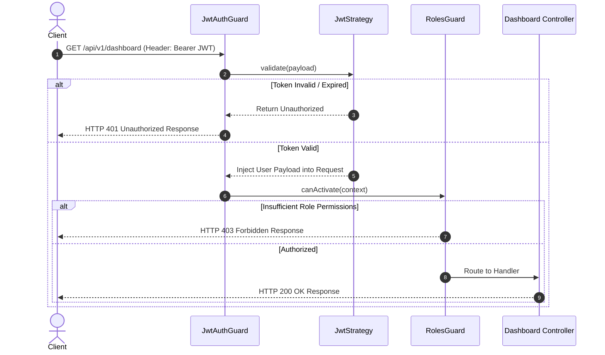
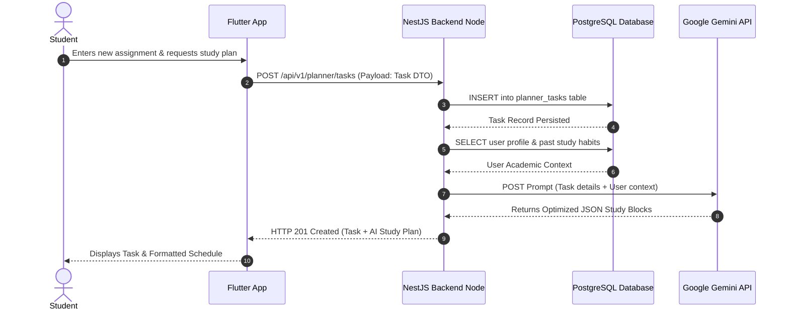
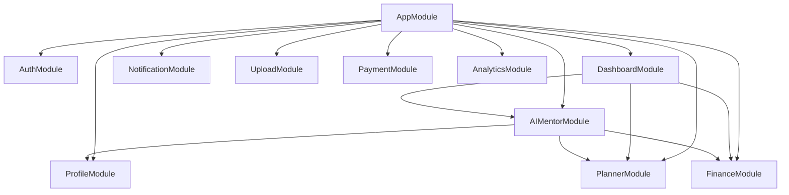

# Nexus AI Backend - High-Level System Architecture Specification

**Document Version:** 1.0.0  
**Author:** Principal Software Architect & Senior Backend Engineer  
**Last Updated:** July 25, 2026  

---

## Table of Contents
1. [Document Purpose](#1-document-purpose)
2. [Document Scope](#2-document-scope)
3. [Overall Architecture Topology](#3-overall-architecture-topology)
4. [Layered Architecture Pattern](#4-layered-architecture-pattern)
5. [Inter-Module Communication Architecture](#5-inter-module-communication-architecture)
6. [External Service Integration Architecture](#6-external-service-integration-architecture)
7. [Authentication & Authorization Pipeline](#7-authentication--authorization-pipeline)
8. [Incoming Request Lifecycle Execution Flow](#8-incoming-request-lifecycle-execution-flow)
9. [Outgoing Response Transformation Lifecycle](#9-outgoing-response-transformation-lifecycle)
10. [End-to-End Data Flow Architecture](#10-end-to-end-data-flow-architecture)
11. [Module Dependency Graph](#11-module-dependency-graph)
12. [Technology Interaction Topology](#12-technology-interaction-topology)
13. [Architecture Notes & Design Trade-offs](#13-architecture-notes--design-trade-offs)
14. [Best Practices & Governance](#14-best-practices--governance)
15. [Future Architectural Evolution](#15-future-architectural-evolution)
16. [References to Related Documents](#16-references-to-related-documents)

---

## 1. Document Purpose

This document provides a definitive technical specification of the high-level architecture governing the Nexus AI backend. It describes the system topology, multi-tier layered boundaries, modular monolith design patterns, request/response lifecycles, inter-module event mechanics, and external integration gateways.

---

## 2. Document Scope

This specification covers:
* The core structural patterns of the NestJS application.
* Data flow pathways between client mobile apps, API gateway, domain modules, PostgreSQL storage, and external cloud services (Google Gemini, Cloudinary, FCM, Razorpay).
* Architectural diagrams illustrating execution lifecycles, security guards, and event emitters.

---

## 3. Overall Architecture Topology

Nexus AI utilizes a **Modular Monolith Architecture** containerized with Docker and powered by Node.js, NestJS, and PostgreSQL. The application is logically partitioned into independent feature modules, enabling high developer velocity and strict boundaries while maintaining zero-overhead deployment simplicity.

```mermaid
flowchart TB
    subgraph Client Layer
        FlutterApp[Flutter Mobile Application]
    end

    subgraph Entry Layer
        Nginx[Nginx Reverse Proxy / Load Balancer]
    end

    subgraph NestJS Modular Monolith Container
        Gateway[API Gateway Router]
        
        subgraph Security & Pipeline
            Guard[Auth Guards / Throttler]
            Pipe[Validation Pipes]
            Inter[Logging & Response Interceptors]
            Filter[Global Exception Filter]
        end

        subgraph Core Feature Modules
            AuthMod[Auth Module]
            ProfMod[Profile Module]
            PlanMod[Smart Planner Module]
            FinMod[Smart Finance Module]
            AIMod[AI Mentor Module]
            DashMod[Dashboard Module]
        end

        subgraph Infrastructure Modules
            NotifMod[Notification Module]
            UplMod[Media Upload Module]
            PayMod[Payment Module]
            AnlMod[Analytics Module]
        end
        
        Events[NestJS EventEmitter2 System]
    end

    subgraph Persistence Layer
        Postgres[(PostgreSQL Relational DB)]
    end

    subgraph External Cloud Gateways
        Gemini[Google Gemini 1.5 API]
        Cloudinary[Cloudinary CDN]
        FCM[Firebase Cloud Messaging]
        Razorpay[Razorpay Payment API]
    end

    FlutterApp -->|HTTPS / REST API| Nginx
    Nginx --> Gateway
    Gateway --> Guard --> Pipe --> Core Feature Modules & Infrastructure Modules
    
    Core Feature Modules -->|TypeORM Repositories| Postgres
    Infrastructure Modules -->|TypeORM Repositories| Postgres
    
    Core Feature Modules -.->|Publish / Subscribe Events| Events
    Infrastructure Modules -.->|Subscribe Events| Events
    
    AIMod -->|HTTPS REST| Gemini
    UplMod -->|SDK Upload| Cloudinary
    NotifMod -->|FCM Push API| FCM
    PayMod -->|HTTPS Webhook / API| Razorpay
```

---

## 4. Layered Architecture Pattern

The codebase inside each domain module follows clean architecture boundaries divided into four explicit layers:



1. **Transport (Controller) Layer:** Handles HTTP request routing, input DTO validation parsing, status code mappings, and Swagger OpenAPI annotations. Contains zero business rules.
2. **Business Logic (Service) Layer:** Encapsulates domain calculations (e.g., safe daily spend calculations, task priority scoring, prompt context assembly). Completely agnostic of HTTP parameters.
3. **Data Access (Repository/Entity) Layer:** Manages ORM persistence calls, transactional query boundaries, and entity mapping to PostgreSQL tables.
4. **Infrastructure Adapter Layer:** Implements external service contracts (e.g., sending push notifications via FCM, uploading binaries to Cloudinary).

---

## 5. Inter-Module Communication Architecture

To prevent tight coupling between feature modules, direct inter-service invocation is strictly prohibited for cross-domain side effects. The backend utilizes asynchronous, event-driven decoupled communication powered by NestJS `EventEmitter2`.



### Advantages & Trade-Offs
* **Advantage:** Updating the notification or analytics system requires zero edits to the Planner module codebase.
* **Microservice Readiness:** Replacing `EventEmitter2` with RabbitMQ or Kafka in the future requires modifying only the event dispatcher decorator without touching domain business logic.

---

## 6. External Service Integration Architecture

External third-party providers are accessed via strict Interface Abstractions (Gateway Pattern):



---

## 7. Authentication & Authorization Pipeline

Nexus AI enforces stateless JWT authentication paired with Role-Based Access Control (RBAC).



---

## 8. Incoming Request Lifecycle Execution Flow

Every incoming HTTP request traverses a strict, predictable NestJS middleware pipeline:

```mermaid
flowchart LR
    Req[Incoming HTTP Request] --> Helm[Helmet & CORS Middleware]
    Helm --> Throttle[Throttler Rate Limiter Guard]
    Throttle --> AuthG[JWT Auth Guard]
    AuthG --> Pipe[Class Validation Pipe]
    Pipe --> Interin[Logging Interceptor (Pre-Controller)]
    Interin --> Ctrl[Controller Action Handler]
    Ctrl --> Svc[Domain Service Execution]
```

---

## 9. Outgoing Response Transformation Lifecycle

```mermaid
flowchart LR
    SvcOut[Domain Service Result] --> CtrlOut[Controller Return Value]
    CtrlOut --> InterOut[Transform Interceptor (Standardize Payload)]
    InterOut --> Res[HTTP Response 200/201]

    CtrlOut -.->|Exception Thrown| ErrFilt[Global Exception Filter]
    ErrFilt --> ErrRes[Standardized Error JSON Payload]
```

All successful HTTP responses are wrapped in a unified structure:
```json
{
  "statusCode": 200,
  "success": true,
  "data": { ... },
  "timestamp": "2026-07-25T18:30:00.000Z"
}
```

---

## 10. End-to-End Data Flow Architecture



---

## 11. Module Dependency Graph

The dependency hierarchy ensures directional, non-circular imports across the backend codebase:



---

## 12. Technology Interaction Topology

```mermaid
graph LR
    subgraph Host Infrastructure (Docker Compose Environment)
        NestContainer[Container: NestJS API App]
        PostgresContainer[Container: PostgreSQL 16 DB]
        Vol[Docker Named Volume: pgdata]
    end

    NestContainer -->|TCP Port 5432 / TypeORM| PostgresContainer
    PostgresContainer -->|Persistent Storage| Vol
    
    NestContainer -->|Outbound HTTPS 443| GeminiAPI[Google Gemini Gateway]
    NestContainer -->|Outbound HTTPS 443| CloudinaryCDN[Cloudinary Media Storage]
    NestContainer -->|Outbound HTTPS 443| FCMGateway[Firebase Messaging]
    NestContainer -->|Outbound HTTPS 443| RazorpayGateway[Razorpay Payments]
```

---

## 13. Architecture Notes & Design Trade-offs

### Modular Monolith vs. Microservices
* **Decision:** We explicitly chose a Modular Monolith over early Microservices.
* **Trade-Off:** Microservices offer independent deployment scalability but introduce severe operational complexity (distributed tracing, network latency, cross-service transactions, service mesh maintenance). A modular monolith built inside NestJS provides clean domain separation with zero operational penalty for initial production launch.

---

## 14. Best Practices & Governance

* **Strict Dependency Injection:** Never instantiate services manually with `new Service()`. Utilize NestJS DI containers.
* **DTO Validation:** Enforce `class-validator` annotations on 100% of incoming request DTOs.

---

## 15. Future Architectural Evolution

The high-level architecture supports future scaling steps:
1. **Caching Integration:** Injecting Redis to cache dashboard aggregation responses.
2. **Event Queue Upgrade:** Transitioning from `EventEmitter2` to BullMQ / RabbitMQ when background tasks exceed CPU bounds.

---

## 16. References to Related Documents

* [01-project-overview.md](file:///d:/Nexus-AI/backend/docs/01-project-overview.md)
* [03-non-functional-requirements.md](file:///d:/Nexus-AI/backend/docs/03-non-functional-requirements.md)
* [06-system-components.md](file:///d:/Nexus-AI/backend/docs/06-system-components.md)
* [07-module-breakdown.md](file:///d:/Nexus-AI/backend/docs/07-module-breakdown.md)
