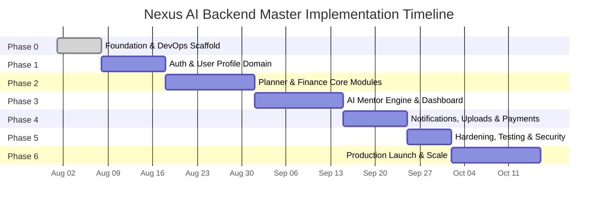
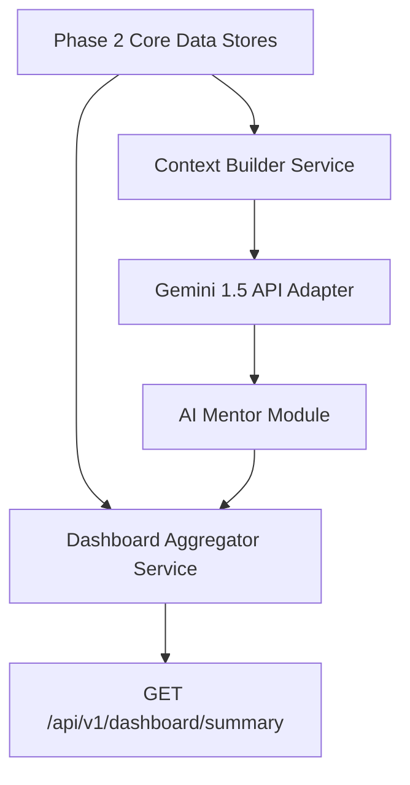
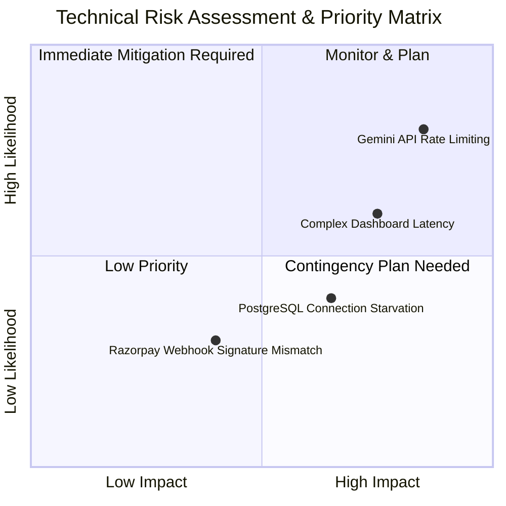
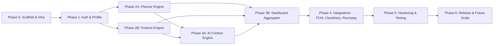

# Nexus AI Backend - Implementation Roadmap & Engineering Strategy

**Document Version:** 1.0.0  
**Author:** Principal Software Architect & Senior Backend Engineer  
**Last Updated:** July 25, 2026  

---

## Table of Contents
1. [Document Purpose](#1-document-purpose)
2. [Document Scope](#2-document-scope)
3. [Implementation Strategy & Phasing Overview](#3-implementation-strategy--phasing-overview)
4. [Phase 0: Foundation & DevOps Bootstrap](#4-phase-0-foundation--devops-bootstrap)
5. [Phase 1: Core Authentication & User Profile Domain](#5-phase-1-core-authentication--user-profile-domain)
6. [Phase 2: Smart Planner & Smart Finance Core Domains](#6-phase-2-smart-planner--smart-finance-core-domains)
7. [Phase 3: AI Mentor Engine & Unified Dashboard Aggregator](#7-phase-3-ai-mentor-engine--unified-dashboard-aggregator)
8. [Phase 4: Notifications, Media Uploads & Payment Infrastructure](#8-phase-4-notifications-media-uploads--payment-infrastructure)
9. [Phase 5: Analytics, System Hardening & Security Audit](#9-phase-5-analytics-system-hardening--security-audit)
10. [Phase 6: Future Scalability & Microservices Expansion](#10-phase-6-future-scalability--microservices-expansion)
11. [Master Milestone Delivery Schedule](#11-master-milestone-delivery-schedule)
12. [Comprehensive Risk Assessment & Mitigation Matrix](#12-comprehensive-risk-assessment--mitigation-matrix)
13. [Critical Path Dependency Diagram](#13-critical-path-dependency-diagram)
14. [Best Practices & Governance](#14-best-practices--governance)
15. [References to Related Documents](#15-references-to-related-documents)

---

## 1. Document Purpose

This document outlines the master implementation roadmap for the Nexus AI backend. It breaks down engineering tasks into logical execution phases, establishes delivery milestones, assesses technical risks, maps dependencies, and provides effort complexity estimates to guide development teams.

---

## 2. Document Scope

This roadmap covers the complete software development lifecycle (SDLC) for the backend, spanning initial repository scaffolding, infrastructure containerization, core domain implementation, external integrations, security auditing, and future scaling milestones.

---

## 3. Implementation Strategy & Phasing Overview

Development is structured into **7 sequential phases** (Phase 0 through Phase 6). Execution follows a strict dependency hierarchy: foundational infrastructure must precede domain modules, and core domains must precede AI context synthesis and client aggregation feeds.

---

## 4. Phase 0: Foundation & DevOps Bootstrap

* **Primary Objective:** Establish production-ready NestJS application structure, Docker container environments, PostgreSQL configurations, and CI/CD pipelines.
* **Deliverables:**
  * NestJS 10.x scaffolding with TypeScript strict mode.
  * `docker-compose.yml` local environment with PostgreSQL 16.
  * `@nestjs/config` environment validation schema using Joi.
  * Winston structured logging and global exception filter boilerplate.
  * Swagger OpenAPI document setup at `/api/docs`.
* **Complexity Rating:** Medium (3 Story Points).
* **Dependencies:** None.

---

## 5. Phase 1: Core Authentication & User Profile Domain

* **Primary Objective:** Build secure, stateless authentication systems and personal user profile engines.
* **Deliverables:**
  * PostgreSQL entities: `User`, `RefreshToken`, `UserProfile`.
  * `AuthModule`: User registration, bcrypt password hashing, JWT Access & Refresh token rotation, logout token revoking.
  * `ProfileModule`: Profile CRUD, academic settings, skill tag management.
  * Passport-JWT strategies and Guards (`JwtAuthGuard`, `RolesGuard`).
  * Unit tests for Auth and Profile services.
* **Complexity Rating:** Medium-High (5 Story Points).
* **Dependencies:** Phase 0.

---

## 6. Phase 2: Smart Planner & Smart Finance Core Domains

* **Primary Objective:** Implement core student productivity and financial tracking engines.
* **Deliverables:**
  * PostgreSQL entities: `Task`, `StudyPlan`, `Budget`, `Expense`, `ExpenseCategory`.
  * `PlannerModule`: Task CRUD, deadline tracking, priority scoring algorithm (`FR-PLAN-002`).
  * `FinanceModule`: Budget setup, expense logging, dynamic safe daily spend calculator (`FR-FIN-002`), insolvency warning flags.
  * Transactional database boundaries for financial entry logging.
* **Complexity Rating:** High (8 Story Points).
* **Dependencies:** Phase 1.

---

## 7. Phase 3: AI Mentor Engine & Unified Dashboard Aggregator

* **Primary Objective:** Connect Google Gemini 1.5 API for contextual mentoring and build the real-time aggregated dashboard feed.
* **Deliverables:**
  * `AIMentorModule`: Context builder synthesizing student profile, active tasks, and financial limits into system prompts; multi-turn chat handler.
  * `DashboardModule`: Sub-second parallel data aggregator fetching today's urgent tasks, remaining safe spend, and AI insights into unified JSON payload.
  * Circuit breaker implementation for Gemini API resiliency.
* **Complexity Rating:** Very High (13 Story Points).
* **Dependencies:** Phase 2.

---

## 8. Phase 4: Notifications, Media Uploads & Payment Infrastructure

* **Primary Objective:** Integrate external integrations for push alerts, Cloudinary image storage, and Razorpay test mode billing.
* **Deliverables:**
  * `NotificationModule`: FCM token registry and scheduled job push dispatches via `@nestjs/schedule`.
  * `UploadModule`: Cloudinary storage gateway for avatar uploads and assignment scans.
  * `PaymentModule`: Razorpay test mode order creation and HMAC SHA256 webhook verification.
* **Complexity Rating:** High (8 Story Points).
* **Dependencies:** Phase 3.

---

## 9. Phase 5: Analytics, System Hardening & Security Audit

* **Primary Objective:** Ensure production readiness, test coverage compliance, and performance tuning.
* **Deliverables:**
  * `AnalyticsModule`: Non-blocking request interceptor logging user interactions and Gemini token usage metrics.
  * Comprehensive Jest test suite execution (>80% coverage target).
  * Rate limiting enforcement via `@nestjs/throttler`.
  * OWASP vulnerability scan and dependency audit.
* **Complexity Rating:** Medium-High (5 Story Points).
* **Dependencies:** Phase 4.

---

## 10. Phase 6: Future Scalability & Microservices Expansion

* **Primary Objective:** Prepare system for high scale via Redis caching, RabbitMQ async messaging, and vector RAG search.
* **Deliverables:**
  * Redis adapter integration for session and dashboard query caching.
  * RabbitMQ broker injection for background event distribution.
  * `pgvector` extension enablement in PostgreSQL.
* **Complexity Rating:** High (8 Story Points).
* **Dependencies:** Phase 5 Production Release.

---

## 11. Master Milestone Delivery Schedule

| Milestone Code | Milestone Title | Target Delivery Phase | Key Acceptance Gate |
| :--- | :--- | :--- | :--- |
| **MS-0** | Infrastructure Ready | Phase 0 | Docker compose up boots clean NestJS app connected to Postgres DB. |
| **MS-1** | Authentication Core | Phase 1 | User can register, login, receive JWT, and access protected profile route. |
| **MS-2** | Planner & Finance Live | Phase 2 | Tasks prioritized algorithmically; safe spend calculated accurately. |
| **MS-3** | AI & Dashboard Live | Phase 3 | Gemini responds with context; Dashboard returns summary in <200ms. |
| **MS-4** | External Integrations | Phase 4 | FCM alerts deliver; Cloudinary images upload; Razorpay webhooks process. |
| **MS-5** | Production Readiness | Phase 5 | 80%+ test coverage; security audit cleanly passed; documentation complete. |

---

## 12. Comprehensive Risk Assessment & Mitigation Matrix

### Risk Mitigation Table

| Risk Item | Likelihood | Impact | Architectural Mitigation Strategy |
| :--- | :---: | :---: | :--- |
| **Gemini API Rate Limits / Outages** | High | High | Implement Circuit Breaker pattern; cache fallback mentorship prompts in database. |
| **Dashboard Query Latency Degrades** | Medium | High | Execute parallel `Promise.all()` sub-queries; prepare Redis caching layer. |
| **Database Connection Starvation** | Low | High | Configure connection pooling caps; optimize TypeORM indexed joins. |
| **Webhook Spoofing / Tampering** | Low | Medium | Enforce strict HMAC SHA256 signature verification in raw HTTP body parser middleware. |

---

## 13. Critical Path Dependency Diagram

---

## 14. Best Practices & Governance

* **Sprint Phasing:** Work executed in 2-week sprint iterations aligned with milestones.
* **Pull Request Gates:** CI/CD automatically enforces ESLint rules, unit test executions, and Swagger documentation updates prior to merge.

---

## 15. References to Related Documents

* [01-project-overview.md](file:///d:/Nexus-AI/backend/docs/01-project-overview.md)
* [02-functional-requirements.md](file:///d:/Nexus-AI/backend/docs/02-functional-requirements.md)
* [04-high-level-architecture.md](file:///d:/Nexus-AI/backend/docs/04-high-level-architecture.md)
* [06-system-components.md](file:///d:/Nexus-AI/backend/docs/06-system-components.md)
