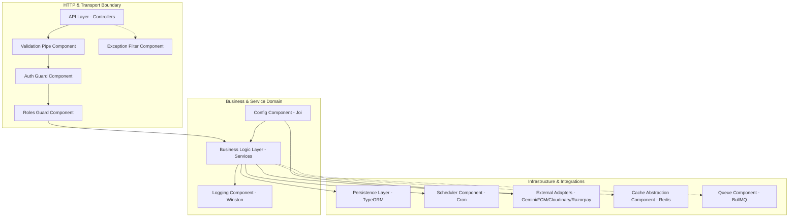
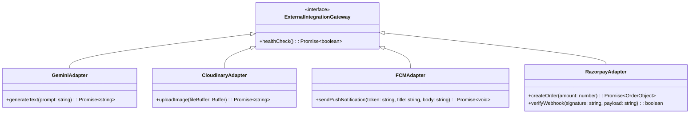
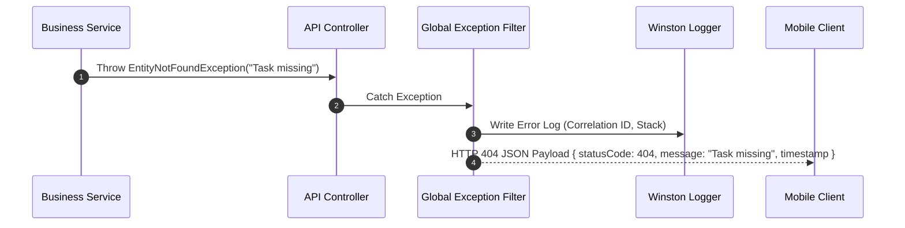

# Nexus AI Backend - System Component Specification

**Document Version:** 1.0.0  
**Author:** Principal Software Architect & Senior Backend Engineer  
**Last Updated:** July 25, 2026  

---

## Table of Contents
1. [Document Purpose](#1-document-purpose)
2. [Document Scope](#2-document-scope)
3. [System Component Topology Overview](#3-system-component-topology-overview)
4. [Component 1: API & Transport Layer](#4-component-1-api--transport-layer)
5. [Component 2: Business Logic Service Layer](#5-component-2-business-logic-service-layer)
6. [Component 3: Persistence & ORM Layer](#6-component-3-persistence--orm-layer)
7. [Component 4: External Integration Adapters](#7-component-4-external-integration-adapters)
8. [Component 5: Task Scheduler Component](#8-component-5-task-scheduler-component)
9. [Component 6: Configuration Management Component](#9-component-6-configuration-management-component)
10. [Component 7: Structured Logging Component](#10-component-7-structured-logging-component)
11. [Component 8: Request Validation & DTO Transformation](#11-component-8-request-validation--dto-transformation)
12. [Component 9: Authentication Guard & Strategy Engine](#12-component-9-authentication-guard--strategy-engine)
13. [Component 10: Authorization & Access Control Component](#13-component-10-authorization--access-control-component)
14. [Component 11: Global Error & Exception Handling Component](#14-component-11-global-error--exception-handling-component)
15. [Component 12: Distributed Caching Abstraction Layer (Future)](#15-component-12-distributed-caching-abstraction-layer-future)
16. [Component 13: Asynchronous Message Queue Infrastructure (Future)](#16-component-13-asynchronous-message-queue-infrastructure-future)
17. [Best Practices & Governance](#17-best-practices--governance)
18. [References to Related Documents](#18-references-to-related-documents)

---

## 1. Document Purpose

This document provides a deep-dive structural specification of every internal component comprising the Nexus AI NestJS backend framework. It articulates the responsibilities, dependencies, interfaces, design patterns, and operational boundaries of each component layer.

---

## 2. Document Scope

This specification details 13 backend components spanning the HTTP transport layer, business services, database ORM accessors, configuration validation, security guards, exception filters, logging infrastructures, background task schedulers, external cloud adapters, and pre-designed interfaces for caching and asynchronous queuing.

---

## 3. System Component Topology Overview

---

## 4. Component 1: API & Transport Layer

* **Architectural Role:** Receives HTTP/HTTPS requests from client applications, routes URIs to controller action methods, enforces OpenAPI (Swagger) annotations, and formats output JSON.
* **Key Responsibilities:**
  * Define explicit RESTful endpoints with appropriate HTTP verbs (`GET`, `POST`, `PATCH`, `DELETE`).
  * Map incoming DTO payloads to business service parameters.
  * Return standardized HTTP status codes (`200 OK`, `201 Created`, `400 Bad Request`, `401 Unauthorized`, `404 Not Found`).
* **Design Guidelines:** Controllers must remain completely lean, delegating all domain logic, validation checks, and entity operations to underlying Services.

---

## 5. Component 2: Business Logic Service Layer

* **Architectural Role:** Serves as the domain heart of the NestJS application, implementing core business rules, algorithms, and orchestration workflows.
* **Key Responsibilities:**
  * Compute dynamic task priority scores in the Smart Planner.
  * Calculate dynamic safe daily spend thresholds in Smart Finance.
  * Assemble user academic and financial context into Google Gemini LLM prompts in AI Mentor.
  * Maintain transactional domain boundaries.
* **Design Guidelines:** Services must depend strictly on abstract interfaces rather than concrete third-party SDKs to facilitate mock injection during unit testing.

---

## 6. Component 3: Persistence & ORM Layer

* **Architectural Role:** Manages database interactions, object-relational mapping, connection pooling, and transactional boundaries between NestJS and PostgreSQL.
* **Key Responsibilities:**
  * Map TypeScript domain entities to PostgreSQL relational tables via TypeORM.
  * Enforce foreign key constraints, indexes, and database migrations.
  * Execute safe parameterization to prevent SQL injection vulnerabilities.
* **Design Guidelines:** Utilize the Repository Pattern (`Repository<T>`) for data access; prohibit raw string SQL queries except for performance-critical analytical aggregations.

---

## 7. Component 4: External Integration Adapters

* **Architectural Role:** Encapsulates third-party APIs behind clean NestJS provider interfaces.
* **Adapters Implemented:**
  * **Gemini Adapter:** Communicates with `@google/generative-ai` SDK.
  * **Cloudinary Adapter:** Uploads binary streams and retrieves optimized CDN URLs.
  * **FCM Adapter:** Dispatches push notifications to iOS/Android mobile clients.
  * **Razorpay Adapter:** Manages payment order creation and HMAC SHA256 webhook signature validation.

---

## 8. Component 5: Task Scheduler Component

* **Architectural Role:** Executes recurring background cron tasks using NestJS `@nestjs/schedule`.
* **Key Responsibilities:**
  * Daily 00:01 AM: Recalculate monthly budget safe-to-spend allowances for all active users.
  * Every 15 Minutes: Scan pending assignment due dates and trigger FCM push reminders for tasks due within 3 hours.
  * Sunday 11:59 PM: Aggregate weekly productivity metrics and log summary entries.

---

## 9. Component 6: Configuration Management Component

* **Architectural Role:** Validates, parses, and provides type-safe access to environment variables using `@nestjs/config` and `Joi`.
* **Key Responsibilities:**
  * Intercept application boot process and validate environment presence (e.g., `DATABASE_URL`, `JWT_SECRET`, `GEMINI_API_KEY`).
  * Throw immediate boot exceptions if required keys are missing or malformed.

---

## 10. Component 7: Structured Logging Component

* **Architectural Role:** Provides centralized, structured JSON logging using `winston`.
* **Key Features:**
  * Log Levels: `error`, `warn`, `info`, `debug`.
  * Context Injection: Automatically appends `X-Correlation-ID`, user ID, and stack trace to every log line.

---

## 11. Component 8: Request Validation & DTO Transformation

* **Architectural Role:** Intercepts incoming HTTP payloads using NestJS global `ValidationPipe` powered by `class-validator` and `class-transformer`.
* **Key Behavior:**
  * Rejects unknown request body properties (`whitelist: true`, `forbidNonWhitelisted: true`).
  * Coerces primitive query parameters to target TypeScript types.

---

## 12. Component 9: Authentication Guard & Strategy Engine

* **Architectural Role:** Validates incoming JWT Bearer tokens and extracts stateless user identity.
* **Key Classes:**
  * `JwtAuthGuard`: Extends NestJS `AuthGuard('jwt')` to protect private endpoints.
  * `JwtStrategy`: Extends Passport `Strategy`, verifying token signatures, expiration dates, and DB active status.

---

## 13. Component 10: Authorization & Access Control Component

* **Architectural Role:** Enforces Role-Based Access Control (RBAC) across endpoints.
* **Key Mechanics:** Custom `@Roles('STUDENT', 'ADMIN')` decorator parsed by `RolesGuard` to check user claim privileges before handler execution.

---

## 14. Component 11: Global Error & Exception Handling Component

* **Architectural Role:** Catches unhandled domain errors and converts them into standardized, secure HTTP JSON error responses without leaking internal server stack traces to users.

---

## 15. Component 12: Distributed Caching Abstraction Layer (Future)

* **Architectural Role:** Pre-designed abstraction wrapping NestJS `CacheModule` to support seamless Redis injection for sub-10ms response caching.

---

## 16. Component 13: Asynchronous Message Queue Infrastructure (Future)

* **Architectural Role:** Pre-designed job consumer interface for BullMQ / RabbitMQ, ready to handle heavy asynchronous background jobs (e.g., PDF RAG parsing, batch AI processing).

---

## 17. Best Practices & Governance

* **Single Responsibility:** Each NestJS provider must manage a single concern.
* **Explicit Providers:** All components registered explicitly in their parent module's `providers` array.

---

## 18. References to Related Documents

* [01-project-overview.md](file:///d:/Nexus-AI/backend/docs/01-project-overview.md)
* [04-high-level-architecture.md](file:///d:/Nexus-AI/backend/docs/04-high-level-architecture.md)
* [07-module-breakdown.md](file:///d:/Nexus-AI/backend/docs/07-module-breakdown.md)
