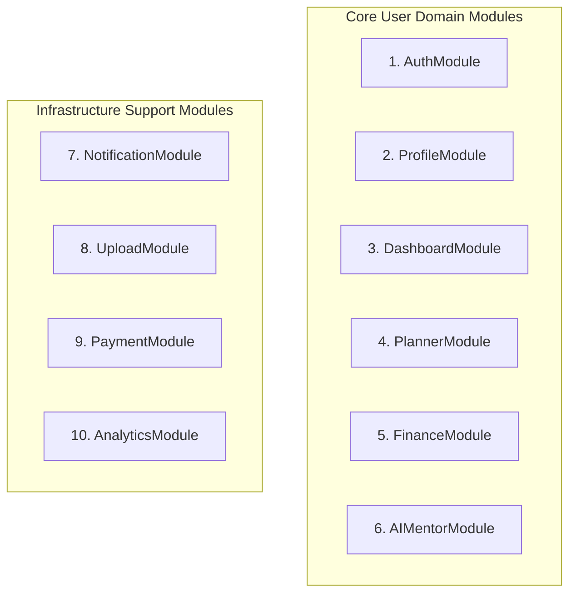
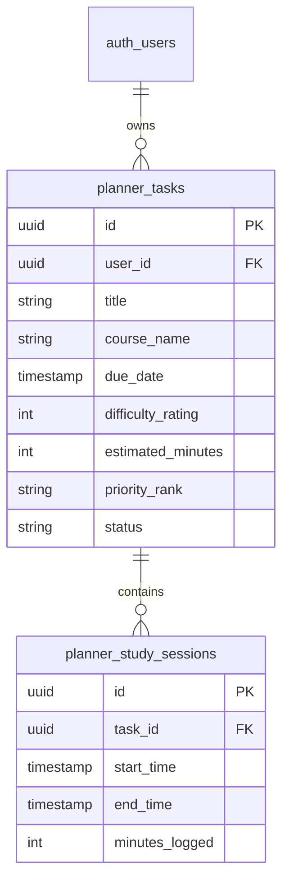
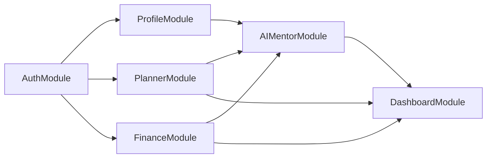

# Nexus AI Backend - Complete Module Breakdown Specification

**Document Version:** 1.0.0  
**Author:** Principal Software Architect & Senior Backend Engineer  
**Last Updated:** July 25, 2026  

---

## Table of Contents
1. [Document Purpose](#1-document-purpose)
2. [Document Scope](#2-document-scope)
3. [Module Breakdown Architecture Overview](#3-module-breakdown-architecture-overview)
4. [Module 1: Authentication & Security (`AuthModule`)](#4-module-1-authentication--security-authmodule)
5. [Module 2: User Profile & Preferences (`ProfileModule`)](#5-module-2-user-profile--preferences-profilemodule)
6. [Module 3: Unified Dashboard (`DashboardModule`)](#6-module-3-unified-dashboard-dashboardmodule)
7. [Module 4: Smart Planner Engine (`PlannerModule`)](#7-module-4-smart-planner-engine-plannermodule)
8. [Module 5: Smart Finance Engine (`FinanceModule`)](#8-module-5-smart-finance-engine-financemodule)
9. [Module 6: Contextual AI Mentor Gateway (`AIMentorModule`)](#9-module-6-contextual-ai-mentor-gateway-aimentormodule)
10. [Module 7: Push Notifications (`NotificationModule`)](#10-module-7-push-notifications-notificationmodule)
11. [Module 8: Media & Attachment Uploads (`UploadModule`)](#11-module-8-media--attachment-uploads-uploadmodule)
12. [Module 9: Payments & Subscriptions (`PaymentModule`)](#12-module-9-payments--subscriptions-paymentmodule)
13. [Module 10: System & User Analytics (`AnalyticsModule`)](#13-module-10-system--user-analytics-analyticsmodule)
14. [Cross-Module Relationship Matrix](#14-cross-module-relationship-matrix)
15. [Microservices Migration Strategy](#15-microservices-migration-strategy)
16. [Best Practices & Governance](#16-best-practices--governance)
17. [References to Related Documents](#17-references-to-related-documents)

---

## 1. Document Purpose

This document provides an exhaustive, microservice-ready specification for all 10 domain modules comprising the Nexus AI backend. For each module, it articulates purpose, responsibilities, API endpoint specifications, logical PostgreSQL database schemas, relational dependencies, core business rules, and future expansion paths.

---

## 2. Document Scope

This specification covers 10 backend modules:
1. `AuthModule`
2. `ProfileModule`
3. `DashboardModule`
4. `PlannerModule`
5. `FinanceModule`
6. `AIMentorModule`
7. `NotificationModule`
8. `UploadModule`
9. `PaymentModule`
10. `AnalyticsModule`

---

## 3. Module Breakdown Architecture Overview

Each module operates as an independent domain unit within the NestJS project structure (`src/modules/<module-name>/`), encapsulating its own controllers, services, repositories, entities, and event listeners.



---

## 4. Module 1: Authentication & Security (`AuthModule`)

### 4.1 Purpose
Manages user identity registration, credentials validation, stateless JWT token issuance, session refresh rotation, password resets, and role assignments.

### 4.2 Responsibilities
* Hash passwords using `bcrypt` (cost factor 12).
* Issue short-lived Access Tokens (15 min) and long-lived Refresh Tokens (7 days).
* Store hashed Refresh Tokens in PostgreSQL to enable session revocation.

### 4.3 Planned API Contracts

#### `POST /api/v1/auth/register`
* **Request Payload:**
  ```json
  {
    "email": "student@university.edu",
    "password": "SecurePassword123!",
    "fullName": "Alex Mercer",
    "institutionName": "State University"
  }
  ```
* **Response Payload (201 Created):**
  ```json
  {
    "statusCode": 201,
    "success": true,
    "data": {
      "userId": "usr_987654321",
      "email": "student@university.edu",
      "fullName": "Alex Mercer",
      "createdAt": "2026-07-25T18:30:00.000Z"
    }
  }
  ```

#### `POST /api/v1/auth/login`
* **Request Payload:**
  ```json
  {
    "email": "student@university.edu",
    "password": "SecurePassword123!"
  }
  ```
* **Response Payload (200 OK):**
  ```json
  {
    "statusCode": 200,
    "success": true,
    "data": {
      "accessToken": "eyJhbGciOiJIUzI1NiIsInR5cCI6IkpXVCJ9...",
      "refreshToken": "d8e9f0a1b2c3d4e5f6...",
      "expiresIn": 900
    }
  }
  ```

### 4.4 Planned Database Schemas

#### Table: `auth_users`
| Column Name | Data Type | Constraints | Description |
| :--- | :--- | :--- | :--- |
| `id` | `UUID` | PRIMARY KEY, DEFAULT `gen_random_uuid()` | Unique user identifier |
| `email` | `VARCHAR(255)` | UNIQUE, NOT NULL | Student email address |
| `password_hash` | `VARCHAR(255)` | NOT NULL | Bcrypt hashed password |
| `role` | `VARCHAR(50)` | NOT NULL, DEFAULT `'STUDENT'` | Access control role |
| `is_active` | `BOOLEAN` | NOT NULL, DEFAULT `true` | Account active flag |
| `created_at` | `TIMESTAMPTZ` | NOT NULL, DEFAULT `NOW()` | Record creation timestamp |
| `updated_at` | `TIMESTAMPTZ` | NOT NULL, DEFAULT `NOW()` | Record update timestamp |

*Indexes:* `idx_auth_users_email` (BTREE on `email`).

#### Table: `auth_refresh_tokens`
| Column Name | Data Type | Constraints | Description |
| :--- | :--- | :--- | :--- |
| `id` | `UUID` | PRIMARY KEY | Unique token record ID |
| `user_id` | `UUID` | FOREIGN KEY (`auth_users.id` ON DELETE CASCADE) | Owner user ID |
| `token_hash` | `VARCHAR(255)` | NOT NULL | Hashed refresh token |
| `expires_at` | `TIMESTAMPTZ` | NOT NULL | Expiration timestamp |
| `created_at` | `TIMESTAMPTZ` | NOT NULL | Token issuance timestamp |

### 4.5 Business Rules
1. Password must contain minimum 8 characters, 1 uppercase letter, 1 number, and 1 special character.
2. Email must be converted to lower-case prior to insertion or lookup.

---

## 5. Module 2: User Profile & Preferences (`ProfileModule`)

### 5.1 Purpose
Stores and manages user academic background, specialization, career goals, skill tags, avatar URLs, and push notification preferences.

### 5.2 Planned API Contracts

#### `GET /api/v1/profile`
* **Response Payload (200 OK):**
  ```json
  {
    "statusCode": 200,
    "success": true,
    "data": {
      "userId": "usr_987654321",
      "major": "Computer Science",
      "graduationYear": 2027,
      "skillTags": ["TypeScript", "Python", "Data Structures"],
      "avatarUrl": "https://res.cloudinary.com/nexus/image/upload/v1/avatar.jpg",
      "notificationPreferences": {
        "assignmentReminders": true,
        "budgetAlerts": true,
        "aiTips": true
      }
    }
  }
  ```

### 5.3 Planned Database Schemas

#### Table: `user_profiles`
| Column Name | Data Type | Constraints | Description |
| :--- | :--- | :--- | :--- |
| `id` | `UUID` | PRIMARY KEY | Unique profile ID |
| `user_id` | `UUID` | UNIQUE, FK (`auth_users.id` ON DELETE CASCADE) | User account linkage |
| `major` | `VARCHAR(150)` | NULLABLE | Academic field of study |
| `graduation_year` | `INT` | NULLABLE | Target graduation year |
| `skill_tags` | `TEXT[]` | DEFAULT `'{}'` | Array of student skills |
| `avatar_url` | `TEXT` | NULLABLE | Cloudinary image URL |
| `notif_prefs` | `JSONB` | NOT NULL, DEFAULT `'{}'` | Notification toggle flags |

---

## 6. Module 3: Unified Dashboard (`DashboardModule`)

### 6.1 Purpose
Aggregates key real-time metrics across Planner, Finance, and AI Mentor into a single high-speed dashboard overview feed.

### 6.2 Planned API Contracts

#### `GET /api/v1/dashboard/summary`
* **Response Payload (200 OK):**
  ```json
  {
    "statusCode": 200,
    "success": true,
    "data": {
      "todayAssignments": [
        { "id": "tsk_101", "title": "CS201 Algorithm Homework", "dueDate": "2026-07-25T23:59:00Z", "priority": "HIGH" }
      ],
      "financialOverview": {
        "monthlyBudget": 500.00,
        "remainingBudget": 240.50,
        "safeDailySpend": 34.35,
        "isInsolvencyWarning": false
      },
      "productivityScore": 85,
      "aiRecommendation": "Review dynamic programming concepts before 6:00 PM to stay on track for your CS201 deadline."
    }
  }
  ```

---

## 7. Module 4: Smart Planner Engine (`PlannerModule`)



### 7.1 Purpose
Manages academic assignments, personal tasks, exam dates, study time-blocks, and calculates automated task priority ranks.

### 7.2 Planned Database Schemas

#### Table: `planner_tasks`
| Column Name | Data Type | Constraints | Description |
| :--- | :--- | :--- | :--- |
| `id` | `UUID` | PRIMARY KEY | Task identifier |
| `user_id` | `UUID` | FK (`auth_users.id` ON DELETE CASCADE) | Task owner |
| `title` | `VARCHAR(255)` | NOT NULL | Task title |
| `course_name` | `VARCHAR(100)` | NULLABLE | Related course/subject |
| `due_date` | `TIMESTAMPTZ` | NOT NULL | Deadline timestamp |
| `difficulty_rating` | `INT` | CHECK (`difficulty_rating BETWEEN 1 AND 5`) | Subjective difficulty |
| `estimated_minutes`| `INT` | NOT NULL | Target completion time |
| `priority_rank` | `VARCHAR(20)` | DEFAULT `'MEDIUM'` | Computed priority (HIGH/MED/LOW) |
| `status` | `VARCHAR(20)` | DEFAULT `'PENDING'` | Status (PENDING/COMPLETED) |

*Indexes:* `idx_planner_tasks_user_due` (BTREE on `user_id`, `due_date`).

---

## 8. Module 5: Smart Finance Engine (`FinanceModule`)

### 8.1 Purpose
Tracks pocket money allowances, logs daily categorized expenses, projects end-of-month liquidity, and calculates safe daily spend limits.

### 8.2 Planned Database Schemas

#### Table: `finance_budgets`
| Column Name | Data Type | Constraints | Description |
| :--- | :--- | :--- | :--- |
| `id` | `UUID` | PRIMARY KEY | Budget ID |
| `user_id` | `UUID` | FK (`auth_users.id`) | Student ID |
| `month_year` | `VARCHAR(7)` | NOT NULL | Target month (Format: `YYYY-MM`) |
| `total_allowance` | `NUMERIC(10,2)` | NOT NULL | Monthly income/pocket money |
| `currency` | `VARCHAR(3)` | DEFAULT `'USD'` | Currency ISO code |

#### Table: `finance_expenses`
| Column Name | Data Type | Constraints | Description |
| :--- | :--- | :--- | :--- |
| `id` | `UUID` | PRIMARY KEY | Expense ID |
| `user_id` | `UUID` | FK (`auth_users.id`) | Student ID |
| `amount` | `NUMERIC(10,2)` | NOT NULL | Amount spent |
| `category` | `VARCHAR(50)` | NOT NULL | Category (FOOD/ACADEMIC/ENT/OTHER) |
| `spent_at` | `TIMESTAMPTZ` | NOT NULL | Expense timestamp |

---

## 9. Module 6: Contextual AI Mentor Gateway (`AIMentorModule`)

### 9.1 Purpose
Orchestrates multi-session mentorship chats, career guidance, decision matrix generation, and personalized study coaching via Google Gemini 1.5 API.

### 9.2 Planned API Contracts

#### `POST /api/v1/ai-mentor/chat`
* **Request Payload:**
  ```json
  {
    "message": "How should I prepare for my upcoming Data Structures mid-term exam?"
  }
  ```
* **Response Payload (200 OK):**
  ```json
  {
    "statusCode": 200,
    "success": true,
    "data": {
      "sessionId": "sess_456789",
      "reply": "Based on your CS201 course progress and your available 15 study hours this week, I recommend breaking down your prep into 3 focused blocks...",
      "suggestedAction": "Create 3 Study Sessions in Smart Planner"
    }
  }
  ```

---

## 10. Module 7: Push Notifications (`NotificationModule`)

* **Purpose:** Registers device tokens and dispatches scheduled FCM push notifications for assignment reminders and financial alert thresholds.

---

## 11. Module 8: Media & Attachment Uploads (`UploadModule`)

* **Purpose:** Uploads user profile avatars and attachment documents securely to Cloudinary, returning optimized CDN image links.

---

## 12. Module 9: Payments & Subscriptions (`PaymentModule`)

* **Purpose:** Manages Razorpay test mode payment orders, subscription plans, billing histories, and HMAC SHA256 webhook validations.

---

## 13. Module 10: System & User Analytics (`AnalyticsModule`)

* **Purpose:** Logs user interactions, API usage metrics, and Gemini token consumption for system monitoring and optimization.

---

## 14. Cross-Module Relationship Matrix



---

## 15. Microservices Migration Strategy

When traffic scale dictates decomposing the NestJS modular monolith into independent microservices:
1. Each module directory (`src/modules/<name>`) converts into a standalone NestJS repository.
2. HTTP REST inter-module calls transition to gRPC or RabbitMQ message buses.
3. Database schemas split into dedicated PostgreSQL instances per domain.

---

## 16. Best Practices & Governance

* Zero direct cross-entity database joins across modules. Inter-module data queries must pass through public module service interfaces.

---

## 17. References to Related Documents

* [01-project-overview.md](file:///d:/Nexus-AI/backend/docs/01-project-overview.md)
* [04-high-level-architecture.md](file:///d:/Nexus-AI/backend/docs/04-high-level-architecture.md)
* [06-system-components.md](file:///d:/Nexus-AI/backend/docs/06-system-components.md)
