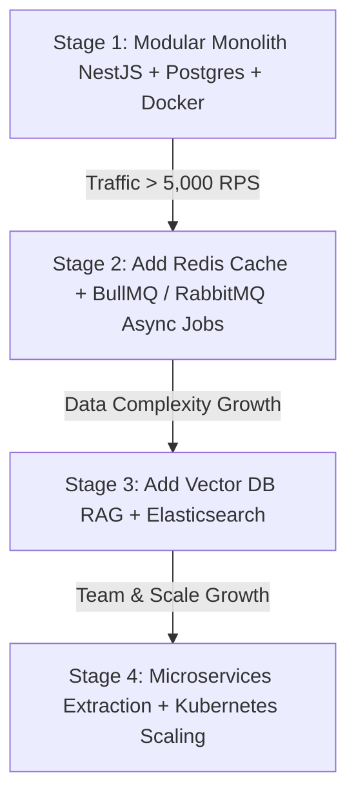
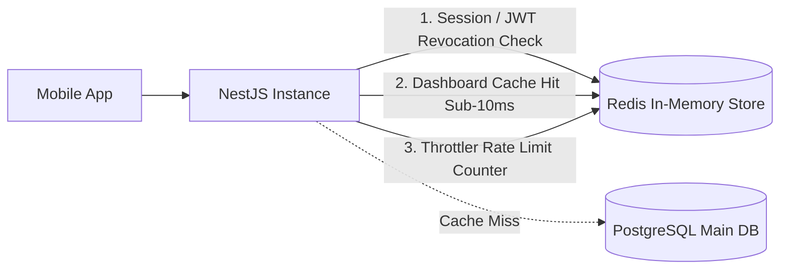
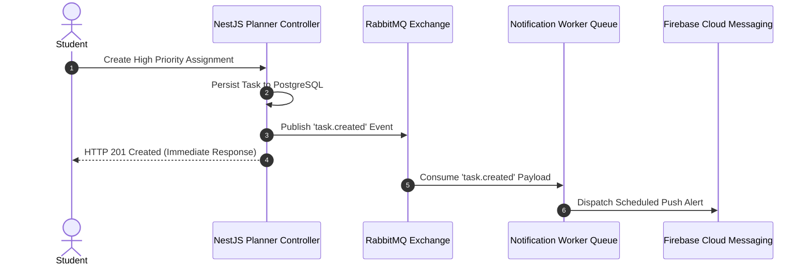
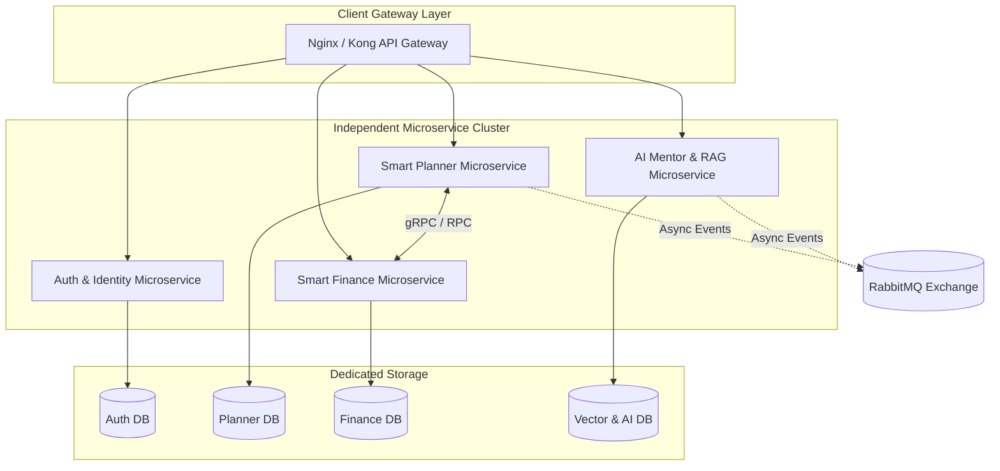
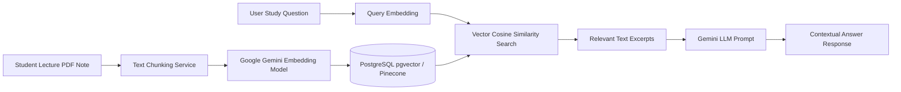
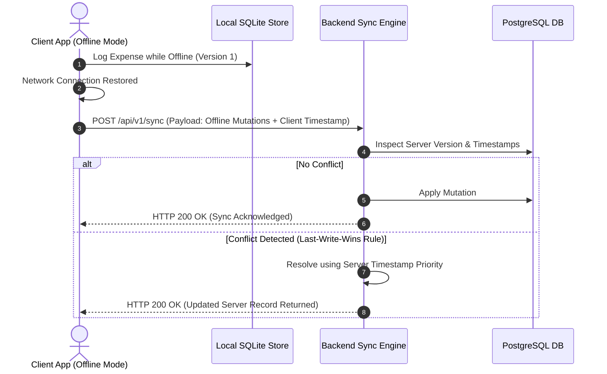
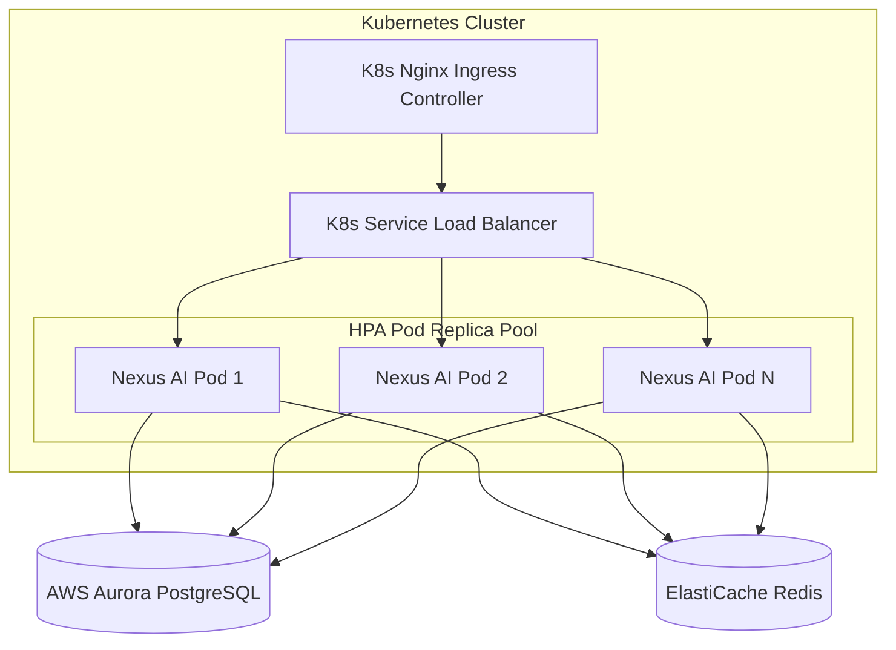
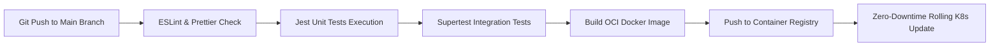

# Nexus AI Backend - Future Scalability & Architecture Evolution

**Document Version:** 1.0.0  
**Author:** Principal Software Architect & Senior Backend Engineer  
**Last Updated:** July 25, 2026  

---

## Table of Contents
1. [Document Purpose](#1-document-purpose)
2. [Document Scope](#2-document-scope)
3. [Macro Evolutionary Strategy](#3-macro-evolutionary-strategy)
4. [Redis Integration Strategy](#4-redis-integration-strategy)
5. [RabbitMQ Message Broker Strategy](#5-rabbitmq-message-broker-strategy)
6. [Microservices Migration Blueprint](#6-microservices-migration-blueprint)
7. [Elasticsearch Full-Text Search Integration](#7-elasticsearch-full-text-search-integration)
8. [Vector Database & RAG Architecture (`pgvector` / Pinecone)](#8-vector-database--rag-architecture-pgvector--pinecone)
9. [Machine Learning & Recommendation Engine Architecture](#9-machine-learning--recommendation-engine-architecture)
10. [Admin Panel & Enterprise Back-Office Gateway](#10-admin-panel--enterprise-back-office-gateway)
11. [Multi-Client & Web Application Ecosystem](#11-multi-client--web-application-ecosystem)
12. [Offline Sync & Conflict Resolution Protocol](#12-offline-sync--conflict-resolution-protocol)
13. [Internationalization (i18n) & Timezone Management](#13-internationalization-i18n--timezone-management)
14. [Horizontal Scaling & Kubernetes (K8s) Topology](#14-horizontal-scaling--kubernetes-k8s-topology)
15. [Automated CI/CD Pipeline Architecture (GitHub Actions)](#15-automated-cicd-pipeline-architecture-github-actions)
16. [Best Practices & Governance](#16-best-practices--governance)
17. [References to Related Documents](#17-references-to-related-documents)

---

## 1. Document Purpose

This document articulates the long-term technical evolution and scalability roadmap for the Nexus AI backend. It details the step-by-step migration plans, infrastructure additions, database expansions, machine learning integrations, container orchestration topologies, and multi-client strategies required to scale from a single-region modular monolith to a globally distributed, high-throughput ecosystem.

---

## 2. Document Scope

This specification covers future integration patterns for:
* **Caching & Queueing:** Redis and RabbitMQ.
* **Architecture Transformation:** Modular Monolith to Microservices.
* **Search & AI RAG Engines:** Elasticsearch and Vector Databases (`pgvector` / Pinecone).
* **Advanced Features:** Machine Learning recommendation engines, Admin Back-Office Portals, Multi-client web applications, Offline Data Synchronization, Internationalization (i18n), Kubernetes (K8s) deployment topologies, and GitHub Actions CI/CD pipelines.

---

## 3. Macro Evolutionary Strategy

The backend evolution follows a measured, data-driven strategy avoiding premature over-engineering while guaranteeing clean expansion pathways:

---

## 4. Redis Integration Strategy

Redis will be injected into the architecture to fulfill three critical operational needs:

1. **Dashboard Query Caching:** Cache aggregated JSON dashboard responses for active users with a 5-minute Time-To-Live (TTL), reducing PostgreSQL read IOPS by up to 70%.
2. **Distributed Session & Token Blacklisting:** Store revoked JWT refresh tokens and active user session states for instant, sub-millisecond validation across horizontally scaled NestJS container nodes.
3. **Distributed Rate Limiting:** Replace in-memory throttler storage with Redis-backed atomic increment counters, ensuring rate limit caps are enforced uniformly across container clusters.

---

## 5. RabbitMQ Message Broker Strategy

To decouple heavy background operations from the synchronous HTTP request/response loop, RabbitMQ will be integrated as the primary asynchronous event broker.

* **Use Cases:** Asynchronous push notification scheduling, bulk email dispatches, user activity analytics processing, and AI transcript indexing.

---

## 6. Microservices Migration Blueprint

When organizational team growth or domain traffic requires independent deployment cycles, feature modules will be extracted into autonomous microservices using a domain-driven strategy:

---

## 7. Elasticsearch Full-Text Search Integration

To enable lightning-fast full-text search across thousands of student assignment notes, course syllabi, and historical AI mentor chat transcripts:
* **Technology:** Elasticsearch 8.x cluster.
* **Sync Strategy:** PostgreSQL `pg_kafka` or Logstash connector automatically streams database write CDC (Change Data Capture) events into Elasticsearch indexes.

---

## 8. Vector Database & RAG Architecture (`pgvector` / Pinecone)

To empower the AI Mentor with Retrieval-Augmented Generation (RAG) capabilities over student lecture slides and PDF notes:

---

## 9. Machine Learning & Recommendation Engine Architecture

* **Objective:** Transition from static heuristic priority scoring to a personalized Machine Learning model predicting student task completion probabilities and optimal study windows based on historical performance.
* **Tech Stack:** Python FastAPI ML microservice executing LightGBM models, invoked asynchronously by the NestJS backend.

---

## 10. Admin Panel & Enterprise Back-Office Gateway

* **Architecture:** Dedicated secure back-office gateway endpoints (`/api/v1/admin/*`) utilizing Role-Based Access Control (`ADMIN`, `SUPPORT`) to manage user flags, view platform analytics, inspect Razorpay billing logs, and manage system feature flags.

---

## 11. Multi-Client & Web Application Ecosystem

* **Unified REST/JSON Core:** The NestJS API gateway enforces strict OpenAPI standards, enabling seamless consumption by Flutter mobile apps (iOS/Android), Next.js web portals, and browser extensions without API modifications.

---

## 12. Offline Sync & Conflict Resolution Protocol

---

## 13. Internationalization (i18n) & Timezone Management

* **Timezone Standard:** Mandatory UTC storage across all database timestamp columns (`TIMESTAMPTZ`). Client requests transmit user timezone headers (`X-Timezone: America/New_York`); backend computes local day boundaries dynamically.
* **i18n Localization:** NestJS `nestjs-i18n` module parses client `Accept-Language` headers to format error messages and push notification templates in user preferred languages.

---

## 14. Horizontal Scaling & Kubernetes (K8s) Topology

---

## 15. Automated CI/CD Pipeline Architecture (GitHub Actions)

---

## 16. Best Practices & Governance

* **Evolutionary Architecture:** Scale infrastructure components only when empirical monitoring metrics (Prometheus/Grafana) indicate SLA degradation.
* **Backward Compatibility:** All future API iterations must maintain multi-version URI support (`/api/v1`, `/api/v2`).

---

## 17. References to Related Documents

* [01-project-overview.md](file:///d:/Nexus-AI/backend/docs/01-project-overview.md)
* [04-high-level-architecture.md](file:///d:/Nexus-AI/backend/docs/04-high-level-architecture.md)
* [06-system-components.md](file:///d:/Nexus-AI/backend/docs/06-system-components.md)
* [07-module-breakdown.md](file:///d:/Nexus-AI/backend/docs/07-module-breakdown.md)
