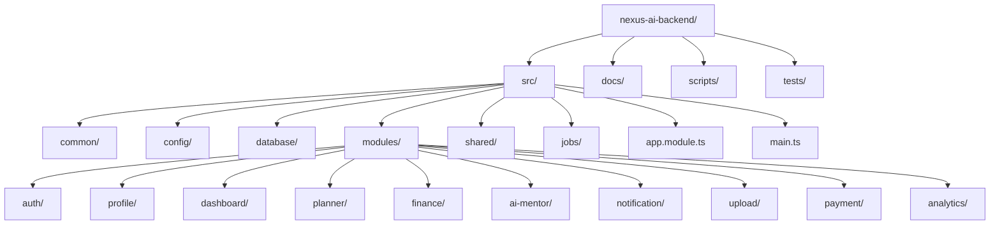
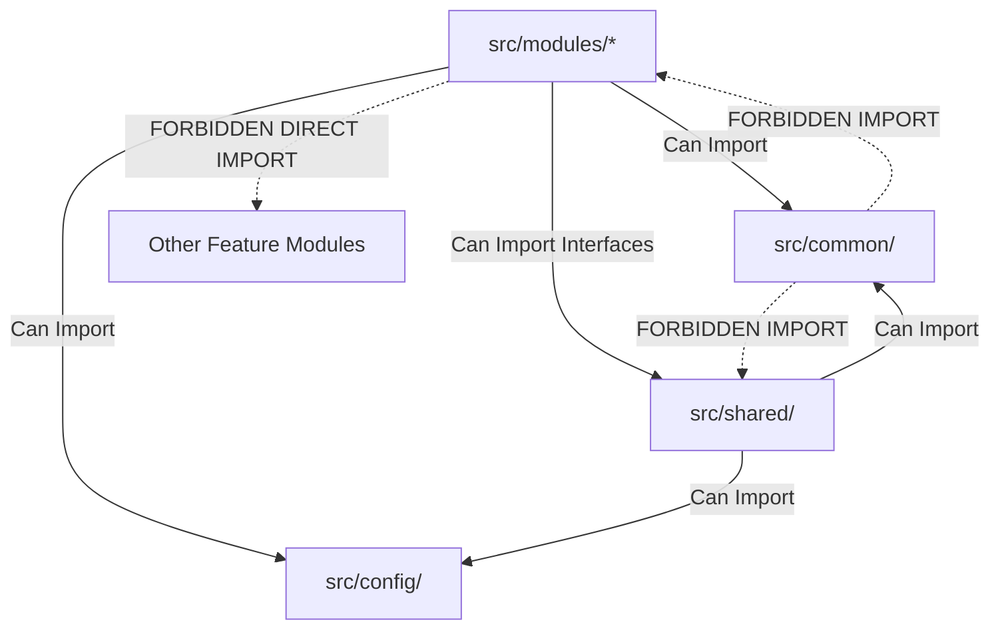

# Nexus AI Backend - Folder Structure & Directory Blueprint

**Document Version:** 1.0.0  
**Author:** Principal Software Architect & Backend Engineering Lead  
**Last Updated:** July 25, 2026  

---

## Table of Contents
1. [Document Purpose](#1-document-purpose)
2. [Document Scope](#2-document-scope)
3. [Folder Hierarchy Overview](#3-folder-hierarchy-overview)
4. [Detailed Breakdown of Directories](#4-detailed-breakdown-of-directories)
   - [4.1 `src/` Root Directory](#41-src-root-directory)
   - [4.2 `src/common/` (Cross-Cutting Concerns)](#42-srccommon-cross-cutting-concerns)
   - [4.3 `src/config/` (Configuration & Schemas)](#43-srcconfig-configuration--schemas)
   - [4.4 `src/database/` (Migrations & Seeds)](#44-srcdatabase-migrations--seeds)
   - [4.5 `src/modules/` (Feature-Based Core)](#45-srcmodules-feature-based-core)
   - [4.6 `src/shared/` (Infrastructure Adapters)](#46-srcshared-infrastructure-adapters)
   - [4.7 `src/jobs/` (Schedulers & Workers)](#47-srcjobs-schedulers--workers)
   - [4.8 Core System Root Folders (`docs/`, `scripts/`, `tests/`)](#48-core-system-root-folders-docs-scripts-tests)
5. [Folder Ownership & Access Boundaries](#5-folder-ownership--access-boundaries)
6. [Module Isolation & Dependency Rules](#6-module-isolation--dependency-rules)
7. [Architectural Rationale & Trade-Off Analysis](#7-architectural-rationale--trade-off-analysis)
8. [Best Practices](#8-best-practices)
9. [Anti-Patterns & Common Mistakes](#9-anti-patterns--common-mistakes)
10. [Future Microservices Scalability Impact](#10-future-microservices-scalability-impact)
11. [Cross References](#11-cross-references)

---

## 1. Document Purpose

This document defines the mandatory, enterprise-grade folder structure for the Nexus AI NestJS backend. It serves as the authoritative guide for every software engineer on the team, ensuring absolute consistency, strict module isolation, clean dependency directions, and seamless future microservice extraction.

---

## 2. Document Scope

This specification applies to all files, directories, feature modules, database migrations, configuration modules, shared utilities, and test suites within the repository codebase.

---

## 3. Folder Hierarchy Overview

The codebase is organized using a **Feature-Based Modular Monolith Architecture**, strictly grouping domain logic by business feature rather than technical layer:



### Complete Repository Tree Representation

```text
nexus-ai-backend/
├── docs/                        # Architectural & engineering standards documentation
├── scripts/                     # DevOps, CI/CD, and database utility scripts
├── tests/                       # Global end-to-end (E2E) test suites
├── src/
│   ├── common/                  # Cross-cutting framework utilities (Guards, Pipes, Filters)
│   │   ├── decorators/          # Custom NestJS decorators (@CurrentUser, @Roles)
│   │   ├── dto/                 # Generic API wrapper DTOs (PaginatedResponseDto)
│   │   ├── exceptions/          # Custom domain exception classes
│   │   ├── filters/             # Global HTTP exception filters
│   │   ├── guards/              # Authentication & Authorization guards
│   │   ├── interceptors/        # Response transformer & logging interceptors
│   │   ├── middleware/          # HTTP request correlation ID & helmet middleware
│   │   ├── pipes/               # Global validation & sanitization pipes
│   │   └── utils/               # Pure helper functions (date math, crypto)
│   ├── config/                  # Type-safe configuration loaders & Joi schemas
│   ├── database/                # Database ORM configuration, migrations & seeders
│   │   ├── migrations/          # Version-controlled TypeORM SQL migration scripts
│   │   ├── seeds/               # Development & test seed data generators
│   │   └── data-source.ts       # TypeORM DataSource instance configuration
│   ├── jobs/                    # Asynchronous background cron jobs & task consumers
│   ├── shared/                  # External infrastructure adapters (Gemini, FCM, Cloudinary, Razorpay)
│   │   ├── cloudinary/          # Cloudinary media storage adapter module
│   │   ├── fcm/                 # Firebase Cloud Messaging push adapter module
│   │   ├── gemini/              # Google Gemini LLM API adapter module
│   │   └── razorpay/            # Razorpay payment gateway adapter module
│   ├── modules/                 # Isolated domain feature modules
│   │   ├── auth/                # Authentication & JWT session module
│   │   ├── profile/             # Student profile & settings module
│   │   ├── dashboard/           # Unified dashboard aggregator module
│   │   ├── planner/             # Smart Planner & task engine module
│   │   ├── finance/             # Smart Finance & budget engine module
│   │   ├── ai-mentor/           # Contextual AI Mentor gateway module
│   │   ├── notification/        # Device token & alert module
│   │   ├── upload/              # Attachment upload module
│   │   ├── payment/             # Subscription billing module
│   │   └── analytics/           # Interaction & token metrics module
│   ├── app.module.ts            # Root application module orchestrator
│   └── main.ts                  # NestJS bootstrap entry point
├── .dockerignore
├── .env.example
├── docker-compose.yml
├── Dockerfile
├── package.json
└── tsconfig.json
```

---

## 4. Detailed Breakdown of Directories

### 4.1 `src/` Root Directory
Contains the application source code. All runtime execution originates from `src/main.ts` which bootstraps `src/app.module.ts`.

### 4.2 `src/common/` (Cross-Cutting Concerns)
Houses infrastructure components that are completely domain-agnostic.
* **Rule:** Code in `common/` must NEVER import anything from `modules/` or `shared/`. It must depend solely on core NestJS and standard libraries.

### 4.3 `src/config/` (Configuration & Schemas)
Contains environment variable loading configurations (`app.config.ts`, `database.config.ts`, `jwt.config.ts`, `gemini.config.ts`) along with Joi validation schemas.

### 4.4 `src/database/` (Migrations & Seeds)
Stores TypeORM CLI migration scripts and database seeding utilities. Keep database configuration isolated from domain business logic.

### 4.5 `src/modules/` (Feature-Based Core)
The primary workspace for domain developers. Each directory inside `src/modules/` represents a self-contained feature module adhering to the standard internal structure:

```text
src/modules/planner/
├── dto/                         # Input validation DTOs (CreateTaskDto, UpdateTaskDto)
├── entities/                    # TypeORM database entities (TaskEntity, StudySessionEntity)
├── enums/                       # Domain enums (TaskPriority, TaskStatus)
├── interfaces/                  # Domain interfaces & service contracts
├── listeners/                   # Event listeners handling domain events (@OnEvent)
├── controllers/                 # REST HTTP endpoint routers (PlannerController)
├── services/                    # Core business logic services (PlannerService)
├── repositories/                # Custom TypeORM repositories (TaskRepository)
├── planner.module.ts            # NestJS feature module declaration
└── planner.service.spec.ts      # Unit tests for domain service
```

### 4.6 `src/shared/` (Infrastructure Adapters)
Contains reusable client adapters for third-party external services (Google Gemini, FCM, Cloudinary, Razorpay). These adapters expose clean interface wrappers to the rest of the application.

---

## 5. Folder Ownership & Access Boundaries

| Directory | Primary Ownership | Access Rules |
| :--- | :--- | :--- |
| `src/common/` | Core Architecture Team | Modifiable only via Lead Architect approval. Read-only for feature devs. |
| `src/config/` | DevOps & Architecture | Changes require env variable review. |
| `src/modules/<feature>` | Feature Domain Engineers | Free modification within feature bounds following clean architecture. |
| `src/shared/` | Integration Engineers | Exposes abstract interfaces (`IChatAdapter`, `IPaymentGateway`). |

---

## 6. Module Isolation & Dependency Rules

To maintain high maintainability and prepare for future microservice extraction, directional dependencies are strictly enforced:



### Strict Rule: Cross-Module Interactions
Feature modules **MUST NOT** directly import entities or repositories from another feature module. 
* **Allowed:** Module A may import Module B's public `Service` exported via Module B's `exports` array.
* **Preferred:** Module A emits an asynchronous domain event (`task.created`), which Module B consumes via `@OnEvent()`.

---

## 7. Architectural Rationale & Trade-Off Analysis

### Decision: Feature-Based Modular Architecture vs. Layer-Based Architecture

| Evaluation Vector | Layer-Based (Controllers/, Services/, Entities/ at root) | Feature-Based (modules/planner/, modules/finance/) |
| :--- | :--- | :--- |
| **Architectural Rationale** | Easy for tiny CRUD projects; becomes a messy monolith as features grow. | Chosen for Nexus AI. Groups code by business capability, enabling parallel team development. |
| **Advantages** | Simple initial setup. | High cohesion, loose coupling, clear domain boundaries, low cognitive overhead. |
| **Disadvantages** | Severe code sprawl; developers must jump between 10 root folders to modify one feature. | Slightly more initial directory structure boilerplate. |
| **Scalability Impact** | Horrible scalability; impossible to decompose into microservices later. | Exceptional; extracting `modules/planner` into a standalone microservice takes hours, not months. |
| **Maintainability Impact**| Low maintainability at scale. | Extremely high maintainability; feature changes are localized. |

---

## 8. Best Practices

1. **Keep Feature Modules Co-located:** Keep entities, controllers, services, DTOs, and unit tests inside the feature module folder.
2. **Export Minimal Surface Area:** In `planner.module.ts`, only put services in `exports` that other modules explicitly need.
3. **Use Index Barrel Exports Carefully:** Avoid barrel export `index.ts` files at root levels to prevent circular dependency bugs.

---

## 9. Anti-Patterns & Common Mistakes

* ❌ **The Junk Drawer (`utils/` overload):** Dumping business logic into `common/utils/helper.ts` instead of encapsulating it in a Domain Service.
* ❌ **Cross-Module Entity Hijacking:** Importing `TaskEntity` directly inside `FinanceService` to run a JOIN query.
* ❌ **Circular Module Imports:** Module A imports Module B, and Module B imports Module A without `forwardRef()`.

---

## 10. Future Microservices Scalability Impact

By enforcing strict directory isolation inside `src/modules/<feature-name>`, extracting a module into an independent NestJS microservice involves:
1. Moving `src/modules/planner/` into a new git repository.
2. Swapping exported NestJS service calls with gRPC client calls.
3. Replacing `EventEmitter2` listeners with RabbitMQ subscribers.

---

## 11. Cross References

* [04-high-level-architecture.md](file:///d:/Nexus-AI/backend/docs/04-high-level-architecture.md)
* [07-module-breakdown.md](file:///d:/Nexus-AI/backend/docs/07-module-breakdown.md)
* [10-coding-standards.md](file:///d:/Nexus-AI/backend/docs/10-coding-standards.md)
