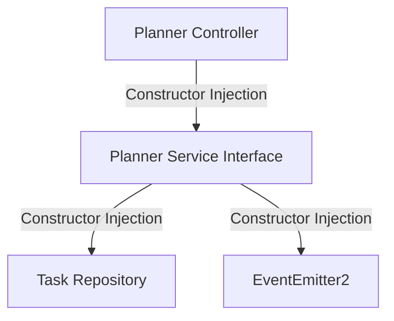
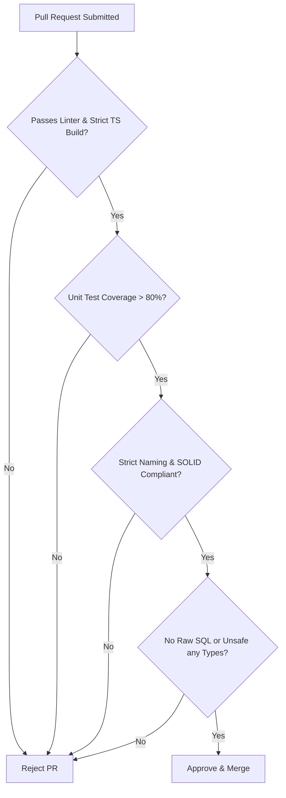

# Nexus AI Backend - Engineering Coding Standards & Guidelines

**Document Version:** 1.0.0  
**Author:** Principal Software Architect & Backend Engineering Lead  
**Last Updated:** July 25, 2026  

---

## Table of Contents
1. [Document Purpose](#1-document-purpose)
2. [Document Scope](#2-document-scope)
3. [Strict Naming Conventions Matrix](#3-strict-naming-conventions-matrix)
4. [Dependency Injection (DI) Guidelines](#4-dependency-injection-di-guidelines)
5. [SOLID Principles in NestJS Architecture](#5-solid-principles-in-nestjs-architecture)
   - [5.1 Single Responsibility Principle (SRP)](#51-single-responsibility-principle-srp)
   - [5.2 Open-Closed Principle (OCP)](#52-open-closed-principle-ocp)
   - [5.3 Liskov Substitution Principle (LSP)](#53-liskov-substitution-principle-lsp)
   - [5.4 Interface Segregation Principle (ISP)](#54-interface-segregation-principle-isp)
   - [5.5 Dependency Inversion Principle (DIP)](#55-dependency-inversion-principle-dip)
6. [Code Review Quality Checklist](#6-code-review-quality-checklist)
7. [Code Smells & Detection Guide](#7-code-smells--detection-guide)
8. [Anti-Patterns & How to Avoid Them](#8-anti-patterns--how-to-avoid-them)
9. [Architectural Rationale & Trade-Off Analysis](#9-architectural-rationale--trade-off-analysis)
10. [Best Practices](#10-best-practices)
11. [Future Considerations](#11-future-considerations)
12. [Cross References](#12-cross-references)

---

## 1. Document Purpose

This handbook defines the official coding standards, style guidelines, naming conventions, object-oriented design principles, and code review criteria for the Nexus AI backend. Compliance with this document is mandatory for all submitted pull requests.

---

## 2. Document Scope

This specification applies to all TypeScript code, NestJS modules, TypeORM entities, services, controllers, DTOs, guards, interceptors, unit tests, and configuration files across the codebase.

---

## 3. Strict Naming Conventions Matrix

To maintain immediate readability across a multi-developer engineering team, strict naming patterns are enforced via ESLint:

| Element Type | Casing Standard | Suffix / Prefix Requirement | Correct Example | Incorrect Anti-Example |
| :--- | :--- | :--- | :--- | :--- |
| **Folders** | `kebab-case` | None | `smart-planner/` | `SmartPlanner/`, `smart_planner/` |
| **Files** | `kebab-case` | `.type.ts` descriptor | `planner.controller.ts` | `plannerController.ts`, `Planner.ts` |
| **Classes** | `PascalCase` | Descriptive Type | `PlannerController` | `plannerController`, `PlannerClass` |
| **Services** | `PascalCase` | `Service` | `PlannerService` | `PlannerLogic`, `PlannerManager` |
| **Controllers**| `PascalCase` | `Controller` | `PlannerController` | `PlannerRoutes`, `PlannerApi` |
| **DTOs** | `PascalCase` | `Dto` | `CreateTaskDto` | `CreateTaskDTO`, `createTaskDto` |
| **Entities** | `PascalCase` | `Entity` | `TaskEntity` | `Task`, `TaskModel`, `tbl_task` |
| **Interfaces** | `PascalCase` | `I` Prefix | `IChatProvider` | `ChatProviderInterface`, `ChatProvider` |
| **Types** | `PascalCase` | `Type` Suffix | `TaskPriorityType` | `taskPriority`, `ITaskPriority` |
| **Enums** | `PascalCase` | Singular Name | `TaskPriority` | `TaskPriorities`, `task_priority` |
| **Enum Keys** | `UPPER_SNAKE` | None | `HIGH_PRIORITY` | `highPriority`, `HighPriority` |
| **Constants** | `UPPER_SNAKE` | None | `MAX_RETRY_COUNT` | `maxRetryCount`, `MaxRetry` |
| **Env Vars** | `UPPER_SNAKE` | Category Prefix | `DATABASE_PORT` | `dbPort`, `database_port` |
| **Methods** | `camelCase` | Verb Start | `calculatePriorityScore()` | `priorityScore()`, `CalculatePriority()` |
| **Variables** | `camelCase` | Noun phrase | `remainingBudget` | `rem_budget`, `RemainingBudget` |
| **Booleans** | `camelCase` | `is`/`has`/`can` prefix | `isTaskCompleted` | `taskCompleted`, `flagCompleted` |
| **Private Methods**| `camelCase` | `#` or `private` keyword | `private formatPrompt()` | `private _formatPrompt()` |

---

## 4. Dependency Injection (DI) Guidelines

NestJS relies heavily on its built-in Inversion of Control (IoC) container. Developers must adhere to constructor-based dependency injection:



### Mandatory DI Standards
1. **Always Use Constructor Injection:** Never use property injection (`@Inject() private readonly service: Service`). Constructor injection ensures immutability and simple unit test mocking.
2. **Mark Dependencies `readonly`:** Declare injected services as `private readonly` to prevent accidental reassignment at runtime.
3. **Avoid Service Locator Anti-Pattern:** Never call `moduleRef.get(MyService)` inside business logic; let NestJS resolve dependencies at instantiation.

---

## 5. SOLID Principles in NestJS Architecture

### 5.1 Single Responsibility Principle (SRP)
* **Rule:** A class must have one, and only one, reason to change.
* **NestJS Application:** Controllers handle ONLY HTTP routing; Services handle ONLY domain business rules; Repositories handle ONLY database queries.

### 5.2 Open-Closed Principle (OCP)
* **Rule:** Software entities should be open for extension, but closed for modification.
* **NestJS Application:** Use Strategy Patterns for third-party integrations. Adding a new payment gateway (e.g., Stripe alongside Razorpay) should involve implementing `IPaymentGateway` in a new class without editing existing billing services.

### 5.3 Liskov Substitution Principle (LSP)
* **Rule:** Derived classes or interface implementations must be completely substitutable for their base types without altering program correctness.

### 5.4 Interface Segregation Principle (ISP)
* **Rule:** Clients should not be forced to depend upon interfaces they do not use.
* **NestJS Application:** Create focused, fine-grained interfaces (e.g., `IChatStreamer`, `ITextSummarizer`) rather than one massive `IAiEverythingProvider`.

### 5.5 Dependency Inversion Principle (DIP)
* **Rule:** High-level modules should not depend on low-level modules. Both should depend on abstractions.
* **NestJS Application:** `AIMentorService` depends on abstract `IChatProvider` token provider, not concrete `GeminiAdapter`.

---

## 6. Code Review Quality Checklist

Every Pull Request must pass the following checklist prior to merging into `main`:



- [ ] **Type Safety:** Zero usage of `any`. All function signatures explicitly state parameter and return types.
- [ ] **DTO Validation:** All incoming request bodies bound to DTOs decorated with `class-validator` rules.
- [ ] **Error Handling:** Domain errors throw specific custom HTTP exceptions (`NotFoundException`, `ConflictException`), not generic `Error`.
- [ ] **Security:** Sensitive tokens or passwords never logged in Winston outputs.
- [ ] **Database Integrity:** Transactions used for multi-entity write operations.

---

## 7. Code Smells & Detection Guide

1. **God Controller / God Service:** A single service file exceeding 300 lines of code. *Fix:* Break down into sub-domain services.
2. **Deep Conditional Nesting:** Nested `if/else` blocks deeper than 3 levels. *Fix:* Use guard clauses and early returns.
3. **Primitive Obsession:** Passing 6 raw primitive strings into a function instead of a typed DTO/interface object.

---

## 8. Anti-Patterns & How to Avoid Them

* ❌ **The Silent Catch:** `try { ... } catch (e) { return null; }` — Swallowing errors masks critical failures. Always log and rethrow domain exceptions.
* ❌ **Mutation of Input Objects:** Modifying parameter objects passed into a service method. Treat all parameters as immutable.
* ❌ **Direct Database Access in Controllers:** Injecting a TypeORM Repository directly into a Controller. Always proxy through a Service layer.

---

## 9. Architectural Rationale & Trade-Off Analysis

### Decision: Strict TypeScript Configuration (`"strict": true`, `"noImplicitAny": true`)

| Evaluation Vector | Loose TypeScript (`strict: false`) | Strict TypeScript (`strict: true`) |
| :--- | :--- | :--- |
| **Architectural Rationale** | Faster initial prototyping for hobby projects. | Chosen for Nexus AI. Guarantees compile-time safety and prevents runtime `TypeError: Cannot read properties of undefined`. |
| **Advantages** | Slightly less code typing. | Eliminates 90% of common runtime crash bugs before code hits staging. |
| **Disadvantages** | Leads to silent production bugs. | Requires developers to explicitly define nullability and interfaces. |
| **Scalability Impact** | Horrible; refactoring codebase at scale becomes a gamble. | Exceptional; safe large-scale automated refactoring across hundreds of files. |
| **Maintainability Impact**| Very Low. | Extremely High. |

---

## 10. Best Practices

1. **Use Early Returns:**
   ```typescript
   // Preferred Guard Clause Pattern
   if (!user) {
     throw new NotFoundException('User profile not found');
   }
   return user;
   ```
2. **Utilize Enums for Static State:** Never hardcode raw comparison strings (`if (status === 'pending')`); use `TaskStatus.PENDING`.

---

## 11. Future Considerations

* ESLint rules will be enforced automatically via Git pre-commit hooks (`husky` + `lint-staged`) and CI pipeline jobs to reject non-compliant formatting automatically.

---

## 12. Cross References

* [06-system-components.md](file:///d:/Nexus-AI/backend/docs/06-system-components.md)
* [09-folder-structure.md](file:///d:/Nexus-AI/backend/docs/09-folder-structure.md)
* [17-git-workflow.md](file:///d:/Nexus-AI/backend/docs/17-git-workflow.md)
