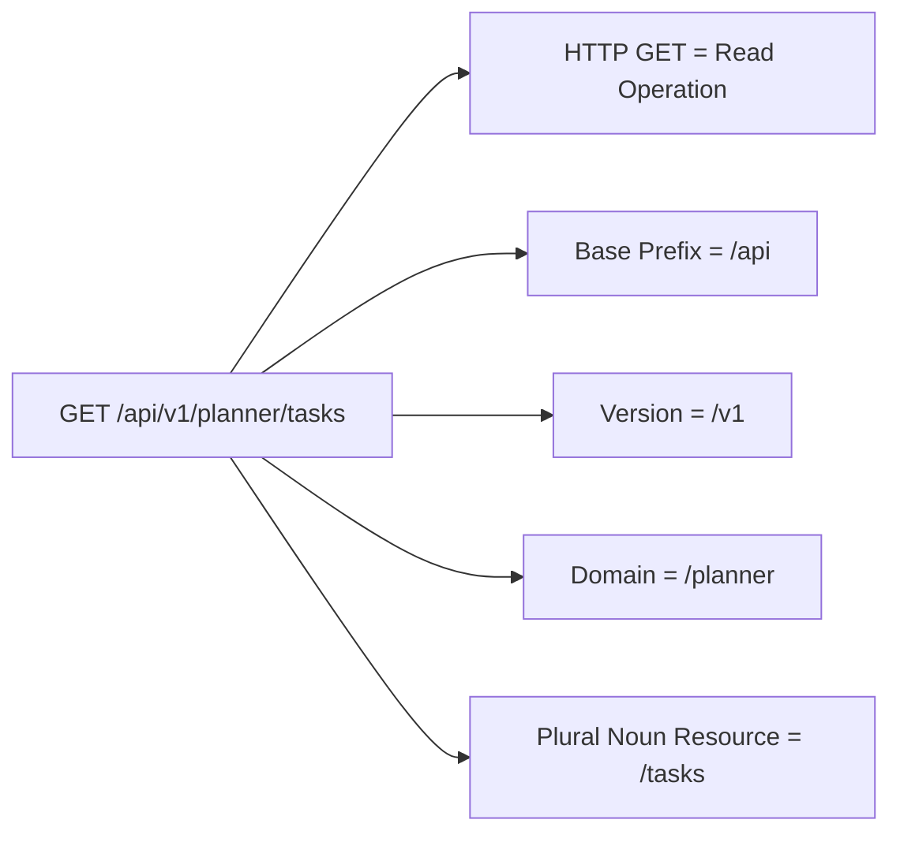
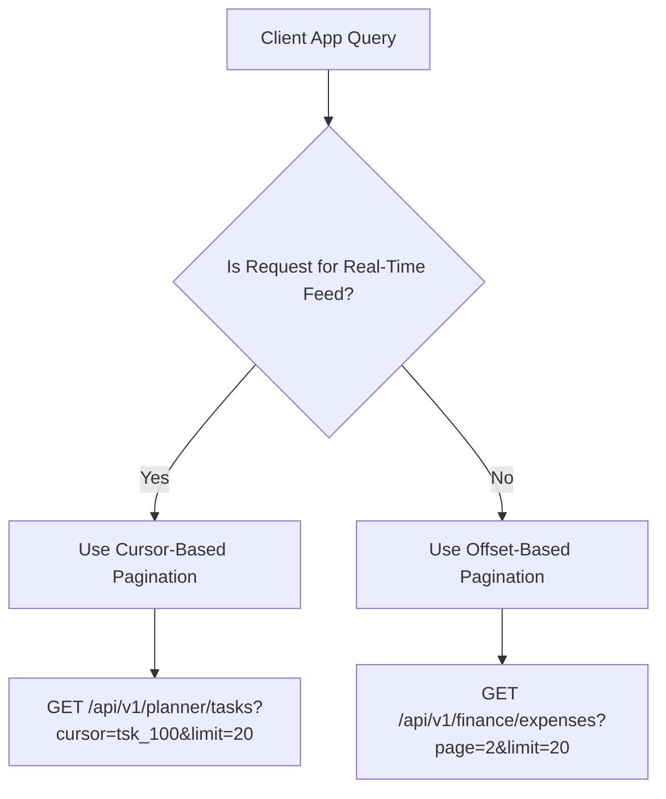

# Nexus AI Backend - REST API Design Standards & Guidelines

**Document Version:** 1.0.0  
**Author:** Principal Software Architect & Backend Engineering Lead  
**Last Updated:** July 25, 2026  

---

## Table of Contents
1. [Document Purpose](#1-document-purpose)
2. [Document Scope](#2-document-scope)
3. [REST Core Principles & URI Naming Standards](#3-rest-core-principles--uri-naming-standards)
4. [HTTP Verbs & Semantic Mappings](#4-http-verbs--semantic-mappings)
5. [API Versioning Strategy](#5-api-versioning-strategy)
6. [Standard Request & Response Contracts](#6-standard-request--response-contracts)
7. [Pagination, Sorting, Filtering & Search Standards](#7-pagination-sorting-filtering--search-standards)
8. [Bulk Operations & Idempotency Guidelines](#8-bulk-operations--idempotency-guidelines)
9. [HTTP Status Code & Header Standards](#9-http-status-code--header-standards)
10. [Backward Compatibility & API Deprecation Strategy](#10-backward-compatibility--api-deprecation-strategy)
11. [OpenAPI (Swagger) Specification Rules](#11-openapi-swagger-specification-rules)
12. [Architectural Rationale & Trade-Off Analysis](#12-architectural-rationale--trade-off-analysis)
13. [Best Practices](#13-best-practices)
14. [Anti-Patterns & Common Mistakes](#14-anti-patterns--common-mistakes)
15. [Cross References](#15-cross-references)

---

## 1. Document Purpose

This document defines the official REST API design standards for the Nexus AI backend. It guarantees that all API endpoints exposed to mobile apps, web applications, and third-party integrations maintain uniform URI semantics, standardized JSON structures, predictable status codes, and robust versioning.

---

## 2. Document Scope

This specification applies to all HTTP REST endpoints exposed by NestJS controllers across all core user domains and infrastructure modules.

---

## 3. REST Core Principles & URI Naming Standards



### Mandatory URI Naming Rules
1. **Always Use Plural Nouns for Resources:** Collections are always plural (`/tasks`, `/expenses`, `/budgets`). Singular nouns are prohibited for collection endpoints.
2. **Kebab-Case Paths:** Resource URIs must be lower-case kebab-case (`/ai-mentor`, `/study-sessions`).
3. **No Verbs in URIs:** URIs represent nouns/resources, NOT actions. Use HTTP verbs to define actions.
   * ✅ **Correct:** `POST /api/v1/planner/tasks`
   * ❌ **Incorrect:** `POST /api/v1/planner/createTask` or `GET /api/v1/planner/getTasks`

---

## 4. HTTP Verbs & Semantic Mappings

| Method | CRUD Mapping | Idempotent? | Safe? | Success Status | Primary Usage |
| :--- | :--- | :---: | :---: | :---: | :--- |
| `GET` | Read | Yes | Yes | `200 OK` | Fetch resources or collections. |
| `POST` | Create / Execute | No | No | `201 Created` | Create new records or trigger complex operations (e.g., AI chat). |
| `PUT` | Complete Replace | Yes | No | `200 OK` | Replace an entire resource payload. |
| `PATCH` | Partial Update | No | No | `200 OK` | Update specific fields of an existing resource. |
| `DELETE` | Remove | Yes | No | `200 OK` / `204` | Soft or hard delete a resource by ID. |

---

## 5. API Versioning Strategy

* **Enforcement:** URI Path Versioning is strictly enforced across all controllers.
* **Standard Prefix:** `/api/v{major_version}/{domain}/{resource}`
* **Example:** `/api/v1/finance/budgets`
* **Rule:** Breaking changes (renaming fields, removing endpoints) mandate incrementing to `/v2`. Non-breaking additions (new optional fields) remain under `/v1`.

---

## 6. Standard Request & Response Contracts

### 6.1 Success Response Wrapper
All successful non-paginated API responses are wrapped in a unified JSON envelope by a NestJS Response Interceptor:

```json
{
  "statusCode": 200,
  "success": true,
  "data": {
    "taskId": "tsk_87654321",
    "title": "Data Structures Assignment",
    "dueDate": "2026-07-28T23:59:00.000Z",
    "priority": "HIGH"
  },
  "timestamp": "2026-07-25T18:30:00.000Z"
}
```

### 6.2 Error Response Wrapper
All HTTP errors follow the RFC 7807 Problem Details envelope output by the Global Exception Filter:

```json
{
  "statusCode": 404,
  "success": false,
  "error": {
    "code": "TASK_NOT_FOUND",
    "message": "Task with ID 'tsk_87654321' was not found.",
    "details": null
  },
  "timestamp": "2026-07-25T18:30:00.000Z",
  "correlationId": "req_abc123xyz789"
}
```

---

## 7. Pagination, Sorting, Filtering & Search Standards

### 7.1 Offset vs Cursor Pagination Standard



* **Standard Paginated Response Envelope:**
```json
{
  "statusCode": 200,
  "success": true,
  "data": [ ... ],
  "meta": {
    "page": 2,
    "limit": 20,
    "totalItems": 145,
    "totalPages": 8,
    "hasNextPage": true,
    "hasPreviousPage": true
  },
  "timestamp": "2026-07-25T18:30:00.000Z"
}
```

### 7.2 Sorting & Filtering Query Conventions
* **Sorting Syntax:** `?sort=dueDate:ASC` or `?sort=priority:DESC,createdAt:ASC`
* **Filtering Syntax:** `?filter.status=PENDING&filter.courseName=CS201`
* **Search Syntax:** `?search=algorithm` (Executes partial ILIKE match against indexed columns).

---

## 8. Bulk Operations & Idempotency Guidelines

* **Idempotency Header:** For sensitive `POST` requests (such as creating payment orders or logging expenses), clients MUST send an `Idempotency-Key: <UUIDv4>` header.
* **Bulk Processing Endpoint:** Batch creation/deletion endpoints must accept array bodies: `POST /api/v1/planner/tasks/bulk-delete` with body `{ "taskIds": ["id1", "id2"] }`.

---

## 9. HTTP Status Code & Header Standards

### Mandatory Custom Headers
* `X-Correlation-ID`: Unique request tracking ID injected into every response.
* `X-Response-Time-MS`: Execution duration in milliseconds.

### Status Code Mapping Table
* `200 OK`: Successful read/update/delete operation.
* `201 Created`: Successful resource creation via `POST`.
* `400 Bad Request`: Validation failure or malformed JSON payload.
* `401 Unauthorized`: Missing, invalid, or expired JWT Access Token.
* `403 Forbidden`: Authenticated user lacks permission role for endpoint.
* `404 Not Found`: Target resource ID does not exist.
* `409 Conflict`: Resource state conflict (e.g., duplicate email address registration).
* `429 Too Many Requests`: Client exceeded rate limit thresholds.
* `500 Internal Server Error`: Unhandled server exception.

---

## 10. Backward Compatibility & API Deprecation Strategy

1. **Deprecation Notice Header:** When an endpoint version is scheduled for sunsetting, the response includes `Sunset: Wed, 11 Nov 2026 00:00:00 GMT` and `Deprecation: @1.2.0`.
2. **Minimum Support Window:** Old major versions (`/v1`) remain supported for a minimum of 6 months after `/v2` releases.

---

## 11. OpenAPI (Swagger) Specification Rules

* **Swagger Endpoint:** Exposed at `/api/docs` in non-production environments.
* **Mandatory Decorators:** Every controller action must be decorated with `@ApiOperation()`, `@ApiResponse()`, `@ApiBearerAuth()`, and `@ApiParam()`.

---

## 12. Architectural Rationale & Trade-Off Analysis

### Decision: URI Path Versioning (`/v1/`) vs Header Versioning (`Accept: application/vnd.nexus.v1+json`)

| Evaluation Vector | Header-Based Versioning | Path-Based Versioning (`/api/v1/`) |
| :--- | :--- | :--- |
| **Architectural Rationale** | Conceptually pure REST; keeps URIs static. | Chosen for Nexus AI. Maximum visibility, simple routing, easy testing in browser/Swagger. |
| **Advantages** | Clean URI paths. | Highly explicit, easy caching key generation in Nginx/CDNs, simple client integration. |
| **Disadvantages** | Difficult to test manually in browser; complex Swagger setup. | Modifies resource URI string. |
| **Scalability Impact** | Neutral. | Positive; Nginx reverse proxies route `/v1/` and `/v2/` to separate container clusters effortlessly. |
| **Maintainability Impact**| Low visibility. | Extremely high visibility for mobile engineering teams. |

---

## 13. Best Practices

1. **Use HTTP Status Codes Accurately:** Never return `200 OK` with `{ "error": "User not found" }`.
2. **Enforce JSON Contracts:** Always return `application/json` content type for non-media endpoints.

---

## 14. Anti-Patterns & Common Mistakes

* ❌ **Verb Infiltration:** Endpoint named `/api/v1/planner/delete-task-by-id` instead of `DELETE /api/v1/planner/tasks/:id`.
* ❌ **Unpaginated Collection Endpoints:** Returning an unbounded array of 10,000 expense records in one response.

---

## 15. Cross References

* [02-functional-requirements.md](file:///d:/Nexus-AI/backend/docs/02-functional-requirements.md)
* [04-high-level-architecture.md](file:///d:/Nexus-AI/backend/docs/04-high-level-architecture.md)
* [13-error-handling.md](file:///d:/Nexus-AI/backend/docs/13-error-handling.md)
