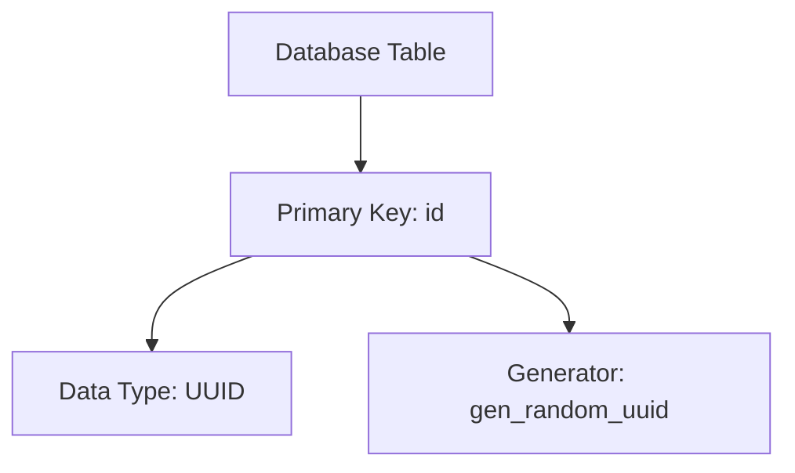
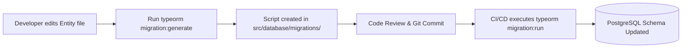
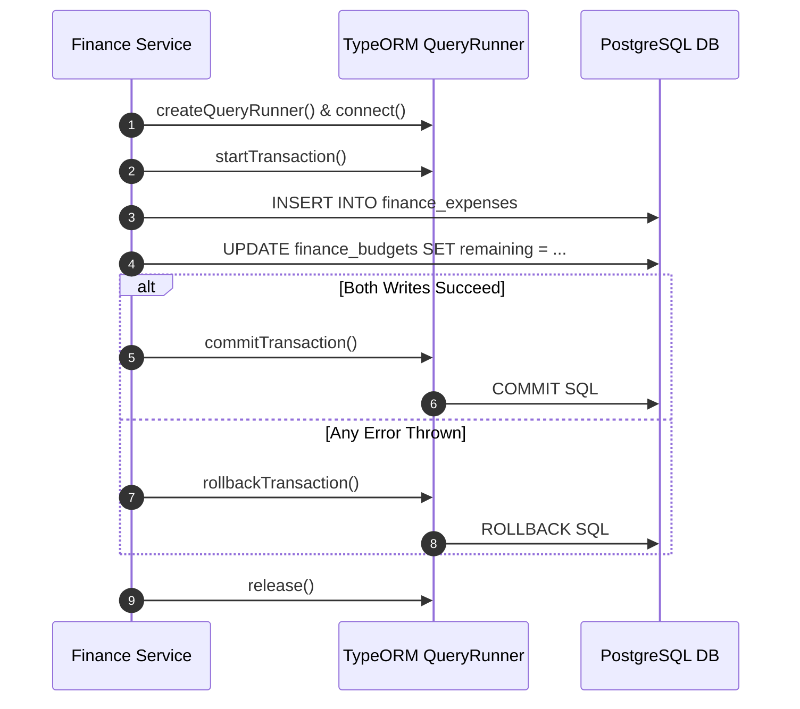
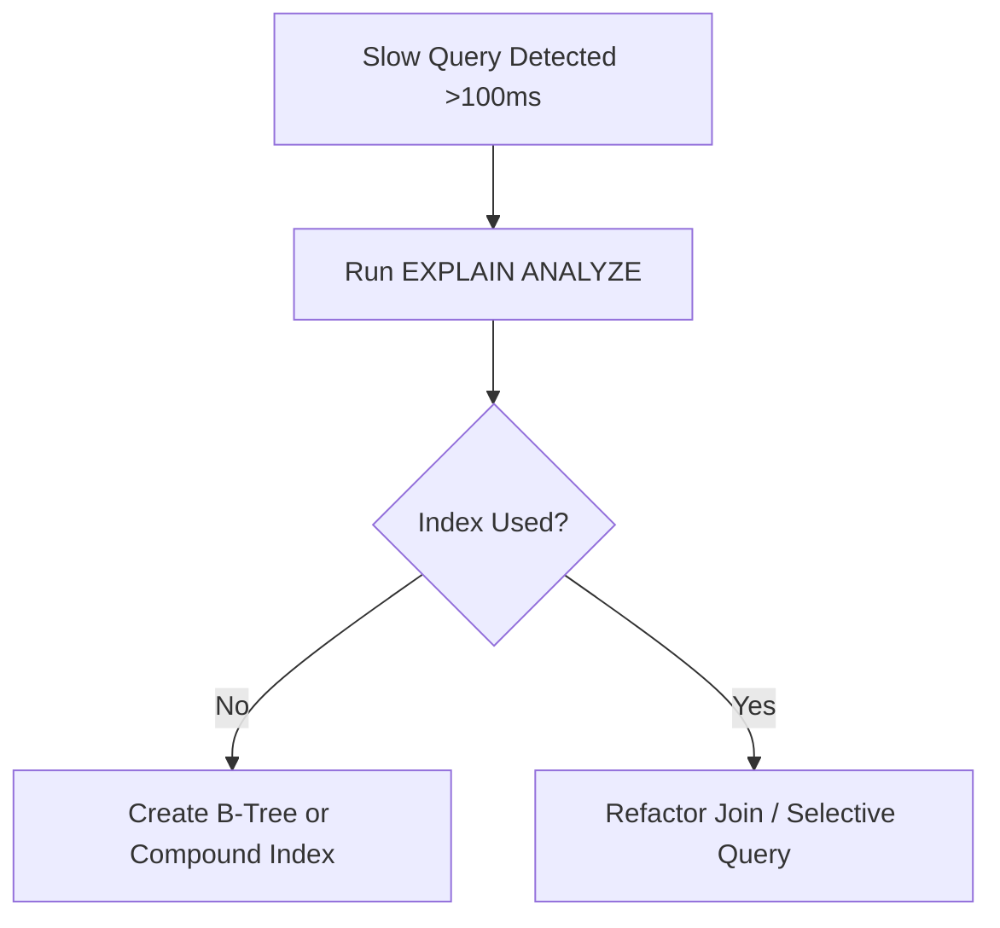

# Nexus AI Backend - PostgreSQL Database Guidelines & Schema Standards

**Document Version:** 1.0.0  
**Author:** Principal Software Architect & Backend Engineering Lead  
**Last Updated:** July 25, 2026  

---

## Table of Contents
1. [Document Purpose](#1-document-purpose)
2. [Document Scope](#2-document-scope)
3. [Strict Relational Naming Conventions](#3-strict-relational-naming-conventions)
4. [Primary Key & UUID v4 Strategy](#4-primary-key--uuid-v4-strategy)
5. [Mandatory Audit Columns & Soft Delete Policy](#5-mandatory-audit-columns--soft-delete-policy)
6. [TypeORM Migration & Schema Versioning Strategy](#6-typeorm-migration--schema-versioning-strategy)
7. [Database Seeding & Test Data Strategy](#7-database-seeding--test-data-strategy)
8. [Transactional Boundaries & Isolation Levels](#8-transactional-boundaries--isolation-levels)
9. [Entity Relationship Guidelines & Cardinality Rules](#9-entity-relationship-guidelines--cardinality-rules)
10. [Indexing Strategy & Performance Tuning](#10-indexing-strategy--performance-tuning)
11. [Future Table Partitioning Blueprint](#11-future-table-partitioning-blueprint)
12. [Architectural Rationale & Trade-Off Analysis](#12-architectural-rationale--trade-off-analysis)
13. [Best Practices](#13-best-practices)
14. [Anti-Patterns & Common Mistakes](#14-anti-patterns--common-mistakes)
15. [Cross References](#15-cross-references)

---

## 1. Document Purpose

This document defines the database engineering guidelines, relational naming standards, migration procedures, transaction policies, indexing rules, and performance optimization techniques for PostgreSQL operating under TypeORM within the Nexus AI backend.

---

## 2. Document Scope

This specification applies to all database tables, columns, indexes, constraints, migrations, seeders, TypeORM entity definitions, and raw SQL queries across the PostgreSQL database.

---

## 3. Strict Relational Naming Conventions

To guarantee consistency between TypeORM JavaScript models and PostgreSQL storage engines, lower-case snake_case is strictly mandated for all database identifiers:

| Database Object | Naming Format | Prefix / Suffix Rule | Correct Example | Incorrect Anti-Example |
| :--- | :--- | :--- | :--- | :--- |
| **Tables** | `lower_snake_case` | Plural Noun + Module Prefix | `planner_tasks` | `PlannerTasks`, `task`, `tblTasks` |
| **Columns** | `lower_snake_case` | Singular Noun | `due_date` | `dueDate`, `DueDate`, `d_date` |
| **Foreign Keys** | `lower_snake_case` | Target Table Singular + `_id` | `user_id` | `userId`, `user_fk`, `id_user` |
| **Primary Keys** | `lower_snake_case` | Always `id` | `id` | `task_id`, `uuid`, `PK_ID` |
| **Indexes** | `lower_snake_case` | `idx_<table_short>_<column>` | `idx_tasks_user_due` | `index1`, `UserDueIndex` |
| **Unique Keys** | `lower_snake_case` | `uq_<table_short>_<column>` | `uq_users_email` | `unique_email`, `EmailConstraint` |
| **Foreign Key Constraint** | `lower_snake_case` | `fk_<table_short>_<ref_table>` | `fk_tasks_users` | `FK_12345` |
| **Check Constraints** | `lower_snake_case` | `chk_<table_short>_<col>` | `chk_tasks_difficulty` | `check_diff` |

---

## 4. Primary Key & UUID v4 Strategy

* **Standard:** All database tables MUST use UUID v4 as their primary key type (`id UUID PRIMARY KEY DEFAULT gen_random_uuid()`).
* **Rationale:** Eliminates sequential ID enumeration security risks (e.g., scraping `/tasks/1`, `/tasks/2`), prevents primary key collisions during future database shard migrations, and allows client applications to generate IDs offline.

---

## 5. Mandatory Audit Columns & Soft Delete Policy

Every primary database table MUST include four standard audit tracking columns:

| Audit Column | PostgreSQL Data Type | Default Value | Purpose |
| :--- | :--- | :--- | :--- |
| `created_at` | `TIMESTAMPTZ` | `NOW()` | Records initial row creation timestamp in UTC. |
| `updated_at` | `TIMESTAMPTZ` | `NOW()` | Automatically updated via trigger/TypeORM on row mutation. |
| `deleted_at` | `TIMESTAMPTZ` | `NULL` | Soft delete timestamp. Non-null indicates logical deletion. |
| `created_by` | `UUID` | `NULL` | Foreign key referencing the user/system process initiating write. |

### Soft Delete Enforcement Policy
* Physical `DELETE` SQL statements are strictly prohibited for core business data (`users`, `tasks`, `expenses`).
* Queries must append `WHERE deleted_at IS NULL`. TypeORM's `@DeleteDateColumn()` decorator manages this automatically.

---

## 6. TypeORM Migration & Schema Versioning Strategy

* **Rule 1: Synchronize Disabled:** `synchronize: false` MUST be enforced in TypeORM configuration across ALL environments. Automatic schema sync causes silent data destruction.
* **Rule 2: Version Controlled Migrations:** All schema alterations MUST be executed via version-controlled migration files in `src/database/migrations/`.
* **Rule 3: Reversible Migrations:** Every migration script must implement both `up()` (apply schema change) and `down()` (revert schema change) methods.

---

## 7. Database Seeding & Test Data Strategy

* **Directory:** Seed scripts reside in `src/database/seeds/`.
* **Behavior:** Seeds populate baseline lookup data (e.g., default expense categories, subscription plan tiers) and realistic mock data for local development. Seeders must check record existence prior to insertion to ensure idempotency.

---

## 8. Transactional Boundaries & Isolation Levels

* **Standard Isolation Level:** `READ COMMITTED` (PostgreSQL default).
* **Multi-Entity Write Operations:** Operations spanning multiple tables (e.g., deducting allowance and creating expense entry simultaneously) MUST be wrapped in a TypeORM `QueryRunner` transaction:

---

## 9. Entity Relationship Guidelines & Cardinality Rules

1. **One-to-Many / Many-to-One:** Foreign key resides on the "Many" side table (`planner_tasks.user_id` -> `auth_users.id`).
2. **Many-to-Many:** Must utilize explicit junction tables with composite primary keys (`user_skills` table linking `user_id` and `skill_id`). Direct TypeORM `@ManyToMany()` without explicit junction entity is prohibited.

---

## 10. Indexing Strategy & Performance Tuning

* **Mandatory Indexing Rules:**
  1. Create B-Tree indexes on all foreign key columns (`user_id`, `task_id`).
  2. Create compound indexes for frequent multi-column queries (e.g., `(user_id, due_date)` on `planner_tasks`).
  3. Use Partial Indexes for active records: `CREATE INDEX idx_active_tasks ON planner_tasks(user_id) WHERE deleted_at IS NULL`.

---

## 11. Future Table Partitioning Blueprint

When `finance_expenses` exceeds 10,000,000 rows, PostgreSQL Range Partitioning by `spent_at` date will be activated (e.g., `finance_expenses_y2026m07`), maintaining fast query performance without restructuring application entities.

---

## 12. Architectural Rationale & Trade-Off Analysis

### Decision: UUID v4 Primary Keys vs Auto-Incrementing BigInt

| Evaluation Vector | Auto-Incrementing BigInt | UUID v4 (`gen_random_uuid()`) |
| :--- | :--- | :--- |
| **Architectural Rationale** | Slightly smaller storage footprint (8 bytes vs 16 bytes). | Chosen for Nexus AI. Guarantees security, distributed ID generation, and sharding safety. |
| **Advantages** | Trivial B-Tree index sorting. | Prevents resource enumeration attacks (`/users/100`), allows offline mobile ID creation. |
| **Disadvantages** | Security vulnerability; reveals transaction volume; collision risk in distributed DBs. | Slightly larger index size; non-sequential B-Tree page splits (mitigated by PG 16 optimizations). |
| **Scalability Impact** | Severe bottleneck when sharding across multi-region databases. | Exceptional horizontal sharding compatibility. |
| **Maintainability Impact**| Medium. | High. |

---

## 13. Best Practices

1. **Explicit Data Types:** Use explicit precision for financial currency (`NUMERIC(10,2)`). Never use floating point (`FLOAT`, `DOUBLE`) for money.
2. **Timestamps in UTC:** Always use `TIMESTAMPTZ` (Timestamp with Time Zone) to store all date-time values.

---

## 14. Anti-Patterns & Common Mistakes

* ❌ **N+1 Query Problem:** Fetching a list of tasks and loop-querying the database to fetch user details for each task. *Fix:* Use TypeORM `relations` or query builder joins.
* ❌ **Missing Foreign Key Indexes:** Leaving foreign key columns unindexed, causing sequential table scans during joins.

---

## 15. Cross References

* [04-high-level-architecture.md](file:///d:/Nexus-AI/backend/docs/04-high-level-architecture.md)
* [07-module-breakdown.md](file:///d:/Nexus-AI/backend/docs/07-module-breakdown.md)
* [13-error-handling.md](file:///d:/Nexus-AI/backend/docs/13-error-handling.md)
