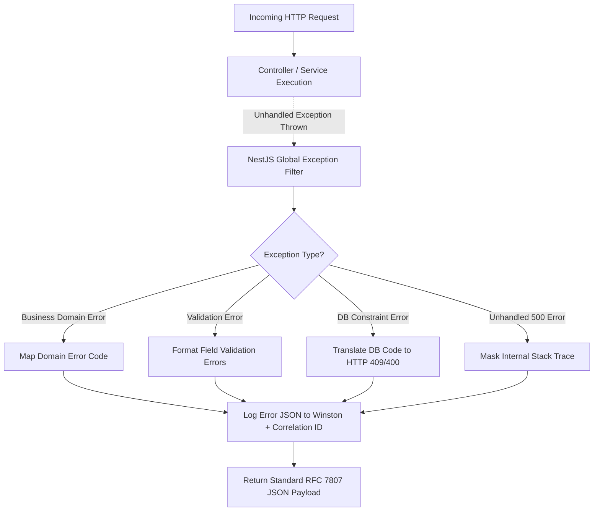
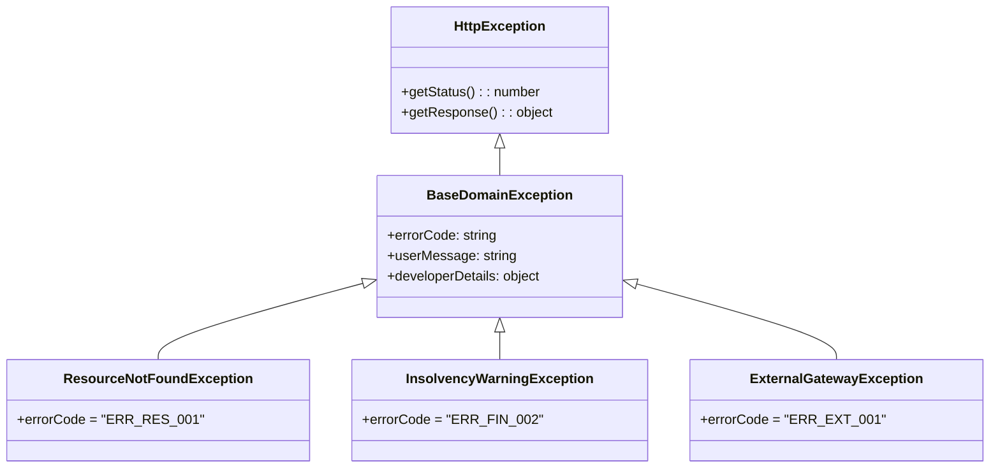
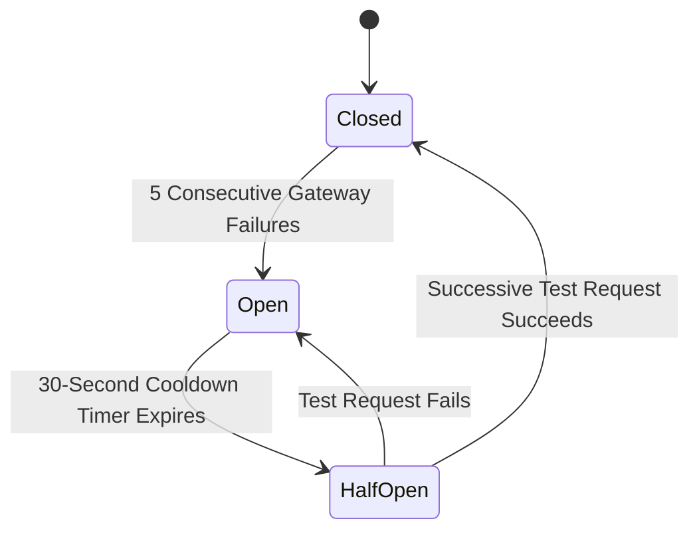

# Nexus AI Backend - Error Handling Architecture & Taxonomy

**Document Version:** 1.0.0  
**Author:** Principal Software Architect & Backend Engineering Lead  
**Last Updated:** July 25, 2026  

---

## Table of Contents
1. [Document Purpose](#1-document-purpose)
2. [Document Scope](#2-document-scope)
3. [Global Exception Architecture Overview](#3-global-exception-architecture-overview)
4. [Custom Domain Exception Taxonomy](#4-custom-domain-exception-taxonomy)
5. [Validation & DTO Error Handling](#5-validation--dto-error-handling)
6. [Authentication & Authorization Exception Pipeline](#6-authentication--authorization-exception-pipeline)
7. [Database Exception Translation Layer](#7-database-exception-translation-layer)
8. [Third-Party Integration Resiliency & Circuit Breakers](#8-third-party-integration-resiliency--circuit-breakers)
9. [Standardized RFC 7807 Error Response Schema](#9-standardized-rfc-7807-error-response-schema)
10. [Master Custom Error Code Registry](#10-master-custom-error-code-registry)
11. [Logging, Masking & Correlation ID Policy](#11-logging-masking--correlation-id-policy)
12. [User-Friendly vs Developer-Friendly Error Strategy](#12-user-friendly-vs-developer-friendly-error-strategy)
13. [Architectural Rationale & Trade-Off Analysis](#13-architectural-rationale--trade-off-analysis)
14. [Best Practices](#14-best-practices)
15. [Anti-Patterns & Common Mistakes](#15-anti-patterns--common-mistakes)
16. [Cross References](#16-cross-references)

---

## 1. Document Purpose

This document defines the error handling strategy, exception taxonomy, resiliency patterns, custom error codes, and exception filter architectures for the Nexus AI backend. It guarantees that unexpected system errors are caught, logged with correlation contexts, transformed into secure RFC 7807 JSON payloads, and gracefully handled across all execution paths.

---

## 2. Document Scope

This specification applies to all NestJS exception filters, business service error handlers, TypeORM query catch blocks, authentication guards, and external HTTP integration gateways (Google Gemini, Cloudinary, FCM, Razorpay).

---

## 3. Global Exception Architecture Overview



---

## 4. Custom Domain Exception Taxonomy

All domain-specific errors inherit from a base `BaseDomainException` extending NestJS `HttpException`. This enables domain services to throw rich, context-aware errors without coupling business logic to HTTP status code mappings.



---

## 5. Validation & DTO Error Handling

* **Interceptor:** NestJS global `ValidationPipe`.
* **Behavior:** Intercepts invalid request payloads prior to controller execution and returns an HTTP 400 Bad Request detailing every invalid property:

```json
{
  "statusCode": 400,
  "success": false,
  "error": {
    "code": "ERR_VAL_001",
    "message": "Input validation failed for 2 fields.",
    "details": [
      { "field": "email", "issue": "email must be a valid email address" },
      { "field": "password", "issue": "password must be longer than or equal to 8 characters" }
    ]
  },
  "timestamp": "2026-07-25T18:30:00.000Z",
  "correlationId": "req_abc123"
}
```

---

## 6. Authentication & Authorization Exception Pipeline

1. **JWT Expiration / Invalid Token:** Passport `JwtStrategy` throws `UnauthorizedException` -> Translated to HTTP 401 with code `ERR_AUTH_EXPIRED` or `ERR_AUTH_INVALID`.
2. **Role Permission Failure:** NestJS `RolesGuard` throws `ForbiddenException` -> Translated to HTTP 403 with code `ERR_AUTH_FORBIDDEN`.

---

## 7. Database Exception Translation Layer

Low-level TypeORM / PostgreSQL errors MUST NOT leak to client applications. The Global Exception Filter catches TypeORM `QueryFailedError` instances and translates native driver error codes:

| PostgreSQL Driver Error Code | Description | Translated HTTP Status | Mapped Error Code |
| :--- | :--- | :---: | :--- |
| `23505` | Unique Constraint Violation (e.g., duplicate email) | `409 Conflict` | `ERR_DB_DUPLICATE_ENTRY` |
| `23503` | Foreign Key Violation (e.g., invalid `user_id`) | `400 Bad Request` | `ERR_DB_INVALID_REFERENCE` |
| `23514` | Check Constraint Violation (e.g., negative budget) | `400 Bad Request` | `ERR_DB_CONSTRAINT_FAILED` |
| `40001` | Serialization Failure / Deadlock | `503 Service Unavailable` | `ERR_DB_DEADLOCK_RETRY` |

---

## 8. Third-Party Integration Resiliency & Circuit Breakers

When communicating with external integrations (Google Gemini, Cloudinary, FCM, Razorpay):



* **Circuit Breaker Policy:** If Google Gemini API returns 5 consecutive 5xx errors or timeouts within 30 seconds, trip circuit breaker to `OPEN` state.
* **Fallback Behavior:** When circuit is `OPEN`, immediately execute local fallback logic (e.g., return cached study tips) without attempting network HTTP calls to Gemini API.

---

## 9. Standardized RFC 7807 Error Response Schema

All error responses strictly comply with RFC 7807 (Problem Details for HTTP APIs):

```json
{
  "statusCode": 404,
  "success": false,
  "error": {
    "code": "ERR_PLAN_001",
    "message": "The requested assignment task does not exist or has been deleted.",
    "details": {
      "resource": "TaskEntity",
      "identifier": "tsk_999999"
    }
  },
  "timestamp": "2026-07-25T18:30:00.000Z",
  "correlationId": "req_f89a7b6c5d"
}
```

---

## 10. Master Custom Error Code Registry

| Error Code | HTTP Status | Domain | Description |
| :--- | :---: | :--- | :--- |
| `ERR_AUTH_001` | 401 | Auth | Invalid email or password credentials. |
| `ERR_AUTH_002` | 401 | Auth | Expired or malformed Refresh Token. |
| `ERR_PLAN_001` | 404 | Planner | Target assignment or task ID not found. |
| `ERR_FIN_001` | 400 | Finance | Expenditure exceeds monthly budget threshold limits. |
| `ERR_AI_001` | 503 | AI Mentor | Gemini API gateway timeout or quota depletion. |
| `ERR_UPL_001` | 413 | Uploads | Uploaded binary file exceeds 5MB size limit. |
| `ERR_PAY_001` | 400 | Payments | Razorpay HMAC SHA256 webhook signature mismatch. |

---

## 11. Logging, Masking & Correlation ID Policy

* **Winston Integration:** Every exception caught by the Global Exception Filter writes an `error` log entry containing `correlationId`, `userId`, `stack`, `path`, and `body`.
* **Data Masking Policy:** Passwords, credit card tokens, JWT secret keys, and bcrypt hashes MUST be scrubbed/masked (`***MASKED***`) before writing log outputs.

---

## 12. User-Friendly vs Developer-Friendly Error Strategy

* **Production Environment (`NODE_ENV=production`):** Stack traces (`error.stack`) are completely stripped from HTTP responses. Client receives clean, safe `message` strings.
* **Development Environment (`NODE_ENV=development`):** Full TypeScript stack traces and raw query payloads are attached to the `error.details` object to enable rapid debugging.

---

## 13. Architectural Rationale & Trade-Off Analysis

### Decision: Centralized Global Exception Filter vs Controller-Level Try/Catch Blocks

| Evaluation Vector | Local Try/Catch Blocks in Controllers | Centralized Global Exception Filter |
| :--- | :--- | :--- |
| **Architectural Rationale** | Verbose, repetitive code across hundreds of controller endpoints. | Chosen for Nexus AI. Intercepts all unhandled errors at application boundary. |
| **Advantages** | Granular local control. | Eliminates code duplication, guarantees 100% uniform error JSON schemas, prevents stack leaks. |
| **Disadvantages** | Easy to miss catch blocks; leads to inconsistent error responses. | Requires proper custom exception hierarchy setup. |
| **Scalability Impact** | Neutral. | High maintainability; updating error response schema requires editing 1 file. |
| **Maintainability Impact**| Very Low. | Extremely High. |

---

## 14. Best Practices

1. **Throw Specific Exceptions:** Throw `TaskNotFoundException` rather than generic `HttpException('Not found', 404)`.
2. **Include Correlation IDs:** Always include `X-Correlation-ID` in error log outputs for distributed tracing.

---

## 15. Anti-Patterns & Common Mistakes

* ❌ **Swallowing Stack Traces in Logs:** Logging `logger.error(err.message)` without passing `err.stack`.
* ❌ **Leaking Internal DB Error Strings:** Exposing raw PostgreSQL error string `relation "users" does not exist` to mobile app clients.

---

## 16. Cross References

* [03-non-functional-requirements.md](file:///d:/Nexus-AI/backend/docs/03-non-functional-requirements.md)
* [06-system-components.md](file:///d:/Nexus-AI/backend/docs/06-system-components.md)
* [11-api-standards.md](file:///d:/Nexus-AI/backend/docs/11-api-standards.md)
