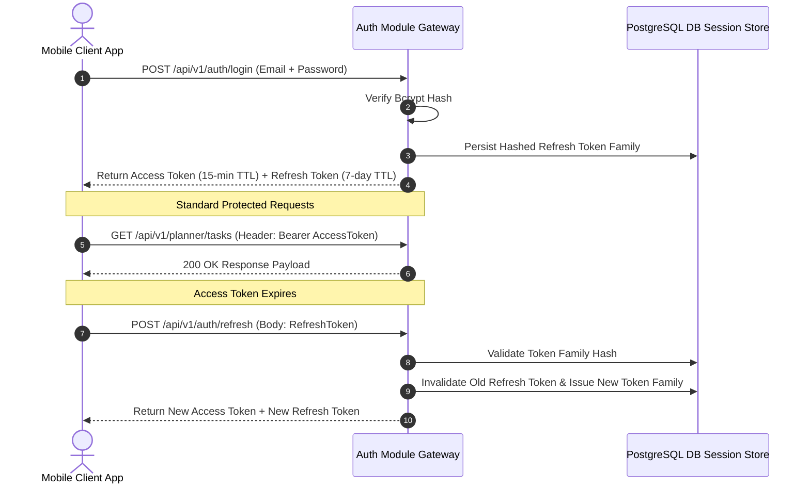
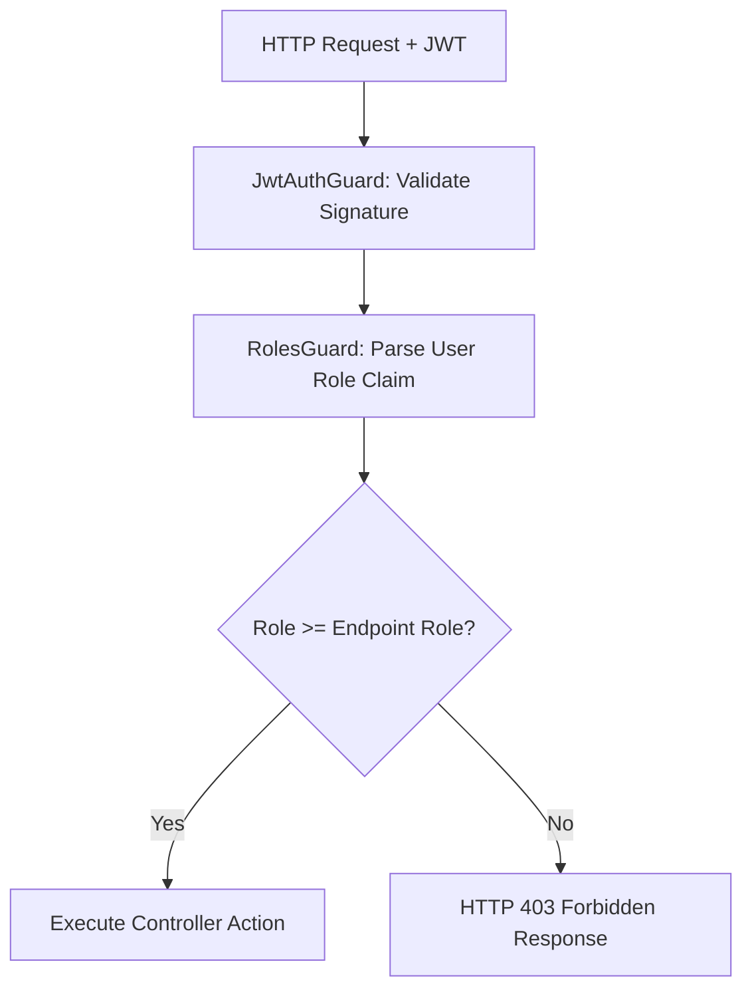
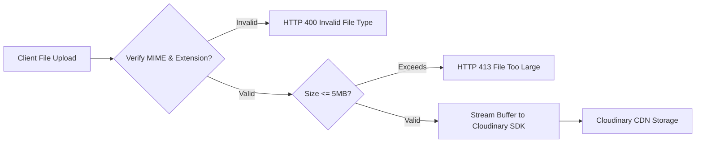

# Nexus AI Backend - Security Architecture & Guidelines

**Document Version:** 1.0.0  
**Author:** Principal Software Architect & Backend Engineering Lead  
**Last Updated:** July 25, 2026  

---

## Table of Contents
1. [Document Purpose](#1-document-purpose)
2. [Document Scope](#2-document-scope)
3. [Authentication Architecture & JWT Lifecycle](#3-authentication-architecture--jwt-lifecycle)
4. [Authorization & Role-Based Access Control (RBAC)](#4-authorization--role-based-access-control-rbac)
5. [Password Security & Hashing Standards](#5-password-security--hashing-standards)
6. [Rate Limiting & Anti-DDoS Defenses](#6-rate-limiting--anti-ddos-defenses)
7. [HTTP Headers Security (Helmet & CORS)](#7-http-headers-security-helmet--cors)
8. [Input Validation & Output Sanitization](#8-input-validation--output-sanitization)
9. [SQL Injection & Cross-Site Scripting (XSS) Defenses](#9-sql-injection--cross-site-scripting-xss-defenses)
10. [CSRF Considerations & Token Strategies](#10-csrf-considerations--token-strategies)
11. [Secrets Management & Environment Hardening](#11-secrets-management--environment-hardening)
12. [File Upload Security & Cloudinary Policies](#12-file-upload-security--cloudinary-policies)
13. [OWASP Top 10 Mitigation Matrix](#13-owasp-top-10-mitigation-matrix)
14. [Architectural Rationale & Trade-Off Analysis](#14-architectural-rationale--trade-off-analysis)
15. [Best Practices](#15-best-practices)
16. [Anti-Patterns & Common Mistakes](#16-anti-patterns--common-mistakes)
17. [Cross References](#17-cross-references)

---

## 1. Document Purpose

This document defines the official security architecture, threat defense mechanisms, cryptographic standards, access control policies, and compliance guidelines for the Nexus AI backend. It ensures the application is hardened against security vulnerabilities and complies with industry best practices.

---

## 2. Document Scope

This specification applies to all HTTP endpoints, JWT authentication lifecycles, database access patterns, file upload pipelines, secrets handling, third-party integrations, and containerized runtime environments.

---

## 3. Authentication Architecture & JWT Lifecycle

Nexus AI uses a stateless JSON Web Token (JWT) architecture featuring short-lived Access Tokens paired with long-lived Refresh Tokens using token rotation detection.

### Security Rules for Tokens
1. **Access Token TTL:** Strictly set to **15 minutes**. Signed using HMAC SHA-256 (`HS256`).
2. **Refresh Token TTL:** Set to **7 days**. Stored in PostgreSQL as a Bcrypt hash.
3. **Token Reuse Detection:** If an invalidated Refresh Token is presented, the system detects a breach and instantly revokes all tokens associated with that user's token family.

---

## 4. Authorization & Role-Based Access Control (RBAC)

Access control is enforced using NestJS `@Roles()` decorators parsed by a global `RolesGuard`:

---

## 5. Password Security & Hashing Standards

* **Algorithm:** `bcrypt`.
* **Cost Factor:** Mandatory work factor of **12** (requires ~250ms computation time per password hash, balancing CPU load with resistance against brute-force attacks).
* **Password Policy:** Minimum 8 characters, at least 1 uppercase letter, 1 lowercase letter, 1 number, and 1 special symbol (`@$!%*?&`).

---

## 6. Rate Limiting & Anti-DDoS Defenses

* **Framework:** `@nestjs/throttler`.
* **Standard Limit:** 100 requests per minute per client IP address.
* **Sensitive Endpoints (`/auth/login`, `/auth/register`):** Restricted to **5 requests per minute** per IP address to eliminate brute-force authentication attacks.

---

## 7. HTTP Headers Security (Helmet & CORS)

### 7.1 Security Headers via Helmet
Every HTTP response emitted by NestJS is injected with hardened security headers via `helmet()` middleware:
* `Strict-Transport-Security: max-age=31536000; includeSubDomains; preload` (HSTS)
* `X-Content-Type-Options: nosniff`
* `X-Frame-Options: DENY`
* `Content-Security-Policy: default-src 'self'`

### 7.2 Strict CORS Policy
CORS is configured to reject requests from unauthorized origins. Production origins must be explicitly whitelisted via `CORS_ALLOWED_ORIGINS` environment variables. Wildcard `Access-Control-Allow-Origin: *` is strictly prohibited in production.

---

## 8. Input Validation & Output Sanitization

1. **Strict DTO Parsing:** Global `ValidationPipe` configured with `whitelist: true` and `forbidNonWhitelisted: true`, stripping unknown fields and throwing HTTP 400 on unexpected parameters.
2. **HTML Scrubbing:** All user-submitted text fields (task titles, bio notes) are sanitized via `dompurify` / `sanitize-html` to remove malicious script tags before database persistence.

---

## 9. SQL Injection & Cross-Site Scripting (XSS) Defenses

* **SQL Injection Prevention:** 100% of database queries execute through TypeORM parameterized object queries or parameterized query builders (`.where("task.id = :id", { id })`). Concatenating raw string variables into SQL statements is prohibited.
* **XSS Prevention:** Output responses are JSON-encoded. Front-end Flutter clients render text via native UI components, preventing script execution.

---

## 10. CSRF Considerations & Token Strategies

* **Mobile API Architecture:** Because mobile apps transmit credentials via `Authorization: Bearer <JWT>` HTTP headers rather than implicit browser cookies, classic Cross-Site Request Forgery (CSRF) is inherently mitigated.
* **Web Client Rule:** If web clients adopt cookie authentication, `SameSite=Strict` and `HttpOnly` cookie flags are mandatory.

---

## 11. Secrets Management & Environment Hardening

1. **Zero Hardcoded Secrets:** API keys, database credentials, and JWT signing keys MUST be injected via environment variables.
2. **Boot Validation:** Application startup fails instantly if required secrets fail Joi schema checks.
3. **Secret Storage:** Production secrets stored in Docker Secrets or AWS Secrets Manager.

---

## 12. File Upload Security & Cloudinary Policies

* **MIME Verification:** Verify magic number buffer bytes (not just file extension string) to enforce permitted types (`image/jpeg`, `image/png`, `application/pdf`).
* **Maximum File Size:** Fixed cap at **5 Megabytes (MB)** per upload request.

---

## 13. OWASP Top 10 Mitigation Matrix

| OWASP Threat Category | Architectural Mitigation Strategy |
| :--- | :--- |
| **A01: Broken Access Control** | Enforce `JwtAuthGuard` + `RolesGuard` on 100% of non-public routes. Validate resource ownership (`user_id`). |
| **A02: Cryptographic Failures** | Mandatory TLS 1.3 in transit; AES-256 for sensitive DB fields; Bcrypt (cost 12) for passwords. |
| **A03: Injection (SQLi/XSS)** | TypeORM parameterized queries; DTO validation pipes; string input sanitization. |
| **A04: Insecure Design** | Threat modeling documentation; rate limiting on auth endpoints; strict modular boundaries. |
| **A05: Security Misconfiguration**| Helmet HTTP security headers; disable `x-powered-by`; production CORS whitelisting. |

---

## 14. Architectural Rationale & Trade-Off Analysis

### Decision: Bcrypt Work Factor 12 vs Argon2id

| Evaluation Vector | Argon2id | Bcrypt (Cost Factor 12) |
| :--- | :--- | :--- |
| **Architectural Rationale** | Slightly superior memory-hard resistance against GPU cracking. | Chosen for Nexus AI. Native Node.js bindings, battle-tested ecosystem, zero native compilation issues in Alpine Docker containers. |
| **Advantages** | Winning password hashing algorithm. | Extremely reliable cross-platform stability, zero native build failures during Docker image generation. |
| **Disadvantages** | Heavy C++ compilation requirement during Node image builds. | Slightly higher CPU-bound compute footprint under high concurrency. |
| **Scalability Impact** | Neutral. | Controlled via cost factor configuration. |
| **Maintainability Impact**| Medium. | High. |

---

## 15. Best Practices

1. **Principle of Least Privilege:** Database container connects using a non-superuser PostgreSQL role restricted to a single schema.
2. **Never Log Passwords:** Ensure passwords and raw JWT tokens are scrubbed from Winston log files.

---

## 16. Anti-Patterns & Common Mistakes

* ❌ **Storing Passwords in Plaintext or MD5:** Using weak hashing algorithms like MD5 or SHA1.
* ❌ **Long-Lived Access Tokens:** Issuing 30-day Access Tokens, exposing users to hijacking risks.

---

## 17. Cross References

* [03-non-functional-requirements.md](file:///d:/Nexus-AI/backend/docs/03-non-functional-requirements.md)
* [06-system-components.md](file:///d:/Nexus-AI/backend/docs/06-system-components.md)
* [13-error-handling.md](file:///d:/Nexus-AI/backend/docs/13-error-handling.md)
