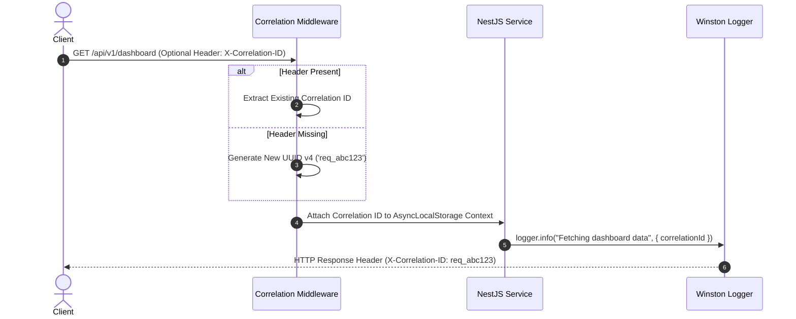
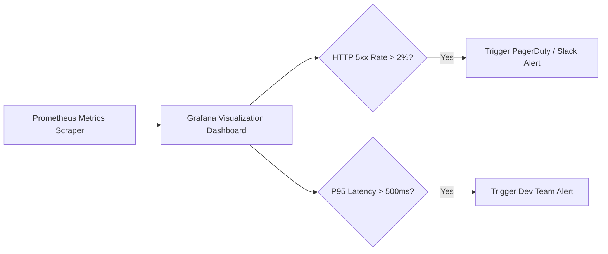

# Nexus AI Backend - Logging, Monitoring & Observability Architecture

**Document Version:** 1.0.0  
**Author:** Principal Software Architect & Backend Engineering Lead  
**Last Updated:** July 25, 2026  

---

## Table of Contents
1. [Document Purpose](#1-document-purpose)
2. [Document Scope](#2-document-scope)
3. [Logging Architecture & Winston Setup](#3-logging-architecture--winston-setup)
4. [Log Categories & Taxonomy](#4-log-categories--taxonomy)
5. [Structured JSON Logging Schema](#5-structured-json-logging-schema)
6. [Correlation ID Tracing Pipeline](#6-correlation-id-tracing-pipeline)
7. [Health Check Infrastructure (`@nestjs/terminus`)](#7-health-check-infrastructure-nestjster-minus)
8. [Prometheus Metrics & Performance Monitoring](#8-prometheus-metrics--performance-monitoring)
9. [Grafana Observability Dashboards & Alert Rules](#9-grafana-observability-dashboards--alert-rules)
10. [OpenTelemetry Readiness & Distributed Tracing](#10-opentelemetry-readiness--distributed-tracing)
11. [Architectural Rationale & Trade-Off Analysis](#11-architectural-rationale--trade-off-analysis)
12. [Best Practices](#12-best-practices)
13. [Anti-Patterns & Common Mistakes](#13-anti-patterns--common-mistakes)
14. [Cross References](#14-cross-references)

---

## 1. Document Purpose

This document defines the logging standards, correlation tracing pipeline, system health probes, Prometheus metrics exporter, alerting criteria, and OpenTelemetry observability architecture for the Nexus AI backend. It guarantees complete operational visibility into system performance and error diagnostics across all deployment environments.

---

## 2. Document Scope

This specification applies to all NestJS loggers, middleware interceptors, health check endpoints, metrics scrapers, and background job telemetry across local, staging, and production environments.

---

## 3. Logging Architecture & Winston Setup

Logging is powered by `winston` integrated into NestJS via `@nestjs-modules/winston`.

```mermaid
flowchart LR
    Req[Incoming HTTP Request] --> Mid[Correlation ID Middleware]
    Mid --> App[NestJS Business Logic Execution]
    
    App -->|Log Event| Winston[Winston Logger Core]
    
    Winston --> Console[Console Transport (JSON)]
    Winston --> FileErr[File Transport: error.log]
    Winston --> FileComb[File Transport: combined.log]
    
    Console --> Loki[Loki / Central Log Aggregator]
```

### Log Levels
* `error`: System failures requiring developer intervention (HTTP 5xx, unhandled exceptions, gateway failures).
* `warn`: Non-critical warnings (slow queries, retried network attempts, safe daily spend limit warnings).
* `info`: Normal operational events (successful user logins, background job executions, server boot).
* `debug`: Granular debugging information (service parameters, prompt context details - active ONLY in non-production).

---

## 4. Log Categories & Taxonomy

1. **Request Logs:** Captured by an interceptor for every HTTP request (Method, Path, Status Code, Response Time, IP).
2. **Error Logs:** Captured by the Global Exception Filter (Stack Trace, Request Payload, Correlation ID).
3. **Audit Logs:** Security events (Password resets, role changes, payment webhook processing).
4. **Performance Logs:** Database queries taking >100ms or external API calls taking >1,000ms.

---

## 5. Structured JSON Logging Schema

All log outputs strictly format as single-line JSON objects to enable seamless parsing by Loki, Elasticsearch, or Datadog:

```json
{
  "timestamp": "2026-07-25T18:30:00.123Z",
  "level": "error",
  "context": "PlannerService",
  "message": "Failed to calculate task priority score for task 'tsk_987'.",
  "correlationId": "req_8f7a6b5c4d",
  "userId": "usr_123456",
  "path": "/api/v1/planner/tasks",
  "method": "POST",
  "error": {
    "name": "InvalidTaskWeightException",
    "stack": "InvalidTaskWeightException: Task weight out of bounds\n    at PlannerService.calculateScore (planner.service.ts:45)"
  }
}
```

---

## 6. Correlation ID Tracing Pipeline

To trace a single user request across multiple services, logs, and database queries:



---

## 7. Health Check Infrastructure (`@nestjs/terminus`)

System health is exposed at `/api/v1/health` using `@nestjs/terminus` for Kubernetes / Docker Liveness and Readiness probes:

```json
{
  "status": "ok",
  "info": {
    "database": { "status": "up" },
    "disk": { "status": "up" },
    "memory_heap": { "status": "up" }
  },
  "error": {},
  "details": {
    "database": { "status": "up" },
    "disk": { "status": "up" },
    "memory_heap": { "status": "up" }
  }
}
```

---

## 8. Prometheus Metrics & Performance Monitoring

Prometheus metrics are exposed at `/metrics` via `prom-client` tracking:
* `http_request_duration_seconds`: Response latency histogram broken down by route and status code.
* `http_requests_total`: Counter tracking total HTTP traffic.
* `nodejs_eventloop_lag_seconds`: Event loop lag gauge.
* `database_connection_pool_active`: Active PostgreSQL database connections.

---

## 9. Grafana Observability Dashboards & Alert Rules



---

## 10. OpenTelemetry Readiness & Distributed Tracing

The backend is configured with OpenTelemetry SDK hooks, allowing seamless integration with Jaeger or Zipkin when transitioning to microservices to visualize distributed tracing spans across microservice boundaries.

---

## 11. Architectural Rationale & Trade-Off Analysis

### Decision: Winston Structured JSON vs Console `console.log()`

| Evaluation Vector | Unformatted `console.log()` | Structured JSON Logging (`winston`) |
| :--- | :--- | :--- |
| **Architectural Rationale** | Easy for local toy scripts; impossible to parse at scale. | Chosen for Nexus AI. Machine-readable, structured, enriched with correlation contexts. |
| **Advantages** | Zero initial setup overhead. | Allows Loki/Elasticsearch to index logs by `correlationId`, `userId`, and `level` instantly. |
| **Disadvantages** | Unstructured plain text; unparseable in production log aggregators. | Slightly higher setup complexity in NestJS. |
| **Scalability Impact** | Horrible; searching logs across 10 Docker nodes requires manual grep. | Exceptional; single-click querying across millions of log lines. |
| **Maintainability Impact**| Low. | Extremely High. |

---

## 12. Best Practices

1. **Always Pass Context:** Supply the class name context (`logger = new Logger(PlannerService.name)`) to identify log source.
2. **Never Log Sensitive Data:** Scrub passwords, credit card numbers, and JWT secrets before writing logs.

---

## 13. Anti-Patterns & Common Mistakes

* ❌ **Logging via `console.log`:** Bypasses Winston log transports and correlation ID injection.
* ❌ **Log Flooding in Loops:** Calling `logger.info()` inside a 10,000-iteration array loop.

---

## 14. Cross References

* [03-non-functional-requirements.md](file:///d:/Nexus-AI/backend/docs/03-non-functional-requirements.md)
* [06-system-components.md](file:///d:/Nexus-AI/backend/docs/06-system-components.md)
* [13-error-handling.md](file:///d:/Nexus-AI/backend/docs/13-error-handling.md)
