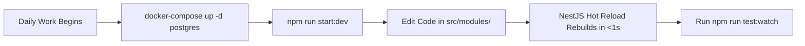
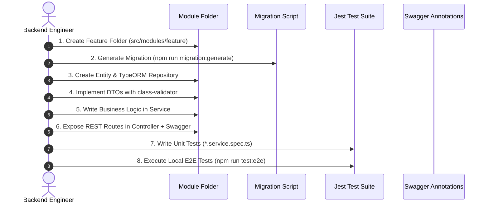
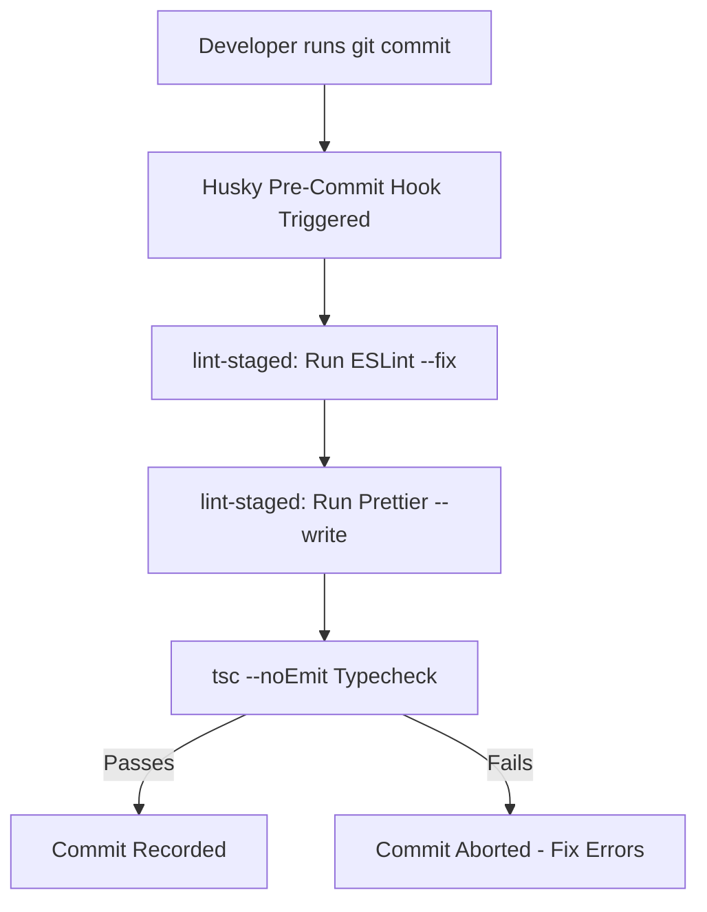

# Nexus AI Backend - Local Development Workflow & Lifecycle

**Document Version:** 1.0.0  
**Author:** Principal Software Architect & Backend Engineering Lead  
**Last Updated:** July 25, 2026  

---

## Table of Contents
1. [Document Purpose](#1-document-purpose)
2. [Document Scope](#2-document-scope)
3. [Local Development Environment Setup](#3-local-development-environment-setup)
4. [Docker-First Daily Engineering Workflow](#4-docker-first-daily-engineering-workflow)
5. [Feature & Module Development Lifecycle](#5-feature--module-development-lifecycle)
6. [Database Migration & Seeder Workflow](#6-database-migration--seeder-workflow)
7. [Local Testing Execution Protocol](#7-local-testing-execution-protocol)
8. [Documentation Maintenance Workflow](#8-documentation-maintenance-workflow)
9. [Pre-Commit Quality Checks & Git Hooks](#9-pre-commit-quality-checks--git-hooks)
10. [Peer Code Review & Release Promotion Process](#10-peer-code-review--release-promotion-process)
11. [Architectural Rationale & Trade-Off Analysis](#11-architectural-rationale--trade-off-analysis)
12. [Best Practices](#12-best-practices)
13. [Anti-Patterns & Common Mistakes](#13-anti-patterns--common-mistakes)
14. [Cross References](#14-cross-references)

---

## 1. Document Purpose

This document defines the mandatory local development workflows, Docker Compose setup, database migration procedures, local testing sequences, pre-commit quality controls, and peer review guidelines for software engineers working on the Nexus AI backend.

---

## 2. Document Scope

This specification applies to all daily software engineering activities across feature creation, bug fixing, database schema alterations, local environment orchestration, unit/integration testing, and code promotion.

---

## 3. Local Development Environment Setup

### Prerequisites
* Node.js v20.x LTS
* Docker Desktop & Docker Compose v2.x
* Git 2.x
* VS Code with recommended extensions (ESLint, Prettier, TypeScript, Docker)

### First-Time Initialization Sequence
1. Clone Repository: `git clone git@github.com:nexus-ai/backend.git`
2. Environment Configuration: `cp .env.example .env`
3. Launch Infrastructure: `docker-compose up -d postgres`
4. Install Dependencies: `npm install`
5. Run Database Migrations: `npm run migration:run`
6. Seed Test Data: `npm run seed:run`
7. Start Local Server in Watch Mode: `npm run start:dev`

---

## 4. Docker-First Daily Engineering Workflow

* **Environment Parity:** PostgreSQL runs inside containerized environments matching production configuration. Host machine connects via `localhost:5432`.

---

## 5. Feature & Module Development Lifecycle

Every new backend capability follows a strict step-by-step development sequence:

---

## 6. Database Migration & Seeder Workflow

### Creating Schema Alterations
1. Modify or create a TypeORM entity inside `src/modules/<feature>/entities/`.
2. Generate migration script: `npm run migration:generate -- src/database/migrations/AddCategoryToTasks`.
3. Inspect generated migration file in `src/database/migrations/`.
4. Apply migration locally: `npm run migration:run`.
5. Test rollback capability: `npm run migration:revert`.

---

## 7. Local Testing Execution Protocol

Engineers MUST execute and pass local test suites prior to committing code:

* **Unit Tests:** `npm run test` (Executes Jest unit test specs across services).
* **Targeted Watch Testing:** `npm run test:watch -- planner.service.spec.ts`.
* **Integration & E2E Testing:** `npm run test:e2e` (Launches test database container and runs Supertest API flows).

---

## 8. Documentation Maintenance Workflow

When creating or modifying API routes:
1. Update Swagger decorators (`@ApiOperation`, `@ApiResponse`) directly in the Controller.
2. If modifying system architecture or database schemas, update corresponding Markdown documents in `docs/` (`07-module-breakdown.md`, `11-api-standards.md`).

---

## 9. Pre-Commit Quality Checks & Git Hooks

Pre-commit git hooks managed by `husky` and `lint-staged` execute automatically upon running `git commit`:

---

## 10. Peer Code Review & Release Promotion Process

1. Push feature branch to GitHub (`feature/planner-task-priority`).
2. Open Pull Request targeting `main`.
3. Automated GitHub Actions CI pipeline runs linter, build, and test suites.
4. Obtain minimum **2 approving code reviews** from Senior Engineers.
5. Execute **Squash and Merge** into `main`.

---

## 11. Architectural Rationale & Trade-Off Analysis

### Decision: Local Node.js Execution (`start:dev`) with Containerized PostgreSQL vs Running Full Application inside Docker Container locally

| Evaluation Vector | Full Application inside Docker Compose | Hybrid: Local Node.js + Containerized Postgres |
| :--- | :--- | :--- |
| **Architectural Rationale** | Slow hot-reloading loop inside container volumes on Windows/macOS. | Chosen for Nexus AI. Ultra-fast Node.js hot reload (<500ms) with 100% database environment parity. |
| **Advantages** | Complete isolation. | Instant hot-reloading speed, seamless debugger attachment in VS Code. |
| **Disadvantages** | File watcher sync lag; high CPU usage on Docker Desktop. | Requires Node.js installed on host machine. |
| **Scalability Impact** | Neutral. | High developer velocity. |
| **Maintainability Impact**| Medium. | Extremely High. |

---

## 12. Best Practices

1. **Keep Commits Atomic:** Submit small, focused commits addressing a single requirement.
2. **Never Commit Secrets:** Verify `.env` is listed in `.gitignore`.

---

## 13. Anti-Patterns & Common Mistakes

* ❌ **Bypassing Migrations with `synchronize: true`:** Enabling auto-sync locally causes accidental column drops when switching git branches.
* ❌ **Ignoring Pre-Commit Hooks:** Using `git commit --no-verify` to bypass failing linter or type-check rules.

---

## 14. Cross References

* [09-folder-structure.md](file:///d:/Nexus-AI/backend/docs/09-folder-structure.md)
* [12-database-guidelines.md](file:///d:/Nexus-AI/backend/docs/12-database-guidelines.md)
* [17-git-workflow.md](file:///d:/Nexus-AI/backend/docs/17-git-workflow.md)
