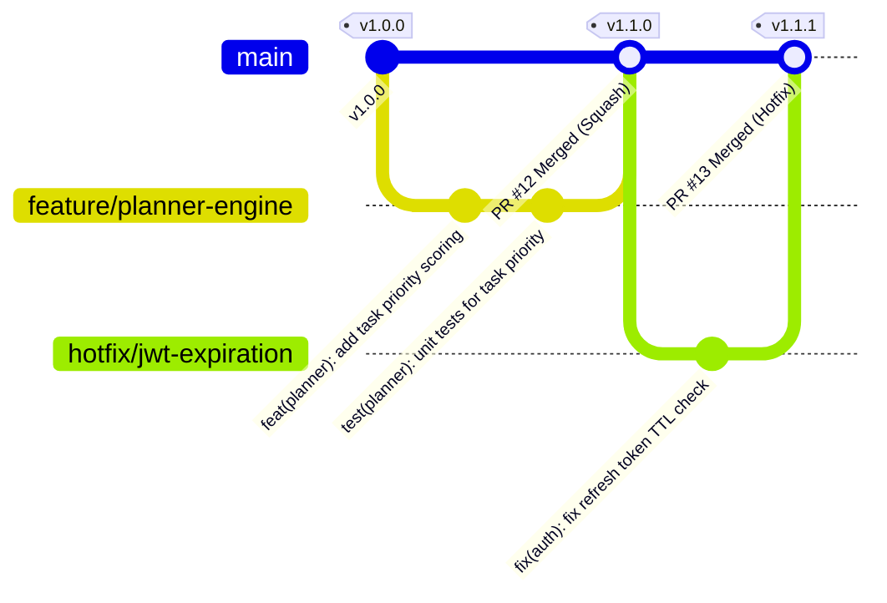
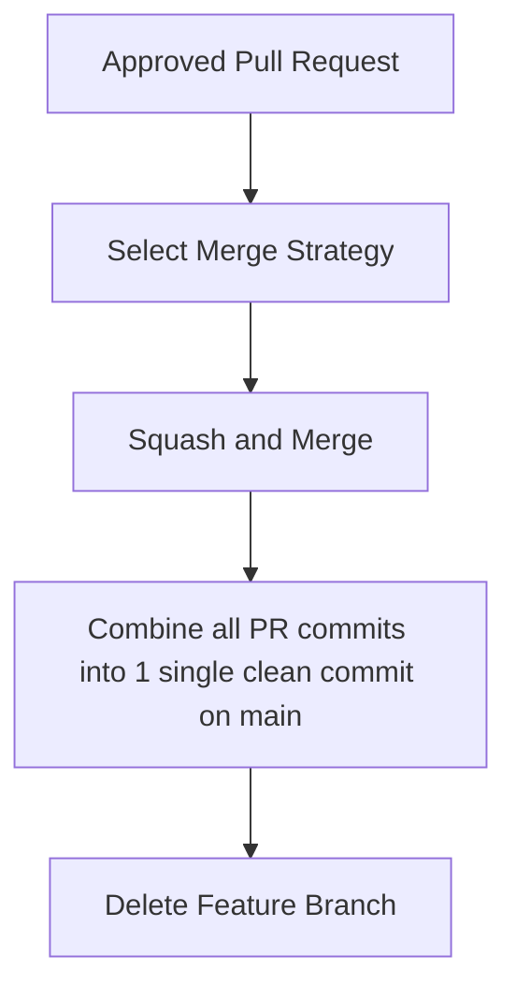

# Nexus AI Backend - Git Branching, Commit & Versioning Protocol

**Document Version:** 1.0.0  
**Author:** Principal Software Architect & Backend Engineering Lead  
**Last Updated:** July 25, 2026  

---

## Table of Contents
1. [Document Purpose](#1-document-purpose)
2. [Document Scope](#2-document-scope)
3. [Git Branching Architecture](#3-git-branching-architecture)
4. [Strict Branch Naming Conventions](#4-strict-branch-naming-conventions)
5. [Conventional Commits Specification](#5-conventional-commits-specification)
6. [Pull Request (PR) Workflow & Guidelines](#6-pull-request-pr-workflow--guidelines)
7. [Peer Code Review & Approval Criteria](#7-peer-code-review--approval-criteria)
8. [Merge Strategy & Commit Squashing Policy](#8-merge-strategy--commit-squashing-policy)
9. [Hotfix Emergency Workflow](#9-hotfix-emergency-workflow)
10. [Semantic Versioning (SemVer) & Release Tagging](#10-semantic-versioning-semver--release-tagging)
11. [Architectural Rationale & Trade-Off Analysis](#11-architectural-rationale--trade-off-analysis)
12. [Best Practices](#12-best-practices)
13. [Anti-Patterns & Common Mistakes](#13-anti-patterns--common-mistakes)
14. [Cross References](#14-cross-references)

---

## 1. Document Purpose

This document defines the official Git branching strategy, commit message formatting standards, Pull Request (PR) review standards, merge policies, hotfix procedures, and Semantic Versioning release protocols for the Nexus AI backend.

---

## 2. Document Scope

This specification applies to all git operations, branches, commits, pull requests, releases, and hotfixes across the repository.

---

## 3. Git Branching Architecture

Nexus AI uses a **Trunk-Based Development Model with Short-Lived Feature Branches**. All development branches diverge from `main` and merge back into `main` via Pull Requests.



---

## 4. Strict Branch Naming Conventions

All branch names MUST follow lower-case `kebab-case` prefixed with a recognized category type:

| Branch Category | Prefix Requirement | Purpose | Example Branch Name |
| :--- | :--- | :--- | :--- |
| **New Features** | `feature/` | Implementing new user or infrastructure capabilities. | `feature/planner-study-schedule` |
| **Bug Fixes** | `bugfix/` | Resolving non-critical bugs on development. | `bugfix/finance-safe-spend-calc` |
| **Hotfixes** | `hotfix/` | Critical production issue requiring immediate patch. | `hotfix/jwt-signature-bypass` |
| **Refactoring** | `refactor/` | Code structure improvements without feature changes. | `refactor/typeorm-repository-layer` |
| **Documentation** | `docs/` | Editing or adding engineering handbook docs. | `docs/api-standards-update` |
| **Infrastructure** | `chore/` | Updating dependencies, Docker Compose, or CI/CD. | `chore/upgrade-nestjs-v10` |

---

## 5. Conventional Commits Specification

Commit messages MUST strictly follow the Conventional Commits specification:

`type(scope): subject description`

```text
feat(planner): implement task prioritization algorithm

- Calculate priority score using deadline proximity and difficulty rating
- Add partial B-Tree index on planner_tasks(user_id, due_date)

Closes #42
```

### Allowed Commit Types
* `feat`: A new feature capability.
* `fix`: A bug fix.
* `docs`: Documentation alterations only.
* `style`: Code formatting changes (white-space, formatting, missing semi-colons).
* `refactor`: Code change that neither fixes a bug nor adds a feature.
* `test`: Adding missing unit/integration tests or updating existing tests.
* `chore`: Maintenance updates to build process, Docker files, or dependencies.

---

## 6. Pull Request (PR) Workflow & Guidelines

### Mandatory PR Rules
1. **Title Standard:** Match conventional commit format: `feat(planner): add study schedule optimization`.
2. **PR Template Checklist:** Every PR must fill out the repository template specifying:
   - Summary of technical changes.
   - Related issue ticket number.
   - List of manual and automated tests executed.
   - Swagger API documentation link updates.

---

## 7. Peer Code Review & Approval Criteria

* **Reviewer Requirement:** Minimum **2 approving reviews** from Senior Backend Engineers.
* **Automated CI Requirement:** GitHub Actions must pass ESLint, TypeScript build (`tsc`), and Jest test execution (>80% coverage) before merge button is enabled.

---

## 8. Merge Strategy & Commit Squashing Policy



* **Policy:** Mandatory **Squash and Merge**. All intermediate local commits (`WIP`, `fix typo`, `debugging`) are squashed into a single, clean commit on `main`.

---

## 9. Hotfix Emergency Workflow

When a critical production bug occurs:
1. Branch directly from the latest release tag on `main`: `git checkout -b hotfix/payment-webhook-auth v1.1.0`.
2. Implement fix, write regression test, and commit.
3. Open priority Hotfix PR.
4. Upon approval, merge to `main` and immediately tag patch release (`v1.1.1`).

---

## 10. Semantic Versioning (SemVer) & Release Tagging

System releases follow Semantic Versioning (`MAJOR.MINOR.PATCH`):
* **MAJOR (`v2.0.0`):** Incompatible API breaking changes or database structural overhauls.
* **MINOR (`v1.2.0`):** New non-breaking functionality added (e.g., adding Finance module).
* **PATCH (`v1.2.1`):** Backward-compatible bug fixes and patch updates.

---

## 11. Architectural Rationale & Trade-Off Analysis

### Decision: Trunk-Based Development with Squash & Merge vs GitFlow (Long-Lived Develop & Release Branches)

| Evaluation Vector | GitFlow (`main`, `develop`, `release/*`, `feature/*`) | Trunk-Based + Squash & Merge (`main`, short-lived `feature/*`) |
| :--- | :--- | :--- |
| **Architectural Rationale** | Complex, merge-conflict heavy workflow for legacy release cycles. | Chosen for Nexus AI. Linear history, continuous integration, zero merge debt. |
| **Advantages** | Isolation of release candidates. | Eliminates long-lived branch drift and catastrophic merge conflicts. Linear git history on `main`. |
| **Disadvantages** | Severe merge hell when `develop` drifts from `main`. | Requires robust CI automated test suites to maintain `main` health. |
| **Scalability Impact** | Slows engineering velocity as team grows. | Exceptional velocity; features ship to production rapidly. |
| **Maintainability Impact**| Low maintainability of git history. | Extremely High. |

---

## 12. Best Practices

1. **Keep PRs Small:** PRs should contain `<400 lines of code` to ensure thorough peer code review.
2. **Rebase Before Merging:** Keep feature branches updated by running `git rebase origin/main`.

---

## 13. Anti-Patterns & Common Mistakes

* ❌ **Vague Commit Messages:** Committing messages like `fixed stuff`, `wip`, or `asdf`.
* ❌ **Long-Lived Feature Branches:** Keeping a feature branch unmerged for 3 weeks, causing massive merge conflicts.

---

## 14. Cross References

* [10-coding-standards.md](file:///d:/Nexus-AI/backend/docs/10-coding-standards.md)
* [16-development-workflow.md](file:///d:/Nexus-AI/backend/docs/16-development-workflow.md)
