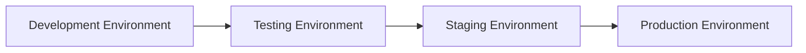
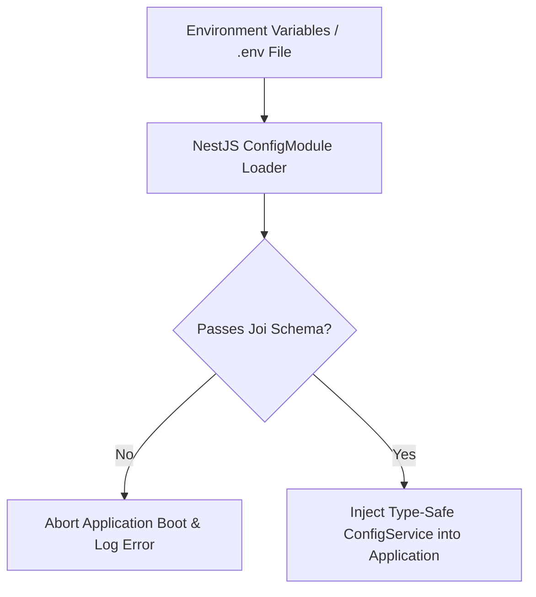

# Nexus AI Backend - Environment Management & Multi-Tier Deployment

**Document Version:** 1.0.0  
**Author:** Principal Software Architect & Backend Engineering Lead  
**Last Updated:** July 25, 2026  

---

## Table of Contents
1. [Document Purpose](#1-document-purpose)
2. [Document Scope](#2-document-scope)
3. [Environment Hierarchy & Purpose](#3-environment-hierarchy--purpose)
4. [Docker Environment Orchestration Topology](#4-docker-environment-orchestration-topology)
5. [Environment Variable Configuration Pipeline](#5-environment-variable-configuration-pipeline)
6. [Strict Environment Schema Validation (Joi)](#6-strict-environment-schema-validation-joi)
7. [Secrets Management & Production Vault Integration](#7-secrets-management--production-vault-integration)
8. [Sensitive Information & Masking Policy](#8-sensitive-information--masking-policy)
9. [Architectural Rationale & Trade-Off Analysis](#9-architectural-rationale--trade-off-analysis)
10. [Best Practices](#10-best-practices)
11. [Anti-Patterns & Common Mistakes](#11-anti-patterns--common-mistakes)
12. [Cross References](#12-cross-references)

---

## 1. Document Purpose

This document defines the environment management architecture, multi-tier deployment topologies, environment variable schemas, secret injection policies, and Docker Compose configurations for the Nexus AI backend.

---

## 2. Document Scope

This specification applies to all runtime execution environments: Local Development (`development`), Automated Integration Testing (`test`), Staging (`staging`), and Production (`production`).

---

## 3. Environment Hierarchy & Purpose



| Environment | Purpose | Database Target | Secret Storage | Logging Level |
| :--- | :--- | :--- | :--- | :--- |
| **`development`** | Local feature coding & rapid debugging. | Local PostgreSQL Container (`localhost:5432`) | Local `.env` file | `debug` |
| **`test`** | Automated Jest unit & E2E integration runs. | Isolated Test Container (`postgres_test`) | Local `.env.test` file | `warn` |
| **`staging`** | Pre-production validation & client QA. | Managed Staging Database Cluster | AWS Secrets Manager / Vault | `info` |
| **`production`** | Live end-user traffic. | Managed High-Availability Primary/Replica DB | HashiCorp Vault / KMS | `info` / `error` |

---

## 4. Docker Environment Orchestration Topology

Orchestration is configured via modular Docker Compose files:

* **`docker-compose.yml`:** Base infrastructure service definitions (PostgreSQL 16, NestJS backend, network bridges).
* **`docker-compose.override.yml`:** Applied automatically during local development. Mounts local volume source code for instant hot reloading (`start:dev`).
* **`docker-compose.prod.yml`:** Production deployment config. Disables volume mounts, enables production OCI container image execution, and configures restart policies (`restart: always`).

---

## 5. Environment Variable Configuration Pipeline



---

## 6. Strict Environment Schema Validation (Joi)

The application intercepts the boot process and enforces Joi schema validation. If required variables are missing or malformed, the boot sequence crashes immediately with an explicit error message:

```text
[ConfigModule] Environment validation error: "DATABASE_PORT" must be a number
```

### Environment Variable Matrix (`.env.example`)

| Variable Name | Required? | Data Type | Default Value | Description |
| :--- | :---: | :--- | :--- | :--- |
| `NODE_ENV` | Yes | Enum | `development` | Runtime environment mode |
| `PORT` | Yes | Number | `3000` | HTTP listening port |
| `DATABASE_HOST` | Yes | String | `localhost` | PostgreSQL host address |
| `DATABASE_PORT` | Yes | Number | `5432` | PostgreSQL port |
| `DATABASE_USER` | Yes | String | `nexus_user` | PostgreSQL user |
| `DATABASE_PASS` | Yes | String | N/A | PostgreSQL password |
| `DATABASE_NAME` | Yes | String | `nexus_db` | PostgreSQL database name |
| `JWT_SECRET` | Yes | String | N/A | HMAC SHA-256 JWT signing secret |
| `GEMINI_API_KEY` | Yes | String | N/A | Google Gemini API access key |
| `CLOUDINARY_URL` | Yes | String | N/A | Cloudinary CDN connection string |
| `RAZORPAY_KEY_ID`| Yes | String | N/A | Razorpay test mode Key ID |

---

## 7. Secrets Management & Production Vault Integration

1. **Local Development:** Developers maintain a local `.env` file (ignored by `.gitignore`).
2. **Production / Staging:** Secret files are NEVER stored on container disks. Secrets are injected at container startup using HashiCorp Vault, AWS Secrets Manager, or Kubernetes Secrets.

---

## 8. Sensitive Information & Masking Policy

* **Git Commitment Check:** Automated pre-commit hooks scan files for accidental commit of API keys (`AWS_SECRET`, `JWT_SECRET`) using `git-secrets`.
* **Log Masking:** Secrets are scrubbed from Winston log outputs.

---

## 9. Architectural Rationale & Trade-Off Analysis

### Decision: Strict Joi Boot Validation vs Soft Fallback Defaults

| Evaluation Vector | Soft Defaults (`process.env.DB_PORT \|\| 5432`) | Fail-Fast Boot Validation (Joi Schema) |
| :--- | :--- | :--- |
| **Architectural Rationale** | Easy for quick scripts; masks missing production configs. | Chosen for Nexus AI. Guarantees 100% environment configuration integrity before processing HTTP traffic. |
| **Advantages** | Simple initial setup. | Prevents silent failures in production due to missing or misconfigured API keys. |
| **Disadvantages** | Can lead to runtime crashes mid-operation if a secret is missing. | Requires explicit schema definition in `config/`. |
| **Scalability Impact** | Neutral. | High reliability during container auto-scaling. |
| **Maintainability Impact**| Low. | Extremely High. |

---

## 10. Best Practices

1. **Keep `.env.example` Updated:** Whenever a new environment variable is introduced, update `.env.example` in the same PR.
2. **Never Commit Secrets:** Immediately revoke and rotate any secret accidentally exposed in Git history.

---

## 11. Anti-Patterns & Common Mistakes

* ❌ **Hardcoding Fallback Secrets:** Writing `const secret = process.env.JWT_SECRET || 'mysecret123'`.
* ❌ **Committing Production Credentials to Git:** Pushing `.env` containing production database passwords.

---

## 12. Cross References

* [14-security-guidelines.md](file:///d:/Nexus-AI/backend/docs/14-security-guidelines.md)
* [16-development-workflow.md](file:///d:/Nexus-AI/backend/docs/16-development-workflow.md)
* [19-configuration-management.md](file:///d:/Nexus-AI/backend/docs/19-configuration-management.md)
