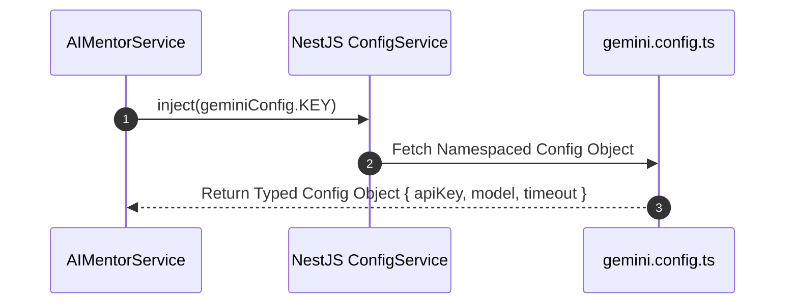

# Nexus AI Backend - Configuration Management Architecture

**Document Version:** 1.0.0  
**Author:** Principal Software Architect & Backend Engineering Lead  
**Last Updated:** July 25, 2026  

---

## Table of Contents
1. [Document Purpose](#1-document-purpose)
2. [Document Scope](#2-document-scope)
3. [Configuration Module Architecture](#3-configuration-module-architecture)
4. [Environment Variable Loading Sequence](#4-environment-variable-loading-sequence)
5. [Domain-Specific Configuration Namespace Separation](#5-domain-specific-configuration-namespace-separation)
6. [Type-Safe Centralized Access Pattern](#6-type-safe-centralized-access-pattern)
7. [External Third-Party Service Configurations](#7-external-third-party-service-configurations)
8. [Future Secrets Manager Integration Architecture](#8-future-secrets-manager-integration-architecture)
9. [Architectural Rationale & Trade-Off Analysis](#9-architectural-rationale--trade-off-analysis)
10. [Best Practices](#10-best-practices)
11. [Anti-Patterns & Common Mistakes](#11-anti-patterns--common-mistakes)
12. [Cross References](#12-cross-references)

---

## 1. Document Purpose

This document defines the configuration management architecture, domain namespacing rules, type-safe config service abstractions, and secret loading pipelines for the Nexus AI backend built on NestJS `@nestjs/config`.

---

## 2. Document Scope

This specification covers all configuration loaders, Joi validation rules, namespace registration files inside `src/config/`, and environment property retrieval across all business domain services and external adapters.

---

## 3. Configuration Module Architecture

The application uses NestJS `@nestjs/config` with custom namespaced configuration loaders and Joi schema validation.

```mermaid
flowchart TD
    AppModule[src/app.module.ts] --> ConfigMod[ConfigModule.forRoot]
    
    ConfigMod --> Schema[Joi Environment Validation Schema]
    
    subgraph Namespaced Config Loaders (src/config/)
        AppConf[app.config.ts]
        DBConf[database.config.ts]
        JWTConf[jwt.config.ts]
        GeminiConf[gemini.config.ts]
        CloudConf[cloudinary.config.ts]
        PayConf[razorpay.config.ts]
    end

    ConfigMod --> AppConf & DBConf & JWTConf & GeminiConf & CloudConf & PayConf
    
    ConfigMod --> ConfigService[Injectable ConfigService Provider]
    ConfigService --> BusinessServices[Domain Services & Infrastructure Adapters]
```

---

## 4. Environment Variable Loading Sequence

Configuration property resolution follows a strict priority order (higher priority overrides lower priority):
1. **OS Environment Variables** (Injected by Docker container runner / AWS ECS).
2. **Local `.env` File** (Parsed by `dotenv` during local development).
3. **Default Fallback Values** (Defined in namespaced config loader files).

---

## 5. Domain-Specific Configuration Namespace Separation

Rather than reading untyped raw string keys (`configService.get('DATABASE_HOST')`), configuration keys are organized into domain namespaces using NestJS `registerAs()`:

```text
src/config/
├── app.config.ts                # Application port, API prefix, CORS origins
├── database.config.ts           # PostgreSQL connection details, pool caps, SSL
├── jwt.config.ts                # JWT secrets, expiration TTLs, issuer strings
├── gemini.config.ts             # Google Gemini API keys, timeout limits, models
├── cloudinary.config.ts         # Cloudinary CDN credentials, folder paths
├── fcm.config.ts                # Firebase Cloud Messaging service account JSON
└── razorpay.config.ts           # Razorpay Test Mode Key ID, Secret, Webhook secret
```

---

## 6. Type-Safe Centralized Access Pattern

Services consume configuration using strongly-typed configuration factories:



### Advantages of Namespaced Injection
* **Autocomplete & Type Safety:** Developers receive IDE IntelliSense autocomplete for configuration properties.
* **Eliminates Magic Strings:** Replaces loose string lookups with strongly-typed interfaces.

---

## 7. External Third-Party Service Configurations

Each external adapter configuration encapsulates its specific options:
* **Gemini Adapter:** `gemini.apiKey`, `gemini.model` (`gemini-1.5-flash`), `gemini.timeoutMs` (`5000`).
* **Cloudinary Adapter:** `cloudinary.cloudName`, `cloudinary.apiKey`, `cloudinary.apiSecret`.
* **Razorpay Adapter:** `razorpay.keyId`, `razorpay.keySecret`, `razorpay.webhookSecret`.

---

## 8. Future Secrets Manager Integration Architecture

When scaling to multi-region cloud deployments:
1. NestJS `ConfigModule` custom loader will execute an initial asynchronous fetch to AWS Secrets Manager or HashiCorp Vault during the NestJS bootstrap phase.
2. Retrieved secret JSON objects will populate the namespaced config objects in memory, requiring zero code changes in business domain services.

---

## 9. Architectural Rationale & Trade-Off Analysis

### Decision: Namespaced Typed Config Loaders vs Loose `process.env.KEY` Access

| Evaluation Vector | Direct `process.env.KEY` Access | Namespaced Typed Config Loaders (`registerAs`) |
| :--- | :--- | :--- |
| **Architectural Rationale** | Quick script style; error-prone and untyped. | Chosen for Nexus AI. Guarantees type safety, encapsulation, and easy mock injection in unit tests. |
| **Advantages** | Zero initial code setup. | Autocomplete support, central Joi validation, refactoring safety, simple unit test mocking. |
| **Disadvantages** | No type safety; risk of typos; difficult to mock in tests. | Requires registering loader files inside `src/config/`. |
| **Scalability Impact** | Neutral. | High maintainability as configuration property count grows. |
| **Maintainability Impact**| Low. | Extremely High. |

---

## 10. Best Practices

1. **Inject Namespaces Directly:** Inject specific configuration namespaces (`@Inject(jwtConfig.KEY)`) rather than global `ConfigService`.
2. **Never Export Raw `process.env`:** Always wrap environment access inside a configuration loader function.

---

## 11. Anti-Patterns & Common Mistakes

* ❌ **Reading `process.env` inside Business Services:** Accessing `process.env.GEMINI_KEY` inside `AIMentorService`.
* ❌ **Unvalidated Secrets:** Omitting Joi schema rules for external API secret keys.

---

## 12. Cross References

* [06-system-components.md](file:///d:/Nexus-AI/backend/docs/06-system-components.md)
* [18-environment-management.md](file:///d:/Nexus-AI/backend/docs/18-environment-management.md)
