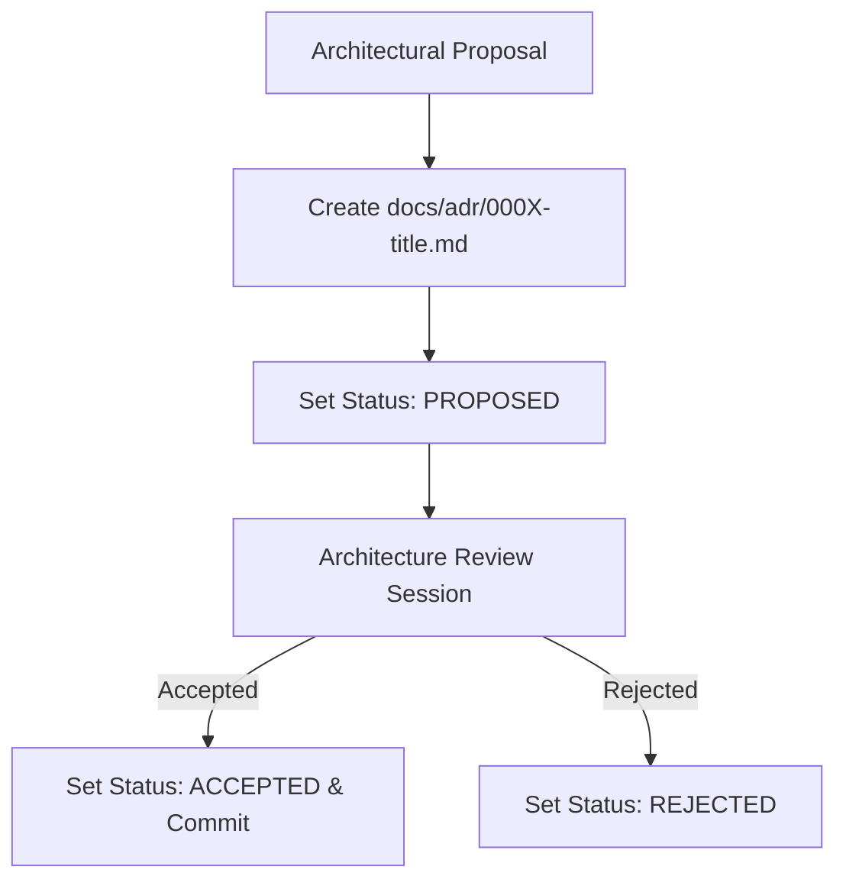

# Nexus AI Backend - Documentation Standards & ADR Framework

**Document Version:** 1.0.0  
**Author:** Principal Software Architect & Backend Engineering Lead  
**Last Updated:** July 25, 2026  

---

## Table of Contents
1. [Document Purpose](#1-document-purpose)
2. [Document Scope](#2-document-scope)
3. [Markdown Formatting Standards](#3-markdown-formatting-standards)
4. [Repository `README.md` Specification](#4-repository-readmemd-specification)
5. [Architecture Decision Records (ADR) Framework](#5-architecture-decision-records-adr-framework)
6. [API & Swagger Documentation Guidelines](#6-api--swagger-documentation-guidelines)
7. [Database Schema Documentation Standards](#7-database-schema-documentation-standards)
8. [Deployment & Infrastructure Documentation](#8-deployment--infrastructure-documentation)
9. [Document Ownership & Maintenance Governance](#9-document-ownership--maintenance-governance)
10. [Architectural Rationale & Trade-Off Analysis](#10-architectural-rationale--trade-off-analysis)
11. [Best Practices](#11-best-practices)
12. [Anti-Patterns & Common Mistakes](#12-anti-patterns--common-mistakes)
13. [Cross References](#13-cross-references)

---

## 1. Document Purpose

This document defines the documentation standards, GitHub-Flavored Markdown rules, Architectural Decision Record (ADR) templates, Swagger annotation guidelines, and maintenance governance for the Nexus AI backend. It guarantees that software documentation remains complete, synchronized with codebase changes, and readable for onboarding software engineers.

---

## 2. Document Scope

This specification applies to all Markdown files inside `docs/`, `README.md`, ADR files (`docs/adr/`), inline Swagger annotations, code docstrings, and database schema documentation.

---

## 3. Markdown Formatting Standards

All documentation MUST conform to GitHub-Flavored Markdown (GFM) and render cleanly across GitHub and IDE markdown viewers:

### Mandatory Markdown Structure Rules
1. **Document Header Block:** Every document in `docs/` MUST start with Title, Document Version, Author Placeholder, and Last Updated Date.
2. **Table of Contents:** Include a hyperlinked Table of Contents immediately following the document scope section.
3. **Mermaid Diagrams:** Use fenced mermaid code blocks (` ```mermaid `) for visual architecture flowcharts, sequence diagrams, and state machines.
4. **GitHub Callout Alerts:** Use GitHub alerts (`> [!NOTE]`, `> [!TIP]`, `> [!IMPORTANT]`, `> [!WARNING]`, `> [!CAUTION]`) to emphasize critical architectural rules.

---

## 4. Repository `README.md` Specification

The root `README.md` serves as the front door to the repository and MUST contain:
* Project title & architecture badges.
* High-level project summary & vision.
* Prerequisites (Node.js version, Docker version).
* Quick start setup instructions (3-command initialization).
* Environment variable configuration overview.
* Local testing and execution commands.
* Links to master architecture documents in `docs/`.

---

## 5. Architecture Decision Records (ADR) Framework

Significant architectural modifications (e.g., introducing Redis, swapping ORMs, or altering JWT strategies) MUST be documented as an Architecture Decision Record (ADR) inside `docs/adr/`.



### Standard ADR Template (`docs/adr/0000-template.md`)

```markdown
# ADR-000X: [Short Title of Architectural Decision]

**Status:** [PROPOSED | ACCEPTED | REJECTED | SUPERSEDED]  
**Date:** YYYY-MM-DD  
**Deciders:** Lead Architect, Senior Backend Engineers  

## Context & Problem Statement
Explain the business requirement or technical problem prompting this decision.

## Decision Drivers
* Driver 1 (e.g., Performance SLA < 200ms)
* Driver 2 (e.g., Maintainability)

## Considered Options
1. Option 1: [Name]
2. Option 2: [Name]

## Decision Outcome
Chosen Option: **Option X**, because [brief justification].

### Positive Consequences
* Advantage 1
* Advantage 2

### Negative Consequences / Trade-Offs
* Disadvantage 1

## Pros and Cons of Options
[Detailed breakdown of evaluated options]
```

---

## 6. API & Swagger Documentation Guidelines

* **Synchronization Rule:** API documentation MUST NOT be maintained as a separate static file. Swagger documentation is generated dynamically from NestJS TypeScript controller decorators (`@ApiOperation`, `@ApiResponse`, `@ApiProperty`).
* **DTO Annotations:** Every property inside a request/response DTO MUST be decorated with `@ApiProperty()` containing descriptive text, example values, and type bounds.

---

## 7. Database Schema Documentation Standards

* **Entity Docstrings:** TypeORM entity classes and properties must feature TypeScript JSDoc comments explaining business purpose.
* **Schema Reference:** `docs/07-module-breakdown.md` serves as the authoritative logical database table directory.

---

## 8. Deployment & Infrastructure Documentation

Deployment workflows, Docker Compose environment variables, and Kubernetes topologies must be documented in `docs/08-future-scalability.md` and `docs/18-environment-management.md`.

---

## 9. Document Ownership & Maintenance Governance

| Document Path | Primary Owner | Review Frequency |
| :--- | :--- | :--- |
| `docs/01` to `docs/08` | Lead Architect | Bi-annually |
| `docs/09` to `docs/20` | Backend Engineering Team | Monthly / Per Sprint |
| `docs/adr/*` | Architecture Review Board | Per Decision Event |

---

## 10. Architectural Rationale & Trade-Off Analysis

### Decision: Code-First Swagger (`@nestjs/swagger`) vs Manual OpenAPI YAML Files

| Evaluation Vector | Manual OpenAPI YAML (`openapi.yaml`) | Code-First Swagger Decorators (`@nestjs/swagger`) |
| :--- | :--- | :--- |
| **Architectural Rationale** | Prone to drift from actual implementation code. | Chosen for Nexus AI. Guarantees 100% synchronization between API implementation and interactive documentation. |
| **Advantages** | Language-agnostic design-first tool. | Zero drift; Swagger UI auto-updates at `/api/docs` whenever controllers or DTOs change. |
| **Disadvantages** | Developers forget to update external YAML when changing DTOs. | Adds decorator metadata verbosity to DTO files. |
| **Scalability Impact** | Neutral. | High developer velocity and accurate API docs. |
| **Maintainability Impact**| Low maintainability. | Extremely High maintainability. |

---

## 11. Best Practices

1. **Document the "Why":** Focus documentation on WHY an architectural choice was made rather than describing obvious code mechanics.
2. **Keep Docs Close to Code:** Maintain technical handbooks in the same Git repository (`docs/`) to enable version control.

---

## 12. Anti-Patterns & Common Mistakes

* ❌ **Outdated API Docs:** Updating a controller DTO without updating `@ApiProperty()` annotations.
* ❌ **Vague Architecture Records:** Omitting negative trade-offs from ADR decision outcomes.

---

## 13. Cross References

* [01-project-overview.md](file:///d:/Nexus-AI/backend/docs/01-project-overview.md)
* [04-high-level-architecture.md](file:///d:/Nexus-AI/backend/docs/04-high-level-architecture.md)
* [11-api-standards.md](file:///d:/Nexus-AI/backend/docs/11-api-standards.md)
