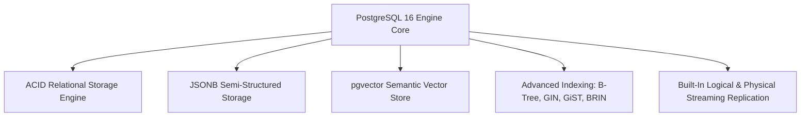
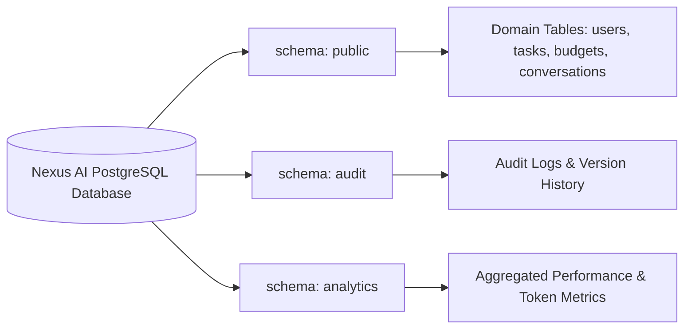
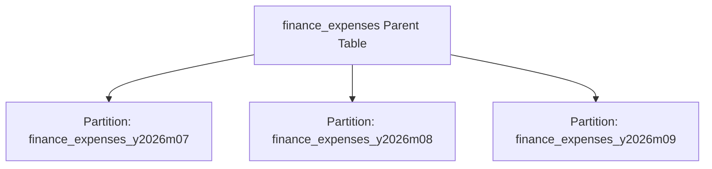

# Nexus AI Backend - Database Architecture & Overview

**Document Version:** 1.0.0  
**Author:** Principal Database Architect & Senior Backend Engineer  
**Last Updated:** July 25, 2026  

---

## Table of Contents
1. [Document Purpose](#1-document-purpose)
2. [Document Scope](#2-document-scope)
3. [Technology Rationale: Why PostgreSQL 16 Was Selected](#3-technology-rationale-why-postgresql-16-was-selected)
4. [Database Architecture & Schema Strategy](#4-database-architecture--schema-strategy)
5. [Database Normalization Strategy (Third Normal Form - 3NF)](#5-database-normalization-strategy-third-normal-form---3nf)
6. [Selective Denormalization Strategy](#6-selective-denormalization-strategy)
7. [Transaction Management & Isolation Levels](#7-transaction-management--isolation-levels)
8. [ACID Guarantees & Consistency Model](#8-acid-guarantees--consistency-model)
9. [Future Partitioning Strategy (Declarative Range Partitioning)](#9-future-partitioning-strategy-declarative-range-partitioning)
10. [Future Horizontal Sharding Architecture](#10-future-horizontal-sharding-architecture)
11. [Architectural Rationale & Trade-Off Analysis](#11-architectural-rationale--trade-off-analysis)
12. [Enterprise Best Practices](#12-enterprise-best-practices)
13. [Future Considerations](#13-future-considerations)
14. [Cross References](#14-cross-references)

---

## 1. Document Purpose

This document defines the high-level database architecture, relational engine selection rationale, schema strategy, normalization policies, transaction isolation models, and multi-year scaling roadmap for the Nexus AI backend database.

---

## 2. Document Scope

This specification applies to all relational data models, table designs, transaction boundaries, indexing policies, and database instances serving the Nexus AI platform.

---

## 3. Technology Rationale: Why PostgreSQL 16 Was Selected

PostgreSQL 16 was selected as the enterprise relational database engine for Nexus AI following a comprehensive evaluation of relational and NoSQL alternatives:

### Comparative Analysis of Database Engines

| Feature / Capability | PostgreSQL 16 | MySQL 8.0 | MongoDB 7.0 | Cassandra |
| :--- | :---: | :---: | :---: | :---: |
| **ACID Multi-Table Compliance** | Full Strict | Full | Single-Doc Default | Eventual Only |
| **JSONB Document Support** | Outstanding | Good | Native | Poor |
| **Vector Embedding Support (`pgvector`)**| Native Extension | Third-Party | Add-On | None |
| **Complex Analytical Joins** | Industry Leader | Moderate | Poor | Not Supported |
| **Open Source Licensing** | PostgreSQL License | Dual (GPL/Commercial) | SSPL (Non-OSI) | Apache 2.0 |

---

## 4. Database Architecture & Schema Strategy

The database uses a single PostgreSQL instance with logical schema isolation separating internal metadata from application business domains:

---

## 5. Database Normalization Strategy (Third Normal Form - 3NF)

To eliminate data redundancy, update anomalies, and structural drift, all core domain tables are designed strictly according to **Third Normal Form (3NF)**:
1. **First Normal Form (1NF):** Every column contains atomic scalar values (no CSV arrays inside string columns; multi-valued attributes stored in dedicated child tables).
2. **Second Normal Form (2NF):** Every non-key column is fully dependent on the primary key UUID.
3. **Third Normal Form (3NF):** No transitive dependencies exist (e.g., student university details reside in `universities` table, referenced via foreign key).

---

## 6. Selective Denormalization Strategy

While 3NF is strictly enforced for write-path tables, **Selective Denormalization** is applied to high-frequency read paths to satisfy strict `<150ms` latency SLAs:

* **Safe Daily Spend Summary:** The `finance_monthly_summaries` table pre-aggregates total monthly expenditure to avoid re-summing thousands of individual `finance_expenses` rows on every mobile dashboard load.
* **Denormalization Governance Rule:** Denormalized summary tables MUST be updated asynchronously via background event listeners (`@OnEvent('expense.created')`) or database triggers, preventing write-path lock contention.

---

## 7. Transaction Management & Isolation Levels

* **Default Isolation Level:** `READ COMMITTED`.
* **Behavior:** Prevents Dirty Reads. Queries see only data committed before the query began.
* **Financial Transactions:** Multi-row financial ledger writes (e.g., wallet transfers, subscription billing) execute inside strict transaction blocks using TypeORM `QueryRunner`.

---

## 8. ACID Guarantees & Consistency Model

1. **Atomicity:** All operations within a transaction complete successfully, or the entire transaction rolls back cleanly.
2. **Consistency:** Database constraints (Foreign Keys, Unique Keys, Check Constraints) are enforced instantly at transaction boundaries.
3. **Isolation:** Concurrent student operations cannot observe intermediate, uncommitted states.
4. **Durability:** Write-Ahead Logging (WAL) ensures committed transactions survive unexpected container or host crashes.

---

## 9. Future Partitioning Strategy (Declarative Range Partitioning)

When high-volume tables exceed 10,000,000 rows, PostgreSQL Declarative Range Partitioning will be transparently activated:

---

## 10. Future Horizontal Sharding Architecture

When active user volume exceeds single-node capacity (50,000+ concurrent active students), PostgreSQL will transition to a distributed sharding topology using **Citus Data** or **Hash-Based Tenant Sharding** keyed by `user_id`.

---

## 11. Architectural Rationale & Trade-Off Analysis

### Decision: PostgreSQL 16 Relational Core vs NoSQL Document Database (MongoDB)

| Evaluation Vector | MongoDB Document Store | PostgreSQL 16 Relational Engine |
| :--- | :--- | :--- |
| **Architectural Rationale** | Easy for unstructured documents; weak multi-table transaction guarantees. | Chosen for Nexus AI. Guarantees 100% financial and academic data integrity via strict foreign keys and ACID compliance. |
| **Advantages** | Flexible schema. | Powerful joins, strict integrity, JSONB support, native vector search via `pgvector`. |
| **Disadvantages** | Data duplication; risk of orphan records during deletions. | Schema alterations require version-controlled migration scripts. |
| **Performance Impact** | Fast single-document reads. | Sub-millisecond indexed joins with connection pooling. |
| **Scalability Impact** | Easy horizontal sharding. | Proven horizontal scale up to multi-terabyte scale with read-replicas. |
| **Maintainability Impact**| Low schema enforcement over time. | Extremely High long-term maintainability. |

---

## 12. Enterprise Best Practices

1. **Enforce Foreign Key Constraints:** Always declare explicit foreign key constraints with index backing.
2. **Store Dates in UTC:** Always use `TIMESTAMPTZ` data types.

---

## 13. Future Considerations

* Integration of `pgvector` extension for localized RAG search across student lecture notes.
* Automated logical replication streaming to an analytical Data Warehouse (ClickHouse / Snowflake).

---

## 14. Cross References

* [04-high-level-architecture.md](file:///d:/Nexus-AI/backend/docs/04-high-level-architecture.md)
* [12-database-guidelines.md](file:///d:/Nexus-AI/backend/docs/12-database-guidelines.md)
* [22-entity-relationship-design.md](file:///d:/Nexus-AI/backend/docs/22-entity-relationship-design.md)
