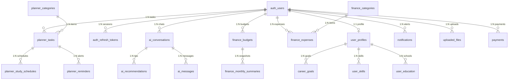
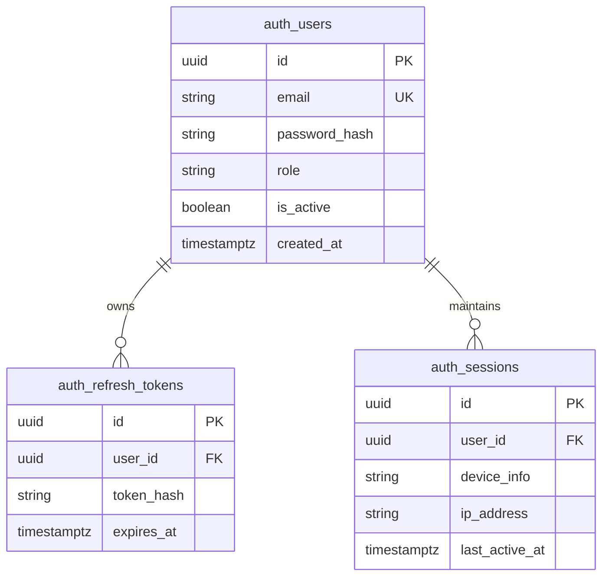
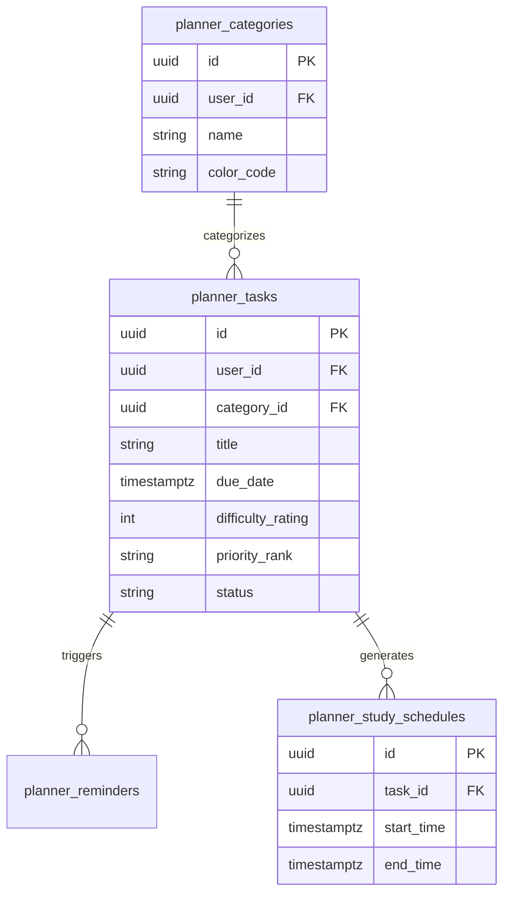
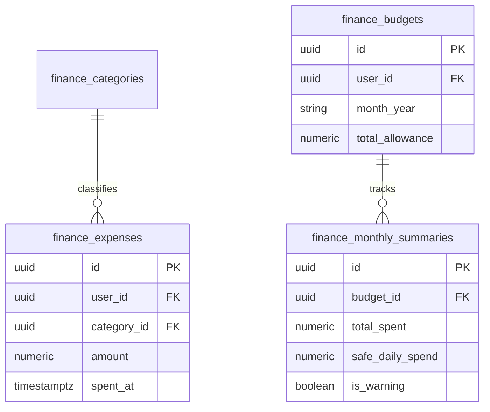
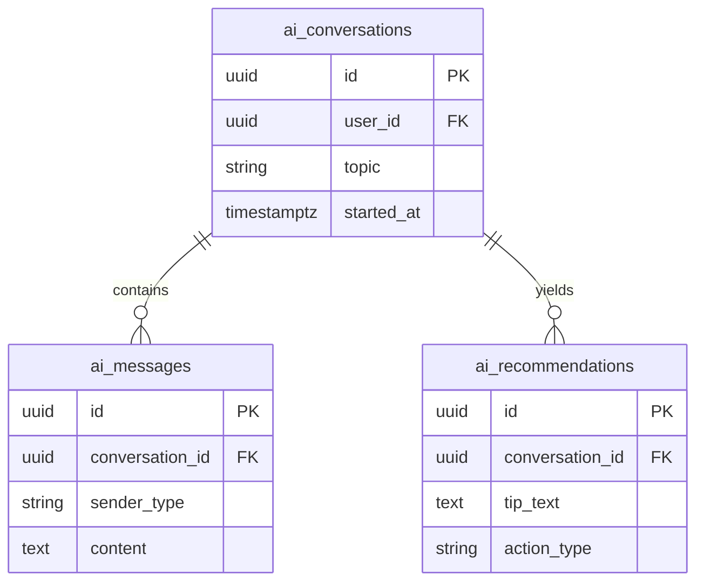
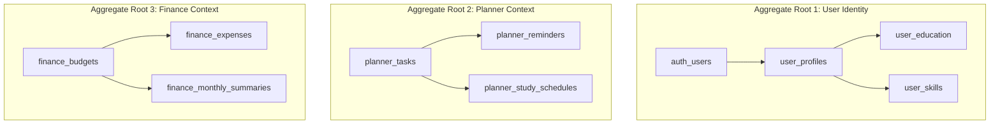

# Nexus AI Backend - Entity-Relationship Design & Domain Models

**Document Version:** 1.0.0  
**Author:** Principal Database Architect & Senior Backend Engineer  
**Last Updated:** July 25, 2026  

---

## Table of Contents
1. [Document Purpose](#1-document-purpose)
2. [Document Scope](#2-document-scope)
3. [Master Entity-Relationship Overview](#3-master-entity-relationship-overview)
4. [Domain 1: Authentication & Identity Domain](#4-domain-1-authentication--identity-domain)
5. [Domain 2: User Profile & Personalization Domain](#5-domain-2-user-profile--personalization-domain)
6. [Domain 3: Smart Planner & Task Engine Domain](#6-domain-3-smart-planner--task-engine-domain)
7. [Domain 4: Smart Finance Engine Domain](#7-domain-4-smart-finance-engine-domain)
8. [Domain 5: AI Mentor & Conversational Gateway Domain](#8-domain-5-ai-mentor--conversational-gateway-domain)
9. [Domain 6: Notifications Domain](#9-domain-6-notifications-domain)
10. [Domain 7: Media & Attachment Uploads Domain](#10-domain-7-media--attachment-uploads-domain)
11. [Domain 8: Payments & Subscriptions Domain](#11-domain-8-payments--subscriptions-domain)
12. [Domain 9: System Analytics Domain](#12-domain-9-system-analytics-domain)
13. [Domain 10: Future Expansion Domain (Teams, Orgs, Activity)](#13-domain-10-future-expansion-domain-teams-orgs-activity)
14. [Domain-Driven Design (DDD) Aggregate Boundaries](#14-domain-driven-design-ddd-aggregate-boundaries)
15. [Architectural Rationale & Trade-Off Analysis](#15-architectural-rationale--trade-off-analysis)
16. [Enterprise Best Practices](#16-enterprise-best-practices)
17. [Future Considerations](#17-future-considerations)
18. [Cross References](#18-cross-references)

---

## 1. Document Purpose

This document provides a comprehensive Entity-Relationship specification for the Nexus AI platform. It defines all business entities, attributes, primary/foreign key relationships, cardinalities, ownership rules, and Domain-Driven Design (DDD) aggregate boundaries across the 10 core user domains and future enterprise modules.

---

## 2. Document Scope

This specification covers 28 conceptual and logical business entities powering the Nexus AI database ecosystem.

---

## 3. Master Entity-Relationship Overview



---

## 4. Domain 1: Authentication & Identity Domain



* **Business Reasoning:** `auth_users` acts as the root identity anchor for the system. `auth_refresh_tokens` enables multi-device JWT session revocation without modifying the core user record.

---

## 5. Domain 2: User Profile & Personalization Domain

```mermaid
erDiagram
    user_profiles ||--o{ user_education : attends
    user_profiles ||--o{ user_skills : possesses
    user_profiles ||--o{ career_goals : pursues

    user_profiles {
        uuid id PK
        uuid user_id FK_UK
        string major
        int graduation_year
        text avatar_url
    }

    user_education {
        uuid id PK
        uuid profile_id FK
        string institution_name
        string degree_level
    }

    user_skills {
        uuid id PK
        uuid profile_id FK
        string skill_name
        string proficiency_level
    }

    career_goals {
        uuid id PK
        uuid profile_id FK
        string target_role
        text roadmap_json
    }
```

---

## 6. Domain 3: Smart Planner & Task Engine Domain



---

## 7. Domain 4: Smart Finance Engine Domain



---

## 8. Domain 5: AI Mentor & Conversational Gateway Domain



---

## 9. Domain 6: Notifications Domain
* `notifications`: Stores push notification alerts (`user_id`, `title`, `body`, `is_read`, `scheduled_at`).
* `notification_preferences`: Toggle flags for user channels (`user_id`, `email_enabled`, `push_enabled`).

---

## 10. Domain 7: Media & Attachment Uploads Domain
* `uploaded_files`: Tracks metadata for files uploaded to Cloudinary (`user_id`, `file_name`, `file_size`, `mime_type`, `cdn_url`).

---

## 11. Domain 8: Payments & Subscriptions Domain
* `payments`: Stores billing transactions (`user_id`, `razorpay_order_id`, `amount`, `status`).
* `subscriptions`: Future table tracking active tier memberships (`user_id`, `plan_type`, `expires_at`).

---

## 12. Domain 9: System Analytics Domain
* `productivity_metrics`: Tracks daily user score snapshots (`user_id`, `completion_rate`, `study_hours_logged`, `score`).
* `financial_metrics`: Tracks daily burn rate indexes (`user_id`, `daily_spent`, `budget_adherence_index`).

---

## 13. Domain 10: Future Expansion Domain (Teams, Orgs, Activity)
* `organisations`: Future B2B university tier entity (`id`, `name`, `domain`).
* `teams`: Study group entity (`id`, `org_id`, `name`).
* `activity_timeline`: System-wide user activity feed log (`user_id`, `event_type`, `event_data_json`).

---

## 14. Domain-Driven Design (DDD) Aggregate Boundaries



---

## 15. Architectural Rationale & Trade-Off Analysis

### Decision: Separate Domain Tables vs Single EAV (Entity-Attribute-Value) Table

| Evaluation Vector | EAV Table Pattern | Strict Domain Entity Tables |
| :--- | :--- | :--- |
| **Architectural Rationale** | High flexibility; terrible query performance and zero foreign key constraints. | Chosen for Nexus AI. Strict 3NF relational schemas enforce data types, indexes, and FK integrity. |
| **Advantages** | Add attributes without migrations. | High query performance, explicit types, full indexing capability, total constraint safety. |
| **Disadvantages** | Impossible to index efficiently; complex SQL joins. | Requires migration files to add new columns. |
| **Performance Impact** | Horrible as row count grows. | Sub-millisecond indexed joins. |
| **Scalability Impact** | Severe bottleneck. | Exceptional scalability. |
| **Maintainability Impact**| Very Low. | Extremely High. |

---

## 16. Enterprise Best Practices

1. **Explicit Foreign Key Constraints:** Always declare foreign keys with `ON DELETE CASCADE` or `ON DELETE RESTRICT` based on ownership.
2. **Isolate Aggregate Roots:** Enforce modification of child records (e.g., `planner_reminders`) strictly via their Aggregate Root (`planner_tasks`).

---

## 17. Future Considerations

* Addition of multi-tenant `organisation_id` foreign keys when launching university B2B licensing tiers.

---

## 18. Cross References

* [07-module-breakdown.md](file:///d:/Nexus-AI/backend/docs/07-module-breakdown.md)
* [21-database-overview.md](file:///d:/Nexus-AI/backend/docs/21-database-overview.md)
* [23-table-design-guidelines.md](file:///d:/Nexus-AI/backend/docs/23-table-design-guidelines.md)
