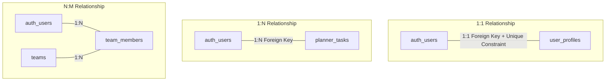
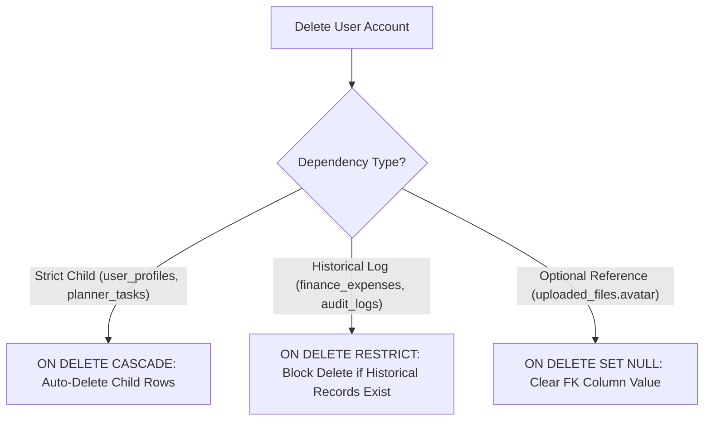

# Nexus AI Backend - Database Relationship Guidelines & Integrity Rules

**Document Version:** 1.0.0  
**Author:** Principal Database Architect & Senior Backend Engineer  
**Last Updated:** July 25, 2026  

---

## Table of Contents
1. [Document Purpose](#1-document-purpose)
2. [Document Scope](#2-document-scope)
3. [Relationship Mechanics & Foreign Key Patterns](#3-relationship-mechanics--foreign-key-patterns)
   - [3.1 One-to-One (1:1) Relationships](#31-one-to-one-11-relationships)
   - [3.2 One-to-Many (1:N) Relationships](#32-one-to-many-1n-relationships)
   - [3.3 Many-to-Many (N:M) Junction Table Patterns](#33-many-to-many-nm-junction-table-patterns)
4. [Cascade Deletion Policies (`CASCADE`, `SET NULL`, `RESTRICT`)](#4-cascade-deletion-policies-cascade-set-null-restrict)
5. [Foreign Key Update & Immutability Rules](#5-foreign-key-update--immutability-rules)
6. [Foreign Key Indexing & Join Optimization](#6-foreign-key-indexing--join-optimization)
7. [Domain-Driven Design (DDD) Aggregate Boundary Integrity](#7-domain-driven-design-ddd-aggregate-boundary-integrity)
8. [Cross-Domain Boundary Data Reference Rules](#8-cross-domain-boundary-data-reference-rules)
9. [Architectural Rationale & Trade-Off Analysis](#9-architectural-rationale--trade-off-analysis)
10. [Enterprise Best Practices](#10-enterprise-best-practices)
11. [Anti-Patterns & Common Mistakes](#11-anti-patterns--common-mistakes)
12. [Cross References](#12-cross-references)

---

## 1. Document Purpose

This document defines the relationship mechanics, foreign key constraint rules, cascade deletion policies, junction table design patterns, and join performance optimization strategies for the Nexus AI PostgreSQL database.

---

## 2. Document Scope

This specification applies to all relational foreign key definitions, constraint declarations, and cross-table references across the database schema.

---

## 3. Relationship Mechanics & Foreign Key Patterns

### 3.1 One-to-One (1:1) Relationships
* **Foreign Key Placement:** Placed on the dependent entity (`user_profiles.user_id`).
* **Constraint Rule:** Foreign key MUST be declared with a `UNIQUE` constraint to prevent duplicate child records.
* **Example:** `user_profiles.user_id REFERENCES auth_users(id) UNIQUE ON DELETE CASCADE`.

### 3.2 One-to-Many (1:N) Relationships
* **Foreign Key Placement:** Placed on the child entity ("Many" side).
* **Constraint Rule:** Non-unique foreign key indexed with a B-Tree index.
* **Example:** `planner_tasks.user_id REFERENCES auth_users(id) ON DELETE CASCADE`.

### 3.3 Many-to-Many (N:M) Junction Table Patterns
* **Rule:** Direct N:M relationship arrays are prohibited. All N:M relationships MUST utilize explicit junction tables featuring a composite primary key or surrogate UUID.
* **Junction Example:** `team_members` junction table containing `(team_id, user_id)` composite primary key, `role`, and `joined_at` timestamp.

---

## 4. Cascade Deletion Policies (`CASCADE`, `SET NULL`, `RESTRICT`)

To ensure database integrity during record deletion, cascade rules are strictly assigned based on domain ownership:

| Parent Table | Child Table | Cascade Action | Architectural Rationale |
| :--- | :--- | :--- | :--- |
| `auth_users` | `user_profiles` | `ON DELETE CASCADE` | Profile cannot exist without a parent user account. |
| `auth_users` | `planner_tasks` | `ON DELETE CASCADE` | Student tasks deleted upon explicit user account wipe. |
| `finance_categories`| `finance_expenses`| `ON DELETE RESTRICT`| Prevents deleting an expense category if historical expenses reference it. |
| `uploaded_files` | `user_profiles` | `ON DELETE SET NULL` | Deleting an uploaded file sets avatar URL reference to null. |

---

## 5. Foreign Key Update & Immutability Rules

* **Foreign Key Updates:** Foreign key values (`user_id`, `task_id`) MUST remain immutable after row insertion. Updates to foreign key values (`ON UPDATE RESTRICT`) are blocked to maintain transactional audit integrity.

---

## 6. Foreign Key Indexing & Join Optimization

* **Mandatory FK Indexing Rule:** PostgreSQL does NOT automatically create indexes on foreign key columns. Every foreign key column in the database MUST feature an explicit B-Tree index (e.g., `CREATE INDEX idx_planner_tasks_user_id ON planner_tasks(user_id)`).
* **Performance Impact:** Unindexed foreign keys cause PostgreSQL to perform full sequential table scans on the child table whenever a parent row is deleted or joined, destroying API response latency.

---

## 7. Domain-Driven Design (DDD) Aggregate Boundary Integrity

1. **Aggregate Root Ownership:** Child entities within an Aggregate (e.g., `planner_reminders` inside `planner_tasks`) MUST be created, updated, or deleted via transactions managed by the Aggregate Root.
2. **Cross-Aggregate References:** Cross-aggregate references MUST store only the primary key UUID of the referenced Aggregate Root (e.g., `finance_expenses` stores `user_id` as a loose foreign key without deep cross-table cascades).

---

## 8. Cross-Domain Boundary Data Reference Rules

When preparing the modular monolith for future microservice extraction:
* Direct relational joins across module boundaries (e.g., joining `planner_tasks` with `finance_expenses`) are prohibited in business services.
* Data from distinct domain aggregates must be assembled in the application layer or fetched via dedicated domain service interfaces.

---

## 9. Architectural Rationale & Trade-Off Analysis

### Decision: Explicit Foreign Keys + Indexes vs Loose Unconstrained Foreign Keys

| Evaluation Vector | Loose Unconstrained References (No FK Constraints) | Explicit Foreign Keys (`REFERENCES` + Indexes) |
| :--- | :--- | :--- |
| **Architectural Rationale** | Slightly faster write execution; leads to orphan data corruption. | Chosen for Nexus AI. Guarantees 100% database-enforced relational integrity and sub-millisecond joins. |
| **Advantages** | Fast bulk writes without constraint checks. | Prevents orphan records, guarantees referential integrity, enables instant join filtering via indexes. |
| **Disadvantages** | Severe risk of orphan records and corrupted state. | Minor CPU overhead (~2%) during INSERT/DELETE validation checks. |
| **Performance Impact** | Fast writes; slow unindexed joins. | Fast sub-millisecond indexed joins. |
| **Scalability Impact** | Severe data corruption risk. | High operational stability. |
| **Maintainability Impact**| Low maintainability. | Extremely High. |

---

## 10. Enterprise Best Practices

1. **Index Every Foreign Key:** Verify 100% of foreign key columns feature an underlying B-Tree index.
2. **Explicit Delete Actions:** Never leave a foreign key definition without an explicit `ON DELETE` clause.

---

## 11. Anti-Patterns & Common Mistakes

* ❌ **Missing Foreign Key Indexes:** Leaving `planner_tasks.user_id` unindexed, causing full table scans during user query joins.
* ❌ **Circular Foreign Keys:** Table A references Table B, and Table B references Table A with `ON DELETE CASCADE`, causing infinite deletion loops.

---

## 12. Cross References

* [21-database-overview.md](file:///d:/Nexus-AI/backend/docs/21-database-overview.md)
* [22-entity-relationship-design.md](file:///d:/Nexus-AI/backend/docs/22-entity-relationship-design.md)
* [25-indexing-strategy.md](file:///d:/Nexus-AI/backend/docs/25-indexing-strategy.md)
