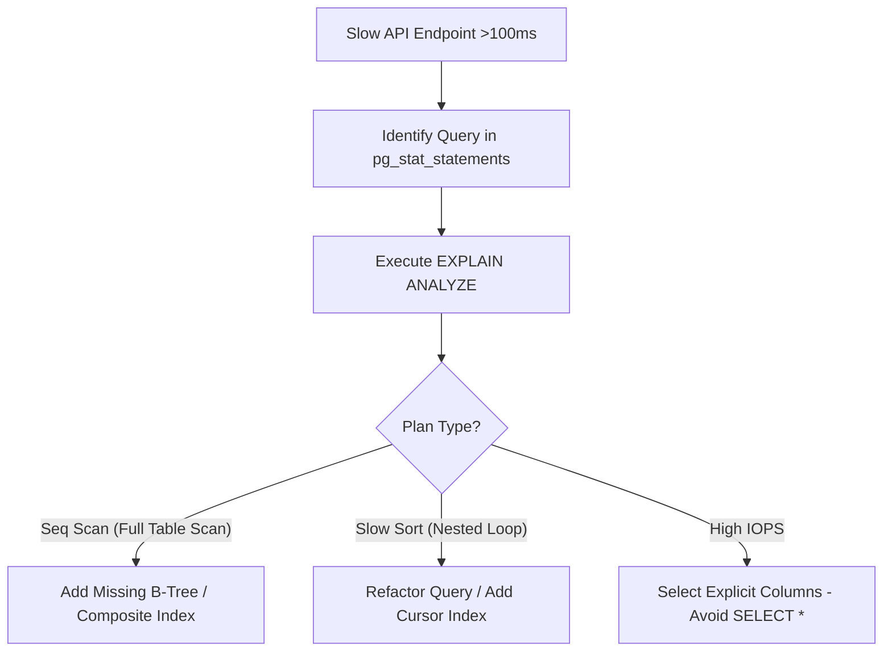
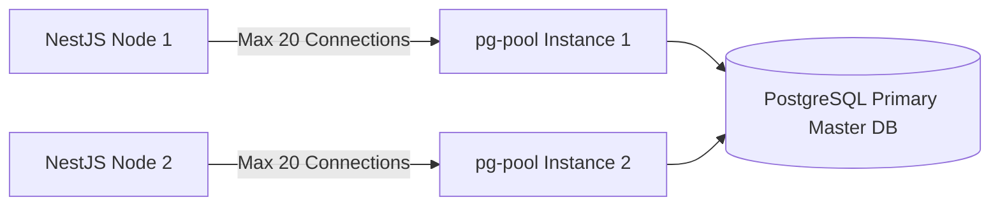
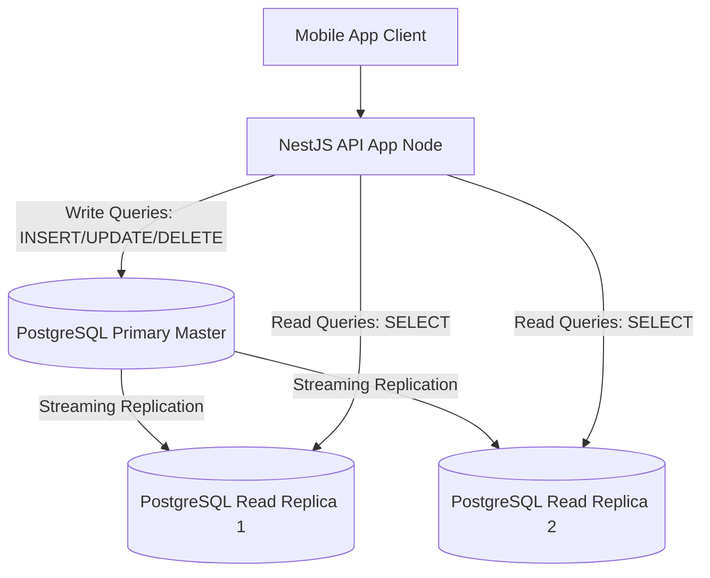
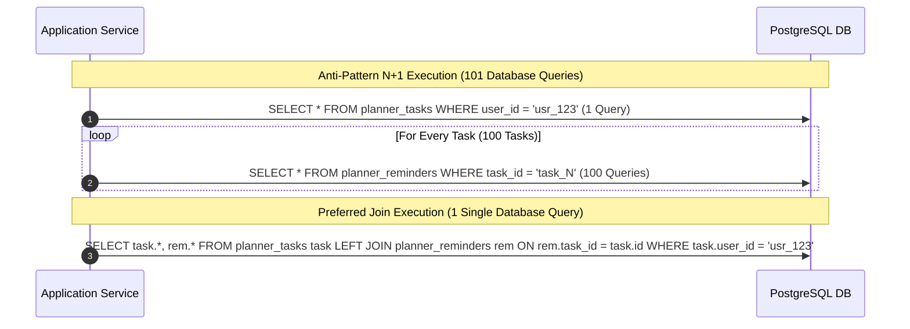
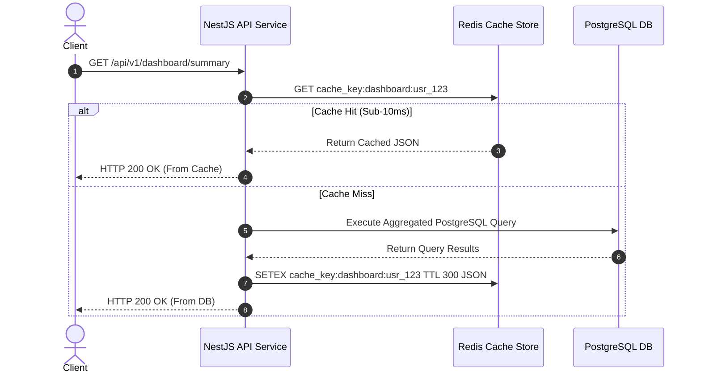

# Nexus AI Backend - Database Performance Optimization & Scalability

**Document Version:** 1.0.0  
**Author:** Principal Database Architect & Senior Backend Engineer  
**Last Updated:** July 25, 2026  

---

## Table of Contents
1. [Document Purpose](#1-document-purpose)
2. [Document Scope](#2-document-scope)
3. [Query Optimization & Execution Plan Analysis](#3-query-optimization--execution-plan-analysis)
4. [Connection Pooling Architecture (`pg-pool`)](#4-connection-pooling-architecture-pg-pool)
5. [Read & Write Scaling Topology (Primary/Replica Split)](#5-read--write-scaling-topology-primaryreplica-split)
6. [N+1 Query Prevention Strategy](#6-n1-query-prevention-strategy)
7. [Eager vs Lazy Loading Execution Rules](#7-eager-vs-lazy-loading-execution-rules)
8. [Caching Readiness Layer (Redis Integration)](#8-caching-readiness-layer-redis-integration)
9. [Large Table Handling Strategy (Partitioning & Materialized Views)](#9-large-table-handling-strategy-partitioning--materialized-views)
10. [Database Performance Monitoring (`pg_stat_statements`)](#10-database-performance-monitoring-pg_stat_statements)
11. [Architectural Rationale & Trade-Off Analysis](#11-architectural-rationale--trade-off-analysis)
12. [Enterprise Best Practices](#12-enterprise-best-practices)
13. [Anti-Patterns & Common Mistakes](#13-anti-patterns--common-mistakes)
14. [Cross References](#14-cross-references)

---

## 1. Document Purpose

This document defines the database performance tuning guidelines, connection pool sizing math, query optimization techniques, read/write scaling topologies, N+1 query prevention rules, caching strategies, and monitoring standards for the Nexus AI database.

---

## 2. Document Scope

This specification applies to all SQL query construction, ORM data loading strategies, database connection pools, read-replica clusters, and performance monitoring tools across all environments.

---

## 3. Query Optimization & Execution Plan Analysis

### Mandatory Query Performance Rules
1. **Never Use `SELECT *`:** Always specify explicit column projections (`SELECT id, title, due_date`). Fetching unneeded columns bloats network payload size and prevents Index-Only scans.
2. **Execution Plan Validation:** Any query executing in production MUST be verified via `EXPLAIN ANALYZE` to ensure it uses Index Scans (`Index Scan` or `Index Only Scan`) rather than Sequential Table Scans (`Seq Scan`).

---

## 4. Connection Pooling Architecture (`pg-pool`)

Connecting directly to PostgreSQL for every HTTP request overwhelms database memory overhead. Connection pools are strictly configured per NestJS instance:

### Connection Pool Math Formula
$$\text{Max Connections Per Node} = \frac{\text{PostgreSQL Max Connections} - \text{Buffer (20)}}{\text{Number of Active NestJS Container Instances}}$$

* **Configuration Target:** 10 NestJS instances with `max: 20` connections per pool = 200 total active connections (well within PostgreSQL default limit of 300).

---

## 5. Read & Write Scaling Topology (Primary/Replica Split)

To support scaling read-heavy traffic (e.g., student dashboard refreshes), TypeORM is configured with Primary/Replica connection splitting:

---

## 6. N+1 Query Prevention Strategy

The N+1 query problem occurs when an ORM fetches a parent collection (1 query) and subsequently executes N separate queries to fetch related child entities.

---

## 7. Eager vs Lazy Loading Execution Rules

1. **Lazy Loading Prohibited:** Implicit lazy loading via ORM proxy getters is strictly forbidden in production services because it causes silent N+1 query bugs.
2. **Explicit Query Builder Joins Enforced:** Developers MUST explicitly specify required relations using TypeORM `.leftJoinAndSelect()` or explicit relation arrays (`relations: ['category']`).

---

## 8. Caching Readiness Layer (Redis Integration)

High-frequency, low-variance query responses (such as monthly expense categories or aggregated dashboard summaries) are cached in Redis with a 5-minute Time-To-Live (TTL):

---

## 9. Large Table Handling Strategy (Partitioning & Materialized Views)

* **Materialized Views:** Used for expensive analytical reports (`finance_monthly_aggregates_mv`). Views are refreshed asynchronously using `REFRESH MATERIALIZED VIEW CONCURRENTLY` via background cron jobs every Sunday at 02:00 UTC.

---

## 10. Database Performance Monitoring (`pg_stat_statements`)

* **Query Telemetry:** PostgreSQL `pg_stat_statements` extension is enabled to track query call frequencies, total execution time, and mean execution duration.
* **Slow Query Log Threshold:** Any query taking longer than **100 milliseconds** is automatically logged to Winston as a performance warning alert.

---

## 11. Architectural Rationale & Trade-Off Analysis

### Decision: Primary/Replica Connection Split vs Single Master Database

| Evaluation Vector | Single Master Database Instance | Primary/Replica Read Split Topology |
| :--- | :--- | :--- |
| **Architectural Rationale** | Easy setup; bottlenecks under high concurrent read traffic. | Chosen for Nexus AI. Offloads 80% of read traffic to streaming read-replicas. |
| **Advantages** | Zero replication lag concerns. | Drastically increases read throughput, isolates read analytical queries from write transactions. |
| **Disadvantages** | Master CPU & IOPS max out under load spikes. | Minimal replication lag (~10ms) between primary master and read replicas. |
| **Performance Impact** | Degrades under heavy load. | Sub-millisecond reads maintained even during peak usage. |
| **Scalability Impact** | Limited to vertical node scaling. | Exceptional horizontal read scalability. |
| **Maintainability Impact**| Low configuration complexity. | Medium (requires managing connection pools). |

---

## 12. Enterprise Best Practices

1. **Use Explicit Join Queries:** Always construct explicit join queries to prevent N+1 query bugs.
2. **Monitor Connection Pools:** Ensure application connection pool sizes match available database memory bounds.

---

## 13. Anti-Patterns & Common Mistakes

* ❌ **Implicit Lazy Loading:** Accessing `task.reminders` inside a loop without pre-fetching relations in the initial query.
* ❌ **Unindexed Sort Operations:** Running `ORDER BY created_at DESC` on an unindexed column across 1,000,000 rows.

---

## 14. Cross References

* [03-non-functional-requirements.md](file:///d:/Nexus-AI/backend/docs/03-non-functional-requirements.md)
* [21-database-overview.md](file:///d:/Nexus-AI/backend/docs/21-database-overview.md)
* [25-indexing-strategy.md](file:///d:/Nexus-AI/backend/docs/25-indexing-strategy.md)
