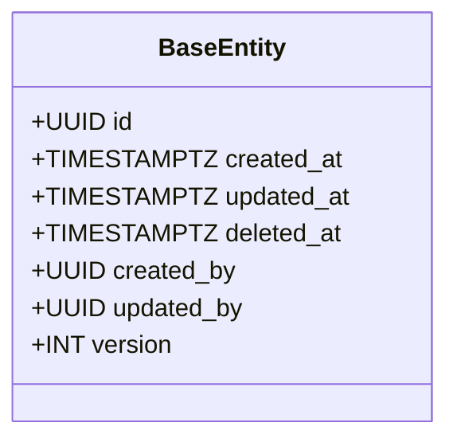
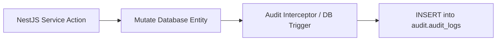
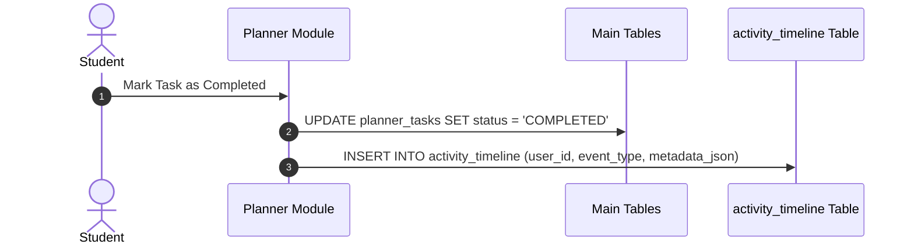

# Nexus AI Backend - Database Auditing, Versioning & Event History

**Document Version:** 1.0.0  
**Author:** Principal Database Architect & Senior Backend Engineer  
**Last Updated:** July 25, 2026  

---

## Table of Contents
1. [Document Purpose](#1-document-purpose)
2. [Document Scope](#2-document-scope)
3. [Standard Audit Column Specification](#3-standard-audit-column-specification)
4. [Soft Delete Architecture & Logical Removal Protocol](#4-soft-delete-architecture--logical-removal-protocol)
5. [Audit History Trail Architecture (`audit_logs`)](#5-audit-history-trail-architecture-audit_logs)
6. [Optimistic Locking & Entity Concurrency Versioning](#6-optimistic-locking--entity-concurrency-versioning)
7. [Activity Timeline Event Logging Architecture](#7-activity-timeline-event-logging-architecture)
8. [Event Sourcing & Change Data Capture (CDC) Readiness](#8-event-sourcing--change-data-capture-cdc-readiness)
9. [Architectural Rationale & Trade-Off Analysis](#9-architectural-rationale--trade-off-analysis)
10. [Enterprise Best Practices](#10-enterprise-best-practices)
11. [Anti-Patterns & Common Mistakes](#11-anti-patterns--common-mistakes)
12. [Cross References](#12-cross-references)

---

## 1. Document Purpose

This document defines the database auditing standards, soft-delete mechanics, state change tracking tables, optimistic concurrency control versioning, user activity timeline logging, and Event Sourcing readiness for the Nexus AI database.

---

## 2. Document Scope

This specification applies to all database entities, audit log storage, state mutation interceptors, version columns, and event streams.

---

## 3. Standard Audit Column Specification

Every primary database table MUST include five standard audit tracking columns:

| Column Name | PostgreSQL Data Type | Nullability | Purpose |
| :--- | :--- | :--- | :--- |
| `created_at` | `TIMESTAMPTZ` | `NOT NULL DEFAULT NOW()` | Timestamp when row was inserted in UTC. |
| `updated_at` | `TIMESTAMPTZ` | `NOT NULL DEFAULT NOW()` | Timestamp when row was last modified in UTC. |
| `deleted_at` | `TIMESTAMPTZ` | `NULLABLE` | Timestamp when row was soft deleted. `NULL` = Active. |
| `created_by` | `UUID` | `NULLABLE` | User ID or system process creating the record. |
| `updated_by` | `UUID` | `NULLABLE` | User ID or system process updating the record. |

---

## 4. Soft Delete Architecture & Logical Removal Protocol

* **Policy:** Physical `DELETE` SQL queries are prohibited for core application domain tables (`auth_users`, `planner_tasks`, `finance_expenses`).
* **Mechanics:** Executing a delete operation sets `deleted_at = NOW()`.
* **Query Interception:** TypeORM automatically appends `WHERE deleted_at IS NULL` to all SELECT queries.
* **Partial Indexing Support:** Partial indexes MUST include `WHERE deleted_at IS NULL` to keep index sizes minimal.

---

## 5. Audit History Trail Architecture (`audit_logs`)

To maintain a permanent, unalterable record of sensitive entity mutations (e.g., changes to financial budgets, password updates, or role alterations), mutations trigger an entry in the centralized `audit_logs` schema:

### Table Structure Specification: `audit.audit_logs`
* `id` (`UUID PRIMARY KEY`): Unique audit entry ID.
* `table_name` (`VARCHAR(100)`): Target table modified (e.g., `finance_budgets`).
* `entity_id` (`UUID`): Primary key of target modified row.
* `action` (`VARCHAR(20)`): Action type (`INSERT`, `UPDATE`, `SOFT_DELETE`).
* `old_values` (`JSONB`): Pre-mutation state snapshot.
* `new_values` (`JSONB`): Post-mutation state snapshot.
* `performed_by` (`UUID`): User ID initiating change.
* `timestamp` (`TIMESTAMPTZ DEFAULT NOW()`): Immutable timestamp.

---

## 6. Optimistic Locking & Entity Concurrency Versioning

To prevent lost update anomalies during concurrent edits (e.g., two client devices updating the same assignment task simultaneously):
* **Version Column:** High-concurrency entities include an integer `version` column managed via TypeORM `@VersionColumn()`.
* **Concurrency Check:** Updates execute `UPDATE planner_tasks SET title = ?, version = version + 1 WHERE id = ? AND version = 3`. If version has changed, TypeORM throws `OptimisticLockVersionMismatchError`, prompting the client to fetch fresh data before retrying.

---

## 7. Activity Timeline Event Logging Architecture

Student interaction feeds are powered by an immutable append-only event log table `activity_timeline`:

---

## 8. Event Sourcing & Change Data Capture (CDC) Readiness

When transitioning to an event-driven microservices architecture:
* PostgreSQL Write-Ahead Logs (WAL) will stream table change events via Debezium CDC (Change Data Capture) into Apache Kafka / RabbitMQ topics without requiring modifications to NestJS business logic.

---

## 9. Architectural Rationale & Trade-Off Analysis

### Decision: Soft Delete (`deleted_at`) + `audit_logs` Table vs Physical SQL Deletion

| Evaluation Vector | Physical SQL Deletion (`DELETE FROM ...`) | Soft Delete + Centralized Audit Trail |
| :--- | :--- | :--- |
| **Architectural Rationale** | Simple; results in irreversible data loss and broken analytical history. | Chosen for Nexus AI. Guarantees 100% data recovery capability, audit compliance, and historical integrity. |
| **Advantages** | Reclaims disk space instantly. | Complete data recovery, user audit trail, zero risk of accidental catastrophic data loss. |
| **Disadvantages** | Irreversible data loss; orphan record risk. | Table row count grows continuously (mitigated by automated archiving routines). |
| **Performance Impact** | Fast single-row delete. | Minimal overhead; query filtering managed via partial indexes (`WHERE deleted_at IS NULL`). |
| **Scalability Impact** | High data loss risk. | High operational safety and compliance readiness. |
| **Maintainability Impact**| Low. | Extremely High. |

---

## 10. Enterprise Best Practices

1. **Scrub Secrets in Audit Logs:** Ensure passwords and credit card details are masked before writing `old_values` and `new_values` JSON snapshots.
2. **Immutable Audit Logs:** Restrict database roles so that `audit_logs` entries can never be updated or deleted.

---

## 11. Anti-Patterns & Common Mistakes

* ❌ **Hard Deleting User Financial Records:** Executing physical SQL deletes on `finance_expenses`, destroying monthly financial audit balances.
* ❌ **Ignoring Optimistic Locking:** Updating shared resources without a version column, allowing concurrent overwrites to silently erase changes.

---

## 12. Cross References

* [12-database-guidelines.md](file:///d:/Nexus-AI/backend/docs/12-database-guidelines.md)
* [23-table-design-guidelines.md](file:///d:/Nexus-AI/backend/docs/23-table-design-guidelines.md)
* [29-data-retention-policy.md](file:///d:/Nexus-AI/backend/docs/29-data-retention-policy.md)
