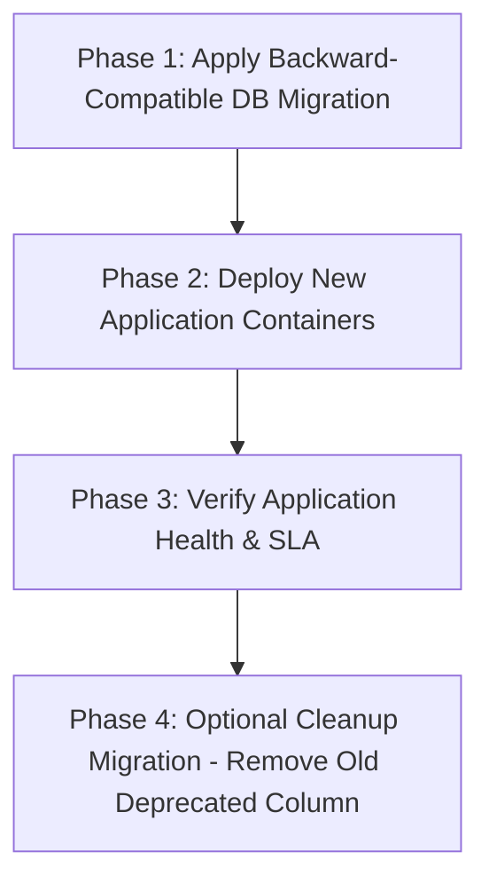
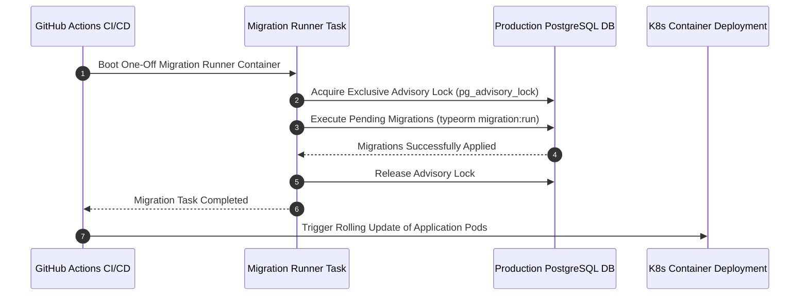

# Nexus AI Backend - Database Migration & Schema Evolution Strategy

**Document Version:** 1.0.0  
**Author:** Principal Database Architect & Senior Backend Engineer  
**Last Updated:** July 25, 2026  

---

## Table of Contents
1. [Document Purpose](#1-document-purpose)
2. [Document Scope](#2-document-scope)
3. [Zero-Downtime Migration Philosophy](#3-zero-downtime-migration-philosophy)
4. [Migration File Naming & Location Conventions](#4-migration-file-naming--location-conventions)
5. [Backward-Compatible Schema Alteration Patterns](#5-backward-compatible-schema-alteration-patterns)
6. [Rollback & Testing Strategy (`up()` and `down()`)](#6-rollback--testing-strategy-up-and-down)
7. [CI/CD Deployment Pipeline Migration Execution](#7-cicd-deployment-pipeline-migration-execution)
8. [Production Migration Execution Checklist](#8-production-migration-execution-checklist)
9. [Database Seeder Architecture](#9-database-seeder-architecture)
10. [Version Control & Schema Drift Detection](#10-version-control--schema-drift-detection)
11. [Architectural Rationale & Trade-Off Analysis](#11-architectural-rationale--trade-off-analysis)
12. [Enterprise Best Practices](#12-enterprise-best-practices)
13. [Anti-Patterns & Common Mistakes](#13-anti-patterns--common-mistakes)
14. [Cross References](#14-cross-references)

---

## 1. Document Purpose

This document defines the database migration philosophy, schema versioning rules, zero-downtime deployment patterns, rollback procedures, CI/CD execution sequences, production safety checklists, and seeder strategies for the Nexus AI PostgreSQL database.

---

## 2. Document Scope

This specification applies to all TypeORM database migrations, schema alteration scripts, seeder classes, and release deployment pipelines.

---

## 3. Zero-Downtime Migration Philosophy

To achieve **99.9% application availability**, database migrations MUST support zero-downtime deployments. Old application container instances and new application container instances must run concurrently against the database schema during release rollouts without throwing errors.

---

## 4. Migration File Naming & Location Conventions

* **Location:** `src/database/migrations/`
* **Naming Standard:** `{Timestamp}-{DescriptivePascalCaseName}.ts`
* **Example:** `1721932200000-AddPriorityIndexToPlannerTasks.ts`

---

## 5. Backward-Compatible Schema Alteration Patterns

### 5.1 Adding a Mandatory (NOT NULL) Column
* ❌ **Destructive Pattern:** Adding a `NOT NULL` column directly without a default value fails instantly on existing rows.
* ✅ **Zero-Downtime 3-Step Pattern:**
  1. Add column as `NULLABLE` in Migration 1.
  2. Deploy application code to populate the new column for active writes. Execute background script to backfill historical null rows.
  3. Apply Migration 2 to set column constraint to `NOT NULL`.

### 5.2 Renaming a Column
* ❌ **Destructive Pattern:** Renaming `amount` to `transaction_amount` breaks running old container instances immediately.
* ✅ **Zero-Downtime Pattern:** Add new column `transaction_amount`, write to both columns during release transition, backfill data, and drop old column in a subsequent release window.

---

## 6. Rollback & Testing Strategy (`up()` and `down()`)

1. **Mandatory `down()` Implementation:** Every migration file MUST contain a fully tested, functional `down()` method that perfectly reverses every SQL statement executed in `up()`.
2. **Dry-Run Testing:** Prior to merging a PR, developers MUST test rollback locally:
   `npm run migration:run && npm run migration:revert`.

---

## 7. CI/CD Deployment Pipeline Migration Execution

---

## 8. Production Migration Execution Checklist

Prior to applying migrations to production:
- [ ] Verified `synchronize: false` is enforced in production configuration.
- [ ] Confirmed migration runs inside a explicit transaction block (`QueryRunner`).
- [ ] Confirmed large index creations use `CREATE INDEX CONCURRENTLY` to avoid blocking table writes.
- [ ] Set `lock_timeout = '5s'` to prevent migration lock wait queues from starving application connection pools.
- [ ] Executed automated backup snapshot prior to deployment.

---

## 9. Database Seeder Architecture

* **Location:** `src/database/seeds/`
* **Idempotency Rule:** Seed scripts MUST check if reference data exists prior to insertion (using `ON CONFLICT DO NOTHING` or `WHERE NOT EXISTS`).
* **Environment Scoping:**
  * **System Seeders:** Populate default lookup categories (`finance_categories`, system roles) across ALL environments.
  * **Development Seeders:** Populate realistic mock students, tasks, and budgets ONLY in `development` and `test` environments.

---

## 10. Version Control & Schema Drift Detection

* **Single Source of Truth:** Git is the authoritative source for database structure.
* **Schema Drift Check:** CI build pipeline verifies that the TypeORM schema generated from TypeScript entity definitions matches the schema resulting from running all migration scripts sequentially.

---

## 11. Architectural Rationale & Trade-Off Analysis

### Decision: Version-Controlled Code Migrations vs Automatic ORM Synchronization (`synchronize: true`)

| Evaluation Vector | Automatic Sync (`synchronize: true`) | Code Migrations (`typeorm migration:run`) |
| :--- | :--- | :--- |
| **Architectural Rationale** | Dangerous; drops columns and tables automatically upon entity edits. | Chosen for Nexus AI. Guarantees 100% deterministic, audit-tracked, reversible schema evolution. |
| **Advantages** | Zero migration script writing. | Zero data loss risk, complete version control history, exact SQL execution visibility. |
| **Disadvantages** | Accidental catastrophic data wipes in production. | Requires generating and testing migration files per schema change. |
| **Performance Impact** | Unpredictable boot delays. | Instant application container boot. |
| **Scalability Impact** | Severe risk of downtime. | High operational stability. |
| **Maintainability Impact**| Unusable for enterprise production. | Extremely High. |

---

## 12. Enterprise Best Practices

1. **Test Reversibility:** Always verify `migration:revert` works cleanly before merging pull requests.
2. **Use Advisory Locks:** Use PostgreSQL advisory locks (`pg_advisory_lock`) during deployment migrations to prevent multi-container execution race conditions.

---

## 13. Anti-Patterns & Common Mistakes

* ❌ **Enabling `synchronize: true` in Production:** Causing TypeORM to drop production columns during container deployment.
* ❌ **Blocking Table Locks:** Creating an index on a 50M row table without `CONCURRENTLY`, locking table writes for 20 minutes.

---

## 14. Cross References

* [12-database-guidelines.md](file:///d:/Nexus-AI/backend/docs/12-database-guidelines.md)
* [16-development-workflow.md](file:///d:/Nexus-AI/backend/docs/16-development-workflow.md)
* [21-database-overview.md](file:///d:/Nexus-AI/backend/docs/21-database-overview.md)
