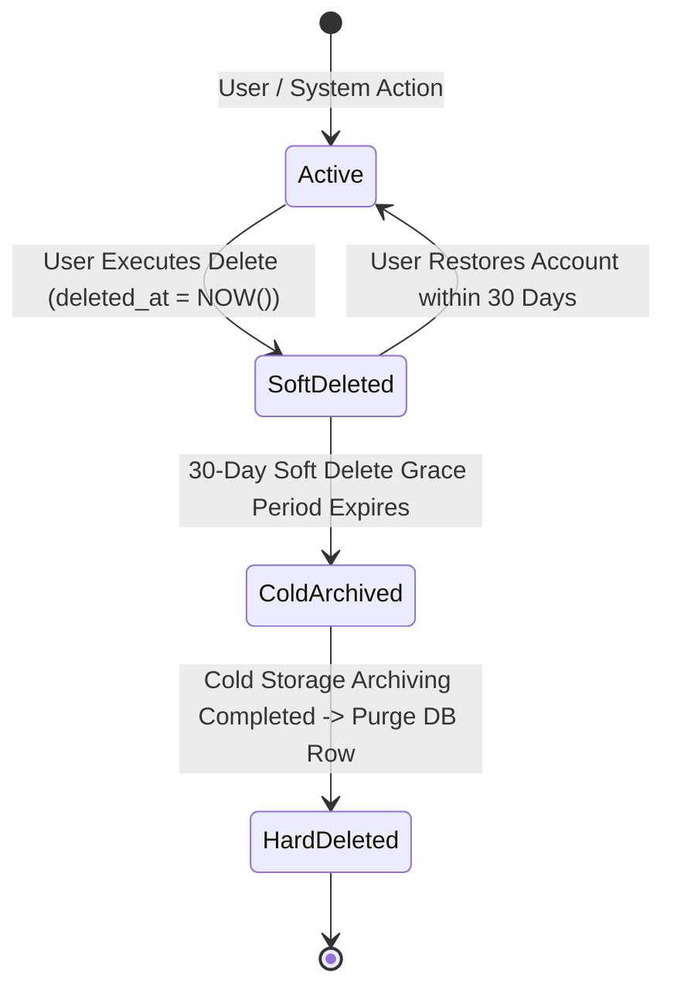
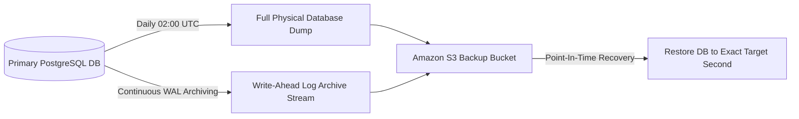
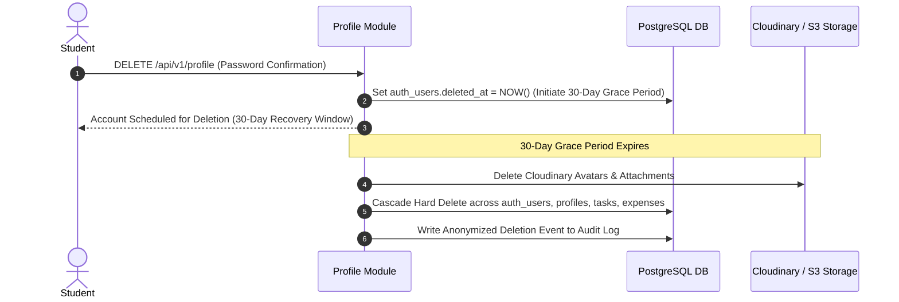

# Nexus AI Backend - Data Retention, Archiving & GDPR Compliance Policy

**Document Version:** 1.0.0  
**Author:** Principal Database Architect & Senior Backend Engineer  
**Last Updated:** July 25, 2026  

---

## Table of Contents
1. [Document Purpose](#1-document-purpose)
2. [Document Scope](#2-document-scope)
3. [Domain Data Retention Lifecycle Matrix](#3-domain-data-retention-lifecycle-matrix)
4. [Soft-to-Hard Deletion Execution Pipeline](#4-soft-to-hard-deletion-execution-pipeline)
5. [Cold Data Archiving Architecture (S3 / Parquet)](#5-cold-data-archiving-architecture-s3--parquet)
6. [Automated Scheduled Purge Jobs](#6-automated-scheduled-purge-jobs)
7. [Database Backup & Point-In-Time Recovery (PITR) Strategy](#7-database-backup--point-in-time-recovery-pitr-strategy)
8. [Disaster Recovery & Business Continuity (RPO / RTO)](#8-disaster-recovery--business-continuity-rpo--rto)
9. [GDPR & FERPA Data Privacy Protocols](#9-gdpr--ferpa-data-privacy-protocols)
10. [Right to be Forgotten (Account Erasure Workflow)](#10-right-to-be-forgotten-account-erasure-workflow)
11. [Architectural Rationale & Trade-Off Analysis](#11-architectural-rationale--trade-off-analysis)
12. [Enterprise Best Practices](#12-enterprise-best-practices)
13. [Anti-Patterns & Common Mistakes](#13-anti-patterns--common-mistakes)
14. [Cross References](#14-cross-references)

---

## 1. Document Purpose

This document defines the data lifecycle policies, domain retention windows, cold storage archiving strategies, automated purge routines, database backup protocols, disaster recovery SLAs, and GDPR/FERPA compliance erasure workflows for the Nexus AI backend.

---

## 2. Document Scope

This specification applies to all data tables, audit logs, media files, backup snapshots, and user personal identifiable information (PII) stored across all environments.

---

## 3. Domain Data Retention Lifecycle Matrix

| Domain Category | Target Tables | Hot Database Retention | Cold Archive Retention | Final Action |
| :--- | :--- | :--- | :--- | :--- |
| **User Identity** | `auth_users`, `user_profiles` | Active Account Lifetime | 30 Days post-deletion | Hard Delete |
| **Session Tokens** | `auth_refresh_tokens` | Expiration + 7 Days | None | Auto-Purge |
| **Planner Data** | `planner_tasks` | Active + 2 Academic Years| 3 Years (S3 JSON) | Hard Delete |
| **Finance Data** | `finance_expenses`, `budgets` | Active + 3 Years | 7 Years (S3 Parquet) | Hard Delete |
| **AI Conversations**| `ai_messages` | Active + 1 Year | 2 Years (S3 Parquet) | Hard Delete |
| **Notifications** | `notifications` | 90 Days | None | Auto-Purge |
| **Analytics Metrics**| `productivity_metrics` | 365 Days | 3 Years (Aggregate) | Auto-Purge |
| **Audit Logs** | `audit_logs` | 1 Year | 5 Years (Immutable S3)| Permanent Legal Hold |

---

## 4. Soft-to-Hard Deletion Execution Pipeline

---

## 5. Cold Data Archiving Architecture (S3 / Parquet)

To keep the primary PostgreSQL database lean and maintain fast query response times:
1. **Cron Archiver:** A background worker runs monthly to query records soft-deleted >30 days ago or active financial data >3 years old.
2. **Parquet Export:** Records are exported to compressed Apache Parquet format and saved in Amazon S3 Cold Glacier storage.
3. **Primary DB Purge:** Once S3 upload is verified via SHA-256 hash checksum, rows are physically purged from PostgreSQL.

---

## 6. Automated Scheduled Purge Jobs

Powered by NestJS `@nestjs/schedule`:
* **Daily 03:00 UTC:** `DELETE FROM auth_refresh_tokens WHERE expires_at < NOW() - INTERVAL '7 days'`.
* **Daily 03:30 UTC:** `DELETE FROM notifications WHERE is_read = true AND created_at < NOW() - INTERVAL '90 days'`.

---

## 7. Database Backup & Point-In-Time Recovery (PITR) Strategy

---

## 8. Disaster Recovery & Business Continuity (RPO / RTO)

* **Recovery Point Objective (RPO):** Maximum allowable data loss: **<15 minutes** (achieved via continuous Write-Ahead Log streaming).
* **Recovery Time Objective (RTO):** Maximum allowable downtime during disaster restore: **<1 hour**.

---

## 9. GDPR & FERPA Data Privacy Protocols

1. **Right of Access (Data Export API):** Users can request a complete JSON archive of all personal data (`GET /api/v1/profile/export`), synthesizing records across Auth, Profile, Planner, Finance, and AI modules into a downloadable `.zip`.
2. **Student Privacy (FERPA Compliance):** Student academic metrics and grades are strictly isolated per `user_id` with zero cross-tenant access.

---

## 10. Right to be Forgotten (Account Erasure Workflow)

When a student executes an account deletion request (`DELETE /api/v1/profile`):

---

## 11. Architectural Rationale & Trade-Off Analysis

### Decision: Automated Archiving to S3 Parquet vs Indefinite Database Storage

| Evaluation Vector | Storing All Historical Data Indefinitely in PostgreSQL | Automated Archiving of Cold Data to S3 Parquet |
| :--- | :--- | :--- |
| **Architectural Rationale** | Causes massive database bloat; degrades index performance and backup speed. | Chosen for Nexus AI. Keeps primary PostgreSQL lean while preserving historical records in low-cost S3 storage. |
| **Advantages** | Simple; historical data instantly accessible via SQL. | Drastically reduces DB storage costs (~90% cheaper), keeps B-Tree indexes small and fast, speeds up DB backup/restore times. |
| **Disadvantages** | Database storage costs skyrocket; query performance degrades over time. | Querying cold archived data requires Athena or specialized S3 analytics tools. |
| **Performance Impact** | Degrades over time as tables exceed 100M rows. | Sub-millisecond queries maintained perpetually. |
| **Scalability Impact** | High database scaling friction. | Unlimited scalable storage. |
| **Maintainability Impact**| Low long-term maintainability. | Extremely High. |

---

## 12. Enterprise Best Practices

1. **Test Restores Monthly:** Execute automated monthly disaster recovery restore drills to verify database backup integrity.
2. **Immutable Audit Logs:** Ensure compliance audit logs remain untouched during account erasure routines.

---

## 13. Anti-Patterns & Common Mistakes

* ❌ **Keeping Expired Tokens Forever:** Allowing `auth_refresh_tokens` to accumulate millions of dead rows.
* ❌ **Failing to Backup WAL Logs:** Relying solely on daily database dumps, risking up to 24 hours of data loss during a failure.

---

## 14. Cross References

* [03-non-functional-requirements.md](file:///d:/Nexus-AI/backend/docs/03-non-functional-requirements.md)
* [27-audit-versioning.md](file:///d:/Nexus-AI/backend/docs/27-audit-versioning.md)
* [30-future-database-evolution.md](file:///d:/Nexus-AI/backend/docs/30-future-database-evolution.md)
