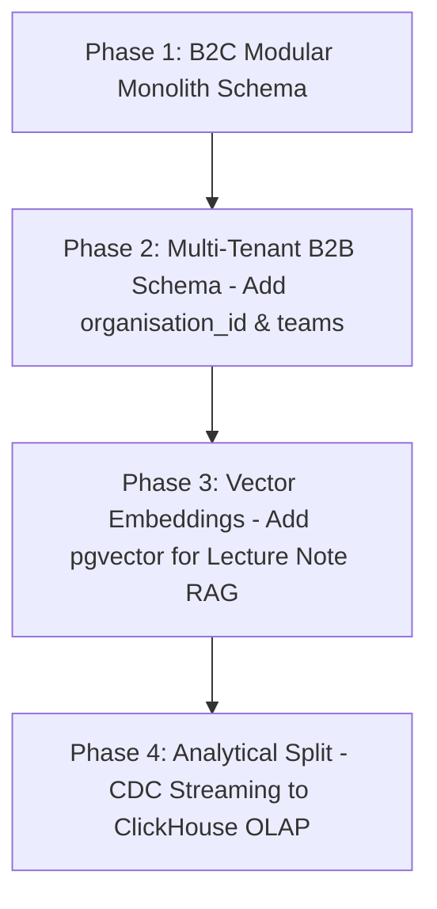
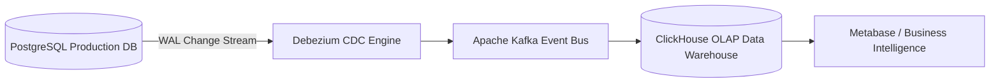
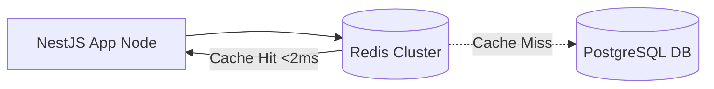
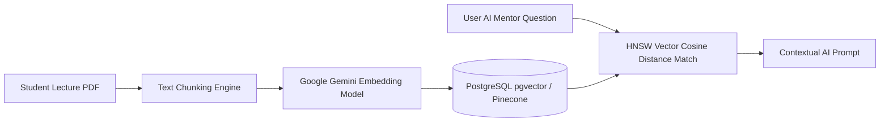

# Nexus AI Backend - Future Database Evolution & Advanced Analytics

**Document Version:** 1.0.0  
**Author:** Principal Database Architect & Senior Backend Engineer  
**Last Updated:** July 25, 2026  

---

## Table of Contents
1. [Document Purpose](#1-document-purpose)
2. [Document Scope](#2-document-scope)
3. [Future Schema Evolution Roadmap](#3-future-schema-evolution-roadmap)
4. [Admin & Back-Office Database Access Layer](#4-admin--back-office-database-access-layer)
5. [Analytical Data Warehouse Architecture (ClickHouse / Snowflake)](#5-analytical-data-warehouse-architecture-clickhouse--snowflake)
6. [Event Store & Change Data Capture (Debezium + Kafka)](#6-event-store--change-data-capture-debezium--kafka)
7. [Distributed Caching Layer (Redis Cluster)](#7-distributed-caching-layer-redis-cluster)
8. [Elasticsearch Search Engine Integration](#8-elasticsearch-search-engine-integration)
9. [Vector Database & RAG Architecture (`pgvector` / Pinecone)](#9-vector-database--rag-architecture-pgvector--pinecone)
10. [Machine Learning Dataset Extraction Pipeline](#10-machine-learning-dataset-extraction-pipeline)
11. [Architectural Rationale & Trade-Off Analysis](#11-architectural-rationale--trade-off-analysis)
12. [Enterprise Best Practices](#12-enterprise-best-practices)
13. [Future Considerations](#13-future-considerations)
14. [Cross References](#14-cross-references)

---

## 1. Document Purpose

This document defines the long-term database evolution strategy, analytical Data Warehouse integrations, Event Store pipelines, vector search additions, machine learning dataset pipelines, and specialized search engine architectures for the Nexus AI platform.

---

## 2. Document Scope

This specification covers future database infrastructure additions beyond the core PostgreSQL relational engine: ClickHouse/Snowflake, Debezium CDC, Kafka Event Streams, Redis Clusters, Elasticsearch, and Vector Databases (`pgvector`/Pinecone).

---

## 3. Future Schema Evolution Roadmap

As Nexus AI expands into B2B university licensing, team collaboration, and advanced monetization tiers, the relational database schema will evolve cleanly:

---

## 4. Admin & Back-Office Database Access Layer

To prevent administrative reporting queries from impacting production student API latencies:
* **Architecture:** Admin Back-Office dashboard queries run against a dedicated, read-only PostgreSQL read replica (`db-replica-admin.nexus.internal`).
* **Security Isolation:** Admin database user roles possess strict `SELECT` privileges on business views, with zero write access to production tables.

---

## 5. Analytical Data Warehouse Architecture (ClickHouse / Snowflake)

For complex multi-year trend analysis across millions of students (OLAP query workloads):

* **Why ClickHouse:** ClickHouse executes columnar aggregations across billions of rows 100x faster than traditional OLTP databases without locking production tables.

---

## 6. Event Store & Change Data Capture (Debezium + Kafka)

* **Mechanism:** Debezium streams PostgreSQL Write-Ahead Logs (WAL) into Kafka topics (`nexus.planner.tasks`, `nexus.finance.expenses`) in real-time.
* **Benefits:** Microservices, search indexing engines, and analytical pipelines consume change events without modifying NestJS application code.

---

## 7. Distributed Caching Layer (Redis Cluster)

* **Responsibilities:**
  1. Sub-10ms response caching for aggregated student dashboards.
  2. Stateless JWT token revocation blacklists.
  3. Throttler rate-limiting state counters.

---

## 8. Elasticsearch Search Engine Integration

When full-text search requirements exceed PostgreSQL `tsvector` bounds (e.g., searching across millions of uploaded PDF lecture notes and chat transcripts):
* **Architecture:** Kafka consumers automatically stream text updates into Elasticsearch 8.x indexes.

---

## 9. Vector Database & RAG Architecture (`pgvector` / Pinecone)

To power AI Mentor RAG (Retrieval-Augmented Generation) queries over student course materials:

---

## 10. Machine Learning Dataset Extraction Pipeline

To train custom recommendation models for task priority optimization:
* **Pipeline:** Nightly ETL background jobs extract anonymized task completion histories and safe-spend compliance rates, formatting datasets into S3-hosted CSV/Parquet files for Python ML training pipelines.

---

## 11. Architectural Rationale & Trade-Off Analysis

### Decision: Specialized Analytics Database (ClickHouse) vs Running Analytics on PostgreSQL Replicas

| Evaluation Vector | Analytics Queries on PostgreSQL Read Replicas | Dedicated OLAP Engine (ClickHouse) |
| :--- | :--- | :--- |
| **Architectural Rationale** | Easy setup; row-oriented storage slows down large aggregations. | Chosen for Nexus AI. Columnar storage executes multi-million row aggregations in milliseconds. |
| **Advantages** | Zero extra infrastructure complexity. | Extreme analytical query performance (~100x faster), columnar compression reduces storage by 80%. |
| **Disadvantages** | Long-running queries consume replica CPU and memory. | Adds Debezium, Kafka, and ClickHouse to DevOps operational footprint. |
| **Performance Impact** | Slow analytical queries (>5s). | Sub-second analytical aggregations (<100ms). |
| **Scalability Impact** | Limited analytical scale. | Unlimited petabyte-scale analytics. |
| **Maintainability Impact**| Medium. | High operational requirement. |

---

## 12. Enterprise Best Practices

1. **Decouple OLTP and OLAP:** Never run heavy analytical aggregation queries on primary transactional databases.
2. **Use CDC for Data Streaming:** Rely on non-intrusive Write-Ahead Log Change Data Capture (Debezium) rather than application dual-writing.

---

## 13. Future Considerations

* Evaluation of `pgvector` vs Pinecone based on total vector storage volume and latency benchmarks.

---

## 14. Cross References

* [08-future-scalability.md](file:///d:/Nexus-AI/backend/docs/08-future-scalability.md)
* [21-database-overview.md](file:///d:/Nexus-AI/backend/docs/21-database-overview.md)
* [26-database-performance.md](file:///d:/Nexus-AI/backend/docs/26-database-performance.md)
