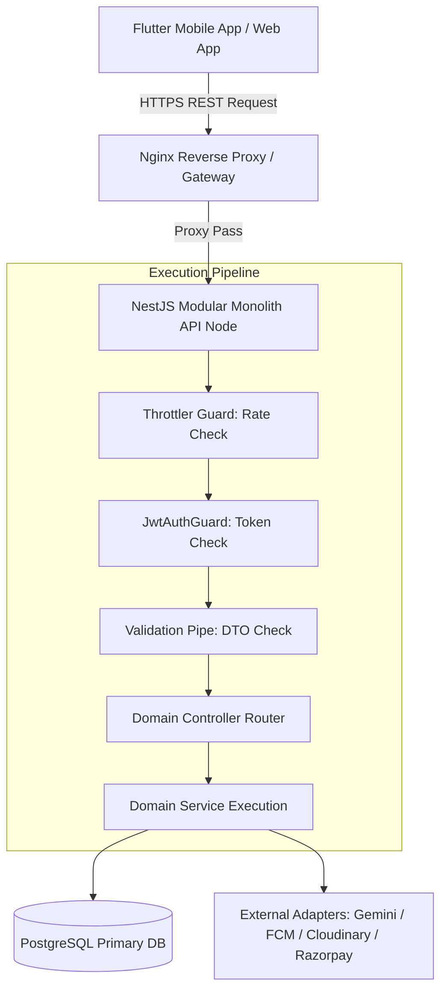
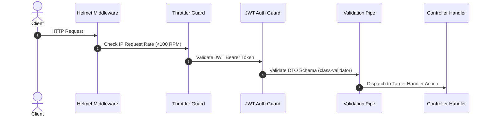
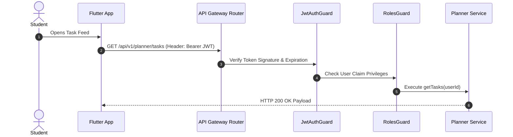

# Nexus AI Backend - REST API Overview & Architecture Philosophy

**Document Version:** 1.0.0  
**Author:** Principal API Architect & Senior Backend Engineer  
**Last Updated:** July 25, 2026  

---

## Table of Contents
1. [Document Purpose](#1-document-purpose)
2. [Document Scope](#2-document-scope)
3. [API Architecture Philosophy](#3-api-architecture-philosophy)
4. [Resource-Oriented REST Principles](#4-resource-oriented-rest-principles)
5. [Incoming Request Lifecycle Execution Pipeline](#5-incoming-request-lifecycle-execution-pipeline)
6. [Outgoing Response Transformation Lifecycle](#6-outgoing-response-transformation-lifecycle)
7. [Authentication & Authorization Integration Flow](#7-authentication--authorization-integration-flow)
8. [Inter-Module Communication Mechanics](#8-inter-module-communication-mechanics)
9. [Rate Limiting & Anti-DDoS Defense Strategy](#9-rate-limiting--anti-ddos-defense-strategy)
10. [API Gateway Readiness & Reverse Proxy Architecture](#10-api-gateway-readiness--reverse-proxy-architecture)
11. [Future GraphQL & gRPC Transport Compatibility](#11-future-graphql--grpc-transport-compatibility)
12. [Architectural Rationale & Trade-Off Analysis](#12-architectural-rationale--trade-off-analysis)
13. [Enterprise Best Practices](#13-enterprise-best-practices)
14. [Future Considerations](#14-future-considerations)
15. [Cross References](#15-cross-references)

---

## 1. Document Purpose

This document articulates the high-level API design philosophy, resource-oriented architecture, request/response execution pipelines, security flow mechanics, rate limiting models, and future transport compatibility standards for the Nexus AI backend. It sets the baseline standards for all API contracts exposed to Flutter mobile apps, web dashboards, and third-party integrations.

---

## 2. Document Scope

This specification applies to all HTTP/HTTPS REST endpoints exposed across all 10 core domain modules and infrastructure adapters.

---

## 3. API Architecture Philosophy

The Nexus AI API is designed with an **API-First Methodology**. Front-end engineers (Flutter mobile and web developers) rely on these standardized contracts to build client applications independently before backend controller implementation begins.

---

## 4. Resource-Oriented REST Principles

1. **Stateless Execution:** No client session state is retained in server memory. Every HTTP request must contain full authentication credentials in its `Authorization: Bearer <JWT>` header.
2. **Resource Nouns over Verbs:** URIs represent entity resources (`/planner/tasks`, `/finance/expenses`), while HTTP verbs (`GET`, `POST`, `PATCH`, `DELETE`) define actions.
3. **Representational JSON Payload:** Request and response bodies are JSON objects structured in UTF-8 encoding.

---

## 5. Incoming Request Lifecycle Execution Pipeline

---

## 6. Outgoing Response Transformation Lifecycle

* **Success Transformation:** All successful responses pass through a global `TransformInterceptor` that wraps the payload in a uniform JSON envelope containing `statusCode`, `success: true`, `data`, and ISO-8601 `timestamp`.
* **Error Transformation:** Unhandled exceptions pass through a global `ExceptionFilter` formatting output to RFC 7807 Problem Details envelopes.

---

## 7. Authentication & Authorization Integration Flow

---

## 8. Inter-Module Communication Mechanics

API Controllers interact strictly with their parent module's Service layer. For cross-module side effects (e.g., creating a task triggers a push notification), services emit asynchronous events (`task.created`) via NestJS `EventEmitter2` rather than invoking cross-controller HTTP endpoints internally.

---

## 9. Rate Limiting & Anti-DDoS Defense Strategy

* **Standard API Limit:** 100 requests per minute per IP address.
* **Sensitive Endpoints (`/auth/login`, `/auth/register`):** 5 requests per minute per IP.
* **Header Telemetry:** Responses include `X-RateLimit-Limit`, `X-RateLimit-Remaining`, and `X-RateLimit-Reset`.

---

## 10. API Gateway Readiness & Reverse Proxy Architecture

The NestJS application runs behind an Nginx reverse proxy / API Gateway. Nginx manages:
1. TLS 1.3 certificate termination.
2. Web Application Firewall (WAF) rule filtering.
3. Path-based request routing (`/api/v1/*`).

---

## 11. Future GraphQL & gRPC Transport Compatibility

While HTTP REST is chosen for initial launch:
* **gRPC Compatibility:** Service interfaces are modularly decoupled, allowing gRPC transport decorators to be added for inter-microservice communication.
* **GraphQL Readiness:** DTO models map 1:1 with GraphQL object type schemas.

---

## 12. Architectural Rationale & Trade-Off Analysis

### Decision: RESTful JSON APIs vs GraphQL for Mobile Client Core

| Evaluation Vector | GraphQL API Transport | RESTful JSON API Transport |
| :--- | :--- | :--- |
| **Architectural Rationale** | Flexible query client selection; complex caching and security setup. | Chosen for Nexus AI. Simple client integration, seamless HTTP caching, straightforward OpenAPI generation. |
| **Advantages** | Prevents over-fetching. | Simple, predictable, easy native caching in Nginx/CDNs, robust Swagger tooling. |
| **Disadvantages** | Difficult to cache HTTP responses at Gateway level; complex rate limiting. | Minor over-fetching risk (mitigated via field selection query params). |
| **Performance Impact** | Higher server CPU query parsing cost. | Sub-millisecond routing and serialization execution. |
| **Scalability Impact** | Complex schema stitching in microservices. | High operational stability. |
| **Maintainability Impact**| Medium. | Extremely High. |

---

## 13. Enterprise Best Practices

1. **Enforce API Contracts:** Front-end and backend teams must align on JSON schemas before code implementation.
2. **Version Everything:** Expose all endpoints under explicit version namespaces (`/api/v1/`).

---

## 14. Future Considerations

* Integration of Redis-backed distributed rate limiting when auto-scaling across multiple application containers.

---

## 15. Cross References

* [04-high-level-architecture.md](file:///d:/Nexus-AI/backend/docs/04-high-level-architecture.md)
* [32-api-design-guidelines.md](file:///d:/Nexus-AI/backend/docs/32-api-design-guidelines.md)
* [44-api-response-standard.md](file:///d:/Nexus-AI/backend/docs/44-api-response-standard.md)
