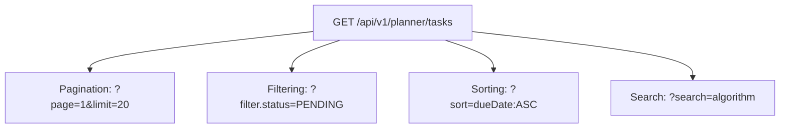

# Nexus AI Backend - REST API Design Guidelines & Standards

**Document Version:** 1.0.0  
**Author:** Principal API Architect & Senior Backend Engineer  
**Last Updated:** July 25, 2026  

---

## Table of Contents
1. [Document Purpose](#1-document-purpose)
2. [Document Scope](#2-document-scope)
3. [Resource Naming & Path Hierarchy Standards](#3-resource-naming--path-hierarchy-standards)
4. [Nested Resource Relationships](#4-nested-resource-relationships)
5. [HTTP Verb Mapping & Semantic Usage](#5-http-verb-mapping--semantic-usage)
6. [HTTP Status Code Taxonomy](#6-http-status-code-taxonomy)
7. [Request & Response Header Standards](#7-request--response-header-standards)
8. [Pagination, Filtering, Sorting & Search Specifications](#8-pagination-filtering-sorting--search-specifications)
9. [Field Selection & Resource Expansion Strategy](#9-field-selection--resource-expansion-strategy)
10. [Bulk Operations & Idempotency Guidelines](#10-bulk-operations--idempotency-guidelines)
11. [Deprecation & Backward Compatibility Protocols](#11-deprecation--backward-compatibility-protocols)
12. [Architectural Rationale & Trade-Off Analysis](#12-architectural-rationale--trade-off-analysis)
13. [Enterprise Best Practices](#13-enterprise-best-practices)
14. [Anti-Patterns & Common Mistakes](#14-anti-patterns--common-mistakes)
15. [Cross References](#15-cross-references)

---

## 1. Document Purpose

This document defines the REST API design standards, URI path structures, nested resource rules, query parameter formats, status code mappings, field expansion conventions, and idempotency protocols for the Nexus AI backend.

---

## 2. Document Scope

This specification applies to all API routes across all 10 core user modules and infrastructure endpoints.

---

## 3. Resource Naming & Path Hierarchy Standards

```mermaid
flowchart LR
    Prefix[/api] --> Version[/v1] --> Domain[/planner] --> Resource[/tasks] --> SubResource[/:id/reminders]
```

### Mandatory Rules
1. **Plural Collection Names:** Resource URIs must be plural nouns (`/tasks`, `/expenses`, `/budgets`).
2. **Kebab-Case Paths:** All path segments must use lower-case kebab-case (`/ai-mentor`, `/study-schedules`).
3. **No Verbs in URIs:** URIs identify resources, not actions. Use HTTP verbs to declare actions.
   * ✅ **Correct:** `POST /api/v1/planner/tasks`
   * ❌ **Incorrect:** `POST /api/v1/planner/create-task`

---

## 4. Nested Resource Relationships

* **Rule:** Sub-resources expressing a child relationship are nested under parent URIs up to a maximum depth of 2 levels:
  * **Level 1 (Collection):** `GET /api/v1/planner/tasks`
  * **Level 2 (Single Item):** `GET /api/v1/planner/tasks/:id`
  * **Level 2 (Sub-Collection):** `GET /api/v1/planner/tasks/:id/reminders`
* **Avoid Deep Nesting (>2 levels):** Instead of `/api/v1/users/:uId/planner/tasks/:tId/reminders/:rId`, access child resources directly via top-level identifier: `/api/v1/planner/reminders/:rId`.

---

## 5. HTTP Verb Mapping & Semantic Usage

| Verb | Action | Idempotent? | Body Allowed? | Primary Success Code |
| :--- | :--- | :---: | :---: | :---: |
| `GET` | Retrieve resource representation | Yes | No | `200 OK` |
| `POST` | Create new resource or execute complex AI process | No | Yes | `201 Created` |
| `PUT` | Complete replacement of existing resource | Yes | Yes | `200 OK` |
| `PATCH` | Partial update of specific fields | No | Yes | `200 OK` |
| `DELETE` | Remove resource (soft or hard delete) | Yes | No | `200 OK` / `204 No Content` |

---

## 6. HTTP Status Code Taxonomy

* `200 OK`: Successful read, update, or deletion.
* `201 Created`: Successful creation of a new resource via `POST`.
* `400 Bad Request`: Input validation error or malformed JSON body.
* `401 Unauthorized`: Missing, expired, or invalid JWT Access Token.
* `403 Forbidden`: User authenticated, but lacks RBAC role permissions.
* `404 Not Found`: Target resource UUID does not exist.
* `409 Conflict`: Business state conflict (e.g., duplicate email address).
* `422 Unprocessable Entity`: Valid JSON syntactically, but fails domain business rules.
* `429 Too Many Requests`: Client exceeded rate limit quotas.
* `500 Internal Server Error`: Unhandled backend server exception.

---

## 7. Request & Response Header Standards

### Mandatory Request Headers
* `Authorization`: `Bearer <JWT_Access_Token>`
* `Content-Type`: `application/json` (or `multipart/form-data` for file uploads)
* `X-Correlation-ID`: Optional client tracking UUID (auto-generated if omitted).

### Mandatory Response Headers
* `Content-Type`: `application/json; charset=utf-8`
* `X-Correlation-ID`: Request tracing UUID.
* `X-Response-Time-MS`: Processing latency in milliseconds.

---

## 8. Pagination, Filtering, Sorting & Search Specifications



### Standard Query Syntax
* **Offset Pagination:** `?page=1&limit=20` (Default: `page=1`, `limit=20`, Max `limit=100`).
* **Cursor Pagination (Real-Time Feeds):** `?cursor=tsk_987654&limit=20`.
* **Filtering:** `?filter.status=PENDING&filter.courseName=CS201`.
* **Sorting:** `?sort=dueDate:ASC,priority:DESC`.
* **Search:** `?search=data+structures`.

---

## 9. Field Selection & Resource Expansion Strategy

* **Sparse Fieldsets:** Allow clients to request only needed properties to optimize bandwidth:
  `GET /api/v1/planner/tasks?fields=id,title,dueDate`
* **Resource Expansion:** Allow clients to request associated child objects in a single call:
  `GET /api/v1/planner/tasks/:id?expand=category,reminders`

---

## 10. Bulk Operations & Idempotency Guidelines

* **Idempotency Header:** For sensitive mutation requests (`POST /api/v1/payments/create-order`, `POST /api/v1/finance/expenses`), clients MUST provide an `Idempotency-Key: <UUIDv4>` header.
* **Bulk Processing Endpoint:** Batch deletion endpoints pass arrays in the request body:
  `POST /api/v1/planner/tasks/bulk-delete` with body `{ "ids": ["id1", "id2"] }`.

---

## 11. Deprecation & Backward Compatibility Protocols

When an API route is scheduled for sunsetting:
1. Response includes header `Deprecation: @1.2.0` and `Sunset: Wed, 11 Nov 2026 00:00:00 GMT`.
2. Old endpoint versions (`/v1/`) remain active for a minimum of **6 months** following new version release (`/v2/`).

---

## 12. Architectural Rationale & Trade-Off Analysis

### Decision: Sparse Fieldsets (`?fields=`) & Expansion (`?expand=`) vs Fixed Payload Schemas

| Evaluation Vector | Fixed Hardcoded Payload Schemas | Dynamic Field Selection & Expansion |
| :--- | :--- | :--- |
| **Architectural Rationale** | Rigid payloads cause over-fetching or multiple round-trip requests. | Chosen for Nexus AI. Gives Flutter mobile clients fine-grained payload control. |
| **Advantages** | Simple controller execution. | Reduces mobile data consumption, eliminates secondary network requests. |
| **Disadvantages** | Wastes bandwidth on mobile apps. | Slightly higher NestJS interceptor processing complexity. |
| **Performance Impact** | Higher network payload bytes. | Reduced mobile network latency over 4G/5G connections. |
| **Scalability Impact** | Higher egress bandwidth costs. | High bandwidth efficiency. |
| **Maintainability Impact**| Low flexibility. | Extremely High. |

---

## 13. Enterprise Best Practices

1. **Use Standard HTTP Verbs:** Never use `GET` to modify server state.
2. **Validate Limits:** Always cap maximum pagination limit at 100 items.

---

## 14. Anti-Patterns & Common Mistakes

* ❌ **Verbs in Path:** `/api/v1/planner/get-tasks-by-user`.
* ❌ **HTTP 200 Error Wrapping:** Returning `HTTP 200 OK` with `{ "success": false, "error": "Unauthorized" }`.

---

## 15. Cross References

* [11-api-standards.md](file:///d:/Nexus-AI/backend/docs/11-api-standards.md)
* [31-api-overview.md](file:///d:/Nexus-AI/backend/docs/31-api-overview.md)
* [44-api-response-standard.md](file:///d:/Nexus-AI/backend/docs/44-api-response-standard.md)
