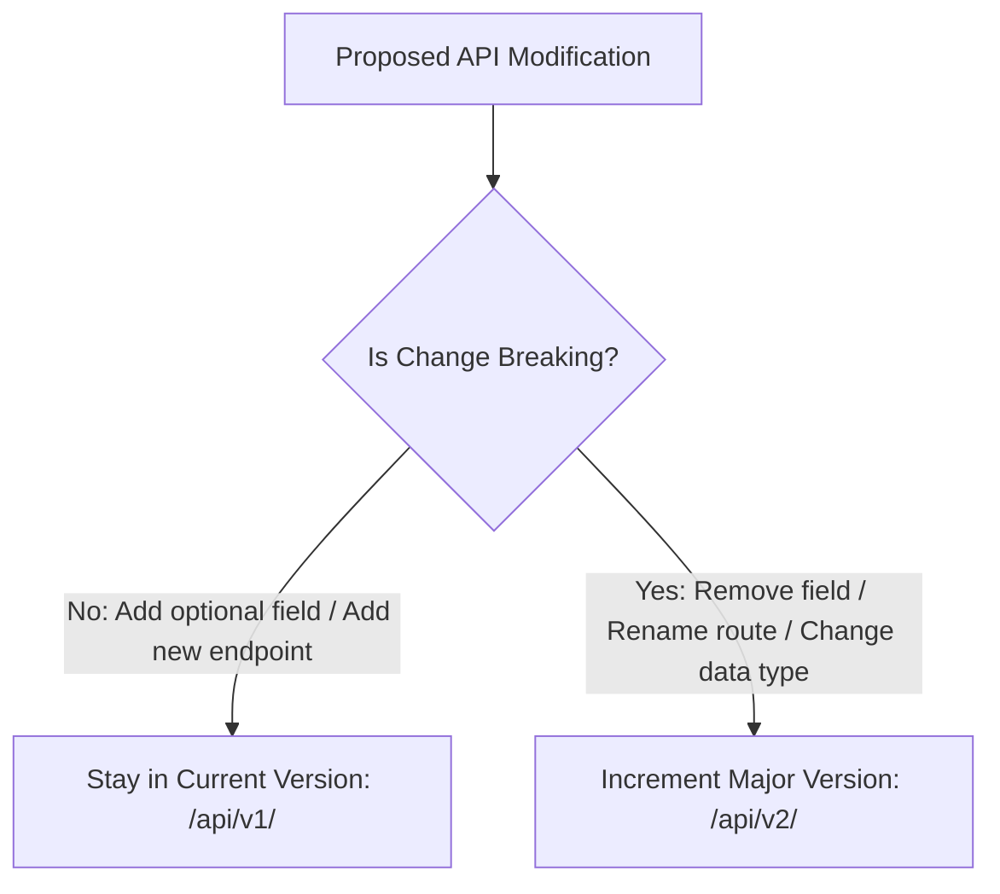
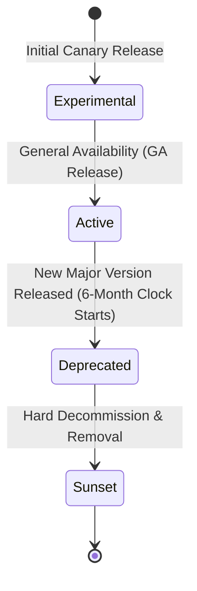

# Nexus AI Backend - API Versioning Strategy & Lifecycle Management

**Document Version:** 1.0.0  
**Author:** Principal API Architect & Senior Backend Engineer  
**Last Updated:** July 25, 2026  

---

## Table of Contents
1. [Document Purpose](#1-document-purpose)
2. [Document Scope](#2-document-scope)
3. [URI Path Versioning Strategy](#3-uri-path-versioning-strategy)
4. [Breaking vs Non-Breaking Change Rules](#4-breaking-vs-non-breaking-change-rules)
5. [API Version Lifecycle Pipeline](#5-api-version-lifecycle-pipeline)
6. [Deprecation Protocol & HTTP Headers](#6-deprecation-protocol--http-headers)
7. [Client Migration & Sunset Procedures](#7-client-migration--sunset-procedures)
8. [Multi-Version Concurrent Execution Architecture](#8-multi-version-concurrent-execution-architecture)
9. [Architectural Rationale & Trade-Off Analysis](#9-architectural-rationale--trade-off-analysis)
10. [Enterprise Best Practices](#10-enterprise-best-practices)
11. [Anti-Patterns & Common Mistakes](#11-anti-patterns--common-mistakes)
12. [Cross References](#12-cross-references)

---

## 1. Document Purpose

This document defines the API versioning strategy, version lifecycle states, backward compatibility rules, deprecation header standards, and migration procedures for the Nexus AI REST API framework.

---

## 2. Document Scope

This specification applies to all API version paths (`/api/v1/`, `/api/v2/`), route handlers, mobile client SDKs, and Swagger documentation specs.

---

## 3. URI Path Versioning Strategy

Nexus AI enforces **URI Path Versioning** across all endpoints:

* **Prefix Format:** `/api/v{major_version}/{domain}/{resource}`
* **Active Release Version:** `/api/v1/`
* **Future Release Version:** `/api/v2/`
* **Rule:** Minor bug fixes and non-breaking additions stay within the active major version (`/v1`). Only breaking schema changes trigger a new major version path (`/v2`).

---

## 4. Breaking vs Non-Breaking Change Rules



### Classification Matrix

| Modification Type | Change Classification | Version Action Required |
| :--- | :---: | :--- |
| **Adding a new optional request parameter** | Non-Breaking | Retain `/api/v1/` |
| **Adding a new response field** | Non-Breaking | Retain `/api/v1/` |
| **Adding an entirely new endpoint** | Non-Breaking | Retain `/api/v1/` |
| **Removing an existing response field** | **Breaking** | Increment to `/api/v2/` |
| **Renaming an existing field or URI path** | **Breaking** | Increment to `/api/v2/` |
| **Changing data type (e.g., String to Number)** | **Breaking** | Increment to `/api/v2/` |
| **Adding a mandatory (required) input field** | **Breaking** | Increment to `/api/v2/` |

---

## 5. API Version Lifecycle Pipeline

Every API major version progresses through four formal lifecycle states:



1. **Experimental:** Internal preview testing for upcoming major releases.
2. **Active (GA):** Production release serving live Flutter mobile traffic.
3. **Deprecated:** Older major version scheduled for decommissioning. Still functional, but returns deprecation headers.
4. **Sunset:** Decommissioned version returning `HTTP 410 Gone`.

---

## 6. Deprecation Protocol & HTTP Headers

When `/v1` is deprecated in favor of `/v2`, all `/v1` responses MUST include standard deprecation HTTP headers:

* `Deprecation: @1.2.0` (Version when deprecation was announced)
* `Sunset: Wed, 11 Nov 2026 00:00:00 GMT` (Hard decommissioning date)
* `Link: <https://api.nexus.ai/docs/v2>; rel="successor-version"` (Link to v2 documentation)

---

## 7. Client Migration & Sunset Procedures

1. **Deprecation Announcement:** Emit notice 6 months prior to sunset date.
2. **Flutter App Minimum Version Enforcement:** Push mobile app store updates with forced-upgrade flags for legacy app versions relying on sunsetted APIs.
3. **Hard Decommissioning:** Update Nginx gateway to intercept requests to `/api/v1/` and return `HTTP 410 Gone`:

```json
{
  "statusCode": 410,
  "success": false,
  "error": {
    "code": "ERR_API_VERSION_SUNSET",
    "message": "API version v1 has been sunsetted. Please upgrade client to v2.",
    "details": { "successorVersion": "/api/v2" }
  },
  "timestamp": "2026-11-11T00:00:00.000Z"
}
```

---

## 8. Multi-Version Concurrent Execution Architecture

To support running `/v1` and `/v2` controllers simultaneously during migration windows:
* NestJS `@Controller({ path: 'planner/tasks', version: '1' })` decorators route requests cleanly to versioned controller handlers.

---

## 9. Architectural Rationale & Trade-Off Analysis

### Decision: URI Path Versioning (`/v1`) vs Header Versioning (`Accept-Version: v1`)

| Evaluation Vector | Custom Header Versioning (`Accept-Version`) | URI Path Versioning (`/api/v1/`) |
| :--- | :--- | :--- |
| **Architectural Rationale** | Conceptually clean; difficult to inspect and route at gateway level. | Chosen for Nexus AI. Maximum visibility, trivial Nginx routing, simple Swagger UI versioning. |
| **Advantages** | Clean resource URIs. | Highly explicit, easy CDN caching keys, clear visibility in mobile network logs. |
| **Disadvantages** | Difficult to test in browser; invisible versioning. | Alters resource URI path. |
| **Performance Impact** | Requires parsing HTTP request headers. | Fast string prefix matching in Gateway router. |
| **Scalability Impact** | Neutral. | High operational stability. |
| **Maintainability Impact**| Medium. | Extremely High. |

---

## 10. Enterprise Best Practices

1. **Maintain 6-Month Support Window:** Never sunset an old API version without a 6-month deprecation grace period.
2. **Automate Deprecation Headers:** Configure NestJS interceptors to inject `Deprecation` and `Sunset` headers automatically.

---

## 11. Anti-Patterns & Common Mistakes

* ❌ **Breaking Changes in Minor Updates:** Removing a field in `/v1` without creating `/v2`, crashing live mobile app clients.
* ❌ **Unannounced Decommissioning:** Deleting legacy endpoints without deprecation notices.

---

## 12. Cross References

* [11-api-standards.md](file:///d:/Nexus-AI/backend/docs/11-api-standards.md)
* [31-api-overview.md](file:///d:/Nexus-AI/backend/docs/31-api-overview.md)
* [46-openapi-conventions.md](file:///d:/Nexus-AI/backend/docs/46-openapi-conventions.md)
