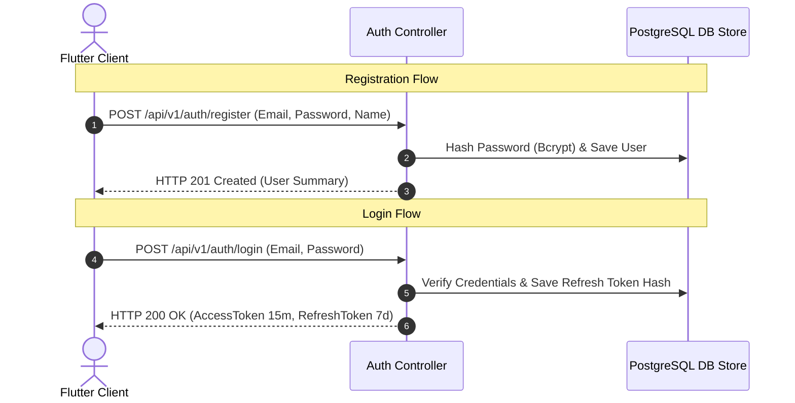

# Nexus AI Backend - Authentication & Authorization API Specification

**Document Version:** 1.0.0  
**Author:** Principal API Architect & Senior Backend Engineer  
**Last Updated:** July 25, 2026  

---

## Table of Contents
1. [Document Purpose](#1-document-purpose)
2. [Document Scope](#2-document-scope)
3. [Authentication API Architecture & Flow](#3-authentication-api-architecture--flow)
4. [Endpoint Specifications](#4-endpoint-specifications)
   - [4.1 `POST /api/v1/auth/register`](#41-post-apiv1authregister)
   - [4.2 `POST /api/v1/auth/login`](#42-post-apiv1authlogin)
   - [4.3 `POST /api/v1/auth/refresh`](#43-post-apiv1authrefresh)
   - [4.4 `POST /api/v1/auth/logout`](#44-post-apiv1authlogout)
   - [4.5 `POST /api/v1/auth/forgot-password`](#45-post-apiv1authforgot-password)
   - [4.6 `POST /api/v1/auth/reset-password`](#46-post-apiv1authreset-password)
5. [Security & Rate Limiting Enforcement](#5-security--rate-limiting-enforcement)
6. [Future Expansion (MFA, OAuth2, Social Login)](#6-future-expansion-mfa-oauth2-social-login)
7. [Architectural Rationale & Trade-Off Analysis](#7-architectural-rationale--trade-off-analysis)
8. [Cross References](#8-cross-references)

---

## 1. Document Purpose

This document provides complete, production-ready REST API specifications for the `AuthModule`. It details endpoints for user registration, credential authentication, JWT token refresh rotation, session logout, and self-service password resets.

---

## 2. Document Scope

Applies to all HTTP REST endpoints under `/api/v1/auth/*`.

---

## 3. Authentication API Architecture & Flow



---

## 4. Endpoint Specifications

### 4.1 `POST /api/v1/auth/register`
* **Purpose:** Registers a new student account.
* **HTTP Method:** `POST`
* **URI:** `/api/v1/auth/register`
* **Authentication Required:** No (Public Route)
* **Rate Limit:** 5 requests per minute per IP.
* **Validation Rules:**
  * `email`: Required, valid email format, converted to lowercase.
  * `password`: Required, min 8 chars, 1 uppercase, 1 lowercase, 1 number, 1 special character.
  * `fullName`: Required, string, 2-100 characters.

#### Request Body Specification
```json
{
  "email": "student@university.edu",
  "password": "SecurePassword123!",
  "fullName": "Alex Mercer",
  "institutionName": "State University"
}
```

#### Success Response Specification (201 Created)
```json
{
  "statusCode": 201,
  "success": true,
  "data": {
    "userId": "usr_987654321",
    "email": "student@university.edu",
    "fullName": "Alex Mercer",
    "role": "STUDENT",
    "createdAt": "2026-07-25T18:30:00.000Z"
  },
  "timestamp": "2026-07-25T18:30:00.000Z"
}
```

#### Failure Responses & Error Codes
* `400 Bad Request` (`ERR_VAL_001`): Email or password validation failed.
* `409 Conflict` (`ERR_AUTH_EMAIL_EXISTS`): Email address is already registered.

---

### 4.2 `POST /api/v1/auth/login`
* **Purpose:** Authenticates user credentials and issues JWT token pair.
* **HTTP Method:** `POST`
* **URI:** `/api/v1/auth/login`
* **Authentication Required:** No (Public Route)
* **Rate Limit:** 5 requests per minute per IP.

#### Request Body Specification
```json
{
  "email": "student@university.edu",
  "password": "SecurePassword123!"
}
```

#### Success Response Specification (200 OK)
```json
{
  "statusCode": 200,
  "success": true,
  "data": {
    "accessToken": "eyJhbGciOiJIUzI1NiIsInR5cCI6IkpXVCJ9...",
    "refreshToken": "d8e9f0a1b2c3d4e5f6a7b8c9d0e1f2a3...",
    "tokenType": "Bearer",
    "expiresIn": 900
  },
  "timestamp": "2026-07-25T18:30:00.000Z"
}
```

#### Failure Responses & Error Codes
* `401 Unauthorized` (`ERR_AUTH_001`): Invalid email or password credentials.

---

### 4.3 `POST /api/v1/auth/refresh`
* **Purpose:** Obtains a fresh Access Token using a valid Refresh Token family.
* **HTTP Method:** `POST`
* **URI:** `/api/v1/auth/refresh`
* **Authentication Required:** No (Token presented in body)

#### Request Body Specification
```json
{
  "refreshToken": "d8e9f0a1b2c3d4e5f6a7b8c9d0e1f2a3..."
}
```

#### Success Response Specification (200 OK)
```json
{
  "statusCode": 200,
  "success": true,
  "data": {
    "accessToken": "eyJhbGciOiJIUzI1NiIsInR5cCI6IkpXVCJ9...",
    "refreshToken": "e9f0a1b2c3d4e5f6a7b8c9d0e1f2a3b4...",
    "tokenType": "Bearer",
    "expiresIn": 900
  },
  "timestamp": "2026-07-25T18:30:00.000Z"
}
```

---

### 4.4 `POST /api/v1/auth/logout`
* **Purpose:** Revokes active Refresh Token session.
* **HTTP Method:** `POST`
* **URI:** `/api/v1/auth/logout`
* **Authentication Required:** Yes (`Bearer <AccessToken>`)

#### Success Response Specification (200 OK)
```json
{
  "statusCode": 200,
  "success": true,
  "data": {
    "message": "Session successfully terminated."
  },
  "timestamp": "2026-07-25T18:30:00.000Z"
}
```

---

### 4.5 `POST /api/v1/auth/forgot-password`
* **Purpose:** Dispatches a password reset link to user's email.
* **HTTP Method:** `POST`
* **URI:** `/api/v1/auth/forgot-password`

---

### 4.6 `POST /api/v1/auth/reset-password`
* **Purpose:** Executes password update using a valid reset token.
* **HTTP Method:** `POST`
* **URI:** `/api/v1/auth/reset-password`

---

## 5. Security & Rate Limiting Enforcement

* Rate limiting strictly enforced at **5 requests per minute** to prevent credential stuffing.
* Refresh tokens stored in DB as Bcrypt hashes to prevent offline token theft.

---

## 6. Future Expansion (MFA, OAuth2, Social Login)

* **Planned Routes:** `/api/v1/auth/google`, `/api/v1/auth/mfa/setup`, `/api/v1/auth/mfa/verify`.

---

## 7. Architectural Rationale & Trade-Off Analysis

### Decision: Stateless JWT + DB Refresh Token Rotation vs Server Sessions

| Evaluation Vector | Server Memory Sessions (Redis) | Stateless JWT + DB Refresh Token Rotation |
| :--- | :--- | :--- |
| **Architectural Rationale** | Requires session lookup call on every API request. | Chosen for Nexus AI. Stateless Access Tokens resolve instantly without DB hits. |
| **Advantages** | Instant revocation. | Extreme API speed (<1ms auth validation), low DB overhead. |
| **Disadvantages** | Server session storage overhead. | Cannot revoke active Access Token during its 15-minute window without blacklisting. |

---

## 8. Cross References

* [14-security-guidelines.md](file:///d:/Nexus-AI/backend/docs/14-security-guidelines.md)
* [44-api-response-standard.md](file:///d:/Nexus-AI/backend/docs/44-api-response-standard.md)
* [45-api-error-catalog.md](file:///d:/Nexus-AI/backend/docs/45-api-error-catalog.md)
