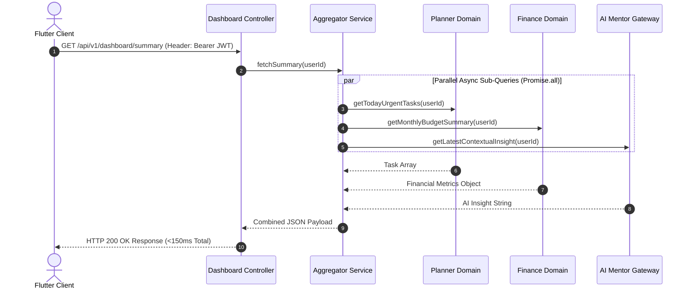

# Nexus AI Backend - Dashboard Aggregator API Specification

**Document Version:** 1.0.0  
**Author:** Principal API Architect & Senior Backend Engineer  
**Last Updated:** July 25, 2026  

---

## Table of Contents
1. [Document Purpose](#1-document-purpose)
2. [Document Scope](#2-document-scope)
3. [Dashboard Aggregator Architecture](#3-dashboard-aggregator-architecture)
4. [Endpoint Specification: `GET /api/v1/dashboard/summary`](#4-endpoint-specification-get-apiv1dashboardsummary)
   - [4.1 Purpose & HTTP Details](#41-purpose--http-details)
   - [4.2 Aggregation Business Logic](#42-aggregation-business-logic)
   - [4.3 Request Specification](#43-request-specification)
   - [4.4 Success Response Payload Specification](#44-success-response-payload-specification)
   - [4.5 Failure Responses & Error Codes](#45-failure-responses--error-codes)
   - [4.6 Performance SLA & Parallel Execution Math](#46-performance-sla--parallel-execution-math)
   - [4.7 Redis Caching Readiness](#47-redis-caching-readiness)
5. [Frontend Flutter Client Formatting Guidelines](#5-frontend-flutter-client-formatting-guidelines)
6. [Future Expansion (Custom Widget Reordering)](#6-future-expansion-custom-widget-reordering)
7. [Architectural Rationale & Trade-Off Analysis](#7-architectural-rationale--trade-off-analysis)
8. [Cross References](#8-cross-references)

---

## 1. Document Purpose

This document provides the complete API contract and aggregation architecture for the `DashboardModule`. It details the high-speed aggregated home feed endpoint (`GET /api/v1/dashboard/summary`), sub-150ms latency SLAs, parallel sub-query orchestration, and Redis caching strategies.

---

## 2. Document Scope

Applies to all HTTP REST endpoints under `/api/v1/dashboard/*`.

---

## 3. Dashboard Aggregator Architecture

The Dashboard endpoint synthesizes real-time data across the Planner, Finance, and AI Mentor domain modules into a single consolidated response payload:



---

## 4. Endpoint Specification: `GET /api/v1/dashboard/summary`

### 4.1 Purpose & HTTP Details
* **Purpose:** Returns a real-time consolidated daily overview feed for the student mobile home screen.
* **HTTP Method:** `GET`
* **URI:** `/api/v1/dashboard/summary`
* **Authentication Required:** Yes (`Bearer <AccessToken>`)

### 4.2 Aggregation Business Logic
1. **Urgent Assignments:** Queries top 5 pending tasks due within the next 48 hours, sorted by priority rank (`HIGH` -> `MED` -> `LOW`).
2. **Financial Runway:** Fetches monthly allowance, remaining budget, calculates safe daily spend limit, and flags `isInsolvencyWarning`.
3. **Productivity Index:** Computes daily productivity score (0-100) based on completed tasks versus target study session hours.
4. **AI Insight:** Pulls the latest contextual study recommendation generated by Google Gemini.

### 4.3 Request Specification
* **Query Parameters:** None (User context resolved via JWT claim).

### 4.4 Success Response Payload Specification (200 OK)
```json
{
  "statusCode": 200,
  "success": true,
  "data": {
    "todayAssignments": [
      {
        "taskId": "tsk_101",
        "title": "CS201 Algorithm Homework",
        "courseName": "Data Structures",
        "dueDate": "2026-07-25T23:59:00.000Z",
        "priority": "HIGH",
        "estimatedMinutes": 90
      }
    ],
    "financialSummary": {
      "monthlyBudget": 500.00,
      "remainingBudget": 240.50,
      "safeDailySpend": 34.35,
      "currency": "USD",
      "isInsolvencyWarning": false
    },
    "productivityScore": 85,
    "aiRecommendation": "Review dynamic programming concepts before 6:00 PM to stay on track for your CS201 deadline."
  },
  "timestamp": "2026-07-25T18:30:00.000Z"
}
```

### 4.5 Failure Responses & Error Codes
* `401 Unauthorized` (`ERR_AUTH_EXPIRED`): Expired or missing Access Token.
* `500 Internal Server Error` (`ERR_DASH_AGGREGATION_FAILED`): Sub-query aggregation failure.

### 4.6 Performance SLA & Parallel Execution Math
* **Performance SLA:** 95% of requests MUST respond in `<150ms`.
* **Execution Math:** Executing sub-queries sequentially takes $40\text{ms} + 35\text{ms} + 80\text{ms} = 155\text{ms}$. By wrapping sub-queries in `Promise.all()`, total execution time equals $\max(40, 35, 80) = 80\text{ms}$, comfortably meeting SLA targets.

### 4.7 Redis Caching Readiness
* Response payloads are cached in Redis under `cache:dashboard:<userId>` with a 5-minute TTL, resolving cache hits in `<10ms`.

---

## 5. Frontend Flutter Client Formatting Guidelines

Mobile engineers should consume `todayAssignments` directly into Flutter `ListView` cards and bind `safeDailySpend` to home screen financial metrics widgets without needing secondary API calls.

---

## 6. Future Expansion (Custom Widget Reordering)

* **Planned Endpoint:** `PATCH /api/v1/dashboard/layout` allowing students to customize home widget card ordering.

---

## 7. Architectural Rationale & Trade-Off Analysis

### Decision: Single Aggregated API Endpoint vs Multiple Granular API Calls

| Evaluation Vector | Client Makes 4 Separate API Calls | Single Aggregated Dashboard API Endpoint |
| :--- | :--- | :--- |
| **Architectural Rationale** | Causes 4 network round-trips over mobile data connections; high latency and battery drain. | Chosen for Nexus AI. Combines 4 reads into 1 high-speed payload. |
| **Advantages** | Simple backend implementation. | Minimal mobile network overhead, instant UI rendering, sub-150ms response times. |
| **Disadvantages** | 4 HTTP connection handshakes over 4G/5G; screen flickering during load. | Backend aggregator must handle partial sub-query failures gracefully. |

---

## 8. Cross References

* [07-module-breakdown.md](file:///d:/Nexus-AI/backend/docs/07-module-breakdown.md)
* [36-planner-api.md](file:///d:/Nexus-AI/backend/docs/36-planner-api.md)
* [37-finance-api.md](file:///d:/Nexus-AI/backend/docs/37-finance-api.md)
