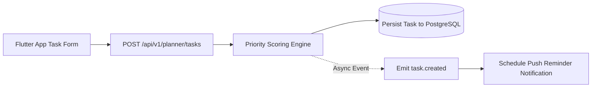

# Nexus AI Backend - Smart Planner API Specification

**Document Version:** 1.0.0  
**Author:** Principal API Architect & Senior Backend Engineer  
**Last Updated:** July 25, 2026  

---

## Table of Contents
1. [Document Purpose](#1-document-purpose)
2. [Document Scope](#2-document-scope)
3. [Smart Planner Architecture & Priority Engine](#3-smart-planner-architecture--priority-engine)
4. [Endpoint Specifications](#4-endpoint-specifications)
   - [4.1 `GET /api/v1/planner/tasks`](#41-get-apiv1plannertasks)
   - [4.2 `POST /api/v1/planner/tasks`](#42-post-apiv1plannertasks)
   - [4.3 `GET /api/v1/planner/tasks/:id`](#43-get-apiv1plannertasksid)
   - [4.4 `PATCH /api/v1/planner/tasks/:id`](#44-patch-apiv1plannertasksid)
   - [4.5 `DELETE /api/v1/planner/tasks/:id`](#45-delete-apiv1plannertasksid)
   - [4.6 `POST /api/v1/planner/optimize-schedule`](#46-post-apiv1planneroptimize-schedule)
   - [4.7 `GET /api/v1/planner/categories`](#47-get-apiv1plannercategories)
   - [4.8 `POST /api/v1/planner/categories`](#48-post-apiv1plannercategories)
5. [Validation & Priority Algorithm Rules](#5-validation--priority-algorithm-rules)
6. [Future Expansion (Group Study Collaboration)](#6-future-expansion-group-study-collaboration)
7. [Architectural Rationale & Trade-Off Analysis](#7-architectural-rationale--trade-off-analysis)
8. [Cross References](#8-cross-references)

---

## 1. Document Purpose

This document details the REST API specifications for the `PlannerModule`. It defines contracts for task management, course categories, push reminders, AI schedule optimization, and task priority scoring algorithms.

---

## 2. Document Scope

Applies to all HTTP REST endpoints under `/api/v1/planner/*`.

---

## 3. Smart Planner Architecture & Priority Engine



---

## 4. Endpoint Specifications

### 4.1 `GET /api/v1/planner/tasks`
* **Purpose:** Retrieves a paginated, filterable list of student tasks.
* **HTTP Method:** `GET` | **URI:** `/api/v1/planner/tasks` | **Auth Required:** Yes
* **Query Parameters:** `page`, `limit`, `filter.status`, `sort`, `search`.

#### Success Response Specification (200 OK)
```json
{
  "statusCode": 200,
  "success": true,
  "data": [
    {
      "taskId": "tsk_101",
      "title": "Data Structures Assignment 3",
      "courseName": "CS201",
      "dueDate": "2026-07-28T23:59:00.000Z",
      "difficultyRating": 4,
      "estimatedMinutes": 120,
      "priority": "HIGH",
      "status": "PENDING"
    }
  ],
  "meta": {
    "page": 1,
    "limit": 20,
    "totalItems": 45,
    "totalPages": 3,
    "hasNextPage": true,
    "hasPreviousPage": false
  },
  "timestamp": "2026-07-25T18:30:00.000Z"
}
```

---

### 4.2 `POST /api/v1/planner/tasks`
* **Purpose:** Creates a new academic assignment or personal task and calculates its priority rank.
* **HTTP Method:** `POST` | **URI:** `/api/v1/planner/tasks` | **Auth Required:** Yes

#### Request Body Specification
```json
{
  "title": "CS201 Algorithm Homework",
  "courseName": "Data Structures",
  "categoryId": "cat_456",
  "dueDate": "2026-07-28T23:59:00.000Z",
  "difficultyRating": 4,
  "estimatedMinutes": 90
}
```

#### Success Response Specification (201 Created)
```json
{
  "statusCode": 201,
  "success": true,
  "data": {
    "taskId": "tsk_101",
    "title": "CS201 Algorithm Homework",
    "priority": "HIGH",
    "status": "PENDING",
    "createdAt": "2026-07-25T18:30:00.000Z"
  },
  "timestamp": "2026-07-25T18:30:00.000Z"
}
```

---

### 4.3 `GET /api/v1/planner/tasks/:id`
* **Purpose:** Fetches detailed information for a specific task.
* **HTTP Method:** `GET` | **URI:** `/api/v1/planner/tasks/:id`

---

### 4.4 `PATCH /api/v1/planner/tasks/:id`
* **Purpose:** Partially updates task status or parameters.
* **HTTP Method:** `PATCH` | **URI:** `/api/v1/planner/tasks/:id`

#### Request Body Specification
```json
{
  "status": "COMPLETED"
}
```

---

### 4.5 `DELETE /api/v1/planner/tasks/:id`
* **Purpose:** Soft deletes a task record.
* **HTTP Method:** `DELETE` | **URI:** `/api/v1/planner/tasks/:id`

---

### 4.6 `POST /api/v1/planner/optimize-schedule`
* **Purpose:** Invokes Google Gemini API to construct an optimized daily study plan.
* **HTTP Method:** `POST` | **URI:** `/api/v1/planner/optimize-schedule`

#### Request Body Specification
```json
{
  "targetDate": "2026-07-26",
  "availableHours": 4.5
}
```

#### Success Response Specification (200 OK)
```json
{
  "statusCode": 200,
  "success": true,
  "data": {
    "scheduleBlocks": [
      {
        "startTime": "09:00",
        "endTime": "10:30",
        "taskId": "tsk_101",
        "activity": "CS201 Algorithm Homework - Dynamic Programming"
      }
    ]
  },
  "timestamp": "2026-07-25T18:30:00.000Z"
}
```

---

### 4.7 `GET /api/v1/planner/categories` & `POST /api/v1/planner/categories`
* APIs managing color-coded course category lookup entities.

---

## 5. Validation & Priority Algorithm Rules

* **Priority Calculation Formula:**  
  $$\text{Score} = (\text{DaysUntilDue} \times -1.5) + (\text{DifficultyRating} \times 2.0) + (\text{EstimatedMinutes} / 30)$$
  * Score $\ge 5.0 \rightarrow$ `HIGH`
  * Score between $2.0$ and $4.9 \rightarrow$ `MEDIUM`
  * Score $< 2.0 \rightarrow$ `LOW`

---

## 6. Future Expansion (Group Study Collaboration)

* Shared task boards for student team projects (`/api/v1/planner/group-tasks`).

---

## 7. Architectural Rationale & Trade-Off Analysis

### Decision: Server-Side Algorithmic Priority Scoring vs Client-Side Calculation

| Evaluation Vector | Client Mobile App Calculates Priority | Backend Server-Side Algorithmic Scoring |
| :--- | :--- | :--- |
| **Architectural Rationale** | Mobile app code duplication across iOS/Android/Web. | Chosen for Nexus AI. Guarantees 100% priority consistency across all clients. |
| **Advantages** | Reduces server compute load. | Centralized business logic, simple rule updates, consistent sorting order in database queries. |
| **Disadvantages** | Logic drift between iOS Flutter and Web apps. | Minimal server compute overhead during task creation. |

---

## 8. Cross References

* [02-functional-requirements.md](file:///d:/Nexus-AI/backend/docs/02-functional-requirements.md)
* [07-module-breakdown.md](file:///d:/Nexus-AI/backend/docs/07-module-breakdown.md)
* [35-dashboard-api.md](file:///d:/Nexus-AI/backend/docs/35-dashboard-api.md)
