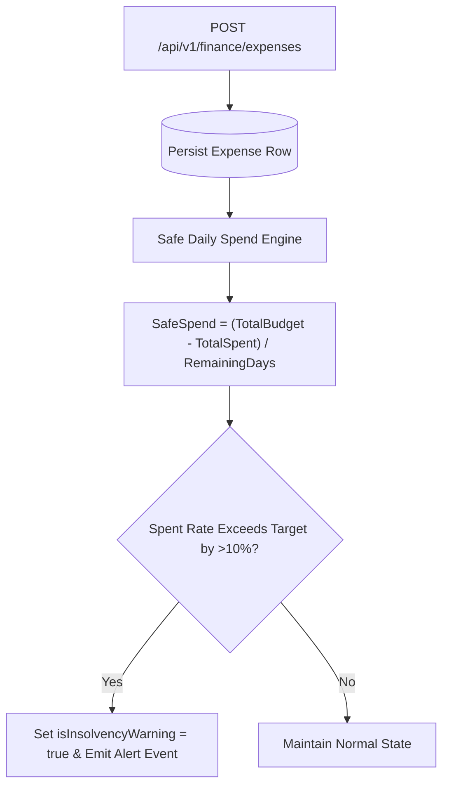

# Nexus AI Backend - Smart Finance API Specification

**Document Version:** 1.0.0  
**Author:** Principal API Architect & Senior Backend Engineer  
**Last Updated:** July 25, 2026  

---

## Table of Contents
1. [Document Purpose](#1-document-purpose)
2. [Document Scope](#2-document-scope)
3. [Smart Finance Architecture & Safe Spend Engine](#3-smart-finance-architecture--safe-spend-engine)
4. [Endpoint Specifications](#4-endpoint-specifications)
   - [4.1 `POST /api/v1/finance/budget`](#41-post-apiv1financebudget)
   - [4.2 `GET /api/v1/finance/budget`](#42-get-apiv1financebudget)
   - [4.3 `POST /api/v1/finance/expenses`](#43-post-apiv1financeexpenses)
   - [4.4 `GET /api/v1/finance/expenses`](#44-get-apiv1financeexpenses)
   - [4.5 `GET /api/v1/finance/safe-spend`](#45-get-apiv1financesafe-spend)
   - [4.6 `GET /api/v1/finance/monthly-report`](#46-get-apiv1financemonthly-report)
   - [4.7 `POST /api/v1/finance/savings-goals`](#47-post-apiv1financesavings-goals)
   - [4.8 `GET /api/v1/finance/ai-predictions`](#48-get-apiv1financeai-predictions)
5. [Validation & Financial Business Rules](#5-validation--financial-business-rules)
6. [Future Expansion (Roommate Expense Splitter)](#6-future-expansion-roommate-expense-splitter)
7. [Architectural Rationale & Trade-Off Analysis](#7-architectural-rationale--trade-off-analysis)
8. [Cross References](#8-cross-references)

---

## 1. Document Purpose

This document details the REST API specifications for the `FinanceModule`. It defines contracts for budget configuration, daily expense logging, dynamic safe daily spend calculation, monthly category reporting, and AI predictive insolvency warnings.

---

## 2. Document Scope

Applies to all HTTP REST endpoints under `/api/v1/finance/*`.

---

## 3. Smart Finance Architecture & Safe Spend Engine



---

## 4. Endpoint Specifications

### 4.1 `POST /api/v1/finance/budget`
* **Purpose:** Configures user monthly allowance/pocket money and target spending cap.
* **HTTP Method:** `POST` | **URI:** `/api/v1/finance/budget` | **Auth Required:** Yes

#### Request Body Specification
```json
{
  "monthYear": "2026-07",
  "totalAllowance": 500.00,
  "currency": "USD"
}
```

#### Success Response Specification (201 Created)
```json
{
  "statusCode": 201,
  "success": true,
  "data": {
    "budgetId": "bdg_789",
    "monthYear": "2026-07",
    "totalAllowance": 500.00,
    "currency": "USD",
    "baselineDailyAllowance": 16.12
  },
  "timestamp": "2026-07-25T18:30:00.000Z"
}
```

---

### 4.2 `GET /api/v1/finance/budget`
* **Purpose:** Retrieves the current active monthly budget status.
* **HTTP Method:** `GET` | **URI:** `/api/v1/finance/budget`

---

### 4.3 `POST /api/v1/finance/expenses`
* **Purpose:** Logs a new categorized student expense transaction.
* **HTTP Method:** `POST` | **URI:** `/api/v1/finance/expenses`
* **Idempotency:** Supports optional `Idempotency-Key` header.

#### Request Body Specification
```json
{
  "amount": 14.50,
  "categoryId": "cat_food_01",
  "description": "University Cafeteria Lunch",
  "spentAt": "2026-07-25T12:30:00.000Z"
}
```

#### Success Response Specification (201 Created)
```json
{
  "statusCode": 201,
  "success": true,
  "data": {
    "expenseId": "exp_456789",
    "amount": 14.50,
    "category": "FOOD",
    "remainingBudget": 240.50,
    "newSafeDailySpend": 34.35
  },
  "timestamp": "2026-07-25T18:30:00.000Z"
}
```

---

### 4.4 `GET /api/v1/finance/expenses`
* **Purpose:** Fetches a paginated, filterable history of logged expenses.
* **HTTP Method:** `GET` | **URI:** `/api/v1/finance/expenses`

---

### 4.5 `GET /api/v1/finance/safe-spend`
* **Purpose:** Returns the current dynamic safe daily spend allowance.
* **HTTP Method:** `GET` | **URI:** `/api/v1/finance/safe-spend`

#### Success Response Specification (200 OK)
```json
{
  "statusCode": 200,
  "success": true,
  "data": {
    "remainingBudget": 240.50,
    "remainingDaysInMonth": 7,
    "safeDailySpend": 34.35,
    "isInsolvencyWarning": false
  },
  "timestamp": "2026-07-25T18:30:00.000Z"
}
```

---

### 4.6 `GET /api/v1/finance/monthly-report`
* **Purpose:** Generates a category-wise aggregated spend report.
* **HTTP Method:** `GET` | **URI:** `/api/v1/finance/monthly-report?monthYear=2026-07`

---

### 4.7 `POST /api/v1/finance/savings-goals`
* **Purpose:** Configures target savings allocation goals.

---

### 4.8 `GET /api/v1/finance/ai-predictions`
* **Purpose:** Fetches AI predictive expenditure trend warnings.

---

## 5. Validation & Financial Business Rules

1. Expense amounts MUST be positive numbers strictly formatted to 2 decimal places (`NUMERIC(10,2)`).
2. Category IDs MUST reference active entries in `finance_categories`.

---

## 6. Future Expansion (Roommate Expense Splitter)

* Planned group splitting APIs: `/api/v1/finance/split-expense`.

---

## 7. Architectural Rationale & Trade-Off Analysis

### Decision: Numeric Financial Precision (`NUMERIC(10,2)`) vs Floating Point (`FLOAT`)

| Evaluation Vector | IEEE Floating Point (`FLOAT`) | Fixed Precision Relational Numeric (`NUMERIC(10,2)`) |
| :--- | :--- | :--- |
| **Architectural Rationale** | Causes floating-point rounding errors (`0.1 + 0.2 = 0.30000000000000004`). | Chosen for Nexus AI. Guarantees 100% exact mathematical currency operations. |
| **Advantages** | Fast CPU operations. | Eliminates silent financial rounding discrepancies, guarantees exact ledger math. |
| **Disadvantages** | Severe financial calculation drift. | Minor storage footprint increase in database rows. |

---

## 8. Cross References

* [07-module-breakdown.md](file:///d:/Nexus-AI/backend/docs/07-module-breakdown.md)
* [12-database-guidelines.md](file:///d:/Nexus-AI/backend/docs/12-database-guidelines.md)
* [35-dashboard-api.md](file:///d:/Nexus-AI/backend/docs/35-dashboard-api.md)
