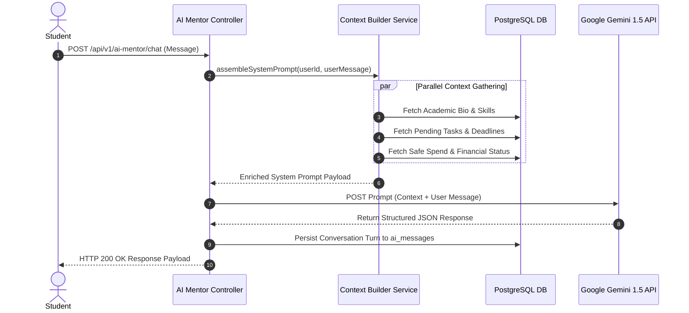

# Nexus AI Backend - AI Mentor & Conversational Gateway API Specification

**Document Version:** 1.0.0  
**Author:** Principal API Architect & Senior Backend Engineer  
**Last Updated:** July 25, 2026  

---

## Table of Contents
1. [Document Purpose](#1-document-purpose)
2. [Document Scope](#2-document-scope)
3. [AI Mentor Gateway Architecture & Prompt Assembly](#3-ai-mentor-gateway-architecture--prompt-assembly)
4. [Endpoint Specifications](#4-endpoint-specifications)
   - [4.1 `POST /api/v1/ai-mentor/chat`](#41-post-apiv1ai-mentorchat)
   - [4.2 `POST /api/v1/ai-mentor/roadmap`](#42-post-apiv1ai-mentorroadmap)
   - [4.3 `POST /api/v1/ai-mentor/decision-matrix`](#43-post-apiv1ai-mentordecision-matrix)
   - [4.4 `GET /api/v1/ai-mentor/conversations`](#44-get-apiv1ai-mentorconversations)
   - [4.5 `GET /api/v1/ai-mentor/conversations/:id/messages`](#45-get-apiv1ai-mentorconversationsidmessages)
5. [Prompt Context Injection Mechanics](#5-prompt-context-injection-mechanics)
6. [Rate Limiting, Circuit Breakers & Token Caps](#6-rate-limiting-circuit-breakers--token-caps)
7. [Future Expansion (Lecture Note PDF RAG Search)](#7-future-expansion-lecture-note-pdf-rag-search)
8. [Architectural Rationale & Trade-Off Analysis](#8-architectural-rationale--trade-off-analysis)
9. [Cross References](#9-cross-references)

---

## 1. Document Purpose

This document details the REST API specifications for the `AIMentorModule`. It defines contracts for multi-turn contextual mentoring chat, personal career roadmapping, academic decision matrices, and conversation history retrieval via Google Gemini 1.5 API.

---

## 2. Document Scope

Applies to all HTTP REST endpoints under `/api/v1/ai-mentor/*`.

---

## 3. AI Mentor Gateway Architecture & Prompt Assembly



---

## 4. Endpoint Specifications

### 4.1 `POST /api/v1/ai-mentor/chat`
* **Purpose:** Multi-turn contextual chat mentoring session using Gemini 1.5 API.
* **HTTP Method:** `POST` | **URI:** `/api/v1/ai-mentor/chat` | **Auth Required:** Yes

#### Request Body Specification
```json
{
  "conversationId": "cvs_123456",
  "message": "How should I structure my preparation for my upcoming CS201 mid-term exam?"
}
```

#### Success Response Specification (200 OK)
```json
{
  "statusCode": 200,
  "success": true,
  "data": {
    "conversationId": "cvs_123456",
    "messageId": "msg_987654",
    "reply": "Based on your CS201 course progress and your available 15 study hours this week, I recommend breaking down your prep into 3 focused study blocks...",
    "suggestedAction": {
      "actionType": "CREATE_STUDY_SESSIONS",
      "label": "Schedule 3 Prep Sessions in Smart Planner"
    }
  },
  "timestamp": "2026-07-25T18:30:00.000Z"
}
```

---

### 4.2 `POST /api/v1/ai-mentor/roadmap`
* **Purpose:** Generates a structured milestone roadmap for a target career goal.
* **HTTP Method:** `POST` | **URI:** `/api/v1/ai-mentor/roadmap`

#### Request Body Specification
```json
{
  "targetRole": "Full-Stack Software Engineer"
}
```

#### Success Response Specification (200 OK)
```json
{
  "statusCode": 200,
  "success": true,
  "data": {
    "targetRole": "Full-Stack Software Engineer",
    "milestones": [
      {
        "phase": 1,
        "title": "Master Core TypeScript & Data Structures",
        "recommendedProjects": ["Build a CLI Task Manager", "Implement Binary Search Trees"],
        "estimatedWeeks": 4
      }
    ]
  },
  "timestamp": "2026-07-25T18:30:00.000Z"
}
```

---

### 4.3 `POST /api/v1/ai-mentor/decision-matrix`
* **Purpose:** Generates a pros/cons comparison matrix for academic decisions.

---

### 4.4 `GET /api/v1/ai-mentor/conversations` & 4.5 `GET /api/v1/ai-mentor/conversations/:id/messages`
* APIs retrieving historical chat sessions and conversation transcripts.

---

## 5. Prompt Context Injection Mechanics

System prompts dynamically inject multi-dimensional student context:
```text
SYSTEM INSTRUCTION: You are Nexus AI, a personal mentor for a student.
STUDENT CONTEXT:
- Major: Computer Science (Graduation 2027)
- Current Skills: [TypeScript, Python]
- Active Urgent Task: CS201 Algorithm Homework (Due in 2 days)
- Remaining Monthly Budget: $240.50 (Safe Daily Spend: $34.35)
INSTRUCTION: Provide actionable, encouraging advice matching their workload context.
```

---

## 6. Rate Limiting, Circuit Breakers & Token Caps

* **Rate Limit:** 10 AI requests per hour per student user (Freemium tier).
* **Token Cap:** Maximum 1,000 output tokens per chat request response.
* **Circuit Breaker:** If Gemini API fails 5 consecutive times, fallback to local pre-cached study advice templates.

---

## 7. Future Expansion (Lecture Note PDF RAG Search)

* **Planned Endpoint:** `POST /api/v1/ai-mentor/ask-notes` executing vector similarity search over uploaded PDF lecture slides using `pgvector`.

---

## 8. Architectural Rationale & Trade-Off Analysis

### Decision: Contextual System Prompt Injection vs Generic Chatbot Prompt

| Evaluation Vector | Generic Chatbot Prompt ("You are a helpful assistant") | Contextual System Prompt Injection |
| :--- | :--- | :--- |
| **Architectural Rationale** | Stateless, generic responses requiring repetitive user prompting. | Chosen for Nexus AI. Injects student's real-time tasks, major, and budget into system prompt. |
| **Advantages** | Simple, static prompt template. | Ultra-personalized advice matching actual student deadlines and financial constraints. |
| **Disadvantages** | Irrelevant or generic career advice. | Higher input token volume per LLM API call. |

---

## 9. Cross References

* [06-system-components.md](file:///d:/Nexus-AI/backend/docs/06-system-components.md)
* [07-module-breakdown.md](file:///d:/Nexus-AI/backend/docs/07-module-breakdown.md)
* [36-planner-api.md](file:///d:/Nexus-AI/backend/docs/36-planner-api.md)
