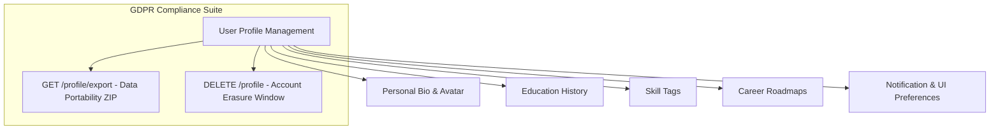

# Nexus AI Backend - User Profile & Settings API Specification

**Document Version:** 1.0.0  
**Author:** Principal API Architect & Senior Backend Engineer  
**Last Updated:** July 25, 2026  

---

## Table of Contents
1. [Document Purpose](#1-document-purpose)
2. [Document Scope](#2-document-scope)
3. [Profile Architecture & GDPR Data Governance](#3-profile-architecture--gdpr-data-governance)
4. [Endpoint Specifications](#4-endpoint-specifications)
   - [4.1 `GET /api/v1/profile`](#41-get-apiv1profile)
   - [4.2 `PATCH /api/v1/profile`](#42-patch-apiv1profile)
   - [4.3 `GET /api/v1/profile/education` & `POST /api/v1/profile/education`](#43-get-apiv1profileeducation--post-apiv1profileeducation)
   - [4.4 `GET /api/v1/profile/skills` & `POST /api/v1/profile/skills`](#44-get-apiv1profileskills--post-apiv1profileskills)
   - [4.5 `GET /api/v1/profile/career-goals` & `POST /api/v1/profile/career-goals`](#45-get-apiv1profilecareer-goals--post-apiv1profilecareer-goals)
   - [4.6 `PUT /api/v1/profile/preferences`](#46-put-apiv1profilepreferences)
   - [4.7 `GET /api/v1/profile/export`](#47-get-apiv1profileexport)
   - [4.8 `DELETE /api/v1/profile`](#48-delete-apiv1profile)
5. [Validation & Security Rules](#5-validation--security-rules)
6. [Future Expansion (University Student ID Verification)](#6-future-expansion-university-student-id-verification)
7. [Architectural Rationale & Trade-Off Analysis](#7-architectural-rationale--trade-off-analysis)
8. [Cross References](#8-cross-references)

---

## 1. Document Purpose

This document details the REST API specifications for the `ProfileModule`. It defines contracts for managing student bio details, education history, skill tags, career goals, user preferences, GDPR data exports, and account deletion workflows.

---

## 2. Document Scope

Applies to all HTTP REST endpoints under `/api/v1/profile/*`.

---

## 3. Profile Architecture & GDPR Data Governance



---

## 4. Endpoint Specifications

### 4.1 `GET /api/v1/profile`
* **Purpose:** Fetches current student profile details.
* **HTTP Method:** `GET` | **URI:** `/api/v1/profile` | **Auth Required:** Yes

#### Success Response Specification (200 OK)
```json
{
  "statusCode": 200,
  "success": true,
  "data": {
    "userId": "usr_987654321",
    "fullName": "Alex Mercer",
    "email": "student@university.edu",
    "major": "Computer Science",
    "graduationYear": 2027,
    "avatarUrl": "https://res.cloudinary.com/nexus/image/upload/v1/avatar.jpg",
    "skillTags": ["TypeScript", "Python", "Algorithms"]
  },
  "timestamp": "2026-07-25T18:30:00.000Z"
}
```

---

### 4.2 `PATCH /api/v1/profile`
* **Purpose:** Partially updates student profile details.
* **HTTP Method:** `PATCH` | **URI:** `/api/v1/profile`

#### Request Body Specification
```json
{
  "major": "Computer Science & AI",
  "graduationYear": 2027,
  "skillTags": ["TypeScript", "Python", "Data Structures", "NestJS"]
}
```

---

### 4.3 `GET /api/v1/profile/education` & `POST /api/v1/profile/education`
* APIs managing academic institution entries.

---

### 4.4 `GET /api/v1/profile/skills` & `POST /api/v1/profile/skills`
* APIs managing student skill inventory tags.

---

### 4.5 `GET /api/v1/profile/career-goals` & `POST /api/v1/profile/career-goals`
* APIs managing target career paths and milestone roadmaps.

---

### 4.6 `PUT /api/v1/profile/preferences`
* **Purpose:** Updates notification toggle preferences and UI theme options.

#### Request Body Specification
```json
{
  "assignmentReminders": true,
  "budgetAlerts": true,
  "aiTips": true,
  "themeMode": "DARK",
  "locale": "en-US"
}
```

---

### 4.7 `GET /api/v1/profile/export`
* **Purpose:** Generates a downloadable JSON archive containing all user records for GDPR data portability compliance.
* **HTTP Method:** `GET` | **URI:** `/api/v1/profile/export`

---

### 4.8 `DELETE /api/v1/profile`
* **Purpose:** Initiates account erasure workflow under GDPR "Right to be Forgotten".
* **HTTP Method:** `DELETE` | **URI:** `/api/v1/profile`

#### Request Body Specification
```json
{
  "password": "SecurePassword123!",
  "confirmationText": "DELETE MY ACCOUNT"
}
```

---

## 5. Validation & Security Rules

* Password confirmation is strictly required for triggering account erasure.
* `skillTags` array cap set to a maximum of 30 items per user profile.

---

## 6. Future Expansion (University Student ID Verification)

* **Planned Endpoint:** `POST /api/v1/profile/verify-student-id` accepting institutional email verification codes.

---

## 7. Architectural Rationale & Trade-Off Analysis

### Decision: Separate Endpoint for GDPR Export vs Inlined Profile Data

| Evaluation Vector | Inlining Full Export inside GET /profile | Dedicated GET /profile/export Route |
| :--- | :--- | :--- |
| **Architectural Rationale** | Inlining heavy historical logs bloats standard profile payload. | Chosen for Nexus AI. Isolates heavy ZIP/JSON data generation to a dedicated route. |
| **Advantages** | Single profile call. | Keeps standard `/profile` payload lightweight (<2KB); prevents database lock during export. |
| **Disadvantages** | Wastes bandwidth on every mobile app startup. | Requires dedicated export worker logic. |

---

## 8. Cross References

* [02-functional-requirements.md](file:///d:/Nexus-AI/backend/docs/02-functional-requirements.md)
* [29-data-retention-policy.md](file:///d:/Nexus-AI/backend/docs/29-data-retention-policy.md)
* [34-authentication-api.md](file:///d:/Nexus-AI/backend/docs/34-authentication-api.md)
