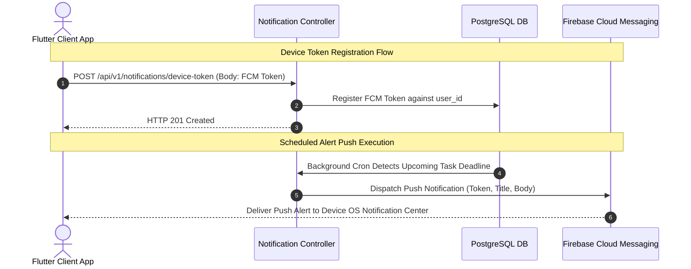

# Nexus AI Backend - Push Notifications & Device Token API Specification

**Document Version:** 1.0.0  
**Author:** Principal API Architect & Senior Backend Engineer  
**Last Updated:** July 25, 2026  

---

## Table of Contents
1. [Document Purpose](#1-document-purpose)
2. [Document Scope](#2-document-scope)
3. [Notification Architecture & FCM Token Dispatch](#3-notification-architecture--fcm-token-dispatch)
4. [Endpoint Specifications](#4-endpoint-specifications)
   - [4.1 `GET /api/v1/notifications`](#41-get-apiv1notifications)
   - [4.2 `PATCH /api/v1/notifications/:id/read`](#42-patch-apiv1notificationsidread)
   - [4.3 `POST /api/v1/notifications/read-all`](#43-post-apiv1notificationsread-all)
   - [4.4 `POST /api/v1/notifications/device-token`](#44-post-apiv1notificationsdevice-token)
   - [4.5 `DELETE /api/v1/notifications/device-token`](#45-delete-apiv1notificationsdevice-token)
5. [FCM Push Dispatch Integration Rules](#5-fcm-push-dispatch-integration-rules)
6. [Future Expansion (In-App Action Buttons)](#6-future-expansion-in-app-action-buttons)
7. [Architectural Rationale & Trade-Off Analysis](#7-architectural-rationale--trade-off-analysis)
8. [Cross References](#8-cross-references)

---

## 1. Document Purpose

This document details the REST API specifications for the `NotificationModule`. It defines contracts for fetching notifications, managing read statuses, registering Firebase Cloud Messaging (FCM) device tokens, and unregistering session tokens.

---

## 2. Document Scope

Applies to all HTTP REST endpoints under `/api/v1/notifications/*`.

---

## 3. Notification Architecture & FCM Token Dispatch



---

## 4. Endpoint Specifications

### 4.1 `GET /api/v1/notifications`
* **Purpose:** Retrieves a paginated list of push notifications for the authenticated student.
* **HTTP Method:** `GET` | **URI:** `/api/v1/notifications` | **Auth Required:** Yes
* **Query Parameters:** `page`, `limit`, `unreadOnly=true`.

#### Success Response Specification (200 OK)
```json
{
  "statusCode": 200,
  "success": true,
  "data": [
    {
      "notificationId": "ntf_101",
      "title": "Assignment Deadline Warning",
      "body": "CS201 Algorithm Homework is due in 3 hours!",
      "category": "PLANNER",
      "isRead": false,
      "createdAt": "2026-07-25T18:00:00.000Z"
    }
  ],
  "meta": {
    "page": 1,
    "limit": 20,
    "unreadCount": 3
  },
  "timestamp": "2026-07-25T18:30:00.000Z"
}
```

---

### 4.2 `PATCH /api/v1/notifications/:id/read`
* **Purpose:** Marks a single notification as read.
* **HTTP Method:** `PATCH` | **URI:** `/api/v1/notifications/:id/read`

---

### 4.3 `POST /api/v1/notifications/read-all`
* **Purpose:** Marks all unread notifications for the user as read.
* **HTTP Method:** `POST` | **URI:** `/api/v1/notifications/read-all`

---

### 4.4 `POST /api/v1/notifications/device-token`
* **Purpose:** Registers an FCM device push token for the active mobile device.
* **HTTP Method:** `POST` | **URI:** `/api/v1/notifications/device-token`

#### Request Body Specification
```json
{
  "deviceToken": "fcm_token_xyz123abc456789...",
  "platform": "ANDROID"
}
```

#### Success Response Specification (201 Created)
```json
{
  "statusCode": 201,
  "success": true,
  "data": {
    "registered": true,
    "platform": "ANDROID"
  },
  "timestamp": "2026-07-25T18:30:00.000Z"
}
```

---

### 4.5 `DELETE /api/v1/notifications/device-token`
* **Purpose:** Unregisters an FCM device token upon logout.
* **HTTP Method:** `DELETE` | **URI:** `/api/v1/notifications/device-token`

---

## 5. FCM Push Dispatch Integration Rules

* Device tokens are validated against FCM SDK prior to persistence.
* Invalid or stale tokens returning `NotRegistered` errors from FCM are automatically purged from PostgreSQL.

---

## 6. Future Expansion (In-App Action Buttons)

* Push notification payloads will include interactive deep-link action routes (`nexus://planner/tasks/tsk_101`).

---

## 7. Architectural Rationale & Trade-Off Analysis

### Decision: Database Notification Center + FCM Push vs FCM-Only Dispatches

| Evaluation Vector | FCM-Only Push Notifications (No DB Log) | Dual: Database Notification Center + FCM Push |
| :--- | :--- | :--- |
| **Architectural Rationale** | If user misses push alert, notification is lost permanently. | Chosen for Nexus AI. Guarantees persistent in-app notification center history. |
| **Advantages** | Zero DB storage footprint. | Users can review past notification history inside the mobile app anytime. |
| **Disadvantages** | Zero in-app notification history. | Requires DB table storage and auto-purge cron jobs (>90 days). |

---

## 8. Cross References

* [06-system-components.md](file:///d:/Nexus-AI/backend/docs/06-system-components.md)
* [07-module-breakdown.md](file:///d:/Nexus-AI/backend/docs/07-module-breakdown.md)
* [36-planner-api.md](file:///d:/Nexus-AI/backend/docs/36-planner-api.md)
