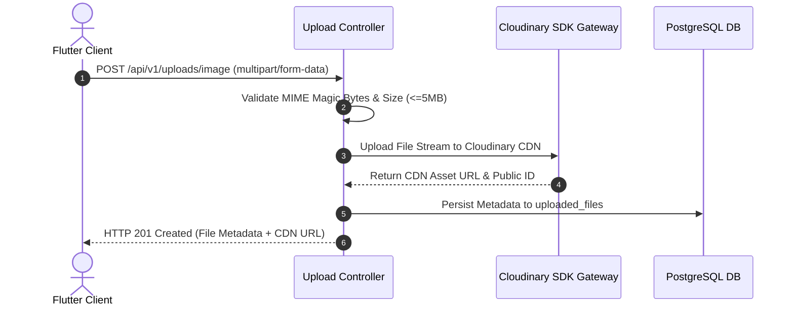

# Nexus AI Backend - Media & File Upload API Specification

**Document Version:** 1.0.0  
**Author:** Principal API Architect & Senior Backend Engineer  
**Last Updated:** July 25, 2026  

---

## Table of Contents
1. [Document Purpose](#1-document-purpose)
2. [Document Scope](#2-document-scope)
3. [Media Upload Architecture & Cloudinary CDN Pipeline](#3-media-upload-architecture--cloudinary-cdn-pipeline)
4. [Endpoint Specifications](#4-endpoint-specifications)
   - [4.1 `POST /api/v1/uploads/image`](#41-post-apiv1uploadsimage)
   - [4.2 `POST /api/v1/uploads/document`](#42-post-apiv1uploadsdocument)
   - [4.3 `GET /api/v1/uploads/:id`](#43-get-apiv1uploadsid)
   - [4.4 `DELETE /api/v1/uploads/:id`](#44-delete-apiv1uploadsid)
5. [Validation & File Security Specifications](#5-validation--file-security-specifications)
6. [Future Expansion (Asynchronous Virus Scan Pipeline)](#6-future-expansion-asynchronous-virus-scan-pipeline)
7. [Architectural Rationale & Trade-Off Analysis](#7-architectural-rationale--trade-off-analysis)
8. [Cross References](#8-cross-references)

---

## 1. Document Purpose

This document details the REST API specifications for the `UploadModule`. It defines contracts for uploading images and PDF documents to Cloudinary CDN, retrieving file metadata, and purging media assets.

---

## 2. Document Scope

Applies to all HTTP REST endpoints under `/api/v1/uploads/*`.

---

## 3. Media Upload Architecture & Cloudinary CDN Pipeline



---

## 4. Endpoint Specifications

### 4.1 `POST /api/v1/uploads/image`
* **Purpose:** Uploads a profile avatar or assignment scan image.
* **HTTP Method:** `POST` | **URI:** `/api/v1/uploads/image` | **Auth Required:** Yes
* **Content-Type:** `multipart/form-data`

#### Request Payload Specification (Form Data)
* `file`: Binary image payload (Allowed types: `image/jpeg`, `image/png`, `image/webp`). Max size: 5MB.

#### Success Response Specification (201 Created)
```json
{
  "statusCode": 201,
  "success": true,
  "data": {
    "fileId": "file_123456",
    "fileName": "avatar.jpg",
    "mimeType": "image/jpeg",
    "fileSizeBytes": 1048576,
    "cdnUrl": "https://res.cloudinary.com/nexus/image/upload/v1721932200/avatars/avatar.jpg"
  },
  "timestamp": "2026-07-25T18:30:00.000Z"
}
```

---

### 4.2 `POST /api/v1/uploads/document`
* **Purpose:** Uploads a PDF lecture slide or assignment document.
* **HTTP Method:** `POST` | **URI:** `/api/v1/uploads/document` | **Content-Type:** `multipart/form-data`
* **Allowed Types:** `application/pdf`. Max size: 10MB.

---

### 4.3 `GET /api/v1/uploads/:id`
* **Purpose:** Fetches metadata and CDN link for an uploaded asset.
* **HTTP Method:** `GET` | **URI:** `/api/v1/uploads/:id`

---

### 4.4 `DELETE /api/v1/uploads/:id`
* **Purpose:** Deletes an asset from Cloudinary CDN and soft deletes its metadata row.
* **HTTP Method:** `DELETE` | **URI:** `/api/v1/uploads/:id`

---

## 5. Validation & File Security Specifications

1. **Magic Byte Inspection:** File validation verifies binary magic bytes (e.g., `FF D8 FF` for JPEG), rejecting malicious files disguised with valid extensions.
2. **CDN Optimization:** Images uploaded to Cloudinary auto-apply `q_auto,f_auto` format transformations.

---

## 6. Future Expansion (Asynchronous Virus Scan Pipeline)

* **Planned Integration:** Incoming files stream through ClamAV virus scanning containers prior to Cloudinary upload.

---

## 7. Architectural Rationale & Trade-Off Analysis

### Decision: Dedicated Cloud CDN (Cloudinary) vs Local Disk File Storage

| Evaluation Vector | Local Server Disk Storage (`/var/uploads`) | Managed Cloud CDN (Cloudinary) |
| :--- | :--- | :--- |
| **Architectural Rationale** | Fails in horizontally scaled container environments (files unavailable on node 2). | Chosen for Nexus AI. Stateless API nodes, global CDN image optimization, automatic SSL URLs. |
| **Advantages** | Zero third-party service costs. | Global low-latency CDN delivery, image compression, stateless NestJS containers. |
| **Disadvantages** | Local disk bloat; multi-container image sync nightmare. | Third-Party API dependency. |

---

## 8. Cross References

* [14-security-guidelines.md](file:///d:/Nexus-AI/backend/docs/14-security-guidelines.md)
* [39-profile-api.md](file:///d:/Nexus-AI/backend/docs/39-profile-api.md)
