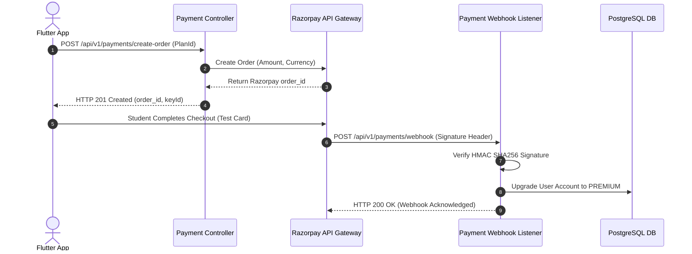

# Nexus AI Backend - Payments & Subscription Billing API Specification

**Document Version:** 1.0.0  
**Author:** Principal API Architect & Senior Backend Engineer  
**Last Updated:** July 25, 2026  

---

## Table of Contents
1. [Document Purpose](#1-document-purpose)
2. [Document Scope](#2-document-scope)
3. [Payment Integration Architecture & Razorpay Workflow](#3-payment-integration-architecture--razorpay-workflow)
4. [Endpoint Specifications](#4-endpoint-specifications)
   - [4.1 `POST /api/v1/payments/create-order`](#41-post-apiv1paymentscreate-order)
   - [4.2 `POST /api/v1/payments/webhook`](#42-post-apiv1paymentswebhook)
   - [4.3 `GET /api/v1/payments/subscriptions`](#43-get-apiv1paymentssubscriptions)
   - [4.4 `GET /api/v1/payments/history`](#44-get-apiv1paymentshistory)
   - [4.5 `POST /api/v1/payments/refunds`](#45-post-apiv1paymentsrefunds)
5. [Razorpay Webhook HMAC SHA256 Verification Rules](#5-razorpay-webhook-hmac-sha256-verification-rules)
6. [Future Expansion (Razorpay Live Mode & In-App Subscriptions)](#6-future-expansion-razorpay-live-mode--in-app-subscriptions)
7. [Architectural Rationale & Trade-Off Analysis](#7-architectural-rationale--trade-off-analysis)
8. [Cross References](#8-cross-references)

---

## 1. Document Purpose

This document details the REST API specifications for the `PaymentModule`. It defines contracts for creating Razorpay Test Mode payment orders, validating HMAC SHA256 payment webhooks, retrieving subscription plan statuses, and viewing payment history.

---

## 2. Document Scope

Applies to all HTTP REST endpoints under `/api/v1/payments/*`.

---

## 3. Payment Integration Architecture & Razorpay Workflow



---

## 4. Endpoint Specifications

### 4.1 `POST /api/v1/payments/create-order`
* **Purpose:** Generates a Razorpay Test Mode order ID for premium subscription upgrades.
* **HTTP Method:** `POST` | **URI:** `/api/v1/payments/create-order` | **Auth Required:** Yes

#### Request Body Specification
```json
{
  "planTier": "PREMIUM_MONTHLY"
}
```

#### Success Response Specification (201 Created)
```json
{
  "statusCode": 201,
  "success": true,
  "data": {
    "orderId": "order_KzX123456789",
    "amount": 999,
    "currency": "INR",
    "keyId": "rzp_test_987654321",
    "planTier": "PREMIUM_MONTHLY"
  },
  "timestamp": "2026-07-25T18:30:00.000Z"
}
```

---

### 4.2 `POST /api/v1/payments/webhook`
* **Purpose:** Receives payment confirmation webhooks from Razorpay and upgrades user subscription status.
* **HTTP Method:** `POST` | **URI:** `/api/v1/payments/webhook` | **Auth Required:** No (HMAC Signature Header)
* **Headers:** `X-Razorpay-Signature: <HMAC_SHA256_HEX>`

---

### 4.3 `GET /api/v1/payments/subscriptions`
* **Purpose:** Retrieves the active student subscription status.
* **HTTP Method:** `GET` | **URI:** `/api/v1/payments/subscriptions`

#### Success Response Specification (200 OK)
```json
{
  "statusCode": 200,
  "success": true,
  "data": {
    "planTier": "PREMIUM_MONTHLY",
    "status": "ACTIVE",
    "expiresAt": "2026-08-25T18:30:00.000Z"
  },
  "timestamp": "2026-07-25T18:30:00.000Z"
}
```

---

### 4.4 `GET /api/v1/payments/history`
* **Purpose:** Fetches a paginated history of billing receipts.

---

### 4.5 `POST /api/v1/payments/refunds`
* **Purpose:** Future endpoint for handling subscription cancellation refunds.

---

## 5. Razorpay Webhook HMAC SHA256 Verification Rules

1. Webhook processing REQUIRES raw request body buffer parsing.
2. Verify HMAC SHA256 signature using `RAZORPAY_WEBHOOK_SECRET`.
3. If signature verification fails, reject request immediately with `HTTP 400 Bad Request` (`ERR_PAY_INVALID_SIGNATURE`).

---

## 6. Future Expansion (Razorpay Live Mode & In-App Subscriptions)

* Seamless transition from `rzp_test_*` to `rzp_live_*` environment credentials.

---

## 7. Architectural Rationale & Trade-Off Analysis

### Decision: Webhook-Driven Account Upgrades vs Client-Side Callback Upgrades

| Evaluation Vector | Client-Side Success Callback Account Upgrade | Webhook-Driven Server Account Upgrade |
| :--- | :--- | :--- |
| **Architectural Rationale** | Unsafe; vulnerable to client spoofing and network disconnects mid-checkout. | Chosen for Nexus AI. Guarantees 100% server-verified payment state changes. |
| **Advantages** | Simple client flow. | Immune to client tampering, handles network drops during checkout seamlessly. |
| **Disadvantages** | Security risk; user can forge client success payload. | Requires maintaining raw HTTP body signature verification logic. |

---

## 8. Cross References

* [02-functional-requirements.md](file:///d:/Nexus-AI/backend/docs/02-functional-requirements.md)
* [14-security-guidelines.md](file:///d:/Nexus-AI/backend/docs/14-security-guidelines.md)
