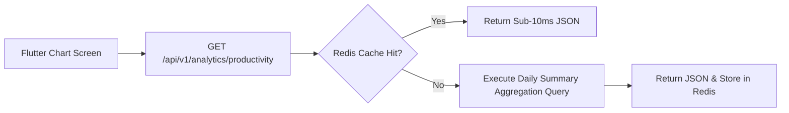

# Nexus AI Backend - System & User Analytics API Specification

**Document Version:** 1.0.0  
**Author:** Principal API Architect & Senior Backend Engineer  
**Last Updated:** July 25, 2026  

---

## Table of Contents
1. [Document Purpose](#1-document-purpose)
2. [Document Scope](#2-document-scope)
3. [Analytics Architecture & Aggregation Flow](#3-analytics-architecture--aggregation-flow)
4. [Endpoint Specifications](#4-endpoint-specifications)
   - [4.1 `GET /api/v1/analytics/productivity`](#41-get-apiv1analyticsproductivity)
   - [4.2 `GET /api/v1/analytics/financial`](#42-get-apiv1analyticsfinancial)
   - [4.3 `GET /api/v1/analytics/user-stats`](#43-get-apiv1analyticsuser-stats)
   - [4.4 `GET /api/v1/analytics/dashboard-metrics`](#44-get-apiv1analyticsdashboard-metrics)
5. [Flutter Chart Data Formatting Guidelines](#5-flutter-chart-data-formatting-guidelines)
6. [Future Expansion (ClickHouse OLAP Integration)](#6-future-expansion-clickhouse-olap-integration)
7. [Architectural Rationale & Trade-Off Analysis](#7-architectural-rationale--trade-off-analysis)
8. [Cross References](#8-cross-references)

---

## 1. Document Purpose

This document details the REST API specifications for the `AnalyticsModule`. It defines contracts for retrieving productivity trend charts, financial burn-rate metrics, student task statistics, and platform analytics formatted for Flutter mobile rendering.

---

## 2. Document Scope

Applies to all HTTP REST endpoints under `/api/v1/analytics/*`.

---

## 3. Analytics Architecture & Aggregation Flow



---

## 4. Endpoint Specifications

### 4.1 `GET /api/v1/analytics/productivity`
* **Purpose:** Returns weekly or monthly productivity index score trends for chart rendering.
* **HTTP Method:** `GET` | **URI:** `/api/v1/analytics/productivity` | **Auth Required:** Yes
* **Query Parameters:** `period=WEEK` or `period=MONTH`.

#### Success Response Specification (200 OK)
```json
{
  "statusCode": 200,
  "success": true,
  "data": {
    "period": "WEEK",
    "averageScore": 82.5,
    "chartData": [
      { "date": "2026-07-19", "score": 75, "tasksCompleted": 4, "studyHours": 3.5 },
      { "date": "2026-07-20", "score": 90, "tasksCompleted": 6, "studyHours": 5.0 }
    ]
  },
  "timestamp": "2026-07-25T18:30:00.000Z"
}
```

---

### 4.2 `GET /api/v1/analytics/financial`
* **Purpose:** Returns categorized monthly expenditure velocity metrics.
* **HTTP Method:** `GET` | **URI:** `/api/v1/analytics/financial`

---

### 4.3 `GET /api/v1/analytics/user-stats`
* **Purpose:** Returns summary totals for student accomplishments (total tasks completed, study sessions logged, budget compliance rate).

---

### 4.4 `GET /api/v1/analytics/dashboard-metrics`
* **Purpose:** Admin-only route returning platform active user totals and Gemini API token consumption.

---

## 5. Flutter Chart Data Formatting Guidelines

All analytics array objects format timestamp fields as `YYYY-MM-DD` strings, allowing Flutter `fl_chart` libraries to render line charts and bar graphs without complex client-side date parsing.

---

## 6. Future Expansion (ClickHouse OLAP Integration)

* Analytical queries will transparently read from a ClickHouse columnar database when user volume exceeds single-node PostgreSQL query limits.

---

## 7. Architectural Rationale & Trade-Off Analysis

### Decision: Pre-Aggregated Daily Metric Tables vs On-the-Fly Aggregation

| Evaluation Vector | On-The-Fly Dynamic Aggregation (`SUM`, `AVG` on raw logs) | Pre-Aggregated Daily Summary Metric Tables |
| :--- | :--- | :--- |
| **Architectural Rationale** | Scans millions of raw log rows on every chart load; slow response times. | Chosen for Nexus AI. Background workers write pre-calculated daily summary rows. |
| **Advantages** | Zero extra database tables. | Sub-millisecond chart loading times (<10ms), low database memory overhead. |
| **Disadvantages** | Slow API response times (>2s) as user data grows. | Requires nightly cron job to calculate summary rows. |

---

## 8. Cross References

* [03-non-functional-requirements.md](file:///d:/Nexus-AI/backend/docs/03-non-functional-requirements.md)
* [26-database-performance.md](file:///d:/Nexus-AI/backend/docs/26-database-performance.md)
* [35-dashboard-api.md](file:///d:/Nexus-AI/backend/docs/35-dashboard-api.md)
