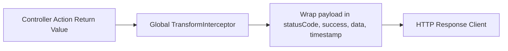

# Nexus AI Backend - API Response Standardization & Envelope Protocols

**Document Version:** 1.0.0  
**Author:** Principal API Architect & Senior Backend Engineer  
**Last Updated:** July 25, 2026  

---

## Table of Contents
1. [Document Purpose](#1-document-purpose)
2. [Document Scope](#2-document-scope)
3. [Success Response JSON Envelope](#3-success-response-json-envelope)
4. [Paginated List Response JSON Envelope](#4-paginated-list-response-json-envelope)
5. [Standard Error Response Envelope (RFC 7807)](#5-standard-error-response-envelope-rfc-7807)
6. [Validation Failure Response Schema](#6-validation-failure-response-schema)
7. [Authentication & Token Response Schema](#7-authentication--token-response-schema)
8. [NestJS Response Interceptor Implementation Specification](#8-nestjs-response-interceptor-implementation-specification)
9. [Architectural Rationale & Trade-Off Analysis](#9-architectural-rationale--trade-off-analysis)
10. [Enterprise Best Practices](#10-enterprise-best-practices)
11. [Anti-Patterns & Common Mistakes](#11-anti-patterns--common-mistakes)
12. [Cross References](#12-cross-references)

---

## 1. Document Purpose

This document defines the mandatory JSON response envelopes, pagination metadata structures, RFC 7807 error wrappers, validation message arrays, and token issuance schemas for the Nexus AI backend.

---

## 2. Document Scope

Applies to 100% of HTTP REST responses emitted across all domain controllers.

---

## 3. Success Response JSON Envelope

All non-paginated successful HTTP responses MUST be wrapped in the standard envelope:

```json
{
  "statusCode": 200,
  "success": true,
  "data": {
    "taskId": "tsk_101",
    "title": "CS201 Algorithm Homework",
    "status": "COMPLETED"
  },
  "timestamp": "2026-07-25T18:30:00.000Z"
}
```

---

## 4. Paginated List Response JSON Envelope

All collection endpoints returning arrays MUST include the `meta` pagination object:

```json
{
  "statusCode": 200,
  "success": true,
  "data": [
    { "taskId": "tsk_101", "title": "Assignment 1" },
    { "taskId": "tsk_102", "title": "Assignment 2" }
  ],
  "meta": {
    "page": 1,
    "limit": 20,
    "totalItems": 42,
    "totalPages": 3,
    "hasNextPage": true,
    "hasPreviousPage": false
  },
  "timestamp": "2026-07-25T18:30:00.000Z"
}
```

---

## 5. Standard Error Response Envelope (RFC 7807)

All HTTP error responses follow the RFC 7807 problem details specification:

```json
{
  "statusCode": 404,
  "success": false,
  "error": {
    "code": "ERR_PLAN_001",
    "message": "The requested assignment task does not exist.",
    "details": {
      "resource": "TaskEntity",
      "identifier": "tsk_999999"
    }
  },
  "timestamp": "2026-07-25T18:30:00.000Z",
  "correlationId": "req_abc123xyz789"
}
```

---

## 6. Validation Failure Response Schema

Input DTO validation errors (`HTTP 400 Bad Request`) format field issues into an array:

```json
{
  "statusCode": 400,
  "success": false,
  "error": {
    "code": "ERR_VAL_001",
    "message": "Input validation failed for 2 fields.",
    "details": [
      { "field": "email", "issue": "email must be a valid email address" },
      { "field": "password", "issue": "password must be longer than 8 characters" }
    ]
  },
  "timestamp": "2026-07-25T18:30:00.000Z",
  "correlationId": "req_val_456"
}
```

---

## 7. Authentication & Token Response Schema

Token issuance endpoints (`/auth/login`, `/auth/refresh`) return standardized JWT payloads:

```json
{
  "statusCode": 200,
  "success": true,
  "data": {
    "accessToken": "eyJhbGciOiJIUzI1NiIsInR5cCI6IkpXVCJ9...",
    "refreshToken": "d8e9f0a1b2c3d4e5f6a7b8c9d0e1f2a3...",
    "tokenType": "Bearer",
    "expiresIn": 900
  },
  "timestamp": "2026-07-25T18:30:00.000Z"
}
```

---

## 8. NestJS Response Interceptor Implementation Specification

The envelope wrapper is enforced globally via a NestJS `TransformInterceptor`:



---

## 9. Architectural Rationale & Trade-Off Analysis

### Decision: Enveloped JSON Responses vs Raw Unwrapped Data Arrays

| Evaluation Vector | Raw Unwrapped Response (`[{ "id": 1 }]`) | Enveloped JSON Response (`{ statusCode, success, data }`) |
| :--- | :--- | :--- |
| **Architectural Rationale** | Slightly fewer payload bytes; lacks metadata and error predictability. | Chosen for Nexus AI. Guarantees uniform response structure across Flutter mobile and web clients. |
| **Advantages** | Slightly smaller payload size. | Uniform parsing logic in Flutter client SDK, explicit success flags, metadata support. |
| **Disadvantages** | Inconsistent responses between arrays and single objects; no metadata slot. | Minor envelope byte size overhead (~50 bytes per response). |

---

## 10. Enterprise Best Practices

1. **Always Set `success: true/false`:** Enables client interceptors to determine request status instantly before parsing domain payloads.
2. **ISO-8601 UTC Timestamps:** Format `timestamp` strings as UTC ISO-8601 (`2026-07-25T18:30:00.000Z`).

---

## 11. Anti-Patterns & Common Mistakes

* ❌ **Inconsistent Wrappers:** Controller A returning `{ data: ... }` while Controller B returns raw unwrapped `{ ... }`.
* ❌ **Missing Correlation IDs:** Returning error JSON without a `correlationId` field for distributed tracing.

---

## 12. Cross References

* [11-api-standards.md](file:///d:/Nexus-AI/backend/docs/11-api-standards.md)
* [13-error-handling.md](file:///d:/Nexus-AI/backend/docs/13-error-handling.md)
* [45-api-error-catalog.md](file:///d:/Nexus-AI/backend/docs/45-api-error-catalog.md)
