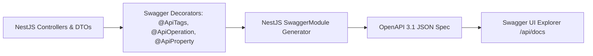

# Nexus AI Backend - OpenAPI (Swagger) Documentation Conventions

**Document Version:** 1.0.0  
**Author:** Principal API Architect & Senior Backend Engineer  
**Last Updated:** July 25, 2026  

---

## Table of Contents
1. [Document Purpose](#1-document-purpose)
2. [Document Scope](#2-document-scope)
3. [OpenAPI 3.1 Specification Architecture](#3-openapi-31-specification-architecture)
4. [Swagger Tag & Module Grouping Conventions](#4-swagger-tag--module-grouping-conventions)
5. [Operation Naming & Summary Standards](#5-operation-naming--summary-standards)
6. [Parameter & DTO Schema Documentation Standards](#6-parameter--dto-schema-documentation-standards)
7. [Example Payload Specifications](#7-example-payload-specifications)
8. [Security Definition & Bearer Token Decorators](#8-security-definition--bearer-token-decorators)
9. [OpenAPI Multi-Version UI Setup](#9-openapi-multi-version-ui-setup)
10. [Architectural Rationale & Trade-Off Analysis](#10-architectural-rationale--trade-off-analysis)
11. [Enterprise Best Practices](#11-enterprise-best-practices)
12. [Anti-Patterns & Common Mistakes](#12-anti-patterns--common-mistakes)
13. [Cross References](#13-cross-references)

---

## 1. Document Purpose

This document defines the OpenAPI 3.1 (Swagger) documentation conventions, NestJS decorator standards, schema naming rules, security definitions, and UI setup for the Nexus AI interactive API explorer.

---

## 2. Document Scope

Applies to all NestJS controllers, DTO classes, custom decorators, and Swagger UI configurations exposed at `/api/docs`.

---

## 3. OpenAPI 3.1 Specification Architecture

Interactive API documentation is generated dynamically at runtime using `@nestjs/swagger`, compiling TypeScript controller decorators into an OpenAPI 3.1 JSON specification exposed at `/api/docs`.



---

## 4. Swagger Tag & Module Grouping Conventions

* **Rule:** Every controller MUST be decorated with `@ApiTags('<Domain Name>')` matching its module title:
  * `@ApiTags('Authentication')`
  * `@ApiTags('Dashboard')`
  * `@ApiTags('Smart Planner')`
  * `@ApiTags('Smart Finance')`
  * `@ApiTags('AI Mentor')`

---

## 5. Operation Naming & Summary Standards

Every controller action method MUST feature explicit `@ApiOperation()` descriptions:
* **Summary:** Concise verb phrase (`"Create a new task and calculate priority"`).
* **Description:** Detailed explanation of business logic, side effects, and async event emissions.

---

## 6. Parameter & DTO Schema Documentation Standards

### 6.1 Parameter Decorators
* Path parameters documented via `@ApiParam({ name: 'id', description: 'Task UUID v4', example: 'tsk_101' })`.
* Query parameters documented via `@ApiQuery({ name: 'page', required: false, example: 1 })`.

### 6.2 DTO Schema Decorators
Every DTO property MUST be decorated with `@ApiProperty()` or `@ApiPropertyOptional()` specifying data type, description, and realistic example values:

```typescript
// Documentation Example Specification
export class CreateTaskDtoSpec {
  @ApiProperty({
    description: 'Title of assignment task',
    example: 'CS201 Algorithm Homework'
  })
  title: string;

  @ApiProperty({
    description: 'Target due date timestamp in UTC ISO-8601 format',
    example: '2026-07-28T23:59:00.000Z'
  })
  dueDate: string;
}
```

---

## 7. Example Payload Specifications

To enable front-end developers to execute mock API requests directly inside Swagger UI:
* Every response decorator MUST specify example JSON payloads for both success (`200`/`201`) and failure (`400`/`401`/`404`) states.

---

## 8. Security Definition & Bearer Token Decorators

* **Global Bearer Auth Definition:** Swagger is configured with `addBearerAuth()` security scheme.
* **Protected Routes:** Every controller or method requiring authentication MUST be decorated with `@ApiBearerAuth()`.

---

## 9. OpenAPI Multi-Version UI Setup

Swagger UI supports inspecting multiple API versions via a drop-down menu selector (`/api/docs` for v1, `/api/docs/v2` for v2).

---

## 10. Architectural Rationale & Trade-Off Analysis

### Decision: Dynamic Code-First Swagger Generation vs Static `swagger.yaml` File

| Evaluation Vector | Static `swagger.yaml` File | Dynamic Code-First Swagger Generation (`@nestjs/swagger`) |
| :--- | :--- | :--- |
| **Architectural Rationale** | Easy to design offline; drifts from actual code implementation. | Chosen for Nexus AI. Guarantees 100% synchronization between implementation and documentation. |
| **Advantages** | Language-agnostic file. | Zero documentation drift; auto-updates whenever DTOs or controllers change. |
| **Disadvantages** | Developers forget to update static YAML files when changing code. | Adds decorator lines to DTO files. |
| **Maintainability Impact**| Low maintainability over time. | Extremely High. |

---

## 11. Enterprise Best Practices

1. **Include Realistic Examples:** Never use generic examples like `"string"` or `123`; provide domain-specific examples (`"CS201 Homework"`).
2. **Document All Error Codes:** Ensure `@ApiResponse()` lists all possible custom error codes returned by the Global Exception Filter.

---

## 12. Anti-Patterns & Common Mistakes

* ❌ **Undocumented DTO Properties:** Leaving DTO fields without `@ApiProperty()`, resulting in empty schema models in Swagger UI.
* ❌ **Missing Bearer Auth Tag:** Forgetting `@ApiBearerAuth()` on protected routes, causing Swagger UI "Try It Out" calls to fail with 401.

---

## 13. Cross References

* [11-api-standards.md](file:///d:/Nexus-AI/backend/docs/11-api-standards.md)
* [20-documentation-standards.md](file:///d:/Nexus-AI/backend/docs/20-documentation-standards.md)
* [44-api-response-standard.md](file:///d:/Nexus-AI/backend/docs/44-api-response-standard.md)
