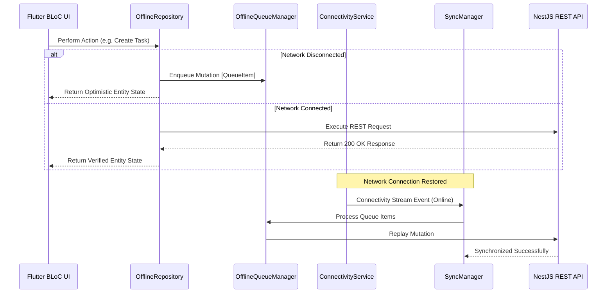

# Nexus AI — Offline-First Architecture & Sync Engine

## 🛰 Offline Architecture Overview

Nexus AI implements an **Offline-First Repository Pattern**. When offline, mutations are queued locally and UI states update optimistically.

## ⚔️ Conflict Resolution Strategies

- **Server-Wins**: Remote server state overwrites local state.
- **Client-Wins**: Local modifications overwrite remote state.
- **Timestamp-Based**: Whichever entity has the higher ISO-8601 `updatedAt` timestamp prevails.
- **Manual Merge**: Merges missing fields dynamically.
