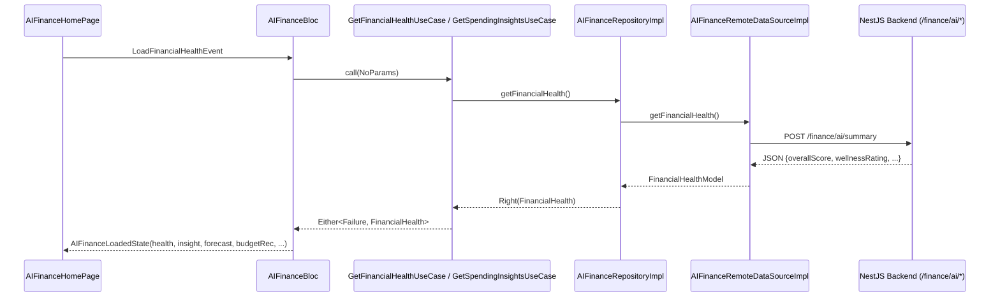

# AI Financial Advisor Module (Nexus-AI Mobile)

The **AI Financial Advisor** module provides intelligent spending habit analysis, financial health scoring, expense forecasting, safe daily limit recommendations, subscription auditing, unusual spending detection, and an interactive AI Chat Assistant.

## 🏗️ Clean Architecture & Directory Structure

```
lib/features/ai_finance/
├── data/
│   ├── datasources/
│   │   └── ai_finance_remote_data_source.dart
│   ├── models/
│   │   ├── ai_finance_history_model.dart
│   │   ├── budget_recommendation_model.dart
│   │   ├── financial_health_model.dart
│   │   ├── forecast_model.dart
│   │   ├── goal_analysis_model.dart
│   │   ├── savings_recommendation_model.dart
│   │   ├── spending_insight_model.dart
│   │   └── subscription_analysis_model.dart
│   └── repositories/
│       └── ai_finance_repository_impl.dart
├── domain/
│   ├── entities/
│   │   ├── ai_finance_history_item.dart
│   │   ├── budget_recommendation.dart
│   │   ├── financial_health.dart
│   │   ├── forecast.dart
│   │   ├── goal_analysis.dart
│   │   ├── savings_recommendation.dart
│   │   ├── spending_insight.dart
│   │   └── subscription_analysis.dart
│   ├── repositories/
│   │   └── i_ai_finance_repository.dart
│   └── usecases/
│       ├── delete_report_usecase.dart
│       ├── get_budget_recommendations_usecase.dart
│       ├── get_financial_health_usecase.dart
│       ├── get_forecast_usecase.dart
│       ├── get_savings_advice_usecase.dart
│       ├── get_spending_insights_usecase.dart
│       ├── get_subscription_analysis_usecase.dart
│       └── save_report_usecase.dart
└── presentation/
    ├── bloc/
    │   ├── ai_finance_bloc.dart
    │   ├── ai_finance_event.dart
    │   └── ai_finance_state.dart
    ├── pages/
    │   ├── ai_finance_history_page.dart
    │   ├── ai_finance_home_page.dart
    │   ├── ai_finance_settings_page.dart
    │   ├── budget_recommendations_page.dart
    │   ├── cash_flow_prediction_page.dart
    │   ├── expense_forecast_page.dart
    │   ├── financial_goals_advisor_page.dart
    │   ├── financial_health_dashboard_page.dart
    │   ├── monthly_ai_report_page.dart
    │   ├── saved_insights_page.dart
    │   ├── savings_advisor_page.dart
    │   ├── spending_insights_page.dart
    │   ├── subscription_analysis_page.dart
    │   ├── unusual_spending_detection_page.dart
    │   └── yearly_ai_report_page.dart
    └── widgets/
        ├── ai_finance_charts.dart
        ├── ai_finance_skeleton.dart
        ├── ai_insight_card.dart
        ├── budget_recommendation_card.dart
        ├── confidence_badge.dart
        ├── finance_ai_summary.dart
        ├── financial_health_card.dart
        ├── forecast_card.dart
        ├── goal_progress_card.dart
        ├── markdown_viewer.dart
        ├── mini_finance_assistant_panel.dart
        ├── risk_indicator.dart
        ├── savings_card.dart
        ├── subscription_card.dart
        └── typing_indicator.dart
```

## 🔄 BLoC Flow Diagram



## 📡 Backend API Endpoint Alignment

| Feature | Route | Method | BLoC Event |
|---|---|---|---|
| Executive Summary | `/finance/ai/summary` | POST | `LoadFinancialHealthEvent` |
| Spending Habits | `/finance/ai/spending-analysis` | POST | `LoadInsightsEvent` |
| Expense Forecast | `/finance/ai/forecast` | POST | `LoadForecastEvent` |
| Safe Daily Limit | `/finance/ai/safe-daily-budget` | POST | `LoadRecommendationsEvent` |
| Savings Strategy | `/finance/ai/savings-plan` | POST | `LoadRecommendationsEvent` |
| Financial Review | `/finance/ai/financial-review` | POST | `LoadSubscriptionsEvent` |
| AI History | `/finance/ai/history` | GET | `LoadFinancialHealthEvent` |
