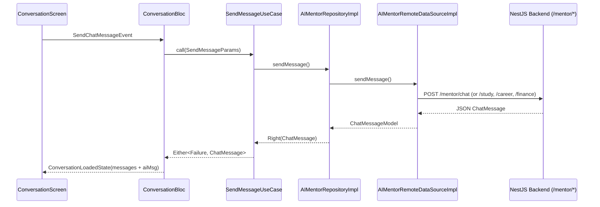

# AI Mentor Module (Nexus-AI Mobile)

The **AI Mentor** module provides a central intelligent assistant for students, supporting academic coaching, study planning, career guidance, financial wellness, productivity coaching, and 7-dimension student wellness tracking.

## 🏗️ Clean Architecture & Directory Structure

```
lib/features/ai_mentor/
├── data/
│   ├── datasources/
│   │   └── ai_mentor_remote_data_source.dart
│   ├── models/
│   │   ├── chat_attachment_model.dart
│   │   ├── chat_message_model.dart
│   │   ├── conversation_model.dart
│   │   ├── mentor_feedback_model.dart
│   │   ├── prompt_template_model.dart
│   │   └── student_wellness_model.dart
│   └── repositories/
│       └── ai_mentor_repository_impl.dart
├── domain/
│   ├── entities/
│   │   ├── chat_attachment.dart
│   │   ├── chat_message.dart
│   │   ├── conversation.dart
│   │   ├── mentor_feedback.dart
│   │   ├── prompt_template.dart
│   │   └── student_wellness.dart
│   ├── repositories/
│   │   └── i_ai_mentor_repository.dart
│   └── usecases/
│       ├── delete_conversation_usecase.dart
│       ├── get_wellness_scores_usecase.dart
│       ├── load_conversation_details_usecase.dart
│       ├── load_conversations_usecase.dart
│       ├── search_conversations_usecase.dart
│       ├── send_message_usecase.dart
│       ├── submit_feedback_usecase.dart
│       └── update_conversation_usecase.dart
└── presentation/
    ├── bloc/
    │   ├── ai_mentor_bloc.dart
    │   ├── attachment_bloc.dart
    │   ├── conversation_bloc.dart
    │   ├── mentor_search_bloc.dart
    │   └── prompt_bloc.dart
    ├── pages/
    │   ├── ai_mentor_home_page.dart
    │   ├── ai_mentor_profile_page.dart
    │   ├── ai_mentor_search_page.dart
    │   ├── ai_mentor_settings_page.dart
    │   ├── conversation_details_page.dart
    │   ├── conversation_history_page.dart
    │   ├── conversation_screen.dart
    │   ├── feedback_screen.dart
    │   ├── pinned_conversations_page.dart
    │   ├── rate_response_screen.dart
    │   ├── saved_messages_page.dart
    │   └── suggested_prompts_page.dart
    └── widgets/
        ├── ai_mentor_skeleton.dart
        ├── attachment_preview.dart
        ├── chat_bubble.dart
        ├── conversation_card.dart
        ├── feedback_card.dart
        ├── markdown_renderer.dart
        ├── prompt_chip.dart
        ├── streaming_text.dart
        ├── suggestion_card.dart
        ├── typing_indicator.dart
        ├── voice_message_card.dart
        └── wellness_score_card.dart
```

## 🔄 BLoC Chat Flow Diagram



## 📡 Backend API Endpoint Alignment

| Feature | Route | Method | BLoC / Component |
|---|---|---|---|
| Main Chat | `/mentor/chat` | POST | `ConversationBloc` |
| Career Mentoring | `/mentor/career` | POST | `ConversationBloc` (topic: CAREER) |
| Academic Mentoring | `/mentor/study` | POST | `ConversationBloc` (topic: STUDY) |
| Decision Mentoring | `/mentor/decision` | POST | `ConversationBloc` (topic: DECISION) |
| Productivity | `/mentor/productivity` | POST | `ConversationBloc` (topic: PRODUCTIVITY) |
| Financial Mentoring | `/mentor/finance` | POST | `ConversationBloc` (topic: FINANCE) |
| Conversation History | `/mentor/conversations` | GET | `AIMentorBloc` / `LoadConversationsUseCase` |
| Conversation Details | `/mentor/conversations/:id` | GET | `LoadConversationDetailsUseCase` |
| Update Conversation | `/mentor/conversations/:id` | PATCH | `UpdateConversationUseCase` |
| Delete Conversation | `/mentor/conversations/:id` | DELETE | `AIMentorRepositoryImpl.deleteConversation` |
| Response Feedback | `/mentor/feedback` | POST | `SubmitFeedbackUseCase` |
| Student Wellness Scores | `/mentor/wellness-scores` | GET | `GetWellnessScoresUseCase` |
