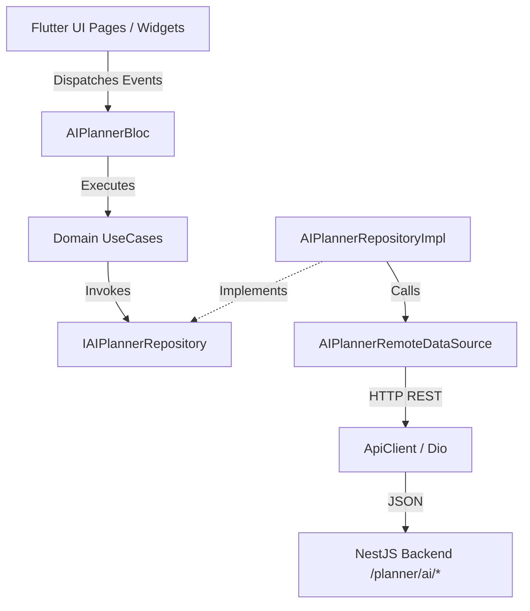
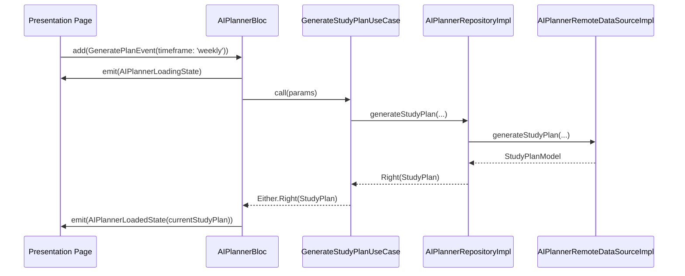

# AI Smart Planner Module

## Overview
The AI Smart Planner module provides an intelligent academic assistance engine for students. It generates customized study plans, optimizes task priorities based on deadline urgency and grade weights, performs workload analysis, detects deadline risks, tracks productivity trends, and offers interactive AI chat guidance.

---

## Folder Structure

```
lib/features/ai_planner/
├── domain/
│   ├── entities/
│   │   ├── study_plan.dart
│   │   ├── workload_analysis.dart
│   │   ├── priority_optimizer.dart
│   │   ├── deadline_risk.dart
│   │   ├── productivity_insight.dart
│   │   ├── recommendation.dart
│   │   └── ai_history_item.dart
│   ├── repositories/
│   │   └── i_ai_planner_repository.dart
│   └── usecases/
│       ├── generate_study_plan_usecase.dart
│       ├── get_ai_history_usecase.dart
│       ├── get_workload_analysis_usecase.dart
│       ├── get_productivity_insights_usecase.dart
│       ├── get_recommendations_usecase.dart
│       ├── save_plan_usecase.dart
│       └── delete_plan_usecase.dart
├── data/
│   ├── datasources/
│   │   └── ai_planner_remote_data_source.dart
│   ├── models/
│   │   ├── study_plan_model.dart
│   │   ├── workload_model.dart
│   │   ├── priority_optimizer_model.dart
│   │   ├── deadline_risk_model.dart
│   │   ├── productivity_insight_model.dart
│   │   ├── recommendation_model.dart
│   │   └── ai_history_model.dart
│   └── repositories/
│       └── ai_planner_repository_impl.dart
└── presentation/
    ├── bloc/
    │   ├── ai_planner_bloc.dart
    │   ├── ai_planner_event.dart
    │   └── ai_planner_state.dart
    ├── widgets/
    │   ├── ai_insight_card.dart
    │   ├── study_plan_card.dart
    │   ├── recommendation_card.dart
    │   ├── risk_card.dart
    │   ├── productivity_card.dart
    │   ├── ai_history_card.dart
    │   ├── confidence_score_badge.dart
    │   ├── priority_badge.dart
    │   ├── ai_summary_widget.dart
    │   ├── markdown_viewer.dart
    │   ├── typing_indicator.dart
    │   ├── mini_ai_chat_panel.dart
    │   ├── workload_charts.dart
    │   ├── study_timeline_widget.dart
    │   ├── weekly_heatmap_widget.dart
    │   ├── priority_matrix_widget.dart
    │   ├── trend_graph_widget.dart
    │   └── ai_skeleton_loader.dart
    └── pages/
        ├── ai_planner_home_page.dart
        ├── generate_study_plan_page.dart
        ├── study_plan_details_page.dart
        ├── workload_analysis_page.dart
        ├── priority_optimizer_page.dart
        ├── deadline_risk_page.dart
        ├── productivity_insights_page.dart
        ├── study_recommendations_page.dart
        ├── weekly_planning_page.dart
        ├── monthly_planning_page.dart
        ├── planner_history_page.dart
        ├── saved_ai_plans_page.dart
        └── ai_planner_settings_page.dart
```

---

## Architecture Diagram



---

## BLoC Flow



---

## Backend API Mapping

| UI Action / Screen | HTTP Method | Backend Route | Response DTO |
| :--- | :--- | :--- | :--- |
| Task Prioritization | `POST` | `/planner/ai/prioritise` | `AIPlanningResponseDto` |
| Generate Study Plan | `POST` | `/planner/ai/study-plan` | `AIPlanningResponseDto` |
| Workload Analysis | `POST` | `/planner/ai/workload-analysis` | `AIPlanningResponseDto` |
| Productivity Insights | `POST` | `/planner/ai/productivity-insights` | `AIPlanningResponseDto` |
| Deadline Risk Analysis | `POST` | `/planner/ai/deadline-risk` | `AIPlanningResponseDto` |
| Recommendations | `GET` | `/planner/ai/recommendations` | `RecommendationDto[]` |
| AI History | `GET` | `/planner/ai/history` | `AIHistoryDto[]` |
