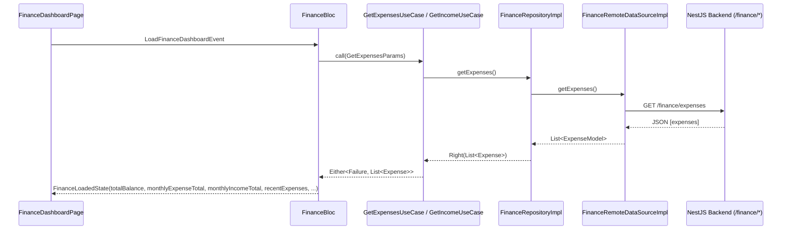

# Smart Finance Module (Nexus-AI Mobile)

The **Smart Finance** module provides end-to-end personal expense and income tracking, budget management, savings goal milestones, cash flow analytics, and category breakdown reports for students and professionals.

## 🏗️ Clean Architecture & Directory Structure

```
lib/features/finance/
├── data/
│   ├── datasources/
│   │   └── finance_remote_data_source.dart
│   ├── models/
│   │   ├── budget_model.dart
│   │   ├── expense_model.dart
│   │   ├── finance_category_model.dart
│   │   ├── income_model.dart
│   │   ├── report_model.dart
│   │   ├── savings_goal_model.dart
│   │   └── transaction_model.dart
│   └── repositories/
│       └── finance_repository_impl.dart
├── domain/
│   ├── entities/
│   │   ├── budget.dart
│   │   ├── expense.dart
│   │   ├── finance_category.dart
│   │   ├── financial_report.dart
│   │   ├── income.dart
│   │   ├── savings_goal.dart
│   │   └── transaction.dart
│   ├── repositories/
│   │   └── i_finance_repository.dart
│   └── usecases/
│       ├── create_expense_usecase.dart
│       ├── create_income_usecase.dart
│       ├── delete_expense_usecase.dart
│       ├── generate_report_usecase.dart
│       ├── get_budget_usecase.dart
│       ├── get_expenses_usecase.dart
│       ├── get_income_usecase.dart
│       ├── get_savings_goals_usecase.dart
│       ├── update_budget_usecase.dart
│       └── update_expense_usecase.dart
└── presentation/
    ├── bloc/
    │   ├── budget_bloc.dart
    │   ├── expense_bloc.dart
    │   ├── finance_bloc.dart
    │   ├── income_bloc.dart
    │   ├── report_bloc.dart
    │   └── savings_bloc.dart
    ├── pages/
    │   ├── add_expense_page.dart
    │   ├── add_income_page.dart
    │   ├── budget_details_page.dart
    │   ├── budget_overview_page.dart
    │   ├── categories_page.dart
    │   ├── create_savings_goal_page.dart
    │   ├── edit_expense_page.dart
    │   ├── expense_details_page.dart
    │   ├── expense_list_page.dart
    │   ├── finance_dashboard_page.dart
    │   ├── finance_empty_state_page.dart
    │   ├── finance_error_state_page.dart
    │   ├── finance_filter_page.dart
    │   ├── finance_search_page.dart
    │   ├── income_list_page.dart
    │   ├── monthly_summary_page.dart
    │   ├── reports_page.dart
    │   ├── savings_goals_page.dart
    │   └── transactions_page.dart
    └── widgets/
        ├── amount_badge.dart
        ├── budget_card.dart
        ├── budget_progress_widget.dart
        ├── category_chip.dart
        ├── expense_card.dart
        ├── finance_charts.dart
        ├── finance_header.dart
        ├── finance_skeleton.dart
        ├── finance_summary_card.dart
        ├── income_card.dart
        ├── report_card.dart
        ├── savings_goal_card.dart
        └── transaction_card.dart
```

## 🔄 BLoC State Management Flow



## 📡 Backend Endpoint Alignment

| Operation | Route | Method | BLoC Event |
|---|---|---|---|
| Get Expenses | `/finance/expenses` | GET | `LoadExpensesEvent` |
| Create Expense | `/finance/expenses` | POST | `CreateExpenseEvent` |
| Update Expense | `/finance/expenses/:id` | PATCH | `UpdateExpenseEvent` |
| Delete Expense | `/finance/expenses/:id` | DELETE | `DeleteExpenseEvent` |
| Get Income Stream | `/finance/incomes` | GET | `LoadIncomeEvent` |
| Create Income | `/finance/incomes` | POST | `CreateIncomeEvent` |
| Get Budgets | `/finance/budgets` | GET | `LoadBudgetsEvent` |
| Savings Goals | `/finance/savings-goals` | GET | `LoadSavingsGoalsEvent` |
| Reports & Analytics | `/finance/reports` | GET | `LoadReportEvent` |
