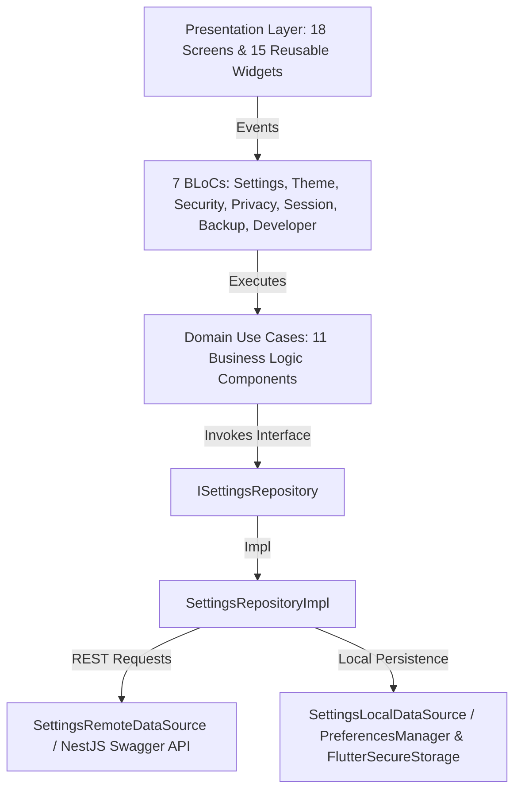

# Enterprise Settings, Security & Preferences Module

The **Enterprise Settings, Security & Preferences** module provides a centralized platform hub for managing application configuration, appearance, theme mode, localizations, biometrics, privacy consent, AI personality, notifications, backup & restore, active device sessions, and developer tools in **Nexus AI**.

---

## 🏗 Architecture Overview

This module is constructed following **Clean Architecture**, **SOLID principles**, and **flutter_bloc** state management.



---

## 📂 Folder Structure

```
lib/features/settings/
├── data/
│   ├── datasources/
│   │   ├── settings_local_data_source.dart
│   │   └── settings_remote_data_source.dart
│   ├── models/
│   │   ├── accessibility_model.dart
│   │   ├── ai_preferences_model.dart
│   │   ├── backup_model.dart
│   │   ├── connected_device_model.dart
│   │   ├── developer_settings_model.dart
│   │   ├── language_model.dart
│   │   ├── notification_preference_model.dart
│   │   ├── privacy_model.dart
│   │   ├── security_model.dart
│   │   ├── session_model.dart
│   │   ├── settings_model.dart
│   │   └── theme_model.dart
│   └── repositories/
│       └── settings_repository_impl.dart
├── domain/
│   ├── entities/
│   │   ├── accessibility_entity.dart
│   │   ├── ai_preferences_entity.dart
│   │   ├── backup_entity.dart
│   │   ├── connected_device_entity.dart
│   │   ├── developer_settings_entity.dart
│   │   ├── language_entity.dart
│   │   ├── notification_preference_entity.dart
│   │   ├── privacy_entity.dart
│   │   ├── security_entity.dart
│   │   ├── session_entity.dart
│   │   ├── settings_entity.dart
│   │   └── theme_entity.dart
│   ├── repositories/
│   │   └── i_settings_repository.dart
│   └── usecases/
│       ├── backup_data_usecase.dart
│       ├── enable_biometric_usecase.dart
│       ├── get_settings_usecase.dart
│       ├── logout_other_devices_usecase.dart
│       ├── restore_data_usecase.dart
│       ├── terminate_session_usecase.dart
│       ├── update_accessibility_usecase.dart
│       ├── update_developer_settings_usecase.dart
│       ├── update_language_usecase.dart
│       ├── update_preferences_usecase.dart
│       └── update_theme_usecase.dart
└── presentation/
    ├── bloc/
    │   ├── backup_bloc.dart / backup_event.dart / backup_state.dart
    │   ├── developer_bloc.dart / developer_event.dart / developer_state.dart
    │   ├── privacy_bloc.dart / privacy_event.dart / privacy_state.dart
    │   ├── security_bloc.dart / security_event.dart / security_state.dart
    │   ├── session_bloc.dart / session_event.dart / session_state.dart
    │   ├── settings_bloc.dart / settings_event.dart / settings_state.dart
    │   └── theme_bloc.dart / theme_event.dart / theme_state.dart
    ├── pages/
    │   ├── about_application_page.dart
    │   ├── accessibility_settings_page.dart
    │   ├── ai_preferences_page.dart
    │   ├── appearance_settings_page.dart
    │   ├── backup_restore_page.dart
    │   ├── connected_devices_page.dart
    │   ├── developer_options_page.dart
    │   ├── language_settings_page.dart
    │   ├── licenses_page.dart
    │   ├── notification_preferences_page.dart
    │   ├── open_source_licenses_page.dart
    │   ├── privacy_policy_page.dart
    │   ├── privacy_settings_page.dart
    │   ├── security_settings_page.dart
    │   ├── session_management_page.dart
    │   ├── settings_home_page.dart
    │   ├── terms_conditions_page.dart
    │   └── theme_settings_page.dart
    └── widgets/
        ├── about_card.dart
        ├── accessibility_preview_widget.dart
        ├── backup_card.dart
        ├── backup_loader.dart
        ├── device_card.dart
        ├── language_selector.dart
        ├── preference_card.dart
        ├── preference_loader.dart
        ├── security_card.dart
        ├── settings_skeleton.dart
        ├── settings_tile.dart
        ├── switch_tile.dart
        ├── theme_card.dart
        ├── theme_preview_widget.dart
        └── version_card.dart
```

---

## ⚡ BLoC State Management Summary

1. **`SettingsBloc`**: Handles initialization of global master settings, AI preferences, and notification preferences.
2. **`ThemeBloc`**: Manages Light/Dark/System theme switching, Material 3 seed color selection, dynamic colors, text scaling, and localizations.
3. **`SecurityBloc`**: Handles Biometric authentication, PIN lock, session inactivity timeouts, and terminating all remote sessions.
4. **`PrivacyBloc`**: Manages analytics telemetry, crash reporting, AI prompt data usage consent, clearing local cache, and wiping AI conversation history.
5. **`SessionBloc`**: Manages active active session feeds, connected devices list, device removal, and session termination.
6. **`BackupBloc`**: Handles cloud backup creation, backup restoration, and automatic backup triggers.
7. **`DeveloperBloc`**: Controls target backend environments, Dio HTTP logging, performance overlay toggles, and feature flags.

---

## 🔗 Backend REST API Mapping

| Feature Area | Endpoint | HTTP Method | Data Contract / DTO |
| :--- | :--- | :--- | :--- |
| General Settings | `/settings` | `GET` | `SettingsResponseDto` |
| Update Settings | `/settings` | `PATCH` | `UpdateUserSettingsDto` |
| Security Settings | `/settings/security` | `GET` | `SecuritySettingsResponseDto` |
| Update Security | `/settings/security` | `PATCH` | `UpdateSecuritySettingsDto` |
| Domain Preferences | `/settings/preferences` | `GET` | `PreferencesResponseDto` |
| Update Preferences | `/settings/preferences` | `PATCH` | `UpdatePreferencesDto` |
| Feature Flags | `/settings/feature-flags` | `GET` / `PATCH` | `UpdateFeatureFlagDto` |
| Audit Log Feed | `/settings/audit-logs` | `GET` | `AuditLogResponseDto` |
| Session Terminate | `/auth/logout` | `POST` | `LogoutDto` |
| Terminate All | `/auth/logout-all` | `POST` | `{ success: true }` |
| Cloud Backup | `/settings/backup` | `POST` | `BackupModel` |
| Cloud Restore | `/settings/restore` | `POST` | `BackupModel` |
